# Kiến Trúc & SQL DDL Toàn Bộ CSDL (Car Service Center Platform)

> **Hệ quản trị CSDL:** MySQL 8.x (InnoDB, utf8mb4)  
> **ORM Engine:** Prisma 5.22.0  
> **Tổng số thực thể:** 47 Models / Tables  
> **Chuẩn hóa:** 3NF, Khóa ngoại toàn vẹn tham chiếu (Foreign Key Constraints), Tự tham chiếu đa cấp (Self-relations)

---

## 1. Bản Đồ Tổng Quan 4 Phân Hệ (System Architecture Map)

```mermaid
flowchart TD
    subgraph M1["Module 1: System, Users & Assets"]
        User["User (users)"]
        Role["Role (roles)"]
        UserRole["UserRole (user_roles)"]
        Employee["Employee (employees)"]
        Skill["Skill (skills)"]
        Vehicle["Vehicle (vehicles)"]
        SystemCatalog["SystemCatalog (system_catalogs)"]
        Notification["Notification (notifications)"]
        AuditLog["AuditLog (audit_logs)"]
    end

    subgraph M2["Module 2: Service Catalog & Pricing"]
        ServiceCategory["ServiceCategory (service_categories)"]
        Service["Service (services)"]
        VehicleSizePrice["VehicleSizePrice (vehicle_size_prices)"]
        JobType["JobType (job_types)"]
        JobTemplate["JobTemplate (job_templates)"]
        JobTemplatePart["JobTemplatePart (job_template_parts)"]
        InspectionTemplate["InspectionTemplate (inspection_templates)"]
        InspectionTemplateItem["InspectionTemplateItem (inspection_template_items)"]
    end

    subgraph M3["Module 3: Operations & Execution"]
        Appointment["Appointment (appointments)"]
        IntakeRecord["IntakeRecord (intake_records)"]
        WorkOrder["WorkOrder (work_orders)"]
        CheckIn["CheckIn (check_ins)"]
        WoService["WoService (wo_services)"]
        Inspection["Inspection (inspections)"]
        Finding["Finding (findings)"]
        Job["Job (jobs)"]
        JobLabour["JobLabour (job_labours)"]
        JobPart["JobPart (job_parts)"]
        QcRecord["QcRecord (qc_records)"]
    end

    subgraph M4["Module 4: Finance, Inventory & Settlement"]
        Quotation["Quotation (quotations)"]
        Invoice["Invoice (invoices)"]
        Payment["Payment (payments)"]
        VehicleRelease["VehicleRelease (vehicle_releases)"]
        Supplier["Supplier (suppliers)"]
        PartCategory["PartCategory (part_categories)"]
        InventoryItem["InventoryItem (inventory_items)"]
        GoodsReceipt["GoodsReceipt (goods_receipts)"]
        StockMovement["StockMovement (stock_movements)"]
        StockAdjustment["StockAdjustment (stock_adjustments)"]
    end

    User --> WorkOrder
    Vehicle --> WorkOrder
    Service --> WoService
    WorkOrder --> CheckIn
    WorkOrder --> WoService
    WorkOrder --> Inspection
    WorkOrder --> Quotation
    WorkOrder --> Invoice
    Invoice --> Payment
    WorkOrder --> VehicleRelease
    InventoryItem --> JobPart
    InventoryItem --> StockMovement
    Supplier --> GoodsReceipt
```



---

## 2. Toàn Bộ Kịch Bản SQL DDL (MySQL 8.x Script)

```sql
-- =============================================================================
-- DATABASE DDL SCRIPT CHO CAR SERVICE CENTER PLATFORM (47 BẢNG CHUẨN HÓA)
-- MySQL 8.x | Engine: InnoDB | Character Set: utf8mb4 | Collation: utf8mb4_unicode_ci
-- Đồng bộ chính xác 100% với schema.prisma (bao gồm Phân hệ Bảo hành Warranty Module)
-- =============================================================================

SET FOREIGN_KEY_CHECKS = 0;

-- Bảng: roles (Model: Role)
DROP TABLE IF EXISTS `roles`;
CREATE TABLE `roles` (
    `id` INT AUTO_INCREMENT PRIMARY KEY,
    `name` VARCHAR(50) NOT NULL UNIQUE
) ENGINE=InnoDB DEFAULT CHARSET=utf8mb4 COLLATE=utf8mb4_unicode_ci;

-- Bảng: users (Model: User)
DROP TABLE IF EXISTS `users`;
CREATE TABLE `users` (
    `id` INT AUTO_INCREMENT PRIMARY KEY,
    `email` VARCHAR(255) NOT NULL UNIQUE,
    `phone` VARCHAR(20) UNIQUE,
    `password_hash` VARCHAR(255) NOT NULL,
    `full_name` VARCHAR(150) NOT NULL,
    `address` TEXT,
    `is_active` BOOLEAN NOT NULL DEFAULT TRUE,
    `otp_hash` VARCHAR(255),
    `otp_attempts` INT NOT NULL DEFAULT 0,
    `otp_requested_at` DATETIME,
    `otp_expires_at` DATETIME,
    `created_at` DATETIME NOT NULL DEFAULT 'now(',
    `updated_at` DATETIME NOT NULL DEFAULT 'now('
) ENGINE=InnoDB DEFAULT CHARSET=utf8mb4 COLLATE=utf8mb4_unicode_ci;

-- Bảng: user_roles (Model: UserRole)
DROP TABLE IF EXISTS `user_roles`;
CREATE TABLE `user_roles` (
    `id` INT AUTO_INCREMENT PRIMARY KEY,
    `user_id` INT NOT NULL,
    `role_id` INT NOT NULL,
    CONSTRAINT `fk_user_roles_user_id` FOREIGN KEY (`user_id`) REFERENCES `users`(`id`) ON DELETE CASCADE ON UPDATE CASCADE,
    CONSTRAINT `fk_user_roles_role_id` FOREIGN KEY (`role_id`) REFERENCES `roles`(`id`) ON DELETE CASCADE ON UPDATE CASCADE
) ENGINE=InnoDB DEFAULT CHARSET=utf8mb4 COLLATE=utf8mb4_unicode_ci;

-- Bảng: employees (Model: Employee)
DROP TABLE IF EXISTS `employees`;
CREATE TABLE `employees` (
    `id` INT AUTO_INCREMENT PRIMARY KEY,
    `user_id` INT UNIQUE,
    `full_name` VARCHAR(150) NOT NULL,
    `position` VARCHAR(50) NOT NULL,
    `is_active` BOOLEAN NOT NULL DEFAULT TRUE,
    `created_at` DATETIME NOT NULL DEFAULT 'now(',
    `updated_at` DATETIME NOT NULL DEFAULT 'now(',
    CONSTRAINT `fk_employees_user_id` FOREIGN KEY (`user_id`) REFERENCES `users`(`id`) ON DELETE CASCADE ON UPDATE CASCADE
) ENGINE=InnoDB DEFAULT CHARSET=utf8mb4 COLLATE=utf8mb4_unicode_ci;

-- Bảng: skills (Model: Skill)
DROP TABLE IF EXISTS `skills`;
CREATE TABLE `skills` (
    `id` INT AUTO_INCREMENT PRIMARY KEY,
    `name` VARCHAR(100) NOT NULL,
    `is_active` BOOLEAN NOT NULL DEFAULT TRUE
) ENGINE=InnoDB DEFAULT CHARSET=utf8mb4 COLLATE=utf8mb4_unicode_ci;

-- Bảng: employee_skills (Model: EmployeeSkill)
DROP TABLE IF EXISTS `employee_skills`;
CREATE TABLE `employee_skills` (
    `id` INT AUTO_INCREMENT PRIMARY KEY,
    `employee_id` INT NOT NULL,
    `skill_id` INT NOT NULL,
    CONSTRAINT `fk_employee_skills_employee_id` FOREIGN KEY (`employee_id`) REFERENCES `employees`(`id`) ON DELETE CASCADE ON UPDATE CASCADE,
    CONSTRAINT `fk_employee_skills_skill_id` FOREIGN KEY (`skill_id`) REFERENCES `skills`(`id`) ON DELETE CASCADE ON UPDATE CASCADE
) ENGINE=InnoDB DEFAULT CHARSET=utf8mb4 COLLATE=utf8mb4_unicode_ci;

-- Bảng: vehicles (Model: Vehicle)
DROP TABLE IF EXISTS `vehicles`;
CREATE TABLE `vehicles` (
    `id` INT AUTO_INCREMENT PRIMARY KEY,
    `customer_id` INT NOT NULL,
    `license_plate` VARCHAR(20) NOT NULL UNIQUE,
    `make` VARCHAR(100) NOT NULL,
    `model` VARCHAR(100) NOT NULL,
    `year` SMALLINT,
    `color` VARCHAR(50),
    `vehicle_size` VARCHAR(50) NOT NULL,
    `status` VARCHAR(50) NOT NULL DEFAULT 'ACTIVE',
    `created_at` DATETIME NOT NULL DEFAULT 'now(',
    `updated_at` DATETIME NOT NULL DEFAULT 'now(',
    CONSTRAINT `fk_vehicles_customer_id` FOREIGN KEY (`customer_id`) REFERENCES `users`(`id`) ON DELETE CASCADE ON UPDATE CASCADE
) ENGINE=InnoDB DEFAULT CHARSET=utf8mb4 COLLATE=utf8mb4_unicode_ci;

-- Bảng: system_catalogs (Model: SystemCatalog)
DROP TABLE IF EXISTS `system_catalogs`;
CREATE TABLE `system_catalogs` (
    `id` INT AUTO_INCREMENT PRIMARY KEY,
    `catalog_type` VARCHAR(50) NOT NULL,
    `name` VARCHAR(150) NOT NULL,
    `description` TEXT,
    `is_active` BOOLEAN NOT NULL DEFAULT TRUE,
    `sort_order` INT NOT NULL DEFAULT 0
) ENGINE=InnoDB DEFAULT CHARSET=utf8mb4 COLLATE=utf8mb4_unicode_ci;

-- Bảng: notifications (Model: Notification)
DROP TABLE IF EXISTS `notifications`;
CREATE TABLE `notifications` (
    `id` INT AUTO_INCREMENT PRIMARY KEY,
    `user_id` INT NOT NULL,
    `notification_type` VARCHAR(50) NOT NULL,
    `title` VARCHAR(255) NOT NULL,
    `message` TEXT NOT NULL,
    `entity_type` VARCHAR(50),
    `entity_id` INT,
    `is_read` BOOLEAN NOT NULL DEFAULT FALSE,
    `read_at` DATETIME,
    `created_at` DATETIME NOT NULL DEFAULT 'now(',
    CONSTRAINT `fk_notifications_user_id` FOREIGN KEY (`user_id`) REFERENCES `users`(`id`) ON DELETE CASCADE ON UPDATE CASCADE
) ENGINE=InnoDB DEFAULT CHARSET=utf8mb4 COLLATE=utf8mb4_unicode_ci;

-- Bảng: audit_logs (Model: AuditLog)
DROP TABLE IF EXISTS `audit_logs`;
CREATE TABLE `audit_logs` (
    `id` INT AUTO_INCREMENT PRIMARY KEY,
    `user_id` INT,
    `action` VARCHAR(50) NOT NULL,
    `entity_type` VARCHAR(50) NOT NULL,
    `entity_id` INT NOT NULL,
    `before_data` JSON,
    `after_data` JSON,
    `ip_address` VARCHAR(45),
    `user_agent` VARCHAR(500),
    `created_at` DATETIME NOT NULL DEFAULT 'now(',
    CONSTRAINT `fk_audit_logs_user_id` FOREIGN KEY (`user_id`) REFERENCES `users`(`id`) ON DELETE CASCADE ON UPDATE CASCADE
) ENGINE=InnoDB DEFAULT CHARSET=utf8mb4 COLLATE=utf8mb4_unicode_ci;

-- Bảng: service_categories (Model: ServiceCategory)
DROP TABLE IF EXISTS `service_categories`;
CREATE TABLE `service_categories` (
    `id` INT AUTO_INCREMENT PRIMARY KEY,
    `name` VARCHAR(100) NOT NULL,
    `description` TEXT,
    `is_active` BOOLEAN NOT NULL DEFAULT TRUE,
    `sort_order` INT NOT NULL DEFAULT 0
) ENGINE=InnoDB DEFAULT CHARSET=utf8mb4 COLLATE=utf8mb4_unicode_ci;

-- Bảng: services (Model: Service)
DROP TABLE IF EXISTS `services`;
CREATE TABLE `services` (
    `id` INT AUTO_INCREMENT PRIMARY KEY,
    `category_id` INT NOT NULL,
    `name` VARCHAR(150) NOT NULL,
    `description` TEXT,
    `pricing_type` VARCHAR(50) NOT NULL,
    `fixed_price` DECIMAL(12,2),
    `warranty_months` INT NOT NULL DEFAULT 0,
    `warranty_mileage` INT NOT NULL DEFAULT 0,
    `is_active` BOOLEAN NOT NULL DEFAULT TRUE,
    `created_at` DATETIME NOT NULL DEFAULT 'now(',
    `updated_at` DATETIME NOT NULL DEFAULT 'now(',
    CONSTRAINT `fk_services_category_id` FOREIGN KEY (`category_id`) REFERENCES `service_categories`(`id`) ON DELETE CASCADE ON UPDATE CASCADE
) ENGINE=InnoDB DEFAULT CHARSET=utf8mb4 COLLATE=utf8mb4_unicode_ci;

-- Bảng: vehicle_size_prices (Model: VehicleSizePrice)
DROP TABLE IF EXISTS `vehicle_size_prices`;
CREATE TABLE `vehicle_size_prices` (
    `id` INT AUTO_INCREMENT PRIMARY KEY,
    `service_id` INT NOT NULL,
    `vehicle_size` VARCHAR(50) NOT NULL,
    `price` DECIMAL(12,2) NOT NULL,
    CONSTRAINT `fk_vehicle_size_prices_service_id` FOREIGN KEY (`service_id`) REFERENCES `services`(`id`) ON DELETE CASCADE ON UPDATE CASCADE
) ENGINE=InnoDB DEFAULT CHARSET=utf8mb4 COLLATE=utf8mb4_unicode_ci;

-- Bảng: job_types (Model: JobType)
DROP TABLE IF EXISTS `job_types`;
CREATE TABLE `job_types` (
    `id` INT AUTO_INCREMENT PRIMARY KEY,
    `name` VARCHAR(150) NOT NULL,
    `description` TEXT,
    `is_active` BOOLEAN NOT NULL DEFAULT TRUE
) ENGINE=InnoDB DEFAULT CHARSET=utf8mb4 COLLATE=utf8mb4_unicode_ci;

-- Bảng: job_templates (Model: JobTemplate)
DROP TABLE IF EXISTS `job_templates`;
CREATE TABLE `job_templates` (
    `id` INT AUTO_INCREMENT PRIMARY KEY,
    `job_type_id` INT NOT NULL,
    `service_id` INT,
    `name` VARCHAR(150) NOT NULL,
    `price` DECIMAL(12,2) NOT NULL,
    `estimated_hours` DECIMAL(5,2),
    `requires_qc` BOOLEAN NOT NULL DEFAULT TRUE,
    CONSTRAINT `fk_job_templates_job_type_id` FOREIGN KEY (`job_type_id`) REFERENCES `job_types`(`id`) ON DELETE CASCADE ON UPDATE CASCADE,
    CONSTRAINT `fk_job_templates_service_id` FOREIGN KEY (`service_id`) REFERENCES `services`(`id`) ON DELETE CASCADE ON UPDATE CASCADE
) ENGINE=InnoDB DEFAULT CHARSET=utf8mb4 COLLATE=utf8mb4_unicode_ci;

-- Bảng: inspection_templates (Model: InspectionTemplate)
DROP TABLE IF EXISTS `inspection_templates`;
CREATE TABLE `inspection_templates` (
    `id` INT AUTO_INCREMENT PRIMARY KEY,
    `service_id` INT,
    `template_type` VARCHAR(50) NOT NULL,
    `name` VARCHAR(150) NOT NULL,
    `is_active` BOOLEAN NOT NULL DEFAULT TRUE,
    CONSTRAINT `fk_inspection_templates_service_id` FOREIGN KEY (`service_id`) REFERENCES `services`(`id`) ON DELETE CASCADE ON UPDATE CASCADE
) ENGINE=InnoDB DEFAULT CHARSET=utf8mb4 COLLATE=utf8mb4_unicode_ci;

-- Bảng: inspection_template_items (Model: InspectionTemplateItem)
DROP TABLE IF EXISTS `inspection_template_items`;
CREATE TABLE `inspection_template_items` (
    `id` INT AUTO_INCREMENT PRIMARY KEY,
    `template_id` INT NOT NULL,
    `name` VARCHAR(255) NOT NULL,
    `is_required` BOOLEAN NOT NULL DEFAULT TRUE,
    `sort_order` INT NOT NULL DEFAULT 0,
    CONSTRAINT `fk_inspection_template_items_template_id` FOREIGN KEY (`template_id`) REFERENCES `inspection_templates`(`id`) ON DELETE CASCADE ON UPDATE CASCADE
) ENGINE=InnoDB DEFAULT CHARSET=utf8mb4 COLLATE=utf8mb4_unicode_ci;

-- Bảng: suppliers (Model: Supplier)
DROP TABLE IF EXISTS `suppliers`;
CREATE TABLE `suppliers` (
    `id` INT AUTO_INCREMENT PRIMARY KEY,
    `code` VARCHAR(30) UNIQUE,
    `name` VARCHAR(255) NOT NULL,
    `tax_code` VARCHAR(30),
    `contact_person` VARCHAR(150),
    `phone` VARCHAR(20),
    `email` VARCHAR(255),
    `address` TEXT,
    `is_active` BOOLEAN NOT NULL DEFAULT TRUE,
    `created_at` DATETIME NOT NULL DEFAULT 'now(',
    `updated_at` DATETIME NOT NULL DEFAULT 'now('
) ENGINE=InnoDB DEFAULT CHARSET=utf8mb4 COLLATE=utf8mb4_unicode_ci;

-- Bảng: part_categories (Model: PartCategory)
DROP TABLE IF EXISTS `part_categories`;
CREATE TABLE `part_categories` (
    `id` INT AUTO_INCREMENT PRIMARY KEY,
    `code` VARCHAR(50) NOT NULL UNIQUE,
    `name` VARCHAR(255) NOT NULL,
    `item_type` VARCHAR(50) NOT NULL,
    `uom_id` INT NOT NULL,
    `description` TEXT,
    `is_active` BOOLEAN NOT NULL DEFAULT TRUE,
    `created_at` DATETIME NOT NULL DEFAULT 'now(',
    `updated_at` DATETIME NOT NULL,
    CONSTRAINT `fk_part_categories_uom_id` FOREIGN KEY (`uom_id`) REFERENCES `system_catalogs`(`id`) ON DELETE CASCADE ON UPDATE CASCADE
) ENGINE=InnoDB DEFAULT CHARSET=utf8mb4 COLLATE=utf8mb4_unicode_ci;

-- Bảng: inventory_items (Model: InventoryItem)
DROP TABLE IF EXISTS `inventory_items`;
CREATE TABLE `inventory_items` (
    `id` INT AUTO_INCREMENT PRIMARY KEY,
    `part_category_id` INT NOT NULL,
    `sku` VARCHAR(50) NOT NULL UNIQUE,
    `brand_id` INT,
    `selling_price` DECIMAL(15,2) NOT NULL,
    `average_cost` DECIMAL(15,2) NOT NULL DEFAULT 0,
    `on_hand` INT NOT NULL DEFAULT 0,
    `reorder_level` INT NOT NULL DEFAULT 0,
    `warranty_months` INT NOT NULL DEFAULT 0,
    `warranty_mileage` INT NOT NULL DEFAULT 0,
    `is_active` BOOLEAN NOT NULL DEFAULT TRUE,
    `created_at` DATETIME NOT NULL DEFAULT 'now(',
    `updated_at` DATETIME NOT NULL,
    CONSTRAINT `fk_inventory_items_part_category_id` FOREIGN KEY (`part_category_id`) REFERENCES `part_categories`(`id`) ON DELETE CASCADE ON UPDATE CASCADE,
    CONSTRAINT `fk_inventory_items_brand_id` FOREIGN KEY (`brand_id`) REFERENCES `system_catalogs`(`id`) ON DELETE CASCADE ON UPDATE CASCADE
) ENGINE=InnoDB DEFAULT CHARSET=utf8mb4 COLLATE=utf8mb4_unicode_ci;

-- Bảng: job_template_parts (Model: JobTemplatePart)
DROP TABLE IF EXISTS `job_template_parts`;
CREATE TABLE `job_template_parts` (
    `id` INT AUTO_INCREMENT PRIMARY KEY,
    `job_template_id` INT NOT NULL,
    `item_id` INT NOT NULL,
    `default_quantity` DECIMAL(10,2) NOT NULL,
    CONSTRAINT `fk_job_template_parts_job_template_id` FOREIGN KEY (`job_template_id`) REFERENCES `job_templates`(`id`) ON DELETE CASCADE ON UPDATE CASCADE,
    CONSTRAINT `fk_job_template_parts_item_id` FOREIGN KEY (`item_id`) REFERENCES `inventory_items`(`id`) ON DELETE CASCADE ON UPDATE CASCADE
) ENGINE=InnoDB DEFAULT CHARSET=utf8mb4 COLLATE=utf8mb4_unicode_ci;

-- Bảng: appointments (Model: Appointment)
DROP TABLE IF EXISTS `appointments`;
CREATE TABLE `appointments` (
    `id` INT AUTO_INCREMENT PRIMARY KEY,
    `customer_id` INT NOT NULL,
    `vehicle_id` INT NOT NULL,
    `scheduled_date` DATETIME NOT NULL,
    `scheduled_time` DATETIME NOT NULL,
    `status` VARCHAR(50) NOT NULL DEFAULT 'REQUESTED',
    `cancel_reason` TEXT,
    `notes` TEXT,
    `is_warranty` BOOLEAN NOT NULL DEFAULT FALSE,
    `created_by_id` INT,
    `created_at` DATETIME NOT NULL DEFAULT 'now(',
    `updated_at` DATETIME NOT NULL DEFAULT 'now(',
    CONSTRAINT `fk_appointments_customer_id` FOREIGN KEY (`customer_id`) REFERENCES `users`(`id`) ON DELETE CASCADE ON UPDATE CASCADE,
    CONSTRAINT `fk_appointments_created_by_id` FOREIGN KEY (`created_by_id`) REFERENCES `users`(`id`) ON DELETE CASCADE ON UPDATE CASCADE,
    CONSTRAINT `fk_appointments_vehicle_id` FOREIGN KEY (`vehicle_id`) REFERENCES `vehicles`(`id`) ON DELETE CASCADE ON UPDATE CASCADE
) ENGINE=InnoDB DEFAULT CHARSET=utf8mb4 COLLATE=utf8mb4_unicode_ci;

-- Bảng: appointment_services (Model: AppointmentService)
DROP TABLE IF EXISTS `appointment_services`;
CREATE TABLE `appointment_services` (
    `id` INT AUTO_INCREMENT PRIMARY KEY,
    `appointment_id` INT NOT NULL,
    `service_id` INT NOT NULL,
    CONSTRAINT `fk_appointment_services_appointment_id` FOREIGN KEY (`appointment_id`) REFERENCES `appointments`(`id`) ON DELETE CASCADE ON UPDATE CASCADE,
    CONSTRAINT `fk_appointment_services_service_id` FOREIGN KEY (`service_id`) REFERENCES `services`(`id`) ON DELETE CASCADE ON UPDATE CASCADE
) ENGINE=InnoDB DEFAULT CHARSET=utf8mb4 COLLATE=utf8mb4_unicode_ci;

-- Bảng: intake_records (Model: IntakeRecord)
DROP TABLE IF EXISTS `intake_records`;
CREATE TABLE `intake_records` (
    `id` INT AUTO_INCREMENT PRIMARY KEY,
    `customer_id` INT NOT NULL,
    `vehicle_id` INT NOT NULL,
    `intake_type` VARCHAR(50) NOT NULL,
    `status` VARCHAR(50) NOT NULL DEFAULT 'QUEUED',
    `arrived_at` DATETIME NOT NULL,
    `tow_company` VARCHAR(255),
    `notes` TEXT,
    `created_by_id` INT NOT NULL,
    `created_at` DATETIME NOT NULL DEFAULT 'now(',
    CONSTRAINT `fk_intake_records_customer_id` FOREIGN KEY (`customer_id`) REFERENCES `users`(`id`) ON DELETE CASCADE ON UPDATE CASCADE,
    CONSTRAINT `fk_intake_records_created_by_id` FOREIGN KEY (`created_by_id`) REFERENCES `users`(`id`) ON DELETE CASCADE ON UPDATE CASCADE,
    CONSTRAINT `fk_intake_records_vehicle_id` FOREIGN KEY (`vehicle_id`) REFERENCES `vehicles`(`id`) ON DELETE CASCADE ON UPDATE CASCADE
) ENGINE=InnoDB DEFAULT CHARSET=utf8mb4 COLLATE=utf8mb4_unicode_ci;

-- Bảng: intake_services (Model: IntakeService)
DROP TABLE IF EXISTS `intake_services`;
CREATE TABLE `intake_services` (
    `id` INT AUTO_INCREMENT PRIMARY KEY,
    `intake_id` INT NOT NULL,
    `service_id` INT NOT NULL,
    CONSTRAINT `fk_intake_services_intake_id` FOREIGN KEY (`intake_id`) REFERENCES `intake_records`(`id`) ON DELETE CASCADE ON UPDATE CASCADE,
    CONSTRAINT `fk_intake_services_service_id` FOREIGN KEY (`service_id`) REFERENCES `services`(`id`) ON DELETE CASCADE ON UPDATE CASCADE
) ENGINE=InnoDB DEFAULT CHARSET=utf8mb4 COLLATE=utf8mb4_unicode_ci;

-- Bảng: work_orders (Model: WorkOrder)
DROP TABLE IF EXISTS `work_orders`;
CREATE TABLE `work_orders` (
    `id` INT AUTO_INCREMENT PRIMARY KEY,
    `wo_number` VARCHAR(20) NOT NULL UNIQUE,
    `customer_id` INT NOT NULL,
    `vehicle_id` INT NOT NULL,
    `advisor_id` INT NOT NULL,
    `source_type` VARCHAR(50) NOT NULL,
    `appointment_id` INT UNIQUE,
    `intake_record_id` INT UNIQUE,
    `status` VARCHAR(50) NOT NULL DEFAULT 'DRAFT',
    `order_type` VARCHAR(50) NOT NULL DEFAULT 'NORMAL',
    `parent_work_order_id` INT,
    `warranty_reason` TEXT,
    `claim_approved_by_id` INT,
    `closed_at` DATETIME,
    `closed_by_id` INT,
    `close_type` VARCHAR(50),
    `close_notes` TEXT,
    `created_by_id` INT NOT NULL,
    `created_at` DATETIME NOT NULL DEFAULT 'now(',
    `updated_at` DATETIME NOT NULL DEFAULT 'now(',
    CONSTRAINT `fk_work_orders_customer_id` FOREIGN KEY (`customer_id`) REFERENCES `users`(`id`) ON DELETE CASCADE ON UPDATE CASCADE,
    CONSTRAINT `fk_work_orders_closed_by_id` FOREIGN KEY (`closed_by_id`) REFERENCES `users`(`id`) ON DELETE CASCADE ON UPDATE CASCADE,
    CONSTRAINT `fk_work_orders_vehicle_id` FOREIGN KEY (`vehicle_id`) REFERENCES `vehicles`(`id`) ON DELETE CASCADE ON UPDATE CASCADE,
    CONSTRAINT `fk_work_orders_advisor_id` FOREIGN KEY (`advisor_id`) REFERENCES `users`(`id`) ON DELETE CASCADE ON UPDATE CASCADE,
    CONSTRAINT `fk_work_orders_created_by_id` FOREIGN KEY (`created_by_id`) REFERENCES `users`(`id`) ON DELETE CASCADE ON UPDATE CASCADE,
    CONSTRAINT `fk_work_orders_appointment_id` FOREIGN KEY (`appointment_id`) REFERENCES `appointments`(`id`) ON DELETE CASCADE ON UPDATE CASCADE,
    CONSTRAINT `fk_work_orders_intake_record_id` FOREIGN KEY (`intake_record_id`) REFERENCES `intake_records`(`id`) ON DELETE CASCADE ON UPDATE CASCADE,
    CONSTRAINT `fk_work_orders_parent_work_order_id` FOREIGN KEY (`parent_work_order_id`) REFERENCES `work_orders`(`id`) ON DELETE CASCADE ON UPDATE CASCADE,
    CONSTRAINT `fk_work_orders_claim_approved_by_id` FOREIGN KEY (`claim_approved_by_id`) REFERENCES `users`(`id`) ON DELETE CASCADE ON UPDATE CASCADE
) ENGINE=InnoDB DEFAULT CHARSET=utf8mb4 COLLATE=utf8mb4_unicode_ci;

-- Bảng: check_ins (Model: CheckIn)
DROP TABLE IF EXISTS `check_ins`;
CREATE TABLE `check_ins` (
    `id` INT AUTO_INCREMENT PRIMARY KEY,
    `work_order_id` INT NOT NULL UNIQUE,
    `mileage` INT NOT NULL,
    `fuel_level` VARCHAR(50) NOT NULL,
    `complaint` TEXT NOT NULL,
    `belongings` TEXT,
    `exterior_condition` TEXT NOT NULL,
    `status` VARCHAR(50) NOT NULL DEFAULT 'PENDING_CONFIRMATION',
    `rejection_reason` TEXT,
    `confirmed_by_customer_id` INT,
    `confirmed_at` DATETIME,
    `evidence_urls` JSON,
    `created_by_id` INT NOT NULL,
    `created_at` DATETIME NOT NULL DEFAULT 'now(',
    `updated_at` DATETIME NOT NULL DEFAULT 'now(',
    CONSTRAINT `fk_check_ins_work_order_id` FOREIGN KEY (`work_order_id`) REFERENCES `work_orders`(`id`) ON DELETE CASCADE ON UPDATE CASCADE,
    CONSTRAINT `fk_check_ins_confirmed_by_customer_id` FOREIGN KEY (`confirmed_by_customer_id`) REFERENCES `users`(`id`) ON DELETE CASCADE ON UPDATE CASCADE,
    CONSTRAINT `fk_check_ins_created_by_id` FOREIGN KEY (`created_by_id`) REFERENCES `users`(`id`) ON DELETE CASCADE ON UPDATE CASCADE
) ENGINE=InnoDB DEFAULT CHARSET=utf8mb4 COLLATE=utf8mb4_unicode_ci;

-- Bảng: wo_services (Model: WoService)
DROP TABLE IF EXISTS `wo_services`;
CREATE TABLE `wo_services` (
    `id` INT AUTO_INCREMENT PRIMARY KEY,
    `work_order_id` INT NOT NULL,
    `service_id` INT,
    `name` VARCHAR(255) NOT NULL,
    `pricing_type` VARCHAR(50) NOT NULL,
    `status` VARCHAR(50) NOT NULL DEFAULT 'PENDING',
    `sort_order` INT NOT NULL DEFAULT 0,
    `created_at` DATETIME NOT NULL DEFAULT 'now(',
    `updated_at` DATETIME NOT NULL DEFAULT 'now(',
    CONSTRAINT `fk_wo_services_work_order_id` FOREIGN KEY (`work_order_id`) REFERENCES `work_orders`(`id`) ON DELETE CASCADE ON UPDATE CASCADE,
    CONSTRAINT `fk_wo_services_service_id` FOREIGN KEY (`service_id`) REFERENCES `services`(`id`) ON DELETE CASCADE ON UPDATE CASCADE
) ENGINE=InnoDB DEFAULT CHARSET=utf8mb4 COLLATE=utf8mb4_unicode_ci;

-- Bảng: inspections (Model: Inspection)
DROP TABLE IF EXISTS `inspections`;
CREATE TABLE `inspections` (
    `id` INT AUTO_INCREMENT PRIMARY KEY,
    `work_order_id` INT NOT NULL,
    `wo_service_id` INT,
    `template_id` INT,
    `status` VARCHAR(50) NOT NULL DEFAULT 'IN_PROGRESS',
    `created_by_id` INT NOT NULL,
    `created_at` DATETIME NOT NULL DEFAULT 'now(',
    `updated_at` DATETIME NOT NULL DEFAULT 'now(',
    CONSTRAINT `fk_inspections_work_order_id` FOREIGN KEY (`work_order_id`) REFERENCES `work_orders`(`id`) ON DELETE CASCADE ON UPDATE CASCADE,
    CONSTRAINT `fk_inspections_wo_service_id` FOREIGN KEY (`wo_service_id`) REFERENCES `wo_services`(`id`) ON DELETE CASCADE ON UPDATE CASCADE,
    CONSTRAINT `fk_inspections_template_id` FOREIGN KEY (`template_id`) REFERENCES `inspection_templates`(`id`) ON DELETE CASCADE ON UPDATE CASCADE,
    CONSTRAINT `fk_inspections_created_by_id` FOREIGN KEY (`created_by_id`) REFERENCES `users`(`id`) ON DELETE CASCADE ON UPDATE CASCADE
) ENGINE=InnoDB DEFAULT CHARSET=utf8mb4 COLLATE=utf8mb4_unicode_ci;

-- Bảng: inspection_results (Model: InspectionResult)
DROP TABLE IF EXISTS `inspection_results`;
CREATE TABLE `inspection_results` (
    `id` INT AUTO_INCREMENT PRIMARY KEY,
    `inspection_id` INT NOT NULL,
    `template_item_id` INT,
    `item_name` VARCHAR(255) NOT NULL,
    `result` VARCHAR(50) NOT NULL,
    `notes` TEXT,
    CONSTRAINT `fk_inspection_results_inspection_id` FOREIGN KEY (`inspection_id`) REFERENCES `inspections`(`id`) ON DELETE CASCADE ON UPDATE CASCADE,
    CONSTRAINT `fk_inspection_results_template_item_id` FOREIGN KEY (`template_item_id`) REFERENCES `inspection_template_items`(`id`) ON DELETE CASCADE ON UPDATE CASCADE
) ENGINE=InnoDB DEFAULT CHARSET=utf8mb4 COLLATE=utf8mb4_unicode_ci;

-- Bảng: findings (Model: Finding)
DROP TABLE IF EXISTS `findings`;
CREATE TABLE `findings` (
    `id` INT AUTO_INCREMENT PRIMARY KEY,
    `inspection_id` INT NOT NULL,
    `status` VARCHAR(50) NOT NULL DEFAULT 'NEW',
    `description` TEXT NOT NULL,
    `severity` VARCHAR(50) NOT NULL DEFAULT 'MEDIUM',
    `recommendation` TEXT,
    `evidence_urls` JSON,
    `is_visible_to_customer` BOOLEAN NOT NULL DEFAULT TRUE,
    `marker_type` VARCHAR(50),
    `part_name` VARCHAR(255),
    `coordinates` JSON,
    `created_by_id` INT NOT NULL,
    `created_at` DATETIME NOT NULL DEFAULT 'now(',
    `updated_at` DATETIME NOT NULL DEFAULT 'now(',
    CONSTRAINT `fk_findings_inspection_id` FOREIGN KEY (`inspection_id`) REFERENCES `inspections`(`id`) ON DELETE CASCADE ON UPDATE CASCADE,
    CONSTRAINT `fk_findings_created_by_id` FOREIGN KEY (`created_by_id`) REFERENCES `users`(`id`) ON DELETE CASCADE ON UPDATE CASCADE
) ENGINE=InnoDB DEFAULT CHARSET=utf8mb4 COLLATE=utf8mb4_unicode_ci;

-- Bảng: jobs (Model: Job)
DROP TABLE IF EXISTS `jobs`;
CREATE TABLE `jobs` (
    `id` INT AUTO_INCREMENT PRIMARY KEY,
    `wo_service_id` INT NOT NULL,
    `job_type_id` INT,
    `job_template_id` INT,
    `name` VARCHAR(255) NOT NULL,
    `description` TEXT,
    `estimated_hours` DECIMAL(5,2),
    `actual_hours` DECIMAL(5,2),
    `status` VARCHAR(50) NOT NULL DEFAULT 'PLANNED',
    `result_notes` TEXT,
    `is_rework` BOOLEAN NOT NULL DEFAULT FALSE,
    `is_warranty` BOOLEAN NOT NULL DEFAULT FALSE,
    `original_job_id` INT,
    `parent_job_id` INT,
    `rework_source_qc_item_id` INT,
    `created_by_id` INT NOT NULL,
    `started_at` DATETIME,
    `completed_at` DATETIME,
    `created_at` DATETIME NOT NULL DEFAULT 'now(',
    `updated_at` DATETIME NOT NULL DEFAULT 'now(',
    CONSTRAINT `fk_jobs_wo_service_id` FOREIGN KEY (`wo_service_id`) REFERENCES `wo_services`(`id`) ON DELETE CASCADE ON UPDATE CASCADE,
    CONSTRAINT `fk_jobs_job_type_id` FOREIGN KEY (`job_type_id`) REFERENCES `job_types`(`id`) ON DELETE CASCADE ON UPDATE CASCADE,
    CONSTRAINT `fk_jobs_job_template_id` FOREIGN KEY (`job_template_id`) REFERENCES `job_templates`(`id`) ON DELETE CASCADE ON UPDATE CASCADE,
    CONSTRAINT `fk_jobs_parent_job_id` FOREIGN KEY (`parent_job_id`) REFERENCES `jobs`(`id`) ON DELETE CASCADE ON UPDATE CASCADE,
    CONSTRAINT `fk_jobs_rework_source_qc_item_id` FOREIGN KEY (`rework_source_qc_item_id`) REFERENCES `qc_items`(`id`) ON DELETE CASCADE ON UPDATE CASCADE,
    CONSTRAINT `fk_jobs_created_by_id` FOREIGN KEY (`created_by_id`) REFERENCES `users`(`id`) ON DELETE CASCADE ON UPDATE CASCADE
) ENGINE=InnoDB DEFAULT CHARSET=utf8mb4 COLLATE=utf8mb4_unicode_ci;

-- Bảng: job_findings (Model: JobFinding)
DROP TABLE IF EXISTS `job_findings`;
CREATE TABLE `job_findings` (
    `id` INT AUTO_INCREMENT PRIMARY KEY,
    `job_id` INT NOT NULL,
    `finding_id` INT NOT NULL,
    CONSTRAINT `fk_job_findings_job_id` FOREIGN KEY (`job_id`) REFERENCES `jobs`(`id`) ON DELETE CASCADE ON UPDATE CASCADE,
    CONSTRAINT `fk_job_findings_finding_id` FOREIGN KEY (`finding_id`) REFERENCES `findings`(`id`) ON DELETE CASCADE ON UPDATE CASCADE
) ENGINE=InnoDB DEFAULT CHARSET=utf8mb4 COLLATE=utf8mb4_unicode_ci;

-- Bảng: job_labours (Model: JobLabour)
DROP TABLE IF EXISTS `job_labours`;
CREATE TABLE `job_labours` (
    `id` INT AUTO_INCREMENT PRIMARY KEY,
    `job_id` INT NOT NULL,
    `job_type_id` INT NOT NULL,
    `description` TEXT,
    `employee_id` INT,
    `estimated_hours` DECIMAL(5,2),
    `price` DECIMAL(12,2) NOT NULL,
    `created_at` DATETIME NOT NULL DEFAULT 'now(',
    `updated_at` DATETIME NOT NULL DEFAULT 'now(',
    CONSTRAINT `fk_job_labours_job_id` FOREIGN KEY (`job_id`) REFERENCES `jobs`(`id`) ON DELETE CASCADE ON UPDATE CASCADE,
    CONSTRAINT `fk_job_labours_job_type_id` FOREIGN KEY (`job_type_id`) REFERENCES `job_types`(`id`) ON DELETE CASCADE ON UPDATE CASCADE,
    CONSTRAINT `fk_job_labours_employee_id` FOREIGN KEY (`employee_id`) REFERENCES `employees`(`id`) ON DELETE CASCADE ON UPDATE CASCADE
) ENGINE=InnoDB DEFAULT CHARSET=utf8mb4 COLLATE=utf8mb4_unicode_ci;

-- Bảng: job_parts (Model: JobPart)
DROP TABLE IF EXISTS `job_parts`;
CREATE TABLE `job_parts` (
    `id` INT AUTO_INCREMENT PRIMARY KEY,
    `job_id` INT NOT NULL,
    `item_id` INT NOT NULL,
    `status` VARCHAR(50) NOT NULL DEFAULT 'PLANNED',
    `is_warranty` BOOLEAN NOT NULL DEFAULT FALSE,
    `planned_quantity` DECIMAL(10,2) NOT NULL,
    `issued_quantity` DECIMAL(10,2) NOT NULL DEFAULT 0,
    `returned_quantity` DECIMAL(10,2) NOT NULL DEFAULT 0,
    `unit_price` DECIMAL(12,2) NOT NULL,
    `created_at` DATETIME NOT NULL DEFAULT 'now(',
    `updated_at` DATETIME NOT NULL DEFAULT 'now(',
    CONSTRAINT `fk_job_parts_job_id` FOREIGN KEY (`job_id`) REFERENCES `jobs`(`id`) ON DELETE CASCADE ON UPDATE CASCADE,
    CONSTRAINT `fk_job_parts_item_id` FOREIGN KEY (`item_id`) REFERENCES `inventory_items`(`id`) ON DELETE CASCADE ON UPDATE CASCADE
) ENGINE=InnoDB DEFAULT CHARSET=utf8mb4 COLLATE=utf8mb4_unicode_ci;

-- Bảng: qc_records (Model: QcRecord)
DROP TABLE IF EXISTS `qc_records`;
CREATE TABLE `qc_records` (
    `id` INT AUTO_INCREMENT PRIMARY KEY,
    `wo_service_id` INT NOT NULL,
    `template_id` INT,
    `overall_result` VARCHAR(50) NOT NULL,
    `notes` TEXT,
    `inspector_id` INT NOT NULL,
    `created_at` DATETIME NOT NULL DEFAULT 'now(',
    CONSTRAINT `fk_qc_records_wo_service_id` FOREIGN KEY (`wo_service_id`) REFERENCES `wo_services`(`id`) ON DELETE CASCADE ON UPDATE CASCADE,
    CONSTRAINT `fk_qc_records_template_id` FOREIGN KEY (`template_id`) REFERENCES `inspection_templates`(`id`) ON DELETE CASCADE ON UPDATE CASCADE,
    CONSTRAINT `fk_qc_records_inspector_id` FOREIGN KEY (`inspector_id`) REFERENCES `users`(`id`) ON DELETE CASCADE ON UPDATE CASCADE
) ENGINE=InnoDB DEFAULT CHARSET=utf8mb4 COLLATE=utf8mb4_unicode_ci;

-- Bảng: qc_items (Model: QcItem)
DROP TABLE IF EXISTS `qc_items`;
CREATE TABLE `qc_items` (
    `id` INT AUTO_INCREMENT PRIMARY KEY,
    `qc_record_id` INT NOT NULL,
    `template_item_id` INT,
    `item_name` VARCHAR(255) NOT NULL,
    `result` VARCHAR(50) NOT NULL,
    `notes` TEXT,
    CONSTRAINT `fk_qc_items_qc_record_id` FOREIGN KEY (`qc_record_id`) REFERENCES `qc_records`(`id`) ON DELETE CASCADE ON UPDATE CASCADE,
    CONSTRAINT `fk_qc_items_template_item_id` FOREIGN KEY (`template_item_id`) REFERENCES `inspection_template_items`(`id`) ON DELETE CASCADE ON UPDATE CASCADE
) ENGINE=InnoDB DEFAULT CHARSET=utf8mb4 COLLATE=utf8mb4_unicode_ci;

-- Bảng: quotations (Model: Quotation)
DROP TABLE IF EXISTS `quotations`;
CREATE TABLE `quotations` (
    `id` INT AUTO_INCREMENT PRIMARY KEY,
    `work_order_id` INT NOT NULL,
    `quotation_number` VARCHAR(30) NOT NULL UNIQUE,
    `quotation_type` VARCHAR(50) NOT NULL DEFAULT 'PRIMARY',
    `parent_quotation_id` INT,
    `status` VARCHAR(50) NOT NULL DEFAULT 'DRAFT',
    `subtotal` DECIMAL(12,2) NOT NULL DEFAULT 0,
    `discount_amount` DECIMAL(12,2) NOT NULL DEFAULT 0,
    `tax_rate` DECIMAL(5,4) NOT NULL DEFAULT '0.1000',
    `tax_amount` DECIMAL(12,2) NOT NULL DEFAULT 0,
    `grand_total` DECIMAL(12,2) NOT NULL DEFAULT 0,
    `sent_at` DATETIME,
    `approved_at` DATETIME,
    `approved_by_id` INT,
    `rejected_at` DATETIME,
    `reject_reason` TEXT,
    `snapshot_at` DATETIME,
    `created_by_id` INT NOT NULL,
    `created_at` DATETIME NOT NULL DEFAULT 'now(',
    `updated_at` DATETIME NOT NULL DEFAULT 'now(',
    CONSTRAINT `fk_quotations_work_order_id` FOREIGN KEY (`work_order_id`) REFERENCES `work_orders`(`id`) ON DELETE CASCADE ON UPDATE CASCADE,
    CONSTRAINT `fk_quotations_parent_quotation_id` FOREIGN KEY (`parent_quotation_id`) REFERENCES `quotations`(`id`) ON DELETE CASCADE ON UPDATE CASCADE,
    CONSTRAINT `fk_quotations_approved_by_id` FOREIGN KEY (`approved_by_id`) REFERENCES `users`(`id`) ON DELETE CASCADE ON UPDATE CASCADE,
    CONSTRAINT `fk_quotations_created_by_id` FOREIGN KEY (`created_by_id`) REFERENCES `users`(`id`) ON DELETE CASCADE ON UPDATE CASCADE
) ENGINE=InnoDB DEFAULT CHARSET=utf8mb4 COLLATE=utf8mb4_unicode_ci;

-- Bảng: quotation_lines (Model: QuotationLine)
DROP TABLE IF EXISTS `quotation_lines`;
CREATE TABLE `quotation_lines` (
    `id` INT AUTO_INCREMENT PRIMARY KEY,
    `quotation_id` INT NOT NULL,
    `line_type` VARCHAR(50) NOT NULL,
    `wo_service_id` INT,
    `job_id` INT,
    `job_labour_id` INT,
    `job_part_id` INT,
    `description` VARCHAR(500) NOT NULL,
    `quantity` DECIMAL(10,2) NOT NULL,
    `snapshot_unit_price` DECIMAL(12,2) NOT NULL,
    `amount` DECIMAL(12,2) NOT NULL,
    `sort_order` INT NOT NULL DEFAULT 0,
    CONSTRAINT `fk_quotation_lines_quotation_id` FOREIGN KEY (`quotation_id`) REFERENCES `quotations`(`id`) ON DELETE CASCADE ON UPDATE CASCADE,
    CONSTRAINT `fk_quotation_lines_wo_service_id` FOREIGN KEY (`wo_service_id`) REFERENCES `wo_services`(`id`) ON DELETE CASCADE ON UPDATE CASCADE,
    CONSTRAINT `fk_quotation_lines_job_id` FOREIGN KEY (`job_id`) REFERENCES `jobs`(`id`) ON DELETE CASCADE ON UPDATE CASCADE,
    CONSTRAINT `fk_quotation_lines_job_labour_id` FOREIGN KEY (`job_labour_id`) REFERENCES `job_labours`(`id`) ON DELETE CASCADE ON UPDATE CASCADE,
    CONSTRAINT `fk_quotation_lines_job_part_id` FOREIGN KEY (`job_part_id`) REFERENCES `job_parts`(`id`) ON DELETE CASCADE ON UPDATE CASCADE
) ENGINE=InnoDB DEFAULT CHARSET=utf8mb4 COLLATE=utf8mb4_unicode_ci;

-- Bảng: invoices (Model: Invoice)
DROP TABLE IF EXISTS `invoices`;
CREATE TABLE `invoices` (
    `id` INT AUTO_INCREMENT PRIMARY KEY,
    `work_order_id` INT NOT NULL,
    `invoice_number` VARCHAR(30) NOT NULL UNIQUE,
    `status` VARCHAR(50) NOT NULL DEFAULT 'DRAFT',
    `subtotal` DECIMAL(12,2) NOT NULL,
    `discount_amount` DECIMAL(12,2) NOT NULL DEFAULT 0,
    `discount_reason` VARCHAR(500),
    `tax_amount` DECIMAL(12,2) NOT NULL DEFAULT 0,
    `total_amount` DECIMAL(12,2) NOT NULL,
    `amount_due` DECIMAL(12,2) NOT NULL,
    `notes` TEXT,
    `issued_at` DATETIME,
    `issued_by_id` INT,
    `paid_at` DATETIME,
    `cancelled_at` DATETIME,
    `cancel_reason` TEXT,
    `created_by_id` INT NOT NULL,
    `created_at` DATETIME NOT NULL DEFAULT 'now(',
    `updated_at` DATETIME NOT NULL DEFAULT 'now(',
    CONSTRAINT `fk_invoices_work_order_id` FOREIGN KEY (`work_order_id`) REFERENCES `work_orders`(`id`) ON DELETE CASCADE ON UPDATE CASCADE,
    CONSTRAINT `fk_invoices_created_by_id` FOREIGN KEY (`created_by_id`) REFERENCES `users`(`id`) ON DELETE CASCADE ON UPDATE CASCADE,
    CONSTRAINT `fk_invoices_issued_by_id` FOREIGN KEY (`issued_by_id`) REFERENCES `users`(`id`) ON DELETE CASCADE ON UPDATE CASCADE
) ENGINE=InnoDB DEFAULT CHARSET=utf8mb4 COLLATE=utf8mb4_unicode_ci;

-- Bảng: invoice_lines (Model: InvoiceLine)
DROP TABLE IF EXISTS `invoice_lines`;
CREATE TABLE `invoice_lines` (
    `id` INT AUTO_INCREMENT PRIMARY KEY,
    `invoice_id` INT NOT NULL,
    `line_type` VARCHAR(50) NOT NULL,
    `quotation_line_id` INT,
    `wo_service_id` INT,
    `job_id` INT,
    `description` VARCHAR(500) NOT NULL,
    `quantity` DECIMAL(10,2) NOT NULL,
    `unit_price` DECIMAL(12,2) NOT NULL,
    `amount` DECIMAL(12,2) NOT NULL,
    `sort_order` INT NOT NULL DEFAULT 0,
    CONSTRAINT `fk_invoice_lines_invoice_id` FOREIGN KEY (`invoice_id`) REFERENCES `invoices`(`id`) ON DELETE CASCADE ON UPDATE CASCADE,
    CONSTRAINT `fk_invoice_lines_quotation_line_id` FOREIGN KEY (`quotation_line_id`) REFERENCES `quotation_lines`(`id`) ON DELETE CASCADE ON UPDATE CASCADE,
    CONSTRAINT `fk_invoice_lines_wo_service_id` FOREIGN KEY (`wo_service_id`) REFERENCES `wo_services`(`id`) ON DELETE CASCADE ON UPDATE CASCADE,
    CONSTRAINT `fk_invoice_lines_job_id` FOREIGN KEY (`job_id`) REFERENCES `jobs`(`id`) ON DELETE CASCADE ON UPDATE CASCADE
) ENGINE=InnoDB DEFAULT CHARSET=utf8mb4 COLLATE=utf8mb4_unicode_ci;

-- Bảng: payments (Model: Payment)
DROP TABLE IF EXISTS `payments`;
CREATE TABLE `payments` (
    `id` INT AUTO_INCREMENT PRIMARY KEY,
    `invoice_id` INT NOT NULL,
    `payment_method` VARCHAR(50) NOT NULL,
    `amount` DECIMAL(12,2) NOT NULL,
    `tendered_amount` DECIMAL(12,2),
    `transaction_ref` VARCHAR(255) UNIQUE,
    `gateway_provider` VARCHAR(50),
    `payment_url` TEXT,
    `payment_payload` JSON,
    `status` VARCHAR(50) NOT NULL DEFAULT 'PENDING',
    `failure_reason` VARCHAR(500),
    `expires_at` DATETIME,
    `paid_at` DATETIME,
    `received_by_id` INT,
    `created_at` DATETIME NOT NULL DEFAULT 'now(',
    CONSTRAINT `fk_payments_invoice_id` FOREIGN KEY (`invoice_id`) REFERENCES `invoices`(`id`) ON DELETE CASCADE ON UPDATE CASCADE,
    CONSTRAINT `fk_payments_received_by_id` FOREIGN KEY (`received_by_id`) REFERENCES `users`(`id`) ON DELETE CASCADE ON UPDATE CASCADE
) ENGINE=InnoDB DEFAULT CHARSET=utf8mb4 COLLATE=utf8mb4_unicode_ci;

-- Bảng: vehicle_releases (Model: VehicleRelease)
DROP TABLE IF EXISTS `vehicle_releases`;
CREATE TABLE `vehicle_releases` (
    `id` INT AUTO_INCREMENT PRIMARY KEY,
    `work_order_id` INT NOT NULL UNIQUE,
    `release_notes` TEXT,
    `released_by_id` INT NOT NULL,
    `released_at` DATETIME NOT NULL,
    `confirmed_by_customer_id` INT,
    `confirmed_at` DATETIME,
    CONSTRAINT `fk_vehicle_releases_work_order_id` FOREIGN KEY (`work_order_id`) REFERENCES `work_orders`(`id`) ON DELETE CASCADE ON UPDATE CASCADE,
    CONSTRAINT `fk_vehicle_releases_released_by_id` FOREIGN KEY (`released_by_id`) REFERENCES `users`(`id`) ON DELETE CASCADE ON UPDATE CASCADE,
    CONSTRAINT `fk_vehicle_releases_confirmed_by_customer_id` FOREIGN KEY (`confirmed_by_customer_id`) REFERENCES `users`(`id`) ON DELETE CASCADE ON UPDATE CASCADE
) ENGINE=InnoDB DEFAULT CHARSET=utf8mb4 COLLATE=utf8mb4_unicode_ci;

-- Bảng: goods_receipts (Model: GoodsReceipt)
DROP TABLE IF EXISTS `goods_receipts`;
CREATE TABLE `goods_receipts` (
    `id` INT AUTO_INCREMENT PRIMARY KEY,
    `receipt_number` VARCHAR(30) NOT NULL UNIQUE,
    `supplier_id` INT,
    `receipt_type` VARCHAR(50) NOT NULL,
    `status` VARCHAR(50) NOT NULL DEFAULT 'POSTED',
    `reference_no` VARCHAR(100),
    `received_date` DATETIME NOT NULL,
    `subtotal` DECIMAL(15,2) NOT NULL DEFAULT 0,
    `discount_amount` DECIMAL(15,2) NOT NULL DEFAULT 0,
    `tax_rate` DECIMAL(5,2) NOT NULL DEFAULT 0,
    `tax_amount` DECIMAL(15,2) NOT NULL DEFAULT 0,
    `grand_total` DECIMAL(15,2) NOT NULL DEFAULT 0,
    `notes` TEXT,
    `cancel_reason` TEXT,
    `cancelled_at` DATETIME,
    `created_by_id` INT NOT NULL,
    `created_at` DATETIME NOT NULL DEFAULT 'now(',
    CONSTRAINT `fk_goods_receipts_supplier_id` FOREIGN KEY (`supplier_id`) REFERENCES `suppliers`(`id`) ON DELETE CASCADE ON UPDATE CASCADE,
    CONSTRAINT `fk_goods_receipts_created_by_id` FOREIGN KEY (`created_by_id`) REFERENCES `users`(`id`) ON DELETE CASCADE ON UPDATE CASCADE
) ENGINE=InnoDB DEFAULT CHARSET=utf8mb4 COLLATE=utf8mb4_unicode_ci;

-- Bảng: goods_receipt_items (Model: GoodsReceiptItem)
DROP TABLE IF EXISTS `goods_receipt_items`;
CREATE TABLE `goods_receipt_items` (
    `id` INT AUTO_INCREMENT PRIMARY KEY,
    `receipt_id` INT NOT NULL,
    `item_id` INT NOT NULL,
    `quantity` DECIMAL(10,2) NOT NULL,
    `unit_cost` DECIMAL(12,4) NOT NULL,
    `discount_rate` DECIMAL(5,2) NOT NULL DEFAULT 0,
    `line_total` DECIMAL(15,2) NOT NULL DEFAULT 0,
    `old_on_hand` INT,
    `old_average_cost` DECIMAL(15,2),
    `new_average_cost` DECIMAL(15,2),
    CONSTRAINT `fk_goods_receipt_items_receipt_id` FOREIGN KEY (`receipt_id`) REFERENCES `goods_receipts`(`id`) ON DELETE CASCADE ON UPDATE CASCADE,
    CONSTRAINT `fk_goods_receipt_items_item_id` FOREIGN KEY (`item_id`) REFERENCES `inventory_items`(`id`) ON DELETE CASCADE ON UPDATE CASCADE
) ENGINE=InnoDB DEFAULT CHARSET=utf8mb4 COLLATE=utf8mb4_unicode_ci;

-- Bảng: stock_movements (Model: StockMovement)
DROP TABLE IF EXISTS `stock_movements`;
CREATE TABLE `stock_movements` (
    `id` INT AUTO_INCREMENT PRIMARY KEY,
    `item_id` INT NOT NULL,
    `movement_type` VARCHAR(50) NOT NULL,
    `reference_type` VARCHAR(50) NOT NULL,
    `reference_id` INT NOT NULL,
    `source_movement_id` INT,
    `job_id` INT,
    `job_part_id` INT,
    `quantity` DECIMAL(10,2) NOT NULL,
    `unit_cost` DECIMAL(12,4) NOT NULL,
    `balance_after` DECIMAL(10,2) NOT NULL,
    `notes` TEXT,
    `created_by_id` INT NOT NULL,
    `created_at` DATETIME NOT NULL DEFAULT 'now(',
    CONSTRAINT `fk_stock_movements_item_id` FOREIGN KEY (`item_id`) REFERENCES `inventory_items`(`id`) ON DELETE CASCADE ON UPDATE CASCADE,
    CONSTRAINT `fk_stock_movements_source_movement_id` FOREIGN KEY (`source_movement_id`) REFERENCES `stock_movements`(`id`) ON DELETE CASCADE ON UPDATE CASCADE,
    CONSTRAINT `fk_stock_movements_job_id` FOREIGN KEY (`job_id`) REFERENCES `jobs`(`id`) ON DELETE CASCADE ON UPDATE CASCADE,
    CONSTRAINT `fk_stock_movements_job_part_id` FOREIGN KEY (`job_part_id`) REFERENCES `job_parts`(`id`) ON DELETE CASCADE ON UPDATE CASCADE,
    CONSTRAINT `fk_stock_movements_created_by_id` FOREIGN KEY (`created_by_id`) REFERENCES `users`(`id`) ON DELETE CASCADE ON UPDATE CASCADE
) ENGINE=InnoDB DEFAULT CHARSET=utf8mb4 COLLATE=utf8mb4_unicode_ci;

-- Bảng: stock_adjustments (Model: StockAdjustment)
DROP TABLE IF EXISTS `stock_adjustments`;
CREATE TABLE `stock_adjustments` (
    `id` INT AUTO_INCREMENT PRIMARY KEY,
    `item_id` INT NOT NULL,
    `adjustment_quantity` DECIMAL(10,2) NOT NULL,
    `reason` TEXT NOT NULL,
    `status` VARCHAR(50) NOT NULL DEFAULT 'PENDING',
    `requested_by_id` INT NOT NULL,
    `approved_by_id` INT,
    `approved_at` DATETIME,
    `reject_reason` TEXT,
    `created_at` DATETIME NOT NULL DEFAULT 'now(',
    CONSTRAINT `fk_stock_adjustments_item_id` FOREIGN KEY (`item_id`) REFERENCES `inventory_items`(`id`) ON DELETE CASCADE ON UPDATE CASCADE,
    CONSTRAINT `fk_stock_adjustments_requested_by_id` FOREIGN KEY (`requested_by_id`) REFERENCES `users`(`id`) ON DELETE CASCADE ON UPDATE CASCADE,
    CONSTRAINT `fk_stock_adjustments_approved_by_id` FOREIGN KEY (`approved_by_id`) REFERENCES `users`(`id`) ON DELETE CASCADE ON UPDATE CASCADE
) ENGINE=InnoDB DEFAULT CHARSET=utf8mb4 COLLATE=utf8mb4_unicode_ci;

SET FOREIGN_KEY_CHECKS = 1;
```
