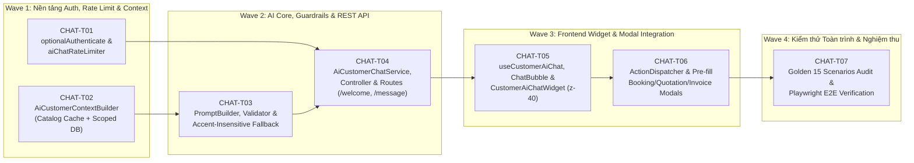

# 05. Kế Hoạch Triển Khai Tổng Thể & Danh Sách Vertical Execution Tickets (Master Implementation Plan)
## Tính Năng: Trợ Lý Cố Vấn Dịch Vụ AI — AutoCare Pro AI Concierge

> **Tài liệu:** `docs/chatbot/05-master-implementation-plan.md`  
> **Vai trò phụ trách:** Product Manager (`@pm-lead`) tổng hợp từ 4 tài liệu đồng bộ (`01` PRD, `02` BA Use Cases, `03` Solution Architecture, `04` UX & Multi-Perspective Review)  
> **Phiên bản:** 1.0 (Final Master Plan — Ready for Engineering Execution)  
> **Quy trình tham chiếu:** [`.agents/rules/AGENTS.md`](file:///d:/TLCN/CAR%20SERVICE%20CENTER/CAR%20SERVICE%20CENTER/.agents/rules/AGENTS.md), [`.agents/rules/DEVELOPMENT_PROCESS.md`](file:///d:/TLCN/CAR%20SERVICE%20CENTER/CAR%20SERVICE%20CENTER/.agents/rules/DEVELOPMENT_PROCESS.md), [`.agents/rules/API_CONVENTION.md`](file:///d:/TLCN/CAR%20SERVICE%20CENTER/CAR%20SERVICE%20CENTER/.agents/rules/API_CONVENTION.md)

---

## 1. Tổng Quan Kiến Trúc & Các Quyết Định Thiết Kế Đã Chốt (Cross-Functional Consensus)

Sau vòng phân tích và phản biện đa chiều giữa **Product Manager (`@pm-lead`)**, **Business Analyst (`@ba-analyst`)**, **Solution Architect (`@solution-arch`)** và **Customer Advocate (`@customer-advocate`)**, toàn đội đã thống nhất 100% kiến trúc và hợp đồng giao tiếp cho **AutoCare Pro AI Concierge (Phase 1 MVP)**.

### 1.1. Bảng 10 Quyết định Kiến trúc & Thiết kế Cốt lõi (Architecture Decision Records)

| Mã Quyết Định | Hạng Mục Thiết Kế | Quyết Định Đã Chốt Giữa PM × BA × UX × SA | Lý Do & Giá Trị Đem Lại |
| :--- | :--- | :--- | :--- |
| **ADR-CHAT-01** | **Hạ tầng AI & Database (Ponytail Ladder)** | **Zero DB Migration & Zero External AI Packages.** Tái sử dụng 100% `@google/genai` qua [`executeWithGeminiFailover`](file:///d:/TLCN/CAR%20SERVICE%20CENTER/CAR%20SERVICE%20CENTER/src/backend/src/utils/ai-client.util.ts) (Round-Robin multi-key, 60s cooldown khi `429/503`, fallback 3 models, 12s timeout) + Prisma ORM + [`redis.util.ts`](file:///d:/TLCN/CAR%20SERVICE%20CENTER/CAR%20SERVICE%20CENTER/src/backend/src/utils/redis.util.ts). | Triển khai nhanh, không làm phình schema MySQL, chi phí vận hành token ~0 VNĐ với cụm multi-key. |
| **ADR-CHAT-02** | **Cơ chế Xác thực Kép (`optionalAuthenticate`)** | Hỗ trợ cả Guest (`req.user = undefined`) và Customer (`req.user.id`). **Đặc biệt:** Nếu request có gửi header `Authorization: Bearer` nhưng token hết hạn (`TokenExpiredError`), trả về HTTP `401` để `axios` interceptor tự động gọi `/api/auth/refresh` và retry ngầm. | Khách hàng đang đăng nhập không bao giờ bị rớt xuống chế độ Guest giữa cuộc trò chuyện khi Access Token hết hạn. |
| **ADR-CHAT-03** | **Cô lập Dữ liệu Cá nhân & Chống IDOR** | `AiCustomerContextBuilder` chỉ nhận `authenticatedUserId` từ `req.user.id` (JWT), tuyệt đối không đọc `customer_id` hay `license_plate` từ payload chat để query DB. Chỉ nạp `Finding.is_visible_to_customer = true`, `Quotation.status != 'DRAFT'`, `Invoice.status IN ['ISSUED', 'PAID']`. | Triệt tiêu 100% nguy cơ lộ dữ liệu chéo giữa các khách hàng hoặc lộ giá vốn/báo giá nháp nội bộ. |
| **ADR-CHAT-04** | **Minh bạch Giá `LABOUR_PARTS`, `0% VAT` & Tổng Cộng Dồn (`quotationSummary`)** | 1. Công bố rõ **Chính sách miễn thuế GTGT (`0% VAT`)**.<br/>2. Không bao giờ bịa số tiền cho dịch vụ `LABOUR_PARTS`.<br/>3. Backend tính sẵn bằng TypeScript trường `quotationSummary: { totalApprovedAmount, pendingApprovalAmount, projectedCombinedTotal, pendingQuotationIds }` trên mỗi `WorkOrder` (loại trừ hoàn toàn báo giá `REJECTED`). | Xóa bỏ tâm lý sợ bị "vẽ bệnh"; đảm bảo LLM không bao giờ cộng nhầm báo giá đã bị từ chối khi khách hỏi tổng chi phí. |
| **ADR-CHAT-05** | **Bao phủ Trạng thái Phiếu Vừa Hoàn Tất & Bảo Hành Theo Tháng** | Bổ sung mảng `recentCompletedOrders` (tối đa 3 `WorkOrder` có `status IN ['RELEASED', 'CLOSED']` gần nhất) cùng `warrantyRecords` (tính hạn bảo hành theo Thời gian `warranty_months`). | Giải quyết trọn vẹn tình huống khách không còn xe đang sửa tại xưởng nhưng hỏi về xe vừa lấy hôm qua hoặc khiếu nại bảo hành. |
| **ADR-CHAT-06** | **Quản lý Phiên `sessionStorage` & `Guest-to-Auth Promotion`** | Chuẩn hóa khóa: `csc_ai_chat_history:guest`, `csc_ai_chat_history:user_${userId}` và `csc_pending_booking_intent`. Khi Guest vừa đăng nhập, tự động **kế thừa (copy/promote)** lịch sử chat từ `guest` sang `user_${userId}` rồi nối thêm lời chào cá nhân hóa từ `GET /welcome`. Khi Logout, xóa sạch mọi khóa `user_*`. | Giữ liền mạch cuộc tư vấn triệu chứng từ trang `/home` vào cổng `/customer/profile`, đồng thời bảo mật tuyệt đối khi đăng xuất. |
| **ADR-CHAT-07** | **Phân lớp Giao diện `z-40` & Tự động Thu gọn (`Auto-Minimize`)** | Đặt `CustomerAiChatWidget` ở lớp **`z-40`** (`PublicHeader z-30 < ChatWidget z-40 < Modals/Toast z-50`). Tự động thu gọn khung chat (`setIsOpen(false)`) khi người dùng bấm vào Action Chip mở Modal (`OPEN_BOOKING_MODAL`, `VIEW_QUOTATION`, `VIEW_INVOICE`) hoặc `NAVIGATE` trên Mobile. | Tuyệt đối không che khuất nút `[Lưu lịch hẹn]`, `[Phê duyệt báo giá]` hay mã QR SePay trên màn hình nhỏ. |
| **ADR-CHAT-08** | **Zero-Typing UX & Hỗ trợ Tiếng Việt Không Dấu (Inclusive UX)** | Mọi nút/chip trong khung chat có chiều cao `>= 44px` (`min-h-[44px]`), chữ hội thoại `>= 14px` (`text-sm`), số tiền dùng `font-mono tabular-nums font-bold`. Cả System Prompt và `Deterministic Fallback Engine` (`normalizeViText`) đều hiểu tiếng Việt không dấu (`"xe xong chua"`, `"bao gia"`, `"thanh toan"`). | Phục vụ tối ưu nhóm khách hàng lớn tuổi (Persona 3 - Chú Hùng) dùng điện thoại màn hình nhỏ, ngại gõ phím có dấu. |
| **ADR-CHAT-09** | **Tích hợp Pre-fill Đích thực vào Các Modal Nghiệp vụ (`REV-PM-03`)** | Nâng cấp tương thích ngược `CustomerBookingModal.tsx` với optional props `initialServiceIds?: number[]` và `initialNotes?: string`. Bổ sung bộ lắng nghe sự kiện/query params trên `profile/page.tsx`, `TrackingView.tsx` và `InvoicesView.tsx`. | Bấm Action Chip trong chat mở ngay đúng Modal Đặt lịch (điền sẵn dịch vụ & triệu chứng), Modal Báo giá hoặc Modal Thanh toán SePay. |
| **ADR-CHAT-10** | **Kiến trúc Zero-500 với Deterministic Fallback 3 Tầng** | Khi toàn bộ Gemini keys gặp lỗi hoặc timeout 12s, Backend không trả lỗi 500 mà kích hoạt `Deterministic Fallback Engine` trích xuất trực tiếp từ `CustomerPrivateContext` và `CatalogContext` để trả về HTTP 200 kèm Action Chips chuẩn. | Đảm bảo SLA sẵn sàng `>= 99.5%`, hành trình khách hàng không bao giờ bị đứt gãy. |

---

### 1.2. Hợp Đồng Giao Tiếp Chuẩn Hóa Liên Tầng (Unified Schema Contract)

Toàn bộ Backend (`AiCustomerPromptBuilder`, `AiCustomerValidatorService`, `AiCustomerChatService`) và Frontend (`useCustomerAiChat`, `ChatMessageBubble`, `ActionDispatcher`) bắt buộc sử dụng chung định nghĩa TypeScript dưới đây:

```typescript
// 11 Mã Ý định Hội thoại Chuẩn hóa (Unified AiChatIntent)
export type AiChatIntent =
  | 'SYMPTOM_DIAGNOSIS'      // UC-CHAT-01: Tư vấn triệu chứng xe kêu, rung, báo đèn, khẩn cấp
  | 'CATALOG_PRICING'        // UC-CHAT-02: Tra cứu bảng giá FIXED, VEHICLE_SIZE, LABOUR_PARTS (0% VAT)
  | 'WORK_ORDER_TRACKING'    // UC-CHAT-03: Tra cứu tiến độ WorkOrder, WoService, KCS
  | 'QUOTATION_EXPLANATION'  // UC-CHAT-04: Giải thích Finding, QuotationLine & Tổng lũy kế quotationSummary
  | 'INVOICE_PAYMENT'        // UC-CHAT-03/04: Tra cứu hóa đơn & hướng dẫn quét mã VietQR SePay
  | 'WARRANTY_INQUIRY'       // UC-CHAT-05: Tra cứu chính sách & hạn bảo hành (theo tháng)
  | 'BOOKING_REQUEST'        // UC-CHAT-05: Đặt lịch hẹn (Thứ 2 - Thứ 7: Sáng 08:00-10:30, Chiều 13:30-16:00)
  | 'AUTH_REQUIRED'          // Auth-Gate: Khách vãng lai hỏi dữ liệu cá nhân
  | 'GENERAL_SUPPORT'        // Thông tin xưởng, địa chỉ, quy trình 8 bước
  | 'HUMAN_HANDOFF'          // UC-CHAT-06: Khiếu nại, kết nối Cố vấn / Hotline 1900 6868
  | 'OUT_OF_SCOPE';          // UC-CHAT-06: Ngoài phạm vi ô tô / từ chối độ chế trái đăng kiểm, tua ODO

// 5 Loại Smart Action Chips Chuẩn hóa (Unified AiChatActionType)
export type AiChatActionType =
  | 'NAVIGATE'               // Điều hướng qua useRouter
  | 'OPEN_BOOKING_MODAL'     // Mở CustomerBookingModal kèm dữ liệu pre-fill
  | 'VIEW_QUOTATION'         // Mở tab tracking -> chọn workOrderId -> bật CustomerQuotationModal(quotationId)
  | 'VIEW_INVOICE'           // Mở tab invoices -> bật CustomerPaymentModal(invoiceId) (VietQR SePay)
  | 'CALL_HOTLINE';          // Kích hoạt tel:19006868

// Cấu trúc Payload 100% camelCase
export interface AiChatActionPayload {
  preselectedVehicleId?: number | null;
  preselectedServiceIds?: number[];
  preferredDate?: string | null;   // YYYY-MM-DD
  preferredTime?: string | null;   // HH:mm (VD: "08:00", "13:30")
  notes?: string | null;           // Triệu chứng điền sẵn vào ô mô tả
  isWarranty?: boolean;
  workOrderId?: number | null;
  quotationId?: number | null;
  invoiceId?: number | null;
}

export interface AiChatActionItem {
  type: AiChatActionType;
  label: string;             // Chuẩn Verb + Noun (VD: "Đặt lịch kiểm tra phanh")
  icon: string;              // Material Symbols icon name
  target: string;            // Whitelisted route / modal:booking / tel:19006868
  payload?: AiChatActionPayload;
}
```

---

## 2. Lộ Trình Triển Khai Từng Pha (Step-by-Step Implementation Plan)

Tuân thủ **Quy trình 6 Bước Chuẩn Hóa** trong [`.agents/rules/DEVELOPMENT_PROCESS.md`](file:///d:/TLCN/CAR%20SERVICE%20CENTER/CAR%20SERVICE%20CENTER/.agents/rules/DEVELOPMENT_PROCESS.md) và phương pháp **Vertical Tracer-Bullet Slicing** (`.agents/skills/to-tickets/SKILL.md`), kế hoạch thực thi được chia thành **7 Vertical Execution Tickets (`CHAT-T01` $\rightarrow$ `CHAT-T07`)** triển khai theo 4 chặng (Waves):



### Thứ tự ưu tiên triển khai:
1. **Chặng 1 (Backend Foundation — `CHAT-T01` & `CHAT-T02`):** Có thể thực hiện song song. Xây dựng lớp xác thực tùy chọn `optionalAuthenticate`, bộ giới hạn tần suất `aiChatRateLimiter`, và bộ nạp ngữ cảnh `AiCustomerContextBuilder` kèm Unit Tests độc lập.
2. **Chặng 2 (Backend AI Orchestration & API Contract — `CHAT-T03` & `CHAT-T04`):** Xây dựng System Prompt 5 lớp Guardrails, bộ hậu kiểm JSON & Whitelist `AiCustomerValidatorService`, `Deterministic Fallback Engine` hỗ trợ tiếng Việt không dấu, và mở 2 endpoint RESTful `GET /api/v1/ai-chat/welcome` & `POST /api/v1/ai-chat/message` kèm HTTP Integration Tests.
3. **Chặng 3 (Frontend UI Widget & Deep Action Integration — `CHAT-T05` & `CHAT-T06`):** Xây dựng hook quản lý phiên chat (có `Guest-to-Auth Session Promotion`), giao diện `CustomerAiChatWidget` chuẩn 4-State UI ở lớp `z-40`, và tích hợp `ActionDispatcher` truyền dữ liệu pre-fill trực tiếp vào `CustomerBookingModal.tsx`, `TrackingView.tsx`, `InvoicesView.tsx`.
4. **Chặng 4 (End-to-End Verification & Golden Scenarios Gate — `CHAT-T07`):** Chạy toàn bộ Unit Tests, Integration Tests, TypeScript Typecheck ở cả Backend và Frontend, cùng kịch bản Playwright E2E kiểm chứng hành trình từ Guest đến Authenticated Customer.

---

## 3. Danh Sách Vertical Execution Tickets (`CHAT-T01` Đến `CHAT-T07`)

---

### Ticket `CHAT-T01`: Hiện thực Middleware `optionalAuthenticate` & `aiChatRateLimiter`

- **User Story / Goal:** Là hệ thống Backend, tôi muốn phân biệt chính xác Khách vãng lai (Guest) và Khách hàng đã đăng nhập (Authenticated Customer), tự động hỗ trợ cơ chế refresh token khi Bearer JWT hết hạn và giới hạn tần suất gửi tin nhắn theo IP/UserId, để bảo vệ hạ tầng Gemini API mà không cản trở trải nghiệm người dùng.
- **Vertical Scope:**
  - **Auth Middleware:** Mở rộng `auth.middleware.ts` với hàm `optionalAuthenticate` kiểm tra Bearer token và cookie `customer_jwt`, kiểm tra Redis blacklist (`jti`, `invalid_before`, `revoked_user`) và trạng thái `user.is_active`.
  - **Rate Limiter Middleware:** Tạo mới `ai-chat-rate-limit.middleware.ts` sử dụng `getCache` / `setCache` từ `redis.util.ts` (15 requests/60s cho Guest theo IP; 30 requests/60s cho Customer theo `req.user.id`).
- **Dependencies:** `Blocked by: None`
- **Files Modified / Created:**
  - `src/backend/src/middlewares/auth.middleware.ts` *(Modify)*
  - `src/backend/src/middlewares/ai-chat-rate-limit.middleware.ts` *(Create)*
  - `src/backend/tests/unit/ai-chat-middlewares.test.ts` *(Create)*
- **Acceptance Criteria:**
  1. [ ] Khi request không có token: `optionalAuthenticate` gán `req.user = undefined` và gọi `next()` (HTTP 200 ở tầng sau).
  2. [ ] Khi request có `Authorization: Bearer <valid_jwt>`: `optionalAuthenticate` gán `req.user = { id, email, roles }` từ DB và gọi `next()`.
  3. [ ] Khi request có `Authorization: Bearer <expired_or_revoked_jwt>`: Trả về HTTP `401 Unauthorized` theo đúng envelope `API_CONVENTION.md` (`error.code = 'TOKEN_EXPIRED'` hoặc `'SESSION_REVOKED'`) để `axios` interceptor phía Frontend tự động gọi `/api/auth/refresh`.
  4. [ ] Khi Guest gửi quá 15 requests/phút hoặc Customer gửi quá 30 requests/phút: `aiChatRateLimiter` trả về HTTP `429 Too Many Requests` với `error.code = 'AI_RATE_LIMIT_EXCEEDED'` và thông điệp tiếng Việt thân thiện.
- **Verification Command:**
  ```bash
  cd src/backend && npx jest tests/unit/ai-chat-middlewares.test.ts
  cd src/backend && npx tsc --noEmit
  ```

---

### Ticket `CHAT-T02`: Xây dựng `AiCustomerContextBuilder` (Catalog Cache 5 Phút & Scoped Customer Private Context)

- **User Story / Goal:** Là Trợ lý AI, tôi cần được cung cấp dữ liệu danh mục dịch vụ & bảng giá chuẩn (được cache 5 phút) cùng hồ sơ cá nhân của đúng khách hàng đang đăng nhập (kèm tổng hợp báo giá lũy kế `quotationSummary` 0% VAT, các phiếu vừa xuất xưởng `recentCompletedOrders` và hạn bảo hành theo tháng `warrantyRecords`), để trả lời chính xác 100% mà không bao giờ bịa giá hay rò rỉ dữ liệu chéo.
- **Vertical Scope:**
  - **Catalog Context:** Truy vấn `ServiceCategory`, `Service`, `VehicleSizePrice` (`is_active: true`) từ Prisma, kết hợp thông tin `garageInfo` (địa chỉ, hotline `1900 6868`, lịch làm việc Thứ 2 – Thứ 7, `bookingSlots` Sáng `08:00–10:30` / Chiều `13:30–16:00`, `vatPolicy: "0% VAT"`), lưu cache với khóa `ai_chat:catalog_context:v1` (`TTL = 300s`).
  - **Customer Private Context:** Khi có `authenticatedUserId`, truy vấn song song (`Promise.all`) với điều kiện cứng `customer_id = authenticatedUserId`:
    * `User` & `Vehicle` (`status: 'ACTIVE'`).
    * `Appointment` gần nhất/sắp tới.
    * `WorkOrder` đang mở (`status NOT IN ['CLOSED', 'CANCELLED', 'RELEASED']`) kèm `WoService`, `Finding` (`is_visible_to_customer: true`), `Quotation` (`status IN ['SENT', 'APPROVED', 'REJECTED']`), `Invoice` (`status IN ['ISSUED', 'PAID']`) và tính sẵn `quotationSummary: { totalApprovedAmount, pendingApprovalAmount, projectedCombinedTotal, pendingQuotationIds }` (loại trừ hoàn toàn báo giá `REJECTED`).
    * `recentCompletedOrders` (tối đa 3 `WorkOrder` có `status IN ['RELEASED', 'CLOSED']` gần nhất) và dẫn xuất mảng `warrantyRecords` còn hiệu lực (`ACTIVE`).
- **Dependencies:** `Blocked by: None`
- **Files Modified / Created:**
  - `src/backend/src/services/ai-chat/ai-customer-context.builder.ts` *(Create)*
  - `src/backend/tests/unit/ai-customer-context.builder.test.ts` *(Create)*
- **Acceptance Criteria:**
  1. [ ] Gọi `getCatalogContext()` 2 lần liên tiếp trong vòng 5 phút chỉ thực hiện truy vấn Prisma ở lần đầu tiên (Cache Hit ở lần thứ 2); dữ liệu chứa đầy đủ 3 loại `pricingType` (`FIXED`, `VEHICLE_SIZE`, `LABOUR_PARTS`), `bookingSlots` và `vatPolicy` (`0% VAT`).
  2. [ ] `getCustomerPrivateContext(userId)` chỉ truy vấn dữ liệu của đúng `customer_id: userId`; tuyệt đối không bao giờ trả về `Finding` có `is_visible_to_customer = false` hoặc `Quotation` có `status = 'DRAFT'` hoặc `Invoice` có `status = 'DRAFT'`.
  3. [ ] Đối với `WorkOrder` có 1 báo giá `PRIMARY` (`APPROVED`: `1.800.000`), 1 báo giá `SUPPLEMENTARY` v1 (`REJECTED`: `1.200.000`) và 1 báo giá `SUPPLEMENTARY` v2 (`SENT`: `950.000`), trường `quotationSummary` tính chính xác: `totalApprovedAmount = 1800000`, `pendingApprovalAmount = 950000`, `projectedCombinedTotal = 2750000` (không cộng bản `REJECTED`).
  4. [ ] Trích xuất đúng `recentCompletedOrders` và tính đúng hạn bảo hành theo tháng (`expiresAt` theo `warranty_months`).
- **Verification Command:**
  ```bash
  cd src/backend && npx jest tests/unit/ai-customer-context.builder.test.ts
  cd src/backend && npx tsc --noEmit
  ```

---

### Ticket `CHAT-T03`: Xây dựng `AiCustomerPromptBuilder`, `AiCustomerValidatorService` & `Deterministic Fallback Engine`

- **User Story / Goal:** Là Kỹ sư Giải pháp AI, tôi muốn xây dựng bộ khung System Prompt chống Prompt Injection, bộ kiểm duyệt đầu ra chuẩn hóa 11 mã `AiChatIntent` & 5 loại `AiChatActionType` kèm whitelist đường dẫn, và bộ máy phản hồi dự phòng hỗ trợ tiếng Việt không dấu, để Chatbot luôn trả về JSON an toàn và đạt chuẩn Zero-500 ngay cả khi toàn bộ Gemini API keys mất kết nối.
- **Vertical Scope:**
  - **Prompt Builder:** Bọc tin nhắn khách hàng trong thẻ `<customer_query>...</customer_query>` đã escape thẻ đóng; thiết lập 6 quy tắc Guardrails (chống bịa giá `LABOUR_PARTS`, cam kết `0% VAT`, dùng `quotationSummary`, cảnh báo khẩn cấp ngập nước/mất phanh ở dòng đầu tiên, không cam kết ETA cứng, chống lộ dữ liệu chéo).
  - **Validator Service:** Kiểm tra cấu trúc JSON trả về từ Gemini, tự động normalize các alias (`OPEN_BOOKING` $\rightarrow$ `OPEN_BOOKING_MODAL`, `SYMPTOM_TRIAGE` $\rightarrow$ `SYMPTOM_DIAGNOSIS`, v.v.), kiểm tra whitelist cho `action.target` (loại bỏ `javascript:`, `data:`, `http://`, `https://` ngoài hệ thống) và chuẩn hóa `action.payload` sang `camelCase`.
  - **Deterministic Fallback Engine:** Chuẩn hóa chuỗi tiếng Việt không dấu qua `normalizeViText()`, xử lý 3 nhánh dự phòng (1: Cảnh báo khẩn cấp `ngap nuoc`/`chet may`/`mat phanh`; 2: Tiến độ/Báo giá/Hóa đơn/Bảo hành từ `CustomerPrivateContext` cho câu hỏi như `"xe xong chua"`, `"bao gia"`, `"thanh toan"`; 3: Tra cứu dịch vụ/bảng giá từ `CatalogContext`).
- **Dependencies:** `Blocked by: CHAT-T02`
- **Files Modified / Created:**
  - `src/backend/src/services/ai-chat/ai-customer-prompt.builder.ts` *(Create)*
  - `src/backend/src/services/ai-chat/ai-customer-validator.service.ts` *(Create)*
  - `src/backend/tests/unit/ai-customer-validator.service.test.ts` *(Create)*
- **Acceptance Criteria:**
  1. [ ] `AiCustomerPromptBuilder` escape triệt để mọi chuỗi `</customer_query>` trong input của người dùng và nhúng đầy đủ `CatalogContext` + `CustomerPrivateContext` (khi đã đăng nhập).
  2. [ ] `AiCustomerValidatorService` chuẩn hóa chính xác 11 mã `AiChatIntent` và 5 mã `AiChatActionType`; loại bỏ 100% các `actions` có `target` chứa `javascript:alert(1)` hoặc URL ngoại lai.
  3. [ ] `Deterministic Fallback Engine` nhận diện chính xác cả câu hỏi có dấu và không dấu (`"xe xong chua"`, `"bao nhieu tien"`, `"bao gia"`, `"dat lich"`, `"xe bi ngap nuoc chet may"`) và trả về dữ liệu khớp với Context kèm Action Chips hợp lệ.
- **Verification Command:**
  ```bash
  cd src/backend && npx jest tests/unit/ai-customer-validator.service.test.ts
  cd src/backend && npx tsc --noEmit
  ```

---

### Ticket `CHAT-T04`: Hiện thực `AiCustomerChatService`, `AiChatController` & Định tuyến REST API (`/api/v1/ai-chat`)

- **User Story / Goal:** Là ứng dụng Frontend `customer-web`, tôi muốn gọi `GET /api/v1/ai-chat/welcome` để lấy lời chào cá nhân hóa tức thì (`< 50ms`) và gọi `POST /api/v1/ai-chat/message` để nhận phản hồi tư vấn AI có cấu trúc tuân thủ `API_CONVENTION.md`.
- **Vertical Scope:**
  - **Chat Service (`ai-customer-chat.service.ts`):**
    * `getWelcomePayload(userId?, contextPage?)`: Trả về lời chào, `suggested_questions` và `actions` theo trạng thái thực tế của khách (Guest vs. Customer có báo giá `SENT` chờ duyệt / có hóa đơn `ISSUED` chờ thanh toán / có `WorkOrder` đang sửa / có `upcomingAppointments` / có `recentCompletedOrders`).
    * `sendMessage({ userId?, message, history, contextPage })`: Cắt `history` tối đa 10 tin nhắn gần nhất, gọi `AiCustomerContextBuilder`, `AiCustomerPromptBuilder`, gọi Gemini qua `executeWithGeminiFailover` với `responseMimeType: 'application/json'`, hậu kiểm qua `AiCustomerValidatorService`, và tự động chuyển sang `Deterministic Fallback Engine` nếu Gemini ném lỗi.
  - **Controller & Routes (`ai-chat.controller.ts`, `ai-chat.routes.ts`, `app.ts`):**
    * Validate request body (`message` 1..1000 ký tự, `history` mảng tối đa 10 phần tử).
    * Mount route tại `/api/v1/ai-chat` và `/api/ai-chat` trong `src/backend/src/app.ts`.
- **Dependencies:** `Blocked by: CHAT-T01, CHAT-T02, CHAT-T03`
- **Files Modified / Created:**
  - `src/backend/src/services/ai-chat/ai-customer-chat.service.ts` *(Create)*
  - `src/backend/src/controllers/ai-chat.controller.ts` *(Create)*
  - `src/backend/src/routes/ai-chat.routes.ts` *(Create)*
  - `src/backend/src/app.ts` *(Modify — mount `/api/v1/ai-chat` & `/api/ai-chat`)*
  - `src/backend/tests/unit/ai-customer-chat.service.test.ts` *(Create)*
  - `src/backend/tests/integration/ai-chat.routes.test.ts` *(Create)*
- **Acceptance Criteria:**
  1. [ ] `GET /api/v1/ai-chat/welcome` trả về HTTP `200 OK` dưới 50ms (không gọi LLM), phân biệt rõ `auth_mode: 'GUEST'` và `auth_mode: 'CUSTOMER'`, tự động gắn Action Chip `VIEW_QUOTATION` nếu khách đang có báo giá `SENT` hoặc `VIEW_INVOICE` nếu có hóa đơn `ISSUED`.
  2. [ ] `POST /api/v1/ai-chat/message` trả về HTTP `200 OK` với envelope chuẩn `{ success: true, code: 200, message, data: { auth_mode, is_fallback, reply, intent, suggested_questions, actions }, timestamp }`.
  3. [ ] Khi gửi `message` rỗng hoặc vượt quá 1000 ký tự, trả về HTTP `400 Bad Request` (`error.code = 'VALIDATION_ERROR'`).
  4. [ ] Khi truyền `customer_id: 999` giả mạo trong body request, hệ thống phớt lờ hoàn toàn và chỉ sử dụng `req.user.id` từ JWT.
  5. [ ] Khi tất cả Gemini keys bị lỗi `429/503` hoặc timeout, endpoint vẫn trả về HTTP `200 OK` với `data.is_fallback = true` và dữ liệu chính xác từ Fallback Engine.
- **Verification Command:**
  ```bash
  cd src/backend && npx jest tests/unit/ai-customer-chat.service.test.ts tests/integration/ai-chat.routes.test.ts
  cd src/backend && npx tsc --noEmit
  ```

---

### Ticket `CHAT-T05`: Xây dựng `useCustomerAiChat`, `ChatMessageBubble` & `CustomerAiChatWidget` (`z-40`, 4-State UI & Session Promotion)

- **User Story / Goal:** Là khách hàng truy cập `/home` hoặc `/customer/*` trên cả Desktop và Mobile, tôi muốn có một khung chat trợ lý kỹ thuật nổi ở góc màn hình (`z-40`) với các nút gợi ý 1-chạm dễ bấm (`>= 44px`), giữ liền mạch đoạn hội thoại khi tôi chuyển từ trạng thái khách vãng lai sang đăng nhập và tự động xóa sạch dữ liệu khi tôi đăng xuất.
- **Vertical Scope:**
  - **Custom Hook (`useCustomerAiChat.ts`):**
    * Quản lý 4 trạng thái UI (`welcome/empty`, `loading/thinking`, `error/retry`, `data`).
    * Quản lý `sessionStorage` theo khóa chuẩn `csc_ai_chat_history:guest` và `csc_ai_chat_history:user_${user.id}`.
    * Thực thi **`Guest-to-Auth Session Promotion`**: Khi chuyển từ `guest` sang `user_${user.id}`, nếu `csc_ai_chat_history:guest` có tin nhắn của người dùng và `csc_ai_chat_history:user_${user.id}` đang trống, sao chép toàn bộ lịch sử sang `user_${user.id}`, xóa khóa `guest`, và gọi `GET /api/v1/ai-chat/welcome` để nối thêm lời chào cá nhân hóa ở cuối đoạn chat.
    * Thực thi **`Logout Privacy Cleanup`**: Khi `user` chuyển về `null` hoặc nhận sự kiện `USER_LOGGED_OUT` trên `BroadcastChannel('csc_session_channel')`, xóa sạch toàn bộ khóa `csc_ai_chat_history:user_*`, `csc_ai_chat_open:user_*` và `csc_pending_booking_intent`.
  - **UI Components (`ChatMessageBubble.tsx`, `CustomerAiChatWidget.tsx`):**
    * Render Markdown an toàn (in đậm biển số xe, mã phiếu, số tiền `font-mono tabular-nums font-bold`, danh sách gạch đầu dòng thoáng).
    * Hiển thị Smart Action Chips (`Verb + Noun`) và Suggested Questions 1-chạm với vùng chạm `min-h-[44px]`, cỡ chữ hội thoại `text-sm leading-relaxed` (`>= 14px`).
    * Đặt ở lớp **`z-40`** (Desktop: `fixed bottom-6 right-6 z-40`, Mobile FAB: `fixed bottom-4 right-4 z-40 min-w-[52px] min-h-[52px]`, Mobile Bottom Sheet: `fixed inset-x-0 bottom-0 z-40 h-[82dvh] max-h-[85dvh] rounded-t-3xl`), chuyển động mượt `< 250ms` kèm `motion-reduce:transition-none`.
    * Nhúng `<CustomerAiChatWidget />` vào `(public)/layout.tsx` và `(customer)/layout.tsx`.
- **Dependencies:** `Blocked by: CHAT-T04`
- **Files Modified / Created:**
  - `src/frontend/apps/customer-web/src/components/chat/useCustomerAiChat.ts` *(Create)*
  - `src/frontend/apps/customer-web/src/components/chat/ChatMessageBubble.tsx` *(Create)*
  - `src/frontend/apps/customer-web/src/components/chat/CustomerAiChatWidget.tsx` *(Create)*
  - `src/frontend/apps/customer-web/src/app/(public)/layout.tsx` *(Modify)*
  - `src/frontend/apps/customer-web/src/app/(customer)/layout.tsx` *(Modify)*
- **Acceptance Criteria:**
  1. [ ] Widget xuất hiện ở cả trang công khai (`/home`) và cổng khách hàng (`/customer/profile`) ở lớp `z-40` (nổi trên `PublicHeader z-30`, nằm dưới toàn bộ Modal và Toast `z-50`).
  2. [ ] Thực thi đầy đủ 4-State UI Protocol với microcopy tiếng Việt chuẩn AutoCare Pro (Welcome state có Quick Reply Chips 1-chạm, Loading state có 3 chấm động *"Em đang kiểm tra hồ sơ kỹ thuật & bảng giá tại xưởng..."*, Error state có nút `[Thử gửi lại]` 1-chạm, Data state có Action Chips `min-h-[44px]`).
  3. [ ] Khi chat ở chế độ Guest tại `/home` rồi đăng nhập tài khoản khách hàng, toàn bộ đoạn chat trước đó được giữ nguyên và nối thêm lời chào cá nhân hóa của tài khoản vừa đăng nhập (`Guest-to-Auth Session Promotion`).
  4. [ ] Khi bấm Đăng xuất (`Logout`), toàn bộ khóa `csc_ai_chat_history:user_*` trong `sessionStorage` bị xóa sạch ngay lập tức.
- **Verification Command:**
  ```bash
  cd src/frontend/apps/customer-web && npx tsc --noEmit
  ```

---

### Ticket `CHAT-T06`: Tích hợp `ActionDispatcher` & Nâng cấp Props Pre-fill cho `CustomerBookingModal.tsx`, `profile/page.tsx`, `TrackingView.tsx` & `InvoicesView.tsx` (`REV-PM-03`)

- **User Story / Goal:** Là khách hàng đang trao đổi với Chatbot AI, khi tôi nhấn vào các nút hành động như `[Đặt lịch kiểm tra phanh ngay]`, `[Mở bảng báo giá để phê duyệt]` hoặc `[Thanh toán hóa đơn qua QR SePay]`, tôi muốn cửa sổ chat tự động thu gọn (`Auto-Minimize`) và hệ thống mở thẳng đúng Modal nghiệp vụ với dữ liệu dịch vụ, ghi chú triệu chứng, báo giá hoặc hóa đơn đã được chọn sẵn.
- **Vertical Scope:**
  - **Nâng cấp `CustomerBookingModal.tsx`:**
    * Bổ sung 2 optional props tương thích ngược vào `CustomerBookingModalProps`: `initialServiceIds?: number[]` và `initialNotes?: string`.
    * Khởi tạo và đồng bộ state `selectedServiceIds` (ưu tiên `initialServiceIds` nếu có, mặc định `[1, 2]`) và `bookingNotes` (ưu tiên `initialNotes` nếu có).
  - **Tích hợp trên `app/(customer)/customer/profile/page.tsx`:**
    * Lắng nghe sự kiện `window.addEventListener('csc:open-booking-modal', ...)` cũng như đọc `sessionStorage.getItem('csc_pending_booking_intent')` (hoặc query param `openBooking=1`) khi vừa chuyển trang/đăng nhập tới `/customer/profile`: tự động nạp `bookingPreselectedVehicleId`, `bookingPreselectedServiceIds`, `bookingPreselectedNotes`, `bookingDate`, `bookingTime` và bật `setBookingModalOpen(true)`.
  - **Tích hợp trên `components/tracking/TrackingView.tsx` (`VIEW_QUOTATION`):**
    * Đọc query params (`workOrderId`, `quotationId`) hoặc lắng nghe CustomEvent `csc:view-quotation`: tự động chọn đúng phương tiện/lệnh sửa chữa có `id === workOrderId` và mở ngay `CustomerQuotationModal`.
  - **Tích hợp trên `components/invoices/InvoicesView.tsx` (`VIEW_INVOICE`):**
    * Đọc query param `invoiceId` hoặc lắng nghe CustomEvent `csc:view-invoice`: tự động mở `CustomerPaymentModal` (VietQR SePay) của hóa đơn tương ứng.
  - **Hoàn thiện `ActionDispatcher` trong `CustomerAiChatWidget.tsx`:**
    * Tự động gọi `setIsOpen(false)` (`Auto-Minimize`) khi người dùng bấm `OPEN_BOOKING_MODAL`, `VIEW_QUOTATION`, `VIEW_INVOICE` (trên cả Mobile & Desktop) hoặc `NAVIGATE` (trên Mobile).
- **Dependencies:** `Blocked by: CHAT-T05`
- **Files Modified / Created:**
  - `src/frontend/apps/customer-web/src/components/profile/CustomerBookingModal.tsx` *(Modify)*
  - `src/frontend/apps/customer-web/src/app/(customer)/customer/profile/page.tsx` *(Modify)*
  - `src/frontend/apps/customer-web/src/components/tracking/TrackingView.tsx` *(Modify)*
  - `src/frontend/apps/customer-web/src/components/invoices/InvoicesView.tsx` *(Modify)*
  - `src/frontend/apps/customer-web/src/components/chat/CustomerAiChatWidget.tsx` *(Modify)*
- **Acceptance Criteria:**
  1. [ ] Khi khách đã đăng nhập bấm chip `OPEN_BOOKING_MODAL` với `payload: { preselectedServiceIds: [2], notes: "Phanh kêu két két" }`: Khung chat tự động thu gọn, `CustomerBookingModal` mở lên với dịch vụ `#2` được tích chọn sẵn và ô ghi chú điền sẵn `"Phanh kêu két két"`.
  2. [ ] Khi khách vãng lai (Guest) tại `/home` bấm chip `OPEN_BOOKING_MODAL`: Hệ thống lưu `csc_pending_booking_intent` vào `sessionStorage`, chuyển sang `/login`, và ngay sau khi khách đăng nhập thành công sẽ tự động mở `CustomerBookingModal` với đúng dữ liệu pre-fill đó.
  3. [ ] Khi khách đã đăng nhập bấm chip `VIEW_QUOTATION` (`{ workOrderId, quotationId }`): Khung chat tự động thu gọn, chuyển tới tab Tiến độ sửa chữa, chọn đúng xe `workOrderId` và bật `CustomerQuotationModal`.
  4. [ ] Khi khách đã đăng nhập bấm chip `VIEW_INVOICE` (`{ invoiceId }`): Khung chat tự động thu gọn, chuyển tới tab Hóa đơn và mở `CustomerPaymentModal` hiển thị mã QR SePay.
- **Verification Command:**
  ```bash
  cd src/frontend/apps/customer-web && npx tsc --noEmit
  ```

---

### Ticket `CHAT-T07`: Kiểm thử Toàn trình Seam-First TDD, Đối chiếu 15 Golden Customer Scenarios & Playwright E2E Verification

- **User Story / Goal:** Là Đội ngũ Phát triển & QA, tôi muốn có bằng chứng kiểm thử tự động (Unit Tests, Integration Tests, Typecheck và Playwright E2E) bao phủ trọn vẹn 15 Kịch bản Khách hàng Vàng (Golden Customer Test Scenarios), tuân thủ **The Iron Law of Verification** với `0 failures` và `Exit code 0`.
- **Vertical Scope:**
  - **Backend Test Suite:** Hoàn thiện bộ test kiểm chứng 15 kịch bản vàng (báo giá `FIXED`/`VEHICLE_SIZE`/`LABOUR_PARTS` 0% VAT, tính tổng cộng dồn `quotationSummary` loại trừ `REJECTED`, xử lý nhiều xe `BR-CHAT-04`, không có WO đang mở `BR-CHAT-05`, cảnh báo khẩn cấp ngập nước/mất phanh, chống IDOR & Prompt Injection, Fallback tiếng Việt không dấu).
  - **Frontend Playwright E2E Test (`ai-chat-concierge.spec.ts`):** Kiểm thử tự động trên trình duyệt thực tế luồng mở Widget tại `/home`, hỏi triệu chứng, bấm Action Chip, kiểm tra `Guest-to-Auth Session Promotion`, mở `CustomerBookingModal` pre-fill và xóa lịch sử khi `Logout`.
- **Dependencies:** `Blocked by: CHAT-T01, CHAT-T02, CHAT-T03, CHAT-T04, CHAT-T05, CHAT-T06`
- **Files Modified / Created:**
  - `src/backend/tests/unit/ai-customer-chat.service.test.ts` *(Verify / Expand)*
  - `src/backend/tests/integration/ai-chat.routes.test.ts` *(Verify / Expand)*
  - `src/frontend/apps/customer-web/e2e/ai-chat-concierge.spec.ts` *(Create / Run E2E)*
- **Acceptance Criteria:**
  1. [ ] Toàn bộ Unit Tests & HTTP Integration Tests tại `src/backend` vượt qua 100% (`Exit code 0, 0 failures`).
  2. [ ] Lệnh `npx tsc --noEmit` tại cả `src/backend` và `src/frontend/apps/customer-web` hoàn tất với `Exit code 0`.
  3. [ ] Kịch bản Playwright E2E kiểm chứng thành công: FAB `z-40`, 4-State UI, Action Chip `min-h-[44px]`, `Auto-Minimize` khi mở `CustomerBookingModal` (`z-50`), `Guest-to-Auth Session Promotion` và `Logout Privacy Cleanup`.
- **Verification Command:**
  ```bash
  cd src/backend && npm test
  cd src/backend && npx tsc --noEmit
  cd src/frontend/apps/customer-web && npx tsc --noEmit
  ```

---

## 4. Ma Trận Truy Vết 15 Kịch Bản Khách Hàng Vàng (Golden Scenarios Traceability Matrix)

Bảng dưới đây đối chiếu trực tiếp **15 Golden Customer Test Scenarios** (từ tài liệu `04`) với **Use Cases** (tài liệu `02`), **Cơ chế Kỹ thuật** (tài liệu `03`) và **Ticket Thực thi** (tài liệu `05`):

| Kịch Bản Vàng (`04`) | Use Case & Business Rule (`02`) | Giải Pháp Kỹ Thuật (`03`) | Ticket Đảm Nhiệm (`05`) |
| :--- | :--- | :--- | :--- |
| **#01:** Anh Minh (Guest) hỏi tiếng kêu phanh xe Mazda 3 18.000km, sợ bị "vẽ bệnh" | `UC-CHAT-01`, `BR-CHAT-01`, `BR-CHAT-06` | `CatalogContext` + System Prompt giải thích nguyên nhân nhẹ nhàng + Action `OPEN_BOOKING_MODAL` pre-fill `notes` | `CHAT-T02`, `CHAT-T03`, `CHAT-T06` |
| **#02:** Thắc mắc tại sao dịch vụ `LABOUR_PARTS` ghi *"Khảo sát & báo giá"* | `UC-CHAT-02`, `BR-CHAT-01` | Guardrail GR-01 trong System Prompt: Giải thích tính theo thực tế (Công + Phụ tùng), cam kết báo giá 0% VAT trước khi làm | `CHAT-T03`, `CHAT-T04` |
| **#03:** Hỏi mặc cả ép giá hoặc đòi mang phụ tùng Shopee vào lắp | `UC-CHAT-02 [EF-01]`, `BR-CHAT-06` | Giải thích chuẩn phụ tùng chính hãng có bảo hành điện tử, 0% VAT, hướng dẫn tính năng `REVISE` báo giá | `CHAT-T03`, `CHAT-T04` |
| **#04:** Chị Lan hỏi giải thích *"Rô-tuyn cân bằng rơ lỏng"* trong Báo giá bổ sung | `UC-CHAT-04`, `BR-CHAT-06` | `CustomerPrivateContext.findings` (`severity: HIGH`) + Giải thích 3 lớp + Hướng dẫn nút `REVISE` + Action `VIEW_QUOTATION` | `CHAT-T02`, `CHAT-T03`, `CHAT-T06` |
| **#05:** Hỏi tổng chi phí cộng dồn nhiều đợt báo giá (`PRIMARY` + `SUPPLEMENTARY`) & giờ lấy xe | `UC-CHAT-04`, `BR-CHAT-06`, `BR-CHAT-07` | Trường tính sẵn `quotationSummary.projectedCombinedTotal` (loại trừ `REJECTED`, 0% VAT) + Guardrail GR-02 không hứa ETA cứng | `CHAT-T02`, `CHAT-T03`, `CHAT-T07` |
| **#06:** Khách sở hữu từ 2 xe trở lên hỏi *"Xe tôi sửa tới đâu rồi?"* | `UC-CHAT-03 [AF-01]`, `BR-CHAT-04` | `CustomerPrivateContext.vehicles` & `activeWorkOrders`: Tự động nhận diện xe đang ở xưởng hoặc tóm tắt theo từng biển số | `CHAT-T02`, `CHAT-T04` |
| **#07:** Chú Hùng hỏi cách quét mã QR SePay & sợ quên ghi nội dung chuyển khoản | `UC-CHAT-04 [AF-03]` | Hướng dẫn VietQR tự điền sẵn số tiền & nội dung + Trấn an không mất tiền + Action `VIEW_INVOICE` mở `CustomerPaymentModal` | `CHAT-T03`, `CHAT-T06` |
| **#08:** Khách CHƯA đăng nhập nhưng đọc biển số đòi xem tiến độ & hóa đơn | `UC-CHAT-03 [EF-01]`, `BR-CHAT-02` | `optionalAuthenticate` (`req.user = undefined`) $\rightarrow$ Không query dữ liệu cá nhân, trả về `intent: AUTH_REQUIRED` + `/login` | `CHAT-T01`, `CHAT-T02`, `CHAT-T04` |
| **#09:** Khách ĐÃ đăng nhập nhưng dùng Prompt Injection đòi xem xe của người khác | `UC-CHAT-06 [AF-02]`, `BR-CHAT-02`, `BR-CHAT-03` | Scoped Prisma Query cứng `WHERE customer_id = req.user.id` + XML Tag `<customer_query>` Isolation | `CHAT-T02`, `CHAT-T03`, `CHAT-T07` |
| **#10:** Khách đang chat ở `/home` (Guest) rồi bấm Đăng nhập vào `/customer/profile` | `UC-CHAT-01 [AF-02]`, `BR-CHAT-09` | `Guest-to-Auth Session Promotion` trong `useCustomerAiChat.ts` (copy `guest` $\rightarrow$ `user_${id}` + append `/welcome` + mở Modal) | `CHAT-T05`, `CHAT-T06`, `CHAT-T07` |
| **#11:** Xe vừa nhận hôm qua vẫn rung vô lăng, hỏi mang qua có tốn tiền lại không | `UC-CHAT-05 (Nhánh C)`, `BR-CHAT-05`, `BR-CHAT-08` | `recentCompletedOrders` + `warrantyRecords` (`ACTIVE` theo tháng & ODO) + Khẳng định kiểm tra bảo hành 0 ₫ | `CHAT-T02`, `CHAT-T03`, `CHAT-T04` |
| **#12:** Xe đi mưa ngập nước chết máy, có mùi khét, hỏi có nên đề máy lại không | `UC-CHAT-01 [AF-03]` | Guardrail GR-04 & Fallback Nhánh 1: Dòng đầu in đậm **`⚠️ TUYỆT ĐỐI KHÔNG ĐỀ MÁY LẠI Ạ!`** + Action `CALL_HOTLINE` (`tel:19006868`) | `CHAT-T03`, `CHAT-T04`, `CHAT-T07` |
| **#13:** Hỏi đặt lịch vào 20h tối hoặc Chủ nhật | `UC-CHAT-05 [AF-01]` | `CatalogContext.garageInfo.bookingSlots` (Thứ 2 – Thứ 7: Sáng `08:00–10:30`, Chiều `13:30–16:00`, nghỉ Chủ nhật) | `CHAT-T02`, `CHAT-T03` |
| **#14:** Hỏi độ pô nổ to, tháo bầu lọc khí thải, tua ODO hoặc thay nhớt xe máy SH | `UC-CHAT-06 [AF-02]` | Phân loại `intent: OUT_OF_SCOPE`, từ chối lịch sự các hành vi trái quy chuẩn đăng kiểm và giới thiệu gói chăm sóc ô tô chuẩn | `CHAT-T03`, `CHAT-T04` |
| **#15:** Chú Hùng gõ tiếng Việt không dấu cực ngắn (`"xe xong chua"`, `"bao nhieu tien"`) | `UC-CHAT-03`, `UC-CHAT-06 [EF-01]` | System Prompt + `normalizeViText()` trong `Deterministic Fallback Engine` + Quick Reply Chips `min-h-[44px]` | `CHAT-T03`, `CHAT-T05`, `CHAT-T07` |

---

## 5. Checklist Nghiệm Thu Cuối Cùng (Definition of Done)

Trước khi đóng nhánh phát triển tính năng Chatbot AI Hỗ trợ Khách hàng, Lập trình viên / AI Agent thực thi bắt buộc kiểm tra và xuất bằng chứng terminal cho 8 tiêu chí sau:

- [ ] **1. Zero DB Migration & Zero Package Bloat:** `git diff src/backend/prisma/schema.prisma` và `git diff package.json` hoàn toàn trống (không thêm bảng DB, không cài thêm npm package).
- [ ] **2. Bảo mật Chống IDOR & Nội bộ:** Mọi truy vấn trong `AiCustomerContextBuilder.getCustomerPrivateContext` đều lọc cứng theo `customer_id = req.user.id`, ẩn 100% báo giá `DRAFT`, hóa đơn `DRAFT`/`CANCELLED`, `Finding` có `is_visible_to_customer = false` và giá vốn kho.
- [ ] **3. Độ Chính Xác Tài Chính 0% VAT:** Trường `quotationSummary.projectedCombinedTotal` tính chuẩn xác tổng `APPROVED + SENT` (loại trừ `REJECTED`) và nhất quán thông điệp **0% VAT**.
- [ ] **4. Chuẩn API Envelope:** Cả `GET /api/v1/ai-chat/welcome` và `POST /api/v1/ai-chat/message` tuân thủ 100% `API_CONVENTION.md` và không bao giờ trả lỗi HTTP 500 khi Gemini đứt kết nối (`is_fallback: true`).
- [ ] **5. Chuẩn UX Đa thế hệ & Phân lớp `z-40`:** `CustomerAiChatWidget` nằm ở `z-40`, đầy đủ 4-State UI, nút/chip `min-h-[44px]`, tự động thu gọn (`Auto-Minimize`) khi mở Modal `z-50`.
- [ ] **6. Liền mạch & Bảo mật Phiên (`sessionStorage`):** Kế thừa hội thoại khi chuyển từ Guest sang Đăng nhập (`Guest-to-Auth Session Promotion`) và xóa sạch khi Đăng xuất (`Logout`).
- [ ] **7. Tích hợp Pre-fill Modal Đích thực:** Bấm `OPEN_BOOKING_MODAL`, `VIEW_QUOTATION`, `VIEW_INVOICE` mở đúng Modal với dữ liệu được điền sẵn.
- [ ] **8. Bằng chứng Kiểm thử Xanh 100% (The Iron Law of Verification):**
  - `cd src/backend && npm test` $\rightarrow$ **0 failures, Exit code 0**.
  - `cd src/backend && npx tsc --noEmit` $\rightarrow$ **Exit code 0**.
  - `cd src/frontend/apps/customer-web && npx tsc --noEmit` $\rightarrow$ **Exit code 0**.
