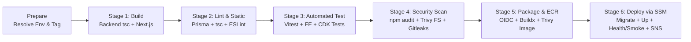

# Tài Liệu Bàn Giao Triển Khai & Vận Hành CI/CD — Car Service Center

> **Dự án:** Car Service Center Management Platform  
> **Repository:** https://github.com/NguyenThanhTin235/car-service-center-web  
> **AWS Region:** `ap-southeast-1` (Singapore)  
> **Domain chính:** `carservice.id.vn`  
> **Release Tags hiện có:** `v1.0.0`, `v1.0.1`, `v1.1.0`  
> **Ngày lập tài liệu bàn giao:** `2026-11-26`

---

## 1. Link Môi Trường Đang Chạy (Production & Staging)

Toàn bộ các cổng ứng dụng và API của cả hai môi trường **Production** và **Staging** đều đang hoạt động công khai qua HTTPS (TLS/Let's Encrypt) và được kiểm tra trạng thái thực tế vào ngày `2026-11-26`:

| Môi trường | Thành phần | URL công khai | Trạng thái kiểm tra thực tế |
| :--- | :--- | :--- | :--- |
| **Production** | Customer Web (Khách hàng) | https://carservice.id.vn | `200 OK` (redirect → `/home`) |
| **Production** | Internal Web (Nội bộ) | https://ops.carservice.id.vn | `200 OK` (redirect → `/login`) |
| **Production** | Backend API Health | https://api.carservice.id.vn/health | `200 OK` (`database: up`, `redis: up`, `version: 1.0.0`) |
| **Staging** | Customer Web (Khách hàng) | https://staging.carservice.id.vn | `200 OK` (redirect → `/home`) |
| **Staging** | Internal Web (Nội bộ) | https://staging-ops.carservice.id.vn | `200 OK` (redirect → `/login`) |
| **Staging** | Backend API Health | https://staging-api.carservice.id.vn/health | `200 OK` (`database: up`, `redis: up`, `version: 1.1.0-staging`) |

> **Tài khoản demo & kiểm thử nghiệp vụ:** Vui lòng tham khảo mục **Danh sách tài khoản thử nghiệm** trong [SETUP_GUIDE.md](../../SETUP_GUIDE.md) để đăng nhập thử các vai trò (`CUSTOMER`, `ADMIN`, `MANAGER`, `SA`, `DESK STAFF`, `TECHNICIAN`).

---

## 2. Tệp Cấu Hình Pipeline CI/CD & Hạ Tầng trong Repository

### 2.1. Danh sách tệp cấu hình Pipeline, Deploy & IaC

| Hạng mục | Đường dẫn trong repo | Link GitHub | Mô tả chức năng |
| :--- | :--- | :--- | :--- |
| **CI Pipeline (4 chặng)** | `.github/workflows/ci.yml` | [ci.yml](https://github.com/NguyenThanhTin235/car-service-center-web/blob/develop/.github/workflows/ci.yml) | Gate kiểm tra Pull Request vào `develop` / `main` (Build, Lint/Static, Automated Tests, Security Scan). |
| **CD Pipeline (6 chặng)** | `.github/workflows/cd.yml` | [cd.yml](https://github.com/NguyenThanhTin235/car-service-center-web/blob/develop/.github/workflows/cd.yml) | Tự động Build → Lint/Static → Test → Security Scan → Docker Buildx + Push ECR + Trivy Image Scan → Deploy EC2 qua AWS SSM + Prisma Migrate + Health Gate + Smoke Test + Auto-Rollback + SNS Alert. |
| **Rollback Pipeline** | `.github/workflows/rollback.yml` | [rollback.yml](https://github.com/NguyenThanhTin235/car-service-center-web/blob/develop/.github/workflows/rollback.yml) | Rollback thủ công (`workflow_dispatch`) cho `staging` hoặc `prod` về `image_tag` chỉ định hoặc `.previous_tag` trên EC2. |
| **Docker Compose (AWS)** | `deploy/docker-compose.aws.yml` | [docker-compose.aws.yml](https://github.com/NguyenThanhTin235/car-service-center-web/blob/develop/deploy/docker-compose.aws.yml) | Điều phối Redis 7, Backend, Customer Web, Internal Web và Nginx SSL (`--profile proxy`) trên EC2 kèm `awslogs`. |
| **Nginx Reverse Proxy** | `deploy/nginx/nginx.conf`<br>`deploy/nginx/conf.d/app.conf.template` | [deploy/nginx](https://github.com/NguyenThanhTin235/car-service-center-web/tree/develop/deploy/nginx) | Cấu hình SSL/TLS, HTTP→HTTPS redirect, Certbot ACME challenge, WebSocket Upgrade (`/socket.io/`) cho cả 6 hostname Prod & Staging. |
| **Scripts Vận hành EC2** | `deploy/scripts/deploy.sh`<br>`deploy/scripts/rollback.sh`<br>`deploy/scripts/init-ssl.sh`<br>`deploy/scripts/backup-db.sh`<br>`deploy/scripts/seed-ssm.ps1` | [deploy/scripts](https://github.com/NguyenThanhTin235/car-service-center-web/tree/develop/deploy/scripts) | Nạp SSM runtime env, login ECR, migrate Prisma, health check loop 60s, auto-rollback, cấp phát SSL Certbot, backup MySQL lên S3 và seed SSM parameters. |
| **AWS CDK (IaC — 6 Stacks)** | `infra/bin/infra.ts`<br>`infra/lib/*.ts` | [infra](https://github.com/NguyenThanhTin235/car-service-center-web/tree/develop/infra) | Định nghĩa toàn bộ hạ tầng AWS (`NetworkStack`, `DataStack`, `RegistryAuthStack`, `ComputeStack`, `DnsStack`, `ObservabilityStack`) kèm unit tests (`infra/test/infra.test.ts`). |
| **Dockerfiles & Local Compose** | `src/backend/Dockerfile`<br>`src/frontend/apps/customer-web/Dockerfile`<br>`src/frontend/apps/internal-web/Dockerfile`<br>`docker-compose.yml` | [src/backend/Dockerfile](https://github.com/NguyenThanhTin235/car-service-center-web/blob/develop/src/backend/Dockerfile) | Multi-stage `node:20-alpine` builds (Next.js `output: 'standalone'`, Prisma client, non-root user, `HEALTHCHECK`). |

### 2.2. Luồng Pipeline CD 6 Chặng (`.github/workflows/cd.yml`)



- **Nhánh `develop`:** Tự động triển khai lên môi trường **Staging** (`staging.carservice.id.vn`, `staging-ops.carservice.id.vn`, `staging-api.carservice.id.vn`).
- **Nhánh `main` hoặc Tag `v*.*.*`:** Tự động triển khai lên môi trường **Production** (`carservice.id.vn`, `ops.carservice.id.vn`, `api.carservice.id.vn`).

### 2.3. Biến & Môi trường cần thiết trên GitHub Actions

Để `cd.yml` và `rollback.yml` vận hành đúng trên GitHub Repository Settings:

| Loại cấu hình | Tên biến / Environment | Giá trị / Mô tả |
| :--- | :--- | :--- |
| **GitHub Environments** | `staging`, `prod` | Tương ứng với 2 môi trường triển khai trong `cd.yml` và `rollback.yml`. |
| **Repository Variable** | `AWS_ROLE_ARN` | ARN của IAM Role xác thực qua GitHub OIDC (`car-service-github-deploy-role`). |
| **Repository Variable** | `AWS_REGION` | Region AWS triển khai (mặc định `ap-southeast-1`). |
| **Repository Variable** | `EC2_INSTANCE_ID` | Instance ID của EC2 host nhận lệnh từ AWS SSM `send-command`. |
| **Repository Variable** | `DOMAIN_NAME` | Tên miền gốc (mặc định `carservice.id.vn`). |
| **Repository Variable** | `SNS_ALERT_TOPIC_ARN` | ARN của SNS Topic nhận cảnh báo khi Deploy/Rollback thất bại (`car-service-alerts`). |

> **Lưu ý bảo mật:** Pipeline sử dụng **GitHub OIDC** (`aws-actions/configure-aws-credentials@v4` với `id-token: write`), **không lưu AWS Access Key/Secret Key tĩnh** trong GitHub Secrets.

---

## 3. Lịch Sử Chạy Pipeline & Triển Khai (GitHub Actions)

- **Trang tổng hợp toàn bộ lịch sử chạy:** https://github.com/NguyenThanhTin235/car-service-center-web/actions
- **Thống kê tính đến `2026-11-26`:**
  - Tổng cộng **91 lần chạy** trên GitHub Actions (**58** lần `CI Pipeline`, **33** lần `CD Pipeline`).
  - **CD Pipeline:** **13 lần triển khai thành công**, trải đều từ `2026-11-17` đến `2026-11-26`.
  - **CI Pipeline:** **36 lần thành công**.

### 3.1. Các lần chạy thành công gần nhất

| Loại Pipeline | Run # | Nhánh / Tag | Sự kiện | Thời lượng | Thời điểm tạo (UTC) | Link chi tiết |
| :--- | :---: | :--- | :--- | :---: | :--- | :--- |
| **CD Staging gần nhất** | `#34` | `develop` | `push` | `14.2m` | `2026-11-26T03:18:23Z` | https://github.com/NguyenThanhTin235/car-service-center-web/actions/runs/45748053821 |
| **CD Production (Tag) gần nhất** | `#24` | `v1.1.0` | `push` | `7.4m` | `2026-11-23T10:32:42Z` | https://github.com/NguyenThanhTin235/car-service-center-web/actions/runs/45157065871 |
| **CD Production (`main`) gần nhất** | `#22` | `main` | `push` | `13.6m` | `2026-11-22T08:39:10Z` | https://github.com/NguyenThanhTin235/car-service-center-web/actions/runs/45003806673 |
| **CI Pipeline gần nhất** | `#58` | `feat/deploy-aws` | `pull_request` | `1.7m` | `2026-11-25T15:57:45Z` | https://github.com/NguyenThanhTin235/car-service-center-web/actions/runs/45649997209 |

### 3.2. Toàn bộ 13 lần triển khai CD thành công

| STT | Run # | Nhánh / Tag | Sự kiện | Thời lượng | Thời điểm tạo (UTC) | Link GitHub Actions |
| :-: | :---: | :--- | :--- | :---: | :--- | :--- |
| 1 | `#34` | `develop` | `push` | `14.2m` | `2026-11-26T03:18:23Z` | https://github.com/NguyenThanhTin235/car-service-center-web/actions/runs/45748053821 |
| 2 | `#33` | `feat/deploy-aws` | `workflow_dispatch` | `15.6m` | `2026-11-24T11:48:44Z` | https://github.com/NguyenThanhTin235/car-service-center-web/actions/runs/45387593781 |
| 3 | `#24` | `v1.1.0` | `push` | `7.4m` | `2026-11-23T10:32:42Z` | https://github.com/NguyenThanhTin235/car-service-center-web/actions/runs/45157065871 |
| 4 | `#23` | `develop` | `push` | `9.8m` | `2026-11-23T02:59:00Z` | https://github.com/NguyenThanhTin235/car-service-center-web/actions/runs/45103251705 |
| 5 | `#22` | `main` | `push` | `13.6m` | `2026-11-22T08:39:10Z` | https://github.com/NguyenThanhTin235/car-service-center-web/actions/runs/45003806673 |
| 6 | `#21` | `develop` | `push` | `14.6m` | `2026-11-21T12:15:47Z` | https://github.com/NguyenThanhTin235/car-service-center-web/actions/runs/44903017515 |
| 7 | `#20` | `feat/deploy-aws` | `workflow_dispatch` | `14.4m` | `2026-11-21T11:53:26Z` | https://github.com/NguyenThanhTin235/car-service-center-web/actions/runs/44901229105 |
| 8 | `#15` | `main` | `push` | `10.5m` | `2026-11-18T13:09:28Z` | https://github.com/NguyenThanhTin235/car-service-center-web/actions/runs/44310849028 |
| 9 | `#14` | `feat/deploy-aws` | `workflow_dispatch` | `16.0m` | `2026-11-18T12:39:46Z` | https://github.com/NguyenThanhTin235/car-service-center-web/actions/runs/44306054835 |
| 10 | `#11` | `main` | `push` | `17.3m` | `2026-11-18T12:04:21Z` | https://github.com/NguyenThanhTin235/car-service-center-web/actions/runs/44300427370 |
| 11 | `#10` | `v1.0.1` | `push` | `6.4m` | `2026-11-17T16:48:35Z` | https://github.com/NguyenThanhTin235/car-service-center-web/actions/runs/44129967125 |
| 12 | `#8` | `main` | `push` | `7.8m` | `2026-11-17T16:00:44Z` | https://github.com/NguyenThanhTin235/car-service-center-web/actions/runs/44120848414 |
| 13 | `#7` | `main` | `push` | `12.5m` | `2026-11-17T15:15:01Z` | https://github.com/NguyenThanhTin235/car-service-center-web/actions/runs/44112134209 |

> **Ghi chú minh bạch trạng thái hiện tại:** Lần chạy CD `#35` trên nhánh `develop` (`2026-11-26T04:15:05Z`, [run #35](https://github.com/NguyenThanhTin235/car-service-center-web/actions/runs/45754004838)) bị dừng tại bước `Install Frontend Dependencies` ở Stage 1 nên **không deploy** xuống server. Môi trường Staging hiện vẫn chạy ổn định trên bản triển khai thành công `#34` (`2026-11-26T03:18:23Z`).

---

## 4. Tổng Quan Kiến Trúc & Hạ Tầng AWS (`ap-southeast-1`)

Hạ tầng được quản lý hoàn toàn bằng AWS CDK v2 trong thư mục `infra/` gồm **6 Stacks**:

| CDK Stack | Tài nguyên chính đã triển khai | Ghi chú kiến trúc & bảo mật |
| :--- | :--- | :--- |
| **`CarServiceNetworkStack`** | VPC `10.0.0.0/16` (2 AZ), Public Subnets + Private Isolated Subnets, 0 NAT Gateway | EC2 Security Group chỉ mở port `80` và `443` (không mở SSH `22`). RDS Security Group chỉ nhận `3306` từ EC2 SG. |
| **`CarServiceDataStack`** | RDS MySQL 8.0 (`db.t4g.micro`, Private Isolated, 20–40GB GP3, backup 7 ngày) + S3 Assets Bucket | S3 bật `BLOCK_ALL` public access, SSE-S3, `enforceSSL: true`, lifecycle tự xóa `backups/` sau 30 ngày. |
| **`CarServiceRegistryAuthStack`** | 3 ECR Repos (`car-service/backend`, `car-service/customer-web`, `car-service/internal-web`), GitHub OIDC Role, EC2 IAM Role | ECR giữ tối đa 10 images/repo. EC2 Role có quyền SSM, CloudWatch Agent, ECR Pull, S3 Read/Write, SES SendEmail. |
| **`CarServiceComputeStack`** | EC2 `t3.small` (Amazon Linux 2023, 30GB GP3 encrypted, Elastic IP) | `ec2-userdata.sh` cấu hình 2GB swapfile, Docker, Docker Compose v2, CloudWatch Agent, tạo `/opt/car-service/{staging,prod}`. |
| **`CarServiceDnsStack`** | Route 53 Hosted Zone `carservice.id.vn` (6 bản ghi `A` TTL 300s) + SES Domain Identity + SPF/DMARC | Trỏ đồng bộ `carservice.id.vn`, `api.*`, `ops.*`, `staging.*`, `staging-api.*`, `staging-ops.*` về Elastic IP của EC2. |
| **`CarServiceObservabilityStack`** | 3 CloudWatch Log Groups (14 ngày), 6 CloudWatch Alarms, SNS Topic `car-service-alerts`, SSM Param `/car-service/cwagent-config` | Alarms giám sát: EC2 CPU (>80%), EC2 StatusCheck, EC2 Memory (>85%), EC2 Disk (>85%), RDS CPU (>80%), RDS FreeStorage (<2GB). |

**Sơ đồ kiến trúc tham chiếu:**
- [aws-architecture-v2.drawio](diagrams/aws-architecture-v2.drawio)
- [cicd-pipeline-v1.drawio](diagrams/cicd-pipeline-v1.drawio)

---

## 5. Hướng Dẫn Vận Hành, Bảo Mật & Xử Lý Sự Cố (Operations Runbook)

### 5.1. Quy trình Triển khai (Deploy)

- **Deploy tự động Staging:** Merge PR vào nhánh `develop` → `CD Pipeline` chạy 6 chặng và đẩy bản mới lên `https://staging.carservice.id.vn`.
- **Deploy tự động Production:** Merge PR vào nhánh `main` hoặc push tag `v*.*.*` → `CD Pipeline` chạy 6 chặng và đẩy bản mới lên `https://carservice.id.vn`.
- **Deploy thủ công (Manual Dispatch):** Trên GitHub Actions → chọn `CD Pipeline` → `Run workflow` → chọn `staging` hoặc `prod`.

### 5.2. Quy trình Rollback

1. **Auto-Rollback:** Trong `deploy/scripts/deploy.sh`, nếu sau `60s` (30 lần kiểm tra x 2s) `/health` hoặc 2 frontend ports không phản hồi hợp lệ, script tự động quay về tag lưu trong `/opt/car-service/<env>/.previous_tag` và báo lỗi về GitHub Actions + SNS.
2. **Rollback thủ công qua GitHub Actions:**
   - Vào tab **Actions** → chọn workflow **Rollback Deployment** (`.github/workflows/rollback.yml`) → **Run workflow**.
   - Chọn `environment` (`staging` hoặc `prod`).
   - Để trống `image_tag` để quay lại phiên bản ngay trước đó (`.previous_tag`), hoặc nhập tag cụ thể trong ECR (ví dụ: `prod-abc1234`).

### 5.3. Truy cập EC2 an toàn qua AWS SSM Session Manager

Do Security Group **không mở cổng SSH (22)**, quản trị viên kết nối vào EC2 bằng AWS CLI (đã xác thực IAM):

```bash
aws ssm start-session --target <EC2_INSTANCE_ID> --region ap-southeast-1
```

Các thư mục vận hành chính trên EC2:
- `/opt/car-service/deploy/` — Mã nguồn cấu hình Nginx, `docker-compose.aws.yml` và scripts (được CD đồng bộ tự động mỗi lần deploy).
- `/opt/car-service/prod/` — `.env.runtime` (chmod `600`), `.current_tag`, `.previous_tag`.
- `/opt/car-service/staging/` — `.env.runtime` (chmod `600`), `.current_tag`, `.previous_tag`.

### 5.4. Quản lý Biến môi trường & Secrets (SSM Parameter Store)

Toàn bộ biến môi trường nhạy cảm được lưu dạng `SecureString` trên **AWS SSM Parameter Store** dưới 2 prefix:
- `/car-service/prod/*`
- `/car-service/staging/*`

Khi cần khởi tạo hoặc cập nhật hàng loạt từ máy local:
1. Sao chép và điền giá trị thật vào bản local của `deploy/scripts/seed-ssm.ps1` (**không commit secret lên Git**).
2. Chạy kiểm tra trước với `-DryRun`:
   ```powershell
   .\deploy\scripts\seed-ssm.ps1 -Environment prod -DryRun
   .\deploy\scripts\seed-ssm.ps1 -Environment prod -Region ap-southeast-1
   ```
3. Sau khi cập nhật SSM, chạy lại CD Pipeline (hoặc `deploy.sh`) để nạp `.env.runtime` mới xuống container.

### 5.5. Chứng chỉ SSL (Let's Encrypt) & Gia hạn tự động

- Chứng chỉ cấp chung cho 6 hostname nằm tại `/etc/letsencrypt/live/carservice.id.vn/`.
- Khi cần cấp mới hoặc mở rộng domain, chạy trên EC2:
  ```bash
  sudo /opt/car-service/deploy/scripts/init-ssl.sh carservice.id.vn <admin-email>
  ```
- Thiết lập cron gia hạn tự động trên EC2:
  ```cron
  0 3 * * * certbot renew --quiet --webroot -w /var/www/certbot --deploy-hook "docker exec car-service-prod-nginx-1 nginx -s reload || true"
  ```

### 5.6. Sao lưu & Khôi phục Cơ sở dữ liệu (Database Backup)

- **RDS Automated Backups:** Bật mặc định **7 ngày** trong `CarServiceDataStack`.
- **Manual / Cron S3 Backup:** Script `deploy/scripts/backup-db.sh` dùng `mysqldump` nén `.sql.gz` và đẩy lên S3 `s3://<AssetsBucketName>/backups/<env>/` (với lifecycle tự xóa sau 30 ngày):
  ```bash
  /opt/car-service/deploy/scripts/backup-db.sh prod ap-southeast-1
  /opt/car-service/deploy/scripts/backup-db.sh staging ap-southeast-1
  ```

### 5.7. Giám sát Log & Cảnh báo (CloudWatch + SNS)

- **CloudWatch Log Groups (Retention 14 ngày):**
  - `/car-service/prod/app`
  - `/car-service/staging/app`
  - `/car-service/nginx`
- **Cảnh báo (SNS):** Đảm bảo email đăng ký nhận cảnh báo đã bấm **Confirm subscription** trong hộp thư từ AWS Notifications để nhận alert từ `car-service-alerts` khi có Alarm hoặc lỗi Deploy/Rollback.

---

### 5.8. Lưu ý kỹ thuật khi tiếp nhận & bảo trì

1. **Giới hạn 1 instance Backend cho mỗi môi trường:** `src/backend` chạy `node-cron` trong tiến trình server nên mỗi môi trường (`prod` / `staging`) chỉ chạy 1 container `backend` để tránh trùng lịch nhắc hẹn.
2. **Tài nguyên EC2 `t3.small` (2 GB RAM + 2 GB Swap):** Production (`5000/3000/3001`) và Staging (`5100/3100/3101`) đang chạy song song trên cùng EC2 với `mem_limit` đã giới hạn trong `docker-compose.aws.yml`. Theo dõi metric `CarService/EC2 -> mem_used_percent` nếu tăng tải.
3. **Đồng bộ `APP_VERSION` trên Production:** `/health` Production hiện trả `"version": "1.0.0"` do giá trị `/car-service/prod/APP_VERSION` trong SSM; cập nhật tham số này lên `1.1.0` khi muốn khớp với tag `v1.1.0`.
4. **Sửa nhỏ khi chạy Docker Compose local (`docker-compose.yml`):** `src/backend/Dockerfile` đã loại bỏ `npm`/`npx` ở stage `runner`; nếu chạy local bằng `docker-compose.yml` ở thư mục gốc, cần đổi lệnh `npx prisma migrate deploy` ở dòng 51 thành `node ./node_modules/prisma/build/index.js migrate deploy` (giống `deploy/docker-compose.aws.yml`).
