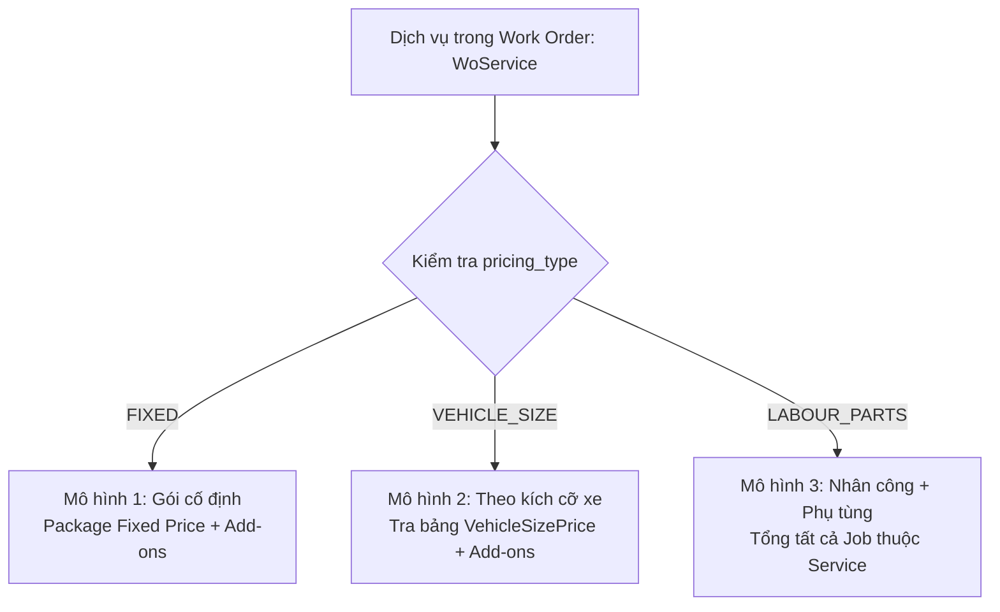

# QUY TẮC VÀ CÔNG THỨC TÍNH GIÁ CHI TIẾT (PRICING CALCULATION SPECIFICATION)

> **Mã tài liệu:** SPEC-FIN-02  
> **Dự án:** Trung tâm Dịch vụ Kỹ thuật Ô tô (Car Service Center)  
> **Áp dụng cho:** Báo giá (Quotation - UC-37, UC-38, UC-39), Hóa đơn (Invoice - UC-27, UC-16), và Thanh toán (Payment - UC-28)  
> **Căn cứ nghiệp vụ:** [BRD.md](BRD.md), [Requirement v2.md](Requirement%20v2.md), [DataDictionary.md](../database/design/DataDictionary.md)

---

> [!IMPORTANT]
> **TUYÊN BỐ QUY CHẾ TÀI CHÍNH CỐT LÕI (ZERO-TAX POLICY):**  
> Dịch vụ và phụ tùng của Trung tâm hiện tại **HOÀN TOÀN KHÔNG CHỊU BẤT KỲ THỨ THUẾ NÀO** (Thuế suất GTGT $r_{vat} = 0\%$, Tiền thuế phát sinh $Tax = 0$ VNĐ).  
> Do đó, toàn bộ công thức tính toán tại mọi phân hệ (Báo giá, Hóa đơn, Quyết toán) áp dụng nguyên tắc tài chính tối giản:  
> $$\mathbf{GrandTotal\ (Tổng\ thanh\ toán) = Subtotal\ (Tổng\ tiền\ trước\ giảm) - Discount\ (Chiết\ khấu)}$$

---

## 1. NGUYÊN TẮC CHUNG (GENERAL PRINCIPLES)

1. **Đơn vị tiền tệ & Độ chính xác:**
   - Đơn vị tiền tệ chính thức: **Việt Nam Đồng (VND)**.
   - Toàn bộ giá trị cuối cùng hiển thị trên UI, in trên phiếu Báo giá / Hóa đơn và lưu vào cơ sở dữ liệu (`quotations`, `invoices`) đều là **số nguyên không có phần lẻ thập phân**, được làm tròn theo quy tắc số học chuẩn (`Math.round()` / `HALF_UP`).
   - Các phép tính tỷ lệ phần trăm chiết khấu hoặc đơn giá phụ tùng trung bình trong kho được tính với độ chính xác số học cao trước khi làm tròn ở bước tổng hợp.

2. **Nguyên tắc đóng băng giá (Price Snapshot Rule - BR-QUO-01):**
   - Khi một Báo giá (`Quotation`) được tạo và gửi cho khách duyệt, hệ thống sẽ lưu **đơn giá đóng băng (`snapshot_unit_price`)** tại thời điểm đó vào bảng `quotation_lines`.
   - Nếu sau này Bảng giá danh mục (`Master Data`, `services`, `vehicle_size_prices`, `inventory_items`) có tăng hoặc giảm giá, các báo giá và hóa đơn trong quá khứ **tuyệt đối không bị thay đổi**.

3. **Cấu trúc phân tầng tính giá 6 cấp độ:**
   $$\begin{matrix}
   \text{Cấp 1: Chi phí Nhân công / Phụ tùng lẻ (Labour / Part Line)} \\
   \downarrow \\
   \text{Cấp 2: Tổng chi phí Công việc (Job Total)} \\
   \downarrow \\
   \text{Cấp 3: Tổng chi phí Dịch vụ (Service Total)} \\
   \downarrow \\
   \text{Cấp 4: Tổng chi phí Báo giá (Quotation Subtotal)} \\
   \downarrow \\
   \text{Cấp 5: Chiết khấu & Khuyến mại (Discount Amount)} \\
   \downarrow \\
   \mathbf{\text{Cấp 6: Tổng thanh toán cuối cùng (Grand Total)}}
   \end{matrix}$$

---

## 2. ĐỊNH NGHĨA BIẾN SỐ & BẢNG THUẬT NGỮ (VARIABLES & NOTATION)

| Ký hiệu | Tên tiếng Việt | Trường trong CSDL | Ý nghĩa & Đơn vị tính |
|---|---|---|---|
| $P_i$ | Đơn giá niêm yết dòng $i$ | `snapshot_unit_price` / `price` | Giá 1 đơn vị phụ tùng hoặc 1 gói công việc (VND) |
| $Q_i$ | Số lượng dòng $i$ | `quantity` / `planned_quantity` | Số lượng phụ tùng hoặc số lần thực hiện công việc |
| $A_i$ | Thành tiền dòng $i$ | `amount` | Thành tiền gốc của dòng $i = Q_i \times P_i$ (VND) |
| $D_{line, i}$ | Chiết khấu riêng dòng $i$ | `line_discount` (nếu có) | Giảm giá trực tiếp trên từng mặt hàng (VND) |
| $D_{order}$ | Chiết khấu tổng phiếu | `discount_amount` | Giảm giá trên toàn bộ Báo giá / Hóa đơn (VND) |
| $Subtotal$ | Tổng thành tiền trước chiết khấu | `subtotal` | Tổng tiền toàn bộ các hạng mục dịch vụ và phụ tùng (VND) |
| $GrandTotal$ | Tổng thanh toán sau chiết khấu | `grand_total` / `total_amount` | Số tiền thực thu cuối cùng từ khách hàng (VND) |
| $AmountDue$ | Số tiền còn nợ | `amount_due` | Số tiền khách còn phải thanh toán sau khi trừ tiền đã cọc/trả (VND) |

---

## 3. CHI TIẾT 3 MÔ HÌNH TÍNH GIÁ DỊCH VỤ (SERVICE PRICING MODELS)

Căn cứ theo trường `pricing_type` của bảng `services` (gồm 3 giá trị: `FIXED`, `VEHICLE_SIZE`, `LABOUR_PARTS`):



---

### MÔ HÌNH 1: GÓI CỐ ĐỊNH (FIXED PRICE PACKAGE)

Áp dụng cho các dịch vụ bảo dưỡng trọn gói theo cấp km định kỳ (bảo dưỡng 5.000km, 10.000km, 20.000km, 40.000km) hoặc các gói dịch vụ vệ sinh/khử mùi trọn gói.

#### 1.1. Quy tắc tính giá:
- Dịch vụ có một mức giá trọn gói niêm yết: $P_{fixed} = \text{service.fixed\_price}$.
- Các công việc và phụ tùng **tiêu chuẩn đã nằm trong gói** sẽ có đơn giá hiển thị là **0 đ** (hoặc đã được tính gộp trong giá gói).
- Nếu khách hàng yêu cầu thêm các hạng mục bổ sung ngoài gói (Add-on Extra):
  $$\text{Service Total} = P_{fixed} + \sum \text{Tiền công bổ sung} + \sum \text{Phụ tùng bổ sung}$$

#### 1.2. Ví dụ minh họa:
- Khách chọn gói: **"Bảo dưỡng định kỳ cấp 10.000 km"** (Giá gói $P_{fixed} = 850.000$ đ).
  - Đã bao gồm: Công kiểm tra 30 hạng mục (0 đ), Dầu động cơ 4L (0 đ), Lọc dầu (0 đ).
- Khách yêu cầu thay thêm ngoài gói: **1 Gạt mưa silicon** ($Q = 1, P = 250.000$ đ).
- **Tổng tiền dịch vụ:**
  $$\text{Service Total} = 850.000 + 250.000 = 1.100.000\text{ đ}$$

---

### MÔ HÌNH 2: THEO KÍCH CỠ / PHÂN KHÚC XE (VEHICLE SIZE PRICING)

Áp dụng cho các dịch vụ chăm sóc xe (Car Care, Detailing, Rửa xe công nghệ cao, Đánh bóng sơn, Phủ Ceramic, Dán phim cách nhiệt). Giá phụ thuộc trực tiếp vào kích thước xe của khách hàng lưu trong hồ sơ xe (`vehicle.vehicle_size`).

#### 2.1. Phân loại kích cỡ xe (Vehicle Size Class):

| Kích cỡ (`vehicle_size`) | Phân khúc xe phổ biến tại Việt Nam | Ví dụ tiêu biểu |
|---|---|---|
| **SMALL** | Xe cỡ nhỏ (Hatchback A, Sedan B) | Hyundai Grand i10, Kia Morning, Toyota Vios, Honda City, Hyundai Accent |
| **MEDIUM** | Xe cỡ trung (Sedan C, Crossover B/C) | Mazda 3, Kia Cerato/K3, Kia Seltos, Hyundai Creta, Toyota Corolla Cross |
| **LARGE** | Xe cỡ lớn (Sedan D, SUV 5-7 chỗ) | Toyota Camry, Mazda 6, Honda CR-V, Hyundai Tucson, Hyundai SantaFe |
| **SUV** | Full-size SUV, MPV 7 chỗ cỡ lớn | Toyota Fortuner, Ford Everest, Toyota Land Cruiser, Kia Carnival |
| **TRUCK** | Xe bán tải & Xe tải nhẹ chở hàng | Ford Ranger, Toyota Hilux, Mitsubishi Triton, Isuzu D-Max |

#### 2.2. Công thức tính giá:
1. Xác định kích thước xe từ thông tin xe của Work Order:
   $$size = \text{work\_order.vehicle.vehicle\_size}$$
2. Tra cứu đơn giá tương ứng trong bảng `vehicle_size_prices`:
   $$P_{size} = \text{Lookup}(service\_id, size)$$
3. Tổng tiền dịch vụ:
   $$\text{Service Total} = P_{size} + \sum \text{Dịch vụ phát sinh đi kèm}$$

#### 2.3. Ví dụ minh họa:
- Dịch vụ: **"Đánh bóng 3 bước & Phủ bóng sơn"**
  - Giá xe SMALL: $1.200.000$ đ
  - Giá xe MEDIUM: $1.500.000$ đ
  - Giá xe LARGE: $1.800.000$ đ
  - Giá xe SUV / TRUCK: $2.200.000$ đ
- Xe vào xưởng: **Ford Ranger** $\implies vehicle\_size = \text{TRUCK}$.
- Khách chọn thêm: **Tẩy ố kính chắn gió** (Add-on: $300.000$ đ).
- **Tổng tiền dịch vụ:**
  $$\text{Service Total} = 2.200.000 + 300.000 = 2.500.000\text{ đ}$$

---

### MÔ HÌNH 3: NHÂN CÔNG & PHỤ TÙNG THỰC TẾ (LABOUR & PARTS PRICING)

Áp dụng cho các công việc sửa chữa hư hỏng, khắc phục lỗi kỹ thuật, đại tu máy gầm phát sinh từ quá trình kiểm tra xe (`Inspection` -> `Finding` -> `Job`).

#### 3.1. Công thức chi tiết từng cấp:
1. **Tiền Nhân công cho 1 dòng công việc (Labour Amount - BR-PRI-01):**
   - **Quy tắc cố định (Fixed Price):** Tiền nhân công của mỗi dòng công việc (`JobLabour`) là **giá tiền khoán trọn gói cố định**, **TUYỆT ĐỐI KHÔNG TÍNH THEO GIỜ CÔNG (HOURLY RATE)**.
   - **Nguồn giá:** Khi Cố vấn dịch vụ chọn `JobType`, hệ thống tự động điền giá tiền công mặc định từ mẫu công việc tương ứng (`JobTemplate.price`).
   - **Quyền điều chỉnh:** Cố vấn dịch vụ (`Service Advisor`) có thể chỉnh sửa trực tiếp mức giá tiền công này trên Báo giá cho phù hợp với độ phức tạp hoặc tình trạng thực tế của xe:
     $$\mathbf{\text{Labour Amount} = \text{Fixed Labour Price}}$$
2. **Tiền Phụ tùng cho 1 dòng vật tư (Part Amount - CT-PRICE02):**
   - **Chính sách phụ tùng chính hãng:** 100% phụ tùng, dầu nhớt và vật tư tiêu hao bắt buộc phải được xuất từ kho của trung tâm (`inventory_items`). Trung tâm **KHÔNG chấp nhận phụ tùng do khách hàng tự mang từ ngoài vào** nhằm đảm bảo an toàn kỹ thuật, bảo hành dịch vụ và nguồn gốc xuất xứ.
   $$\mathbf{\text{Part Amount} = \text{Quantity} \times \text{Unit Selling Price}}$$
3. **Tổng tiền cho 1 Job (Job Total - CT-PRICE03):**
   $$\text{Job Total} = \sum_{j} \text{Labour Amount}_j + \sum_{k} \text{Part Amount}_k$$
4. **Tổng tiền Dịch vụ (Service Total - CT-PRICE04):**
   $$\text{Service Total} = \sum_{m} \text{Job Total}_m$$

#### 3.2. Ví dụ minh họa:
Dịch vụ sửa chữa hệ thống phanh gồm 2 Job:
- **Job 1: Thay má phanh trước**
  - Tiền công thay má phanh: $150.000$ đ.
  - Phụ tùng: 1 bộ má phanh chính hãng $\times 1.200.000$ đ = $1.200.000$ đ.
  - $\implies \text{Job 1 Total} = 150.000 + 1.200.000 = 1.350.000$ đ.
- **Job 2: Láng đĩa phanh trước (2 đĩa)**
  - Tiền công láng đĩa phanh: $300.000$ đ.
  - Phụ tùng / Vật tư: 1 chai xịt làm sạch thắng $\times 80.000$ đ = $80.000$ đ.
  - $\implies \text{Job 2 Total} = 300.000 + 80.000 = 380.000$ đ.
- **Tổng tiền dịch vụ phanh:**
  $$\text{Service Total} = 1.350.000 + 380.000 = 1.730.000\text{ đ}$$

---

## 4. CÔNG THỨC TỔNG HỢP BÁO GIÁ & CHIẾT KHẤU (QUOTATION & DISCOUNTS)

---

### 4.1. TỔNG TIỀN TRƯỚC CHIẾT KHẤU (SUBTOTAL - CT-PRICE05)

Tổng thành tiền của Báo giá là tổng của tất cả các dịch vụ trong phiếu công việc cộng với các phụ phí hợp lệ (nếu có):

$$Subtotal = \sum_{s=1}^{M} \text{Service Total}_s + \sum \text{Approved Fees}$$

*Trong đó phụ phí (`FEE`) có thể bao gồm: Phí cứu hộ cẩu kéo xe vào xưởng, Phí gia công tiện ren bên ngoài, Phí rửa xe dọn nội thất hỗ trợ.*

---

### 4.2. CÁC HÌNH THỨC CHIẾT KHẤU (DISCOUNT SCENARIOS)

Chiết khấu là khoản giảm trừ trực tiếp vào tổng tiền thanh toán của khách hàng.

#### Hình thức 1: Chiết khấu số tiền mặt cố định ($D_{fixed}$)
Áp dụng khi dùng Voucher giảm giá (vd: Giảm 100.000 đ cho khách hàng mới) hoặc giảm giá trực tiếp do Cố vấn đàm phán:
$$Discount = \min(D_{fixed}, Subtotal)$$
*(Quy tắc chặn: Chiết khấu không bao giờ vượt quá Subtotal để tránh tổng tiền âm)*.

#### Hình thức 2: Chiết khấu theo tỷ lệ phần trăm ($k\%$)
Áp dụng cho các chương trình khuyến mại (vd: Giảm 10% dịp lễ):
$$Discount = \text{round}\left(Subtotal \times \frac{k}{100}\right)$$

#### Hình thức 3: Chiết khấu theo Hạng thành viên (Loyalty Member Tier)

| Hạng thành viên (`MemberTier`) | Quy chế giảm giá | Công thức tính chiết khấu |
|---|---|---|
| **Standard (Khách mới / Vãng lai)** | Không giảm | $Discount = 0$ đ |
| **Silver (Bạc - Tích lũy > 10 triệu)** | Giảm 5% Tiền công (Labour) | $Discount = \text{round}(\text{Total Labour} \times 0.05)$ |
| **Gold (Vàng - Tích lũy > 30 triệu)** | Giảm 10% Tiền công (Labour) | $Discount = \text{round}(\text{Total Labour} \times 0.10)$ |
| **VIP / Diamond (Kim cương > 60 triệu)** | Giảm 15% Tiền công + 5% Phụ tùng | $Discount = \text{round}(\text{Total Labour} \times 0.15) + \text{round}(\text{Total Parts} \times 0.05)$ |

---

### 4.3. CÔNG THỨC TỔNG THANH TOÁN CUỐI CÙNG (GRAND TOTAL)

Do doanh nghiệp không thu thuế ($Tax = 0$):

$$\mathbf{GrandTotal = \max(0, Subtotal - Discount)}$$

---

## 5. CÁC TRƯỜNG HỢP VẬN HÀNH ĐẶC BIỆT (SPECIAL OPERATIONAL CASES)

---

### TRƯỜNG HỢP A: BÁO GIÁ PHÁT SINH BỔ SUNG (SUPPLEMENTARY QUOTATION)

Khi xe đang thi công, thợ tháo dỡ phát hiện hư hỏng mới, Cố vấn tạo **Báo giá bổ sung** (Supplementary Quotation liên kết `parent_quotation_id`).

1. **Báo giá chính thức ban đầu (Primary Quotation):**
   $$GrandTotal_{pri} = Subtotal_{pri} - Discount_{pri}$$
2. **Báo giá bổ sung lần thứ $k$ (Supplementary Quotation #$k$):**
   $$GrandTotal_{supp, k} = Subtotal_{supp, k} - Discount_{supp, k}$$
3. **Tổng chi phí lũy kế toàn bộ lần vào xưởng (Work Order Accumulated Total):**
   $$Subtotal_{total} = Subtotal_{pri} + \sum_{k} Subtotal_{supp, k}$$
   $$Discount_{total} = Discount_{pri} + \sum_{k} Discount_{supp, k}$$
   $$\mathbf{GrandTotal_{total} = Subtotal_{total} - Discount_{total}}$$

---

### TRƯỜNG HỢP B: HÀNG BẢO HÀNH & KHUYẾN MẠI MIỄN PHÍ (WARRANTY / FREE OF CHARGE)

Áp dụng khi bảo hành lỗi cho khách (trong thời hạn bảo hành dịch vụ) hoặc quà tặng miễn phí:
- Đơn giá: $P_i = 0$ đ.
- Thành tiền: $A_i = 0$ đ.
- Dòng trạng thái ghi rõ: `"Bảo hành (0 đ)"` hoặc `"Quà tặng khuyến mại (0 đ)"`.

---

### TRƯỜNG HỢP C: SỬA CHỮA BẢO HIỂM BỒI THƯỜNG (INSURANCE CLAIM)

Áp dụng cho sửa chữa đồng sơn tai nạn do Công ty bảo hiểm bồi thường:
1. **Tổng báo giá sửa chữa:** $GrandTotal$.
2. **Khoản tiền Khách hàng tự chi trả ($Total_{cust}$):**
   - Mức miễn thường (Deductible): Thường là $500.000$ đ/vụ.
   - Chế tài bảo hiểm (nếu có vi phạm điều khoản báo tai nạn): vd $10\%$ chi phí.
   - Khấu hao phụ tùng cũ đổi mới theo số năm sử dụng xe.
   $$Total_{cust} = \text{Mức miễn thường} + \text{Chế tài} + \text{Khấu hao}$$
3. **Khoản tiền Công ty bảo hiểm thanh toán ($Total_{ins}$):**
   $$Total_{ins} = GrandTotal - Total_{cust}$$

---

### TRƯỜNG HỢP D: ĐỐI SOÁT TỪ BÁO GIÁ SANG HÓA ĐƠN THỰC TẾ (QUOTATION VS INVOICE RECONCILIATION)

- **Báo giá (Quotation):** Lập dựa trên số lượng **dự kiến** ban đầu (`job_parts.planned_quantity`).
- **Hóa đơn (Invoice):** Xuất dựa trên số lượng **thực tế xuất dùng** (`job_parts.used_quantity` = `issued_quantity` - `returned_quantity`).
- Nếu số lượng dùng thực tế ít hơn dự kiến (ví dụ dự kiến thay 4 buzi nhưng chỉ hỏng và thay 2 buzi, 2 buzi nhập trả kho):
  $$\text{Invoice Line Amount} = \text{used\_quantity} \times \text{snapshot\_unit\_price}$$
  $$\text{Invoice Total} < \text{Quotation Grand Total}$$
  *(Hệ thống tự động điều chỉnh hóa đơn theo giá trị thực tế thấp hơn, bảo vệ quyền lợi khách hàng)*.

---

## 6. MA TRẬN TỔNG HỢP CÁC TRƯỜNG HỢP TÍNH GIÁ (PRICING DECISION MATRIX)

| Mã TH | Tình huống | Đầu vào nghiệp vụ | Công thức tính Subtotal | Công thức tính Discount | Công thức Grand Total |
|---|---|---|---|---|---|
| **TH-01** | Gói bảo dưỡng cố định | `Service.fixed_price`, Add-ons | $P_{fixed} + \sum \text{Add-ons}$ | Nhập tay hoặc $0$ đ | $Subtotal - Discount$ |
| **TH-02** | Dịch vụ theo cỡ xe | `Vehicle.vehicle_size`, Bảng giá cỡ | $P(size) + \sum \text{Add-ons}$ | Nhập tay hoặc $0$ đ | $Subtotal - Discount$ |
| **TH-03** | Sửa chữa máy gầm | Danh sách Job (Labour + Parts) | $\sum (\text{Labour} + \text{Parts})$ | Nhập tay hoặc $0$ đ | $Subtotal - Discount$ |
| **TH-04** | Giảm giá tiền mặt | $Subtotal$, Voucher tiền mặt $D_{fixed}$ | Tổng các dịch vụ | $\min(D_{fixed}, Subtotal)$ | $Subtotal - Discount$ |
| **TH-05** | Giảm giá % | $Subtotal$, Tỷ lệ $k\%$ | Tổng các dịch vụ | $\text{round}(Subtotal \times \frac{k}{100})$ | $Subtotal - Discount$ |
| **TH-06** | Khách VIP | Hạng thẻ thành viên | Tổng các dịch vụ | Theo bảng % Member Tier | $Subtotal - Discount$ |
| **TH-07** | Báo giá bổ sung | Báo giá phát sinh độc lập | $\sum \text{Hạng mục phát sinh}$ | Theo thỏa thuận bổ sung | $Subtotal_{supp} - Discount_{supp}$ |
| **TH-08** | Bảo hành xưởng | Lỗi kỹ thuật bảo hành | $0$ đ | $0$ đ | $0$ đ |
| **TH-09** | Xe bảo hiểm | Hồ sơ bồi thường bảo hiểm | Tổng chi phí duyệt | Miễn thường + Chế tài | Tách Bảo hiểm / Khách trả |

---

## 7. CODE MẪU CHUẨN TYPESCRIPT SỬ DỤNG TRONG CODEBASE (REFERENCE IMPLEMENTATION)

Dưới đây là module logic tính toán hoàn chỉnh (Zero-tax), sẵn sàng tích hợp trực tiếp vào `quotation.service.ts` và `work-order.service.ts`:

```typescript
export interface PricingLineItem {
  id?: number;
  lineType: 'PACKAGE' | 'LABOUR' | 'PART' | 'MATERIAL' | 'FEE';
  description: string;
  quantity: number;
  unitPrice: number;
}

export interface PricingCalculationInput {
  lines: PricingLineItem[];
  discountAmount?: number;     // Chiết khấu tiền mặt cố định
  discountPercent?: number;    // Chiết khấu theo % (0 - 100)
}

export interface PricingCalculationResult {
  subtotal: number;            // Tổng tiền gốc
  discountAmount: number;      // Tiền chiết khấu
  grandTotal: number;          // Tổng tiền thực thu (Không thuế)
  lines: Array<PricingLineItem & { amount: number }>;
}

/**
 * Hàm tính toán giá trị Báo giá / Hóa đơn chuẩn xác (Quy chế Không Thuế)
 */
export function calculatePricingTotals(input: PricingCalculationInput): PricingCalculationResult {
  // 1. Tính thành tiền từng dòng: Amount = Quantity * UnitPrice
  let subtotal = 0;
  const calculatedLines = input.lines.map((line) => {
    const qty = Math.max(0, Number(line.quantity) || 0);
    const price = Math.max(0, Number(line.unitPrice) || 0);
    const amount = Math.round(qty * price);
    subtotal += amount;

    return {
      ...line,
      quantity: qty,
      unitPrice: price,
      amount,
    };
  });

  // 2. Tính tiền chiết khấu (Ưu tiên % nếu có, sau đó đến số tiền mặt)
  let discount = 0;
  if (input.discountPercent && input.discountPercent > 0) {
    const validPercent = Math.min(Math.max(0, input.discountPercent), 100);
    discount = Math.round((subtotal * validPercent) / 100);
  } else if (input.discountAmount && input.discountAmount > 0) {
    discount = Math.round(input.discountAmount);
  }

  // 3. Quy tắc chặn chiết khấu không vượt quá Subtotal
  discount = Math.min(discount, subtotal);

  // 4. Tổng thanh toán cuối cùng (GrandTotal = Subtotal - Discount, KHÔNG CÓ THUẾ)
  const grandTotal = Math.max(0, subtotal - discount);

  return {
    subtotal,
    discountAmount: discount,
    grandTotal,
    lines: calculatedLines,
  };
}
```

---

## 8. TIÊU CHUẨN KIỂM ĐỊNH TÀI CHÍNH (VERIFICATION CRITERIA)

Mọi bản ghi Báo giá (`quotations`) hoặc Hóa đơn (`invoices`) trước khi ghi vào cơ sở dữ liệu phải thỏa mãn bộ 4 ràng buộc toàn vẹn tài chính sau:

1. **Bảo toàn số học:**
   $$\text{subtotal} \equiv \sum_{i} \text{line.amount}$$
2. **Chiết khấu hợp lệ:**
   $$0 \le \text{discount\_amount} \le \text{subtotal}$$
3. **Cân bằng phương trình thanh toán không thuế:**
   $$\mathbf{grand\_total \equiv subtotal - discount\_amount}$$
4. **Không phát sinh thuế trong CSDL:**
   $$\text{tax\_rate} = 0.0000, \quad \text{tax\_amount} = 0.00$$
