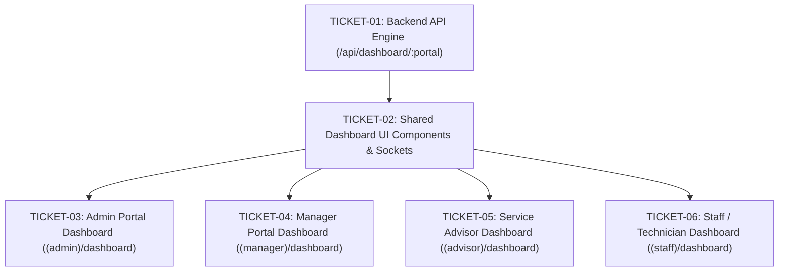

# TICKETS-MULTI-PORTAL-DASHBOARD: Kế Hoạch Thực Thi Theo Kỹ Năng Tracer-Bullet

> **Dựa trên đặc tả:** [`SPEC-MULTI-PORTAL-DASHBOARD.md`](SPEC-MULTI-PORTAL-DASHBOARD.md)  
> **Nguyên tắc:** Mỗi ticket là một lát cắt dọc (Vertical Slice) hoàn chỉnh, có lệnh kiểm thử và tiêu chí nghiệm thu rõ ràng.

---

---

### 🎫 TICKET-01: Xây dựng Backend Aggregation Engine & Unified Controller
- **Mục tiêu:** Tạo controller `/api/dashboard/:portal` và service `multi-dashboard.service.ts` truy vấn dữ liệu thực 100% từ Prisma cho cả 4 vai trò (`admin`, `manager`, `sa`, `staff`).
- **Phạm vi file:**
  - `src/backend/src/services/multi-dashboard.service.ts` (mới)
  - `src/backend/src/controllers/dashboard.controller.ts` (cập nhật)
  - `src/backend/src/routes/dashboard.routes.ts` (cập nhật)
  - `src/backend/src/constants/dashboard.constant.ts` (mới)
- **Tiêu chí nghiệm thu (Acceptance Criteria):**
  - Truy vấn đúng thời gian (today, 7days, 30days, this_month, custom).
  - Lọc theo scope `my` (lấy theo user.employee.id) và `workshop` (toàn xưởng).
  - Phản hồi đúng chuẩn `API_CONVENTION.md` (`{ success: true, data: { kpis, charts, actionableList } }`).
- **Lệnh xác thực:**
  - `Set-Location src/backend; npx tsc --noEmit; npm test`

---

### 🎫 TICKET-02: Xây dựng Bộ UI Components & Custom Hooks Tương Tác Dùng Chung
- **Mục tiêu:** Tạo các component dashboard cốt lõi theo chuẩn `interactive-dashboard-builder` và `operational-dashboard-craft`.
- **Phạm vi file:**
  - `src/frontend/apps/internal-web/src/components/dashboard/KPICard.tsx`
  - `src/frontend/apps/internal-web/src/components/dashboard/DashboardFilterBar.tsx`
  - `src/frontend/apps/internal-web/src/components/dashboard/DashboardTrendChart.tsx`
  - `src/frontend/apps/internal-web/src/components/dashboard/DashboardStatusDonut.tsx`
  - `src/frontend/apps/internal-web/src/components/dashboard/DashboardActionTable.tsx`
  - `src/frontend/apps/internal-web/src/hooks/useDashboardData.ts` (quản lý state, socket live-pulse và polling fallback)
- **Tiêu chí nghiệm thu:**
  - Định dạng VNĐ chuẩn (`tỷ ₫`, `tr ₫`).
  - Hỗ trợ đầy đủ 4-State UI (Loading Skeleton, Empty State, Error Retry, Data).
  - Lọc chéo mượt mà (Cross-filtering) khi click vào biểu đồ hoặc trạng thái.
- **Lệnh xác thực:**
  - `Set-Location src/frontend/apps/internal-web; npx tsc --noEmit`

---

### 🎫 TICKET-03: Triển khai Dashboard Quản Trị Viên (Admin Portal)
- **Mục tiêu:** Xây dựng trang Dashboard trung tâm cho Quản trị viên (`(admin)/dashboard`), kết nối dữ liệu thực về IAM/RBAC, nhân sự, bảng giá dịch vụ, và tình trạng hạ tầng.
- **Phạm vi file:**
  - `src/frontend/apps/internal-web/src/app/(admin)/dashboard/page.tsx` (mới)
  - `src/frontend/apps/internal-web/src/app/(admin)/layout.tsx` (thêm link Tổng quan / Dashboard vào nav bar)
- **Tiêu chí nghiệm thu:**
  - Hiển thị 4 thẻ KPI: Tổng tài khoản & tỷ lệ hoạt động, Nhân sự kỹ thuật theo ca, Số lượng dịch vụ niêm yết, Uptime & SLA.
  - Biểu đồ phân bổ vai trò RBAC & cơ cấu danh mục dịch vụ.
  - Bảng tài khoản mới tạo và nhật ký phân quyền gần nhất.
- **Lệnh xác thực:**
  - `Set-Location src/frontend/apps/internal-web; npx tsc --noEmit`

---

### 🎫 TICKET-04: Nâng Cấp Toàn Diện Dashboard Giám Đốc Dịch Vụ (Manager Portal)
- **Mục tiêu:** Hiện đại hóa trang `(manager)/dashboard` bằng cách chuyển đổi sang dùng API dữ liệu thực `/api/dashboard/manager`, bổ sung bộ lọc thời gian và tính năng lọc chéo.
- **Phạm vi file:**
  - `src/frontend/apps/internal-web/src/app/(manager)/dashboard/page.tsx` (tái cấu trúc)
- **Tiêu chí nghiệm thu:**
  - Biểu đồ sóng doanh thu thực tế (Area Wave) theo ngày/tuần/tháng.
  - Thống kê tỷ lệ hoàn thành, thời gian xử lý lệnh trung bình (Cycle time).
  - Hàng đợi các lệnh sửa chữa quá hạn hoặc chờ duyệt giá cần can thiệp ngoại lệ.
  - Click vào trạng thái trên Donut/Bar tự động lọc danh sách Work Order bên dưới.
- **Lệnh xác thực:**
  - `Set-Location src/frontend/apps/internal-web; npx tsc --noEmit`

---

### 🎫 TICKET-05: Triển khai Dashboard Cố Vấn Dịch Vụ (Service Advisor)
- **Mục tiêu:** Xây dựng màn hình điều hành tập trung cho Cố vấn dịch vụ, theo dõi đường ống báo giá, xe đang kiểm tra, và xe sẵn sàng bàn giao.
- **Phạm vi file:**
  - `src/frontend/apps/internal-web/src/app/(advisor)/advisor/page.tsx` (hoặc `(advisor)/dashboard/page.tsx`)
  - `src/frontend/apps/internal-web/src/app/(advisor)/layout.tsx`
- **Tiêu chí nghiệm thu:**
  - KPI: Báo giá chờ duyệt, Xe đang kiểm tra, Xe sẵn sàng nghiệm thu QC, Xe đã thanh toán chờ bàn giao (`FINANCIAL_CLEARED`).
  - Hỗ trợ chuyển đổi: "Hồ sơ do tôi phụ trách" (My Scope) vs "Toàn bộ xưởng".
  - Danh sách hồ sơ xe ưu tiên xử lý trong ngày.
- **Lệnh xác thực:**
  - `Set-Location src/frontend/apps/internal-web; npx tsc --noEmit`

---

### 🎫 TICKET-06: Triển khai Dashboard Kỹ Thuật Viên & Tiếp Nhận (Staff Portal)
- **Mục tiêu:** Xây dựng trang Dashboard vận hành ca cho Lễ tân và Kỹ thuật viên sửa chữa.
- **Phạm vi file:**
  - `src/frontend/apps/internal-web/src/app/(dashboard)/staff/dashboard/page.tsx`
  - `src/frontend/apps/internal-web/src/app/(dashboard)/staff/layout.tsx` (hoặc nav menu tương ứng)
- **Tiêu chí nghiệm thu:**
  - Đối với Lễ tân: Lượng xe chờ tiếp nhận (Intake Queue), lịch hẹn hôm nay.
  - Đối với Kỹ thuật viên: Công việc được giao (My Jobs), trạng thái bắt đầu/tạm dừng/hoàn thành, cảnh báo thiếu phụ tùng.
  - Hỗ trợ chuyển đổi nhanh chế độ xem cá nhân / xem phân chuyền xưởng.
- **Lệnh xác thực:**
  - `Set-Location src/frontend/apps/internal-web; npx tsc --noEmit`
