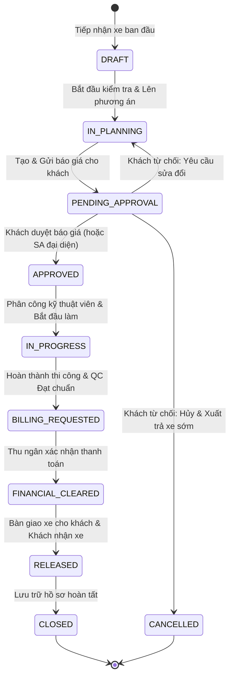

# KẾ HOẠCH & MA TRẬN PHÂN QUYỀN ACTION CRUD THEO TRẠNG THÁI PHIẾU CÔNG VIỆC (WORK ORDER)

> **Mã tài liệu:** SPEC-WO-CRUD-MATRIX-2026  
> **Phiên bản:** 1.0.0 (Áp dụng cho Web Cố vấn/Nội bộ & Web Khách hàng)  
> **Mục tiêu:** Định nghĩa chuẩn hóa trạng thái kích hoạt (Enable) / Vô hiệu hóa (Disable) của toàn bộ các hành động Tạo - Đọc - Sửa - Xóa (CRUD) trên các thực thể thuộc quy trình bảo dưỡng - sửa chữa xe ô tô theo vòng đời 10 trạng thái của Phiếu công việc.

---

## 1. NGUYÊN TẮC THIẾT KẾ CỐT LÕI (CORE PRINCIPLES)

1. **Nguyên tắc đóng băng Snapshot hợp đồng (Quotation Immutability):**
   - Khi Báo giá đã được Khách hàng phê duyệt (`APPROVED`), toàn bộ nội dung dịch vụ, công việc (`Job`), và định mức phụ tùng (`JobPart`) gắn với báo giá đó trở thành **Hợp đồng cam kết bất biến**.
   - Tuyệt đối cấm xóa (`DELETE`) hoặc chỉnh sửa giảm giá trị các công việc đã chốt để tránh xung đột quyền lợi và sai lệch kế hoạch kho.
2. **Nguyên tắc Quản lý phát sinh (Change Management via Supplementary Quote):**
   - Trong quá trình thi công (`IN_PROGRESS`), nếu phát hiện lỗi mới hoặc khách hàng yêu cầu thêm hạng mục, hệ thống **không sửa đè vào hợp đồng gốc**, mà bắt buộc tạo **Báo giá bổ sung (`SUPPLEMENTARY`)** kèm theo mã liên kết `parent_quotation_id`.
   - Báo giá bổ sung phải được Khách hàng phê duyệt trước khi phụ tùng được xuất kho và kỹ thuật viên bắt đầu làm hạng mục phát sinh đó.
3. **Nguyên tắc Phòng vệ đa tầng (Defense in Depth):**
   - **Tầng Giao diện (Frontend):** Ẩn hoặc disable nút bấm kèm tooltip giải thích lý do (UX minh bạch, người dùng không bấm nhầm).
   - **Tầng Nghiệp vụ (Backend Service/Guard):** Mọi API endpoint nhận thao tác CRUD phải kiểm tra `workOrder.status` và trạng thái thực thể con, trả mã lỗi HTTP 400 nếu vi phạm ràng buộc trạng thái.

---

## 2. DANH MỤC 10 TRẠNG THÁI CỦA PHIẾU CÔNG VIỆC (`WorkOrderStatus`)



---

## 3. BẢNG MA TRẬN PHÂN QUYỀN THAO TÁC CRUD THEO TRẠNG THÁI

> **Ký hiệu quy ước:**
> - 🟢 **ENABLE:** Cho phép thực hiện đầy đủ.
> - 🟡 **CONDITIONAL:** Cho phép có điều kiện (ví dụ: chỉ cho phép với hạng mục mới phát sinh chưa chốt báo giá).
> - 🔴 **DISABLED:** Bị khóa chặt (nút bị ẩn/vô hiệu hóa trên UI, Backend chặn trả lỗi 400).
> - ⚪ **N/A:** Không áp dụng ở trạng thái này.

| Nhóm chức năng | Thao tác CRUD | DRAFT | IN_PLANNING | PENDING_APPROVAL | APPROVED | IN_PROGRESS | BILLING_REQ | FIN_CLEARED | RELEASED / CLOSED | CANCELLED |
| :--- | :--- | :---: | :---: | :---: | :---: | :---: | :---: | :---: | :---: | :---: |
| **1. Tiếp nhận (Check-In)** | Tạo biên bản / Ghi ODO, Xăng | 🟢 | 🟢 | 🔴 | 🔴 | 🔴 | 🔴 | 🔴 | 🔴 | 🔴 |
| | Sửa đồ đạc, hiện trạng xe | 🟢 | 🟢 | 🔴 | 🔴 | 🔴 | 🔴 | 🔴 | 🔴 | 🔴 |
| | Khách xác nhận bàn giao xe | 🟢 | 🟢 | 🟢 | 🔴 (Tự động chốt) | 🔴 | 🔴 | 🔴 | 🔴 | 🔴 |
| **2. Khám xe (Inspection)** | Thêm điểm đánh dấu (Marker) | 🟢 | 🟢 | 🔴 | 🔴 | 🟡 *(Lỗi phát sinh mới)* | 🔴 | 🔴 | 🔴 | 🔴 |
| | Sửa ghi chú / Upload ảnh vết lỗi | 🟢 | 🟢 | 🔴 | 🔴 | 🟡 *(Lỗi phát sinh mới)* | 🔴 | 🔴 | 🔴 | 🔴 |
| | Xóa vết lỗi (Delete Finding) | 🟢 | 🟢 | 🔴 | 🔴 | 🔴 | 🔴 | 🔴 | 🔴 | 🔴 |
| **3. Dịch vụ (WoService)** | Thêm Gói/Dịch vụ mới | 🟢 | 🟢 | 🔴 | 🔴 | 🟡 *(Để làm báo giá bổ sung)* | 🔴 | 🔴 | 🔴 | 🔴 |
| | Sửa tên/phân loại dịch vụ | 🟢 | 🟢 | 🔴 | 🔴 | 🔴 | 🔴 | 🔴 | 🔴 | 🔴 |
| | Xóa Dịch vụ chưa có công việc | 🟢 | 🟢 | 🔴 | 🔴 | 🔴 | 🔴 | 🔴 | 🔴 | 🔴 |
| **4. Công việc (Job)** | Thêm Job kỹ thuật mới | 🟢 | 🟢 | 🔴 | 🔴 | 🟡 *(Job bổ sung)* | 🔴 | 🔴 | 🔴 | 🔴 |
| | Sửa nội dung / Thời lượng Job | 🟢 | 🟢 | 🔴 | 🔴 | 🔴 | 🔴 | 🔴 | 🔴 | 🔴 |
| | Sắp xếp thứ tự Job | 🟢 | 🟢 | 🔴 | 🔴 | 🔴 | 🔴 | 🔴 | 🔴 | 🔴 |
| | **XÓA JOB (Delete Job)** | 🟢 | 🟢 | 🔴 | 🔴 **(CHẶN)** | 🔴 **(CHẶN)** | 🔴 **(CHẶN)** | 🔴 **(CHẶN)** | 🔴 **(CHẶN)** | 🔴 **(CHẶN)** |
| **5. Phụ tùng (JobPart)** | Thêm phụ tùng vào Job | 🟢 | 🟢 | 🔴 | 🔴 | 🟡 *(Cho Job bổ sung)* | 🔴 | 🔴 | 🔴 | 🔴 |
| | Sửa số lượng phụ tùng | 🟢 | 🟢 | 🔴 | 🔴 | 🔴 | 🔴 | 🔴 | 🔴 | 🔴 |
| | Xóa phụ tùng khỏi Job | 🟢 | 🟢 | 🔴 | 🔴 **(CHẶN)** | 🔴 **(CHẶN)** | 🔴 **(CHẶN)** | 🔴 **(CHẶN)** | 🔴 **(CHẶN)** | 🔴 **(CHẶN)** |
| | Yêu cầu xuất kho (Issue) | 🔴 | 🔴 | 🔴 | 🟢 | 🟢 | 🔴 | 🔴 | 🔴 | 🔴 |
| | Trả phụ tùng dư về kho (Return) | 🔴 | 🔴 | 🔴 | 🔴 | 🟢 | 🟢 | 🔴 | 🔴 | 🔴 |
| **6. Báo giá (Quotation)** | Tạo Báo giá chính (PRIMARY) | 🔴 | 🟢 | 🔴 | 🔴 | 🔴 | 🔴 | 🔴 | 🔴 | 🔴 |
| | Cập nhật Chiết khấu / Giảm giá | 🔴 | 🟢 | 🟢 | 🔴 | 🔴 | 🔴 | 🔴 | 🔴 | 🔴 |
| | Gửi báo giá cho khách (SENT) | 🔴 | 🟢 | 🔴 | 🔴 | 🔴 | 🔴 | 🔴 | 🔴 | 🔴 |
| | Khách hàng Duyệt báo giá | 🔴 | 🔴 | 🟢 | 🔴 | 🔴 | 🔴 | 🔴 | 🔴 | 🔴 |
| | Khách từ chối: Điều chỉnh | 🔴 | 🔴 | 🟢 | 🔴 | 🔴 | 🔴 | 🔴 | 🔴 | 🔴 |
| | Khách từ chối: Hủy làm xe | 🔴 | 🔴 | 🟢 | 🔴 | 🔴 | 🔴 | 🔴 | 🔴 | 🔴 |
| | **Tạo Báo giá bổ sung (SUPP)** | 🔴 | 🔴 | 🔴 | 🔴 | 🟢 *(Khi có lỗi mới)* | 🔴 | 🔴 | 🔴 | 🔴 |
| **7. Phân công & Thi công** | Phân công KTV (Assign Tech) | 🔴 | 🔴 | 🔴 | 🟢 | 🟢 | 🔴 | 🔴 | 🔴 | 🔴 |
| | Bắt đầu làm việc (Start Job) | 🔴 | 🔴 | 🔴 | 🟢 | 🟢 | 🔴 | 🔴 | 🔴 | 🔴 |
| | Hoàn thành công việc (Complete) | 🔴 | 🔴 | 🔴 | 🔴 | 🟢 | 🔴 | 🔴 | 🔴 | 🔴 |
| **8. Nghiệm thu (QC)** | Lập phiếu kiểm tra QC | 🔴 | 🔴 | 🔴 | 🔴 | 🟢 *(Sau khi Job xong)* | 🔴 | 🔴 | 🔴 | 🔴 |
| | Đánh giá Pass / Fail tiêu chí | 🔴 | 🔴 | 🔴 | 🔴 | 🟢 | 🔴 | 🔴 | 🔴 | 🔴 |
| | Tạo Rework Job (khi Fail QC) | 🔴 | 🔴 | 🔴 | 🔴 | 🟢 | 🔴 | 🔴 | 🔴 | 🔴 |
| **9. Thu ngân & Hóa đơn** | Tạo hóa đơn (Generate Invoice) | 🔴 | 🔴 | 🔴 | 🔴 | 🔴 | 🟢 | 🔴 | 🔴 | 🔴 |
| | Thu tiền / Xác nhận thanh toán | 🔴 | 🔴 | 🔴 | 🔴 | 🔴 | 🟢 | 🔴 | 🔴 | 🔴 |
| **10. Bàn giao xe (Release)** | Xuất trả xe sớm (Early Release) | 🔴 | 🔴 | 🔴 | 🔴 | 🔴 | 🔴 | 🔴 | 🔴 | 🟢 *(Hủy dịch vụ)* |
| | Bàn giao xe xuất xưởng chuẩn | 🔴 | 🔴 | 🔴 | 🔴 | 🔴 | 🔴 | 🟢 *(Đã thanh toán)* | 🔴 | 🔴 |

---

## 4. CHI TIẾT CÁC KỊCH BẢN ĐẶC BIỆT (SPECIAL SCENARIOS)

### Kịch bản 1: Khách hàng từ chối báo giá & Báo giá lại (Re-Quotation Flow)
1. **Trạng thái kích hoạt:** Work Order đang ở `PENDING_APPROVAL`.
2. **Khách hàng thao tác:** Chọn *"Yêu cầu điều chỉnh phương án dịch vụ"* (`REVISE`) kèm lý do (ví dụ: *"Bỏ bớt dịch vụ đánh bóng, đổi gạt mưa loại thường"*).
3. **Chuyển đổi hệ thống:**
   - Báo giá cũ chuyển `REJECTED`.
   - Work Order tự động quay lui về `IN_PLANNING`.
   - Mở khóa (`Enable`) lại toàn bộ quyền chỉnh sửa, thêm/bớt Job và Phụ tùng cho Cố vấn dịch vụ.
4. **Cố vấn dịch vụ thao tác:**
   - Điều chỉnh hạng mục theo ý kiến khách.
   - Nhấn **Tạo báo giá mới** (hệ thống sinh `QUO-...-02` với `version: 2`).
   - Nhấn **Gửi báo giá** -> Work Order chuyển lại `PENDING_APPROVAL`.
5. **Hiển thị phía Khách hàng:**
   - Khách xem được Báo giá v2 (Chờ duyệt).
   - Có thanh chuyển đổi để xem lại Báo giá v1 (Đã từ chối kèm lý do).
   - Xem được Tổng chi phí mới nhất.

### Kịch bản 2: Báo giá bổ sung trong quá trình thi công (Supplementary Quotation Flow)
1. **Trạng thái kích hoạt:** Work Order đang ở `IN_PROGRESS` (Báo giá chính v1 đã `APPROVED`).
2. **Thợ tháo dỡ phát hiện hư hỏng:**
   - Cố vấn tạo điểm khám xe mới (Finding) -> Gắn thêm `Job` mới và `JobPart` mới.
   - Các Job/Part cũ đã duyệt **bị khóa cứng**, không thể xóa/sửa.
   - Cố vấn nhấn **Tạo báo giá bổ sung (`SUPPLEMENTARY`)**.
3. **Xử lý Báo giá:**
   - Hệ thống tạo báo giá bổ sung (ví dụ `QUO-...-02`, loại `SUPPLEMENTARY`, liên kết `parent_quotation_id`).
   - Báo giá này chỉ tính tiền các mục mới phát sinh.
4. **Trang Khách hàng (Customer Web):**
   - Banner cảnh báo: *"Có báo giá bổ sung cần quý khách phê duyệt"*.
   - Khách mở modal xem báo giá:
     - Tab mặc định: Hiển thị Báo giá bổ sung kèm chi phí phát sinh đợt này.
     - Dòng cộng dồn tài chính: *"Đã duyệt trước đó: 2.500.000 đ | Phát sinh đợt này: 600.000 đ | Tổng cả đơn: 3.100.000 đ"*.
     - Tab *"Tổng hợp toàn bộ xe"*: Liệt kê chi tiết trọn gói mọi dịch vụ & phụ tùng của xe từ đầu đến hiện tại.

### Kịch bản 3: Chặn xóa Job khi đã duyệt báo giá (Job Deletion Protection)
1. **Quy tắc:**
   - Nếu Work Order ở trạng thái $\in$ `['APPROVED', 'IN_PROGRESS', 'BILLING_REQUESTED', 'FINANCIAL_CLEARED', 'RELEASED', 'CLOSED']`:
     - **UI Tab Kiểm tra xe (VehicleInspectionPanel):** Ẩn hoàn toàn icon/nút xóa (Close `X`) ở danh sách Job gắn với vết lỗi.
     - **UI Tab Công việc (TabJob):** Ẩn icon thùng rác xóa Job ở bảng danh sách.
     - **UI Modal điều phối (CreateDispatchJobModal):** Ẩn nút *"Xóa việc"*.
     - **API Backend (`DELETE /api/work-orders/:id/jobs/:jobId`):** Kiểm tra Work Order status và cờ duyệt báo giá. Ném ngoại lệ lỗi:
       ```json
       {
         "success": false,
         "message": "Không thể xóa công việc khi báo giá đã được khách hàng phê duyệt. Mọi điều chỉnh công việc sau khi duyệt cần thông qua quy trình Báo giá bổ sung."
       }
       ```

---

## 5. KẾ HOẠCH TRIỂN KHAI & KIỂM THỬ (TEST PLAN)

| Mã Test Case | Hạng mục kiểm tra | Dữ liệu đầu vào | Kết quả kỳ vọng |
| :--- | :--- | :--- | :--- |
| **TC-CRUD-01** | Xóa Job khi WO ở `IN_PLANNING` | Job ở trạng thái `PLANNED`, chưa có báo giá `APPROVED` | Xóa thành công, phục hồi vết lỗi về `NEW` |
| **TC-CRUD-02** | Xóa Job khi WO ở `APPROVED` | Khách vừa duyệt báo giá, Job ở trạng thái `PLANNED` | Nút xóa bị ẩn trên UI; gọi API trực tiếp trả HTTP 400 |
| **TC-CRUD-03** | Xóa Job khi WO ở `IN_PROGRESS` | Xe đang sửa trong xưởng | Nút xóa bị ẩn; API trả lỗi từ chối xóa |
| **TC-CRUD-04** | Xem báo giá bổ sung trên Khách hàng | WO có 1 báo giá chính đã duyệt + 1 báo giá bổ sung đang gửi | Khách chuyển đổi được giữa Báo giá bổ sung, Báo giá gốc, và xem Tổng hợp toàn bộ xe |
| **TC-CRUD-05** | Báo giá lại sau khi từ chối | Khách từ chối với lý do `REVISE`, SA sửa và gửi báo giá v2 | Khách xem được báo giá v2 mới nhất và lịch sử báo giá v1 |

