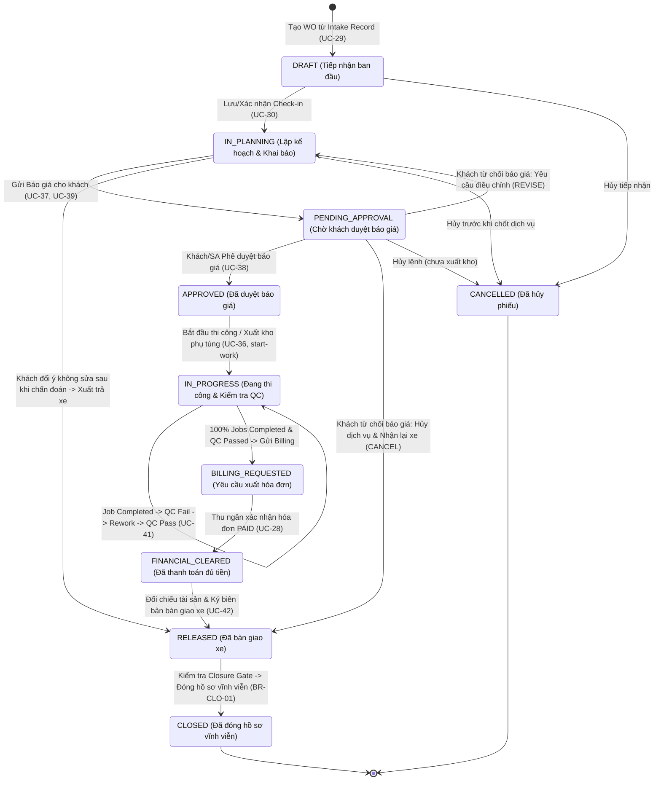
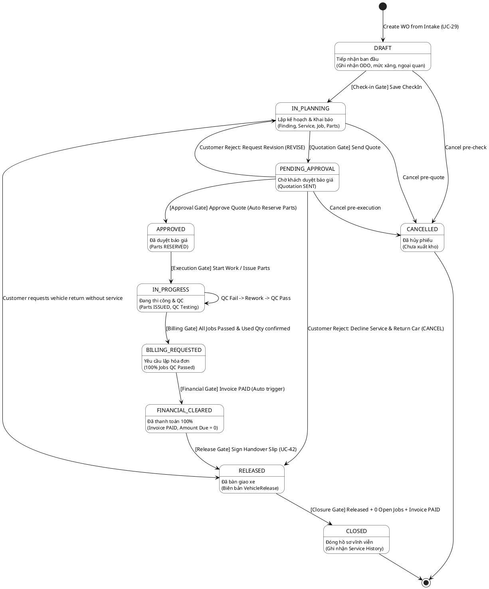

# QUY TRÌNH CHUYỂN ĐỔI TRẠNG THÁI PHIẾU CÔNG VIỆC (WORK ORDER STATUS TRANSITION SPECIFICATION)

> **Tài liệu chuẩn hóa nghiệp vụ & kiến trúc kỹ thuật hệ thống Car Service Center**  
> **Áp dụng cho:** Backend Services, Frontend Workspaces (Advisor, Customer, Front Desk, Manager), Database & QA Test Cases  
> **Mã quy chuẩn:** `SPEC-WO-STATUS-01` | **Phiên bản:** 2.0 (Cập nhật quy trình duyệt/từ chối báo giá & xuất trả xe)

---

## 1. TỔNG QUAN & TRIẾT LÝ VẬN HÀNH (OVERVIEW & ARCHITECTURAL PHILOSOPHY)

Trong kiến trúc hệ thống Trung tâm dịch vụ Ô tô, **Phiếu công việc (Work Order)** là **hồ sơ trung tâm (Single Source of Truth)** quản lý toàn bộ vòng đời của một lượt xe vào xưởng (Vehicle Visit).

Work Order liên kết, điều phối và phản ánh trạng thái của 8 thực thể vệ tinh:
1. **Intake Record & Appointment**: Hồ sơ tiếp nhận ban đầu tại quầy hoặc xe cứu hộ/đặt lịch.
2. **Check-In**: Ghi nhận ODO, mức nhiên liệu, ngoại quan vết xước, đồ đạc và chữ ký khách hàng.
3. **Inspection & Finding**: Kết quả kiểm tra chẩn đoán và các điểm hư hỏng đánh dấu trên sơ đồ 2D.
4. **WoService & Job**: Danh mục dịch vụ và các bước công việc sửa chữa chi tiết của kỹ thuật viên.
5. **JobPart**: Vật tư/phụ tùng dự kiến, giữ chỗ trong kho (`RESERVED`), xuất kho (`ISSUED`), thực dùng (`USED`) hoặc nhập trả (`RETURNED`).
6. **Quotation**: Báo giá sơ bộ, chiết khấu, thuế VAT và quyết định phê duyệt của khách hàng.
7. **Invoice & Payment**: Hóa đơn thanh toán, đối soát công nợ và quyết toán tài chính.
8. **VehicleRelease**: Biên bản kiểm tra đối chiếu tài sản, bàn giao và xuất xưởng.

```
+-----------------------------------------------------------------------------------+
|                              WORK ORDER LIFECYCLE                                 |
|                                                                                   |
|  [Intake Queue]                                                                   |
|         |                                                                         |
|         v                                                                         |
|     +-------+       +-------------+       +------------------+       +----------+ |
|     | DRAFT | ----> | IN_PLANNING | ----> | PENDING_APPROVAL | ----> | APPROVED | |
|     +-------+       +-------------+       +------------------+       +----------+ |
|                            ^                        |                      |      |
|                            | (Revise Quote)         | (Reject & Cancel)    v      |
|                            +------------------------+                +-------------+
|                                                     |                | IN_PROGRESS |
|                                                     |                +-------------+
|                                                     |                      |      |
|                                                     v (Early Release)      v      |
|                                                  +----------+       +-------------------+
|                                                  | RELEASED | <---- | BILLING_REQUESTED |
|                                                  +----------+       +-------------------+
|                                                       |                      |      |
|                                                       v (Closure Gate)       v      |
|                                                   +--------+        +-------------------+
|                                                   | CLOSED | <===== | FINANCIAL_CLEARED |
|                                                   +--------+        +-------------------+
+-----------------------------------------------------------------------------------+
```

---

## 2. DANH MỤC 10 TRẠNG THÁI WORK ORDER (`enum WorkOrderStatus`)

Hệ thống định nghĩa chính xác **10 trạng thái** bất biến trong cơ sở dữ liệu (`Prisma enum WorkOrderStatus`):

| STT | Trạng thái (`DB Enum`) | Tên tiếng Việt | Nhãn hiển thị UI | Giai đoạn vòng đời | Định nghĩa nghiệp vụ |
|:---:|:---|:---|:---|:---|:---|
| 1 | **`DRAFT`** | Khởi tạo / Tiếp nhận | Tiếp nhận | Tiếp nhận ban đầu | Work Order vừa được Cố vấn dịch vụ tạo từ Intake Record. Đang tiến hành kiểm tra xe, ghi nhận số ODO, xăng, đồ đạc và chụp ảnh hiện trạng. |
| 2 | **`IN_PLANNING`** | Đang lập kế hoạch | Lập kế hoạch | Chẩn đoán & Kế hoạch | Xe đã hoàn tất tiếp nhận, đưa lên cầu nâng chẩn đoán. Cố vấn gắn Finding, lập danh sách Dịch vụ (Service), Công việc (Job) và dự trù Phụ tùng (Part). |
| 3 | **`PENDING_APPROVAL`** | Chờ duyệt báo giá | Chờ duyệt | Thỏa thuận khách hàng | Báo giá (Quotation) đã được tạo và gửi tới Khách hàng (qua SMS/Email/Customer App). Work Order tạm dừng chờ phản hồi từ khách. |
| 4 | **`APPROVED`** | Đã duyệt báo giá | Đã duyệt | Chuẩn bị thi công | Khách hàng đã phê duyệt báo giá (hoặc SA ghi nhận ủy quyền). Phụ tùng được tự động chuyển sang trạng thái giữ chỗ (`RESERVED`) trong kho. Sẵn sàng bắt đầu sửa chữa. |
| 5 | **`IN_PROGRESS`** | Đang thi công & QC | Đang sửa | Thi công xưởng | Thợ bắt đầu thực hiện công việc. Vật tư được xuất kho (`ISSUED`). Kỹ thuật viên/QC Staff thực hiện kiểm tra chất lượng (QC) và xử lý Rework nếu có lỗi. |
| 6 | **`BILLING_REQUESTED`** | Chờ lập hóa đơn | Chờ thanh toán | Quyết toán xưởng | 100% công việc (Jobs) đã Hoàn thành và Vượt qua QC (`QC PASSED`). SA kiểm tra lần cuối và gửi lệnh sang Thu ngân/Lễ tân để phát hành hóa đơn. |
| 7 | **`FINANCIAL_CLEARED`** | Đã quyết toán tài chính | Chờ giao xe | Tài chính hoàn tất | Khách hàng đã thanh toán đầy đủ 100% tiền trên Hóa đơn (`Invoice.status = PAID`, công nợ còn lại = 0 đ). Hệ thống tự động mở cổng cho phép bàn giao xe. |
| 8 | **`RELEASED`** | Đã bàn giao xe | Đã giao xe | Xuất xưởng | Cố vấn dịch vụ và Khách hàng đã ký biên bản bàn giao xe (`VehicleRelease`), đối chiếu tài sản và xe chính thức rời khỏi garage. |
| 9 | **`CLOSED`** | Đã đóng hồ sơ | Đóng hồ sơ | Kết thúc vĩnh viễn | Quản lý dịch vụ (Manager) hoặc Cố vấn kiểm tra thỏa mãn toàn bộ **Closure Gate** và đóng hồ sơ. Dữ liệu bị khóa bất biến, cập nhật Lịch sử dịch vụ (`Service History`). |
| 10 | **`CANCELLED`** | Đã hủy lệnh | Đã hủy | Hủy bỏ | Phiếu công việc bị hủy bỏ theo yêu cầu của khách hàng hoặc xưởng khi **chưa thực hiện xuất kho hay thi công**. |

---

## 3. SƠ ĐỒ CHUYỂN ĐỔI TRẠNG THÁI (STATE TRANSITION DIAGRAM)

### 3.1. Mermaid State Machine Diagram



### 3.2. PlantUML State Machine Diagram



---

## 4. MA TRẬN CHUYỂN ĐỔI TRẠNG THÁI (STATE TRANSITION MATRIX)

Bảng ma trận 10x10 quy định tính hợp lệ của từng bước chuyển đổi:

| Trạng thái Nguồn (Hàng) \ Đích (Cột) | `DRAFT` | `IN_PLANNING` | `PENDING_APPROVAL` | `APPROVED` | `IN_PROGRESS` | `BILLING_REQUESTED` | `FINANCIAL_CLEARED` | `RELEASED` | `CLOSED` | `CANCELLED` |
|:---|:---:|:---:|:---:|:---:|:---:|:---:|:---:|:---:|:---:|:---:|
| **`DRAFT`** | - | **HỢP LỆ** | ❌ | ❌ | ❌ | ❌ | ❌ | ❌ | ❌ | **HỢP LỆ** |
| **`IN_PLANNING`** | ❌ | - | **HỢP LỆ** | ❌ | ❌ | ❌ | ❌ | **HỢP LỆ (1)** | ❌ | **HỢP LỆ** |
| **`PENDING_APPROVAL`** | ❌ | **HỢP LỆ (2)**| - | **HỢP LỆ** | ❌ | ❌ | ❌ | **HỢP LỆ (3)** | ❌ | **HỢP LỆ** |
| **`APPROVED`** | ❌ | ❌ | ❌ | - | **HỢP LỆ** | ❌ | ❌ | ❌ | ❌ | ❌ |
| **`IN_PROGRESS`** | ❌ | ❌ | ❌ | ❌ | - (Loop) | **HỢP LỆ** | ❌ | ❌ | ❌ | ❌ |
| **`BILLING_REQUESTED`** | ❌ | ❌ | ❌ | ❌ | ❌ | - | **HỢP LỆ (Auto)**| ❌ | ❌ | ❌ |
| **`FINANCIAL_CLEARED`** | ❌ | ❌ | ❌ | ❌ | ❌ | ❌ | - | **HỢP LỆ** | ❌ | ❌ |
| **`RELEASED`** | ❌ | ❌ | ❌ | ❌ | ❌ | ❌ | ❌ | - | **HỢP LỆ** | ❌ |
| **`CLOSED`** | ❌ | ❌ | ❌ | ❌ | ❌ | ❌ | ❌ | ❌ | - (Term) | ❌ |
| **`CANCELLED`** | ❌ | ❌ | ❌ | ❌ | ❌ | ❌ | ❌ | ❌ | ❌ | - (Term) |

*Ghi chú đặc biệt:*
- **(1) & (3)**: Luồng khách hàng từ chối làm dịch vụ (`rejectType: CANCEL`) hoặc đổi ý sau chẩn đoán $\to$ Kích hoạt `cancelAndReleaseWorkOrder`, hoàn trả vật tư giữ chỗ và lập biên bản xuất trả xe trực tiếp.
- **(2)**: Luồng khách hàng từ chối báo giá nhưng muốn điều chỉnh (`rejectType: REVISE`) $\to$ Work Order quay lại `IN_PLANNING` để Cố vấn sửa đổi danh mục dịch vụ/phụ tùng.

---

## 5. ĐẶC TẢ CHI TIẾT TỪNG BƯỚC CHUYỂN ĐỔI (STEP-BY-STEP SPECIFICATIONS)

---

### TR-01: Khởi tạo Phiếu công việc (`(Init)` $\to$ `DRAFT`)
- **Tác nhân (Actor):** Service Advisor (SA), Admin.
- **Sự kiện kích hoạt:** SA duyệt danh sách Intake Queue hoặc tiếp nhận Walk-in/Tow-in, nhấn *"Tạo Work Order"*.
- **API Endpoint:** `POST /api/work-orders` (body: `{ intakeRecordId }`).
- **Tiền điều kiện (Preconditions):**
  - Phiếu tiếp nhận tồn tại và ở trạng thái `QUEUED`.
  - Phương tiện không có Work Order nào khác đang mở (`ACTIVE`).
- **Hậu điều kiện & Tác động lan tỏa (Postconditions):**
  - Bản ghi `WorkOrder` được tạo với mã tự động `WO-YYYYMMDD-XXXX`, status = `DRAFT`.
  - Tạo sẵn bản ghi `CheckIn` liên kết với status = `PENDING_CONFIRMATION`.
  - Cập nhật `IntakeRecord.status = CONVERTED`.

---

### TR-02: Hoàn tất Tiếp nhận xe (`DRAFT` $\to$ `IN_PLANNING`)
- **Tác nhân:** Service Advisor.
- **Sự kiện kích hoạt:** SA ghi nhận đầy đủ ODO, mức xăng, đồ đạc trên xe, chụp ảnh ngoại quan và lưu/xác nhận Check-in.
- **API Endpoint:** `POST /api/work-orders/:id/check-in` hoặc `POST /api/work-orders/:id/check-in/confirm`.
- **Cổng kiểm soát (Check-in Gate):**
  - Phải có số ODO km $\ge$ ODO lần tiếp nhận gần nhất của xe.
  - Phải có mức nhiên liệu (`FuelLevel`).
- **Hậu điều kiện:**
  - `WorkOrder.status = IN_PLANNING`.
  - Hệ thống cho phép đưa xe vào khoang chẩn đoán, tạo Finding trên sơ đồ 2D, lập Service và thêm Job.

---

### TR-03: Gửi Báo giá cho Khách hàng (`IN_PLANNING` $\to$ `PENDING_APPROVAL`)
- **Tác nhân:** Service Advisor.
- **Sự kiện kích hoạt:** SA hoàn tất việc bóc tách chi phí dịch vụ/nhân công/phụ tùng, tạo bản Báo giá và nhấn *"Gửi báo giá"*.
- **API Endpoint:** `POST /api/quotations/:id/send`.
- **Cổng kiểm soát (Quotation Gate):**
  - Phiếu công việc phải có ít nhất 1 Service và 1 Job.
  - Báo giá phải ở trạng thái `DRAFT`, tổng tiền $> 0$ và đã áp dụng công thức tính giá hợp lệ.
- **Hậu điều kiện:**
  - `Quotation.status = SENT`, lưu `sent_at = NOW()`.
  - `WorkOrder.status = PENDING_APPROVAL`.
  - Khóa tạm thời việc thêm/xóa Job trong lúc chờ khách phản hồi.
  - Tự động gửi Email/Thông báo kèm Deep Link tra cứu cho khách hàng (`/tracking`).

---

### TR-04A: Khách hàng Phê duyệt Báo giá (`PENDING_APPROVAL` $\to$ `APPROVED`)
- **Tác nhân:** Khách hàng (qua Customer Web) hoặc Service Advisor (ghi nhận ủy quyền của khách).
- **Sự kiện kích hoạt:** Khách hàng nhấn *"Đồng ý toàn bộ báo giá"* trên trang tracking hoặc SA chọn *"Khách đã phê duyệt"*.
- **API Endpoint:** `POST /api/quotations/:id/approve`.
- **Cổng kiểm soát (Approval Gate):**
  - Báo giá phải đang ở trạng thái `SENT`.
- **Hậu điều kiện:**
  - `Quotation.status = APPROVED`, `approved_at = NOW()`, `approved_by = userId`.
  - Tạo bản Freeze Snapshot: Khóa toàn bộ đơn giá phụ tùng, giờ công tại thời điểm duyệt.
  - **Giữ kho phụ tùng tự động:** Toàn bộ phụ tùng trong báo giá chuyển trạng thái `JobPart.status = RESERVED`.
  - `WorkOrder.status = APPROVED`.
  - Xác nhận hoàn tất Check-in nếu trước đó chưa xác nhận (`CheckIn.status = CONFIRMED`).

---

### TR-04B: Khách hàng Từ chối Báo giá & Yêu cầu Điều chỉnh (`PENDING_APPROVAL` $\to$ `IN_PLANNING`)
- **Tác nhân:** Khách hàng hoặc Service Advisor.
- **Sự kiện kích hoạt:** Khách hàng từ chối báo giá với lựa chọn *"Yêu cầu điều chỉnh lại báo giá"* (`rejectType = REVISE`), nhập lý do/yêu cầu cắt giảm.
- **API Endpoint:** `POST /api/quotations/:id/reject` (body: `{ rejectType: 'REVISE', reason }`).
- **Hậu điều kiện:**
  - `Quotation.status = REJECTED`, lưu lý do chi tiết vào `reject_reason`.
  - `WorkOrder.status = IN_PLANNING`.
  - Mở khóa cho phép Cố vấn sửa đổi danh mục dịch vụ, thêm bớt công việc hoặc phụ tùng.
  - Hiển thị banner cảnh báo và nút tạo bản Báo giá sửa đổi mới (`Version + 1`).

---

### TR-04C: Khách hàng Từ chối Dịch vụ & Nhận lại xe (`PENDING_APPROVAL` / `IN_PLANNING` $\to$ `RELEASED`)
- **Tác nhân:** Khách hàng yêu cầu hủy dịch vụ $\to$ Service Advisor thực hiện thủ tục xuất trả xe.
- **Sự kiện kích hoạt:** Khách từ chối với lý do không sửa xe (`rejectType = CANCEL`). SA mở modal *"Biên bản xuất trả xe"*, đối chiếu ODO, xăng, tình trạng tài sản và xác nhận xuất trả xe.
- **API Endpoint:** `POST /api/work-orders/:id/cancel-release` (body: `{ releaseNotes, diagnosticFee, mileage, fuelLevel }`).
- **Cổng kiểm soát (Early Release Gate):**
  - Chưa có phụ tùng nào bị xuất dùng (`status != ISSUED`).
  - Toàn bộ phụ tùng giữ chỗ (`RESERVED`) phải được giải phóng.
- **Hậu điều kiện:**
  - Tự động hủy toàn bộ giữ chỗ kho: `JobPart.status = RETURNED`.
  - Tạo bản ghi `VehicleRelease` ghi nhận ODO trả xe, mức xăng, ghi chú bàn giao và phí chẩn đoán (nếu có).
  - `WorkOrder.status = RELEASED`.
  - Gửi email biên bản bàn giao xe và hóa đơn phí chẩn đoán (nếu áp dụng) cho khách hàng.

---

### TR-05: Bắt đầu Thi công xưởng (`APPROVED` $\to$ `IN_PROGRESS`)
- **Tác nhân:** Service Advisor hoặc Workshop Foreman.
- **Sự kiện kích hoạt:** SA bấm *"Bắt đầu thi công phiếu công việc"* (hoặc bấm *"Bắt đầu"* ở dịch vụ/job đầu tiên).
- **API Endpoint:** `POST /api/work-orders/:id/start-work` hoặc `POST /api/work-orders/:id/services/:serviceId/start`.
- **Cổng kiểm soát (Execution Gate):**
  - `WorkOrder.status` bắt buộc phải là `APPROVED` (không cho phép thợ làm xe khi chưa có báo giá được duyệt).
  - Kho vật tư đã kiểm tra đủ lượng tồn kho phục vụ cho các phụ tùng đã `RESERVED`.
- **Hậu điều kiện:**
  - `WorkOrder.status = IN_PROGRESS`.
  - Các `WoService` chuyển trạng thái sang `IN_PROGRESS`.
  - Các `Job` chuyển từ `PLANNED` sang `IN_PROGRESS`.
  - Ghi nhận thời điểm bắt đầu thi công thực tế.

---

### TR-06: Vòng lặp Kiểm định Chất lượng & Rework (`IN_PROGRESS` $\leftrightarrow$ `IN_PROGRESS`)
- **Tác nhân:** Kỹ thuật viên (Thợ chính), Service Advisor, QC Staff.
- **Sự kiện kích hoạt:** 
  1. Thợ làm xong Job $\to$ Đánh dấu `Job.status = COMPLETED`, nhập số lượng vật tư thực dùng (`used_qty`).
  2. Phụ tùng dư thừa tự động chuyển sang `RETURNED` và trả lại On-hand trong kho.
  3. Cố vấn hoặc QC Staff kiểm tra từng hạng mục (UC-41):
     - **Nếu QC Đạt (`PASS`):** `Job.status = PASSED`, các Finding liên quan chuyển `RESOLVED`.
     - **Nếu QC Hỏng (`FAIL`):** `Job.status = REWORK`, ghi chú lỗi kỹ thuật $\to$ Kỹ thuật viên khắc phục lỗi $\to$ Quay lại `IN_PROGRESS` $\to$ Kiểm tra QC lại.
- **Hậu điều kiện:**
  - Work Order duy trì trạng thái `IN_PROGRESS` cho đến khi tất cả các Job trong tất cả các Service đều đạt chuẩn chất lượng.

---

### TR-07: Yêu cầu Quyết toán & Xuất hóa đơn (`IN_PROGRESS` $\to$ `BILLING_REQUESTED`)
- **Tác nhân:** Service Advisor.
- **Sự kiện kích hoạt:** SA kiểm tra xe lần cuối, xác nhận toàn bộ dịch vụ đã hoàn tất và bấm *"Yêu cầu thanh toán"*.
- **API Endpoint:** `POST /api/work-orders/:id/request-billing`.
- **Cổng kiểm soát (Billing Request Gate - BR-INV-03):**
  - **100% Job phải ở trạng thái `PASSED` hoặc `COMPLETED`.** Tuyệt đối không còn Job nào ở trạng thái `PLANNED`, `IN_PROGRESS` hoặc `REWORK`.
  - Không còn vật tư nào ở trạng thái chờ xuất kho (`RESERVED`). Tất cả phải là `USED` hoặc `RETURNED`.
- **Hậu điều kiện:**
  - `WorkOrder.status = BILLING_REQUESTED`.
  - Toàn bộ `WoService` chuyển `COMPLETED`.
  - Hệ thống tự động tạo bản ghi `Invoice` ở trạng thái `DRAFT` (hoặc gửi thông báo sang quầy Thu ngân/Lễ tân để lập bill).
  - Khóa toàn bộ các thao tác chỉnh sửa giờ công, phụ tùng và dịch vụ.

---

### TR-08: Quyết toán Tài chính Thành công (`BILLING_REQUESTED` $\to$ `FINANCIAL_CLEARED`)
- **Tác nhân:** Hệ thống xử lý tự động (System Auto-Trigger) khi Thu ngân (Cashier/Front Desk) xác nhận thanh toán.
- **Sự kiện kích hoạt:** Thu ngân phát hành hóa đơn (`Invoice.status = ISSUED`) và nhập xác nhận thanh toán đủ 100% tiền (Tiền mặt, Thẻ POS hoặc Chuyển khoản QR).
- **API Endpoint:** `POST /api/invoices/:id/payments` (UC-28).
- **Cổng kiểm soát (Financial Gate - BR-INV-04, BR-INV-05):**
  - Tổng số tiền thanh toán hợp lệ $\ge$ Tổng tiền hóa đơn (`Amount Due = 0 đ`).
  - `Invoice.status` chuyển thành `PAID`.
- **Hậu điều kiện:**
  - **Tự động chuyển:** `WorkOrder.status = FINANCIAL_CLEARED`.
  - Gửi thông báo đến Cố vấn dịch vụ: *"Xe đã hoàn tất thanh toán, sẵn sàng bàn giao cho khách hàng"*.
  - Khóa vĩnh viễn hóa đơn, không cho phép chỉnh sửa số tiền.

---

### TR-09: Bàn giao xe & Xuất xưởng (`FINANCIAL_CLEARED` $\to$ `RELEASED`)
- **Tác nhân:** Service Advisor.
- **Sự kiện kích hoạt:** Khách hàng đến nhận xe, Cố vấn cùng khách đối chiếu xe, kiểm tra đồ đạc bàn giao, ký biên bản và bấm *"Xác nhận bàn giao xe"*.
- **API Endpoint:** `POST /api/work-orders/:id/release` (UC-42).
- **Cổng kiểm soát (Release Gate - BR-REL-01):**
  - `WorkOrder.status` bắt buộc phải là `FINANCIAL_CLEARED` (không cho phép giao xe khi còn nợ tiền, trừ luồng hủy dịch vụ sớm TR-04C).
- **Hậu điều kiện:**
  - Tạo bản ghi `VehicleRelease` lưu: Người giao (`released_by`), Người nhận xe, SĐT, Thời gian bàn giao và Ghi chú kiểm tra.
  - `WorkOrder.status = RELEASED`.
  - Cập nhật số ODO mới nhất vào hồ sơ phương tiện (`Vehicle.current_mileage`).
  - Gửi biên lai điện tử & thư cảm ơn tới khách hàng.

---

### TR-10: Đóng Phiếu công việc Vĩnh viễn (`RELEASED` $\to$ `CLOSED`)
- **Tác nhân:** Quản lý dịch vụ (Service Manager), Service Advisor, Admin.
- **Sự kiện kích hoạt:** Manager rà soát hồ sơ cuối ngày/kỳ quyết toán, kiểm tra đủ điều kiện và bấm *"Đóng phiếu công việc"*.
- **API Endpoint:** `POST /api/work-orders/:id/close` (hoặc lệnh quản trị tự động).
- **Cổng kiểm soát (Closure Gate - BR-CLO-01, QĐ-MGR10):**
  - [x] Xe đã hoàn tất bàn giao: `WorkOrder.status = RELEASED` và có bản ghi `VehicleRelease`.
  - [x] Không còn bất kỳ Job hoặc Rework nào đang mở.
  - [x] Hóa đơn thanh toán ở trạng thái `PAID` (hoặc đã xử lý miễn phí 100%).
- **Hậu điều kiện:**
  - `WorkOrder.status = CLOSED`.
  - **Ghi nhận Lịch sử dịch vụ (Service History - BR-HIS-01):** Toàn bộ lịch sử bảo dưỡng, phụ tùng thay thế được đóng băng và lưu vào lịch sử xe vĩnh viễn để phục vụ tra cứu bảo hành.
  - Hồ sơ trở thành Read-only (chỉ xem, tuyệt đối không thể sửa hoặc xóa).

---

### TR-11: Hủy Phiếu công việc (`DRAFT` / `IN_PLANNING` / `PENDING_APPROVAL` $\to$ `CANCELLED`)
- **Tác nhân:** Service Advisor, Quản lý dịch vụ (Manager).
- **Sự kiện kích hoạt:** Khách hàng hủy tiếp nhận trước khi xe vào khoang hoặc có sự cố tiếp nhận không thể thực hiện.
- **API Endpoint:** `POST /api/work-orders/:id/cancel` (body: `{ cancelReason }`).
- **Cổng kiểm soát (Cancellation Gate):**
  - **Chỉ cho phép hủy khi chưa có phụ tùng nào được xuất kho (`ISSUED`) và chưa có Job nào bắt đầu thi công.**
  - Nếu đã có Báo giá `APPROVED` hoặc vật tư `RESERVED`, hệ thống phải giải phóng toàn bộ phụ tùng giữ chỗ trước khi hủy.
- **Hậu điều kiện:**
  - `WorkOrder.status = CANCELLED`.
  - Ghi nhận lý do hủy và người thực hiện vào audit log.

---

## 6. BẢNG TỔNG HỢP CÁC CỔNG KIỂM SOÁT (GATING CONDITIONS CHEAT-SHEET)

| Tên Cổng Kiểm Soát | Mã Quy Tắc | Kiểm Tra Tại Bước Chuyển | Điều Kiện Bắt Buộc Để Thông Qua | Nếu Thất Bại (Hành Động Hệ Thống) |
|:---|:---|:---|:---|:---|
| **Check-in Gate** | `QĐ-SA01` | `DRAFT` $\to$ `IN_PLANNING` | Đầy đủ ODO (km), mức nhiên liệu, ảnh hiện trạng và đồ đạc trên xe. | Chặn chuyển trạng thái, yêu cầu SA hoàn tất biểu mẫu tiếp nhận. |
| **Quotation Gate** | `BR-PRI-05` | `IN_PLANNING` $\to$ `PENDING_APPROVAL` | Tối thiểu 1 Service & 1 Job; báo giá đã tính đúng thuế/chiết khấu; tổng tiền $> 0$. | Báo lỗi thiếu hạng mục hoặc báo giá chưa được tính toán chi phí. |
| **Approval Gate** | `BR-QUO-02` | `PENDING_APPROVAL` $\to$ `APPROVED` | Khách hàng xác nhận hoặc SA có xác nhận ủy quyền; Quotation đang ở `SENT`. | Từ chối kích hoạt giữ kho phụ tùng; không cho phép bắt đầu làm xe. |
| **Execution Gate** | `BR-WO-EXEC` | `APPROVED` $\to$ `IN_PROGRESS` | Work Order phải là `APPROVED`; các phụ tùng cần thiết đã sẵn sàng trong kho. | Chặn lệnh start-work; hiển thị thông báo chưa duyệt báo giá. |
| **QC & Billing Gate** | `BR-INV-03` | `IN_PROGRESS` $\to$ `BILLING_REQUESTED` | 100% Jobs `PASSED` / `COMPLETED`; không còn Job `REWORK`; vật tư đã chốt `USED`/`RETURNED`. | Báo đỏ danh sách Job chưa nghiệm thu hoặc phụ tùng chưa hoàn tất xuất dùng. |
| **Financial Gate** | `BR-INV-04` | `BILLING_REQUESTED` $\to$ `FINANCIAL_CLEARED` | `Invoice.status = PAID`; số tiền đã thu $\ge$ tổng tiền hóa đơn; `Amount Due = 0`. | Giữ nguyên trạng thái `BILLING_REQUESTED`; không thể bàn giao xe. |
| **Release Gate** | `BR-REL-01` | `FINANCIAL_CLEARED` $\to$ `RELEASED` | Đã thanh toán đầy đủ; lập biên bản bàn giao xe; có chữ ký nhận xe. | Chặn xuất xưởng; báo động xe còn công nợ chưa thu. |
| **Closure Gate** | `BR-CLO-01`, `QĐ-MGR10` | `RELEASED` $\to$ `CLOSED` | Xe đã `RELEASED` + 0 Job mở + Hóa đơn `PAID`. | Từ chối đóng hồ sơ; hiển thị danh sách điều kiện còn thiếu cho Manager. |

---

## 7. MA TRẬN ĐỒNG BỘ TRẠNG THÁI ĐA THỰC THỂ (CROSS-ENTITY STATE SYNCHRONIZATION)

Bảng đối chiếu trạng thái tương ứng giữa Work Order và toàn bộ các đối tượng liên quan trong hệ thống:

| WorkOrder Status | CheckIn Status | Quotation Status | WoService Status | Job Status | JobPart Status | Invoice Status | VehicleRelease |
|:---|:---:|:---:|:---:|:---:|:---:|:---:|:---:|
| **`DRAFT`** | `PENDING_CONFIRMATION` | *(Chưa có)* | *(Trống)* | *(Trống)* | *(Trống)* | *(Chưa có)* | *(Chưa có)* |
| **`IN_PLANNING`** | `CONFIRMED` / `PENDING` | `DRAFT` / *(Chưa gửi)* | `PENDING` | `PLANNED` | `PLANNED` | *(Chưa có)* | *(Chưa có)* |
| **`PENDING_APPROVAL`** | `CONFIRMED` | `SENT` | `PENDING` | `PLANNED` | `PLANNED` | *(Chưa có)* | *(Chưa có)* |
| **`APPROVED`** | `CONFIRMED` | `APPROVED` | `PENDING` | `PLANNED` | **`RESERVED`** | *(Chưa có)* | *(Chưa có)* |
| **`IN_PROGRESS`** | `CONFIRMED` | `APPROVED` | `IN_PROGRESS` | `IN_PROGRESS` / `COMPLETED` / `REWORK` / `PASSED` | **`ISSUED`** $\to$ `USED` / `RETURNED` | *(Chưa có)* | *(Chưa có)* |
| **`BILLING_REQUESTED`** | `CONFIRMED` | `APPROVED` | `COMPLETED` | `PASSED` (100%) | `USED` / `RETURNED` | **`DRAFT`** / `ISSUED` | *(Chưa có)* |
| **`FINANCIAL_CLEARED`** | `CONFIRMED` | `APPROVED` | `COMPLETED` | `PASSED` (100%) | `USED` / `RETURNED` | **`PAID`** | *(Sẵn sàng lập)* |
| **`RELEASED`** | `CONFIRMED` | `APPROVED` (hoặc `REJECTED` luồng hủy) | `COMPLETED` | `PASSED` (hoặc `CANCELLED`) | `USED` / `RETURNED` | `PAID` (hoặc n/a) | **`RELEASED` (Có biên bản)** |
| **`CLOSED`** | `CONFIRMED` | `APPROVED` | `COMPLETED` | `PASSED` | `USED` / `RETURNED` | `PAID` | **`RELEASED` (Khóa bất biến)** |
| **`CANCELLED`** | `REJECTED` | `REJECTED` | *(Hủy bỏ)* | *(Hủy bỏ)* | `RETURNED` | `CANCELLED` | *(Không có)* |

---

## 8. QUY CHUẨN HIỂN THỊ GIAO DIỆN NGƯỜI DÙNG (UI/UX DESIGN SYSTEM MAPPING)

Hệ thống giao diện Cố vấn (`internal-web`) và Khách hàng (`customer-web`) áp dụng các token trực quan chuẩn hóa:

| Mã Trạng thái | Nhãn Hiển thị (Tiếng Việt) | Màu sắc (Color Token) | Material Symbol Icon | Vị trí trên `ChevronPipeline` |
|:---|:---|:---|:---|:---:|
| `DRAFT` | Tiếp nhận | Surface High (`#e2e8f0`) / Text On-surface | `assignment_add` | Bước 1 (Tiếp nhận) |
| `IN_PLANNING` | Lập kế hoạch | Amber Light (`#fef3c7`) / Amber 900 | `engineering` | Bước 2 (Lập kế hoạch) |
| `PENDING_APPROVAL` | Chờ duyệt | Orange Container (`#ffedd5`) / Orange 900 | `hourglass_top` | Bước 3 (Chờ duyệt) |
| `APPROVED` | Đã duyệt | Cyan Container (`#cffafe`) / Cyan 900 | `task_alt` | Bước 4 (Đã duyệt) |
| `IN_PROGRESS` | Đang sửa | Primary Blue (`#1d4ed8`) / White | `handyman` | Bước 5 (Đang sửa) |
| `BILLING_REQUESTED` | Chờ thanh toán | Purple Container (`#f3e8ff`) / Purple 900 | `receipt_long` | Bước 6 (Chờ thanh toán) |
| `FINANCIAL_CLEARED` | Chờ giao xe | Emerald Container (`#d1fae5`) / Emerald 900 | `key` | Bước 7 (Chờ giao xe) |
| `RELEASED` | Đã giao xe | Emerald Solid (`#059669`) / White | `verified` | Bước 8 (Đóng / Hoàn tất) |
| `CLOSED` | Đã đóng hồ sơ | Slate Solid (`#475569`) / White | `lock` | Bước 8 (Đóng / Hoàn tất) |
| `CANCELLED` | Đã hủy | Rose Container (`#ffe4e6`) / Rose 900 | `cancel` | Badge riêng |

---

## 9. QUY TẮC BẢO MẬT & PHÂN QUYỀN (RBAC & AUDIT LOGGING)

1. **Khách hàng (`CUSTOMER`):**
   - Chỉ được phép: Xem tiến độ (`my-tracking`), Phê duyệt hoặc Từ chối Báo giá (`Approve`/`Reject Quotation`), Xác nhận Check-in, Xem Hóa đơn và Tải PDF biên bản.
   - Không được phép tự ý thay đổi trạng thái Work Order trực tiếp qua API.
2. **Cố vấn dịch vụ (`SA`):**
   - Quyền hạn toàn bộ các chuyển đổi từ `DRAFT` $\to$ `IN_PLANNING` $\to$ `PENDING_APPROVAL` $\to$ `APPROVED` $\to$ `IN_PROGRESS` $\to$ `BILLING_REQUESTED` $\to$ `RELEASED`.
   - Có quyền thực hiện thủ tục `cancelAndReleaseWorkOrder` khi khách từ chối dịch vụ.
3. **Thu ngân / Lễ tân (`FRONT DESK / CASHIER`):**
   - Quyền tạo hóa đơn từ `BILLING_REQUESTED` và ghi nhận thanh toán `PAID` (kích hoạt chuyển tự động sang `FINANCIAL_CLEARED`).
4. **Quản lý dịch vụ / Quản trị viên (`SERVICE MANAGER / ADMIN`):**
   - Độc quyền thực hiện kiểm tra **Closure Gate** và chuyển trạng thái sang `CLOSED`.
   - Quyền phê duyệt các ngoại lệ hoặc hủy lệnh `CANCELLED`.
5. **Nhật ký thay đổi (Audit Trail):**
   - Mọi lần chuyển đổi trạng thái Work Order bắt buộc ghi nhận: `work_order_id`, `from_status`, `to_status`, `changed_by_id`, `reason` (nếu có), và `created_at`.
