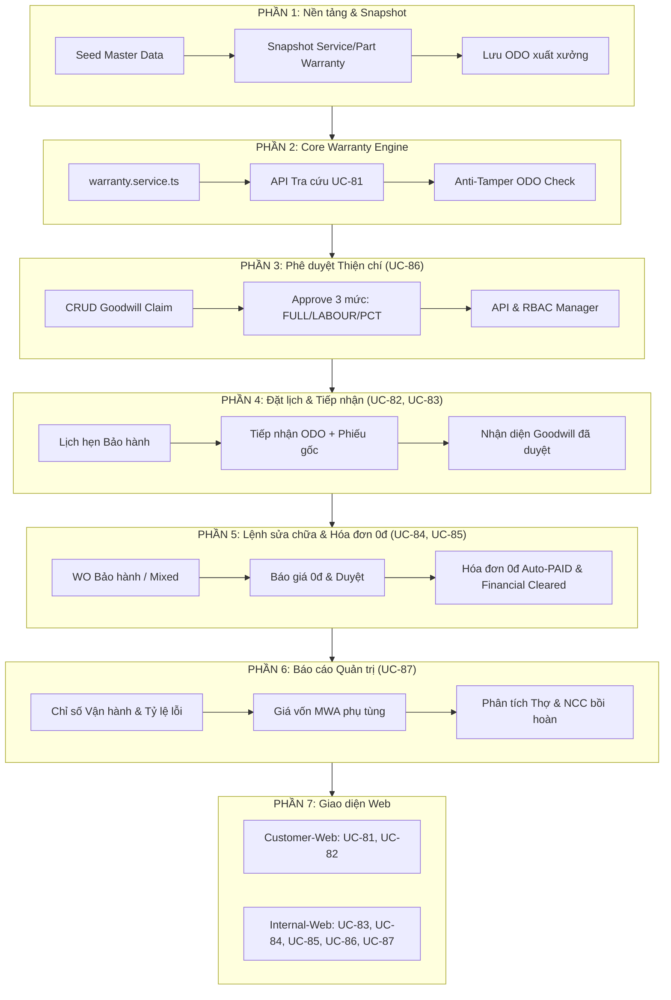

Analyzed UseCase V2.md:L1380-1499
Ran list backend routes

Error: API error (attempt 1): UNAVAILABLE (code 503): No capacity available for model gemini-3.8-flash-high on the server (Error ID: b09bff99-914d-48b6-8163-4e92069749be-8744-2010)

Ran check route mounting in app.ts
Ran list frontend apps
Ran list customer-web app directory pages
Ran list internal-web app directory pages
Ran check seed.ts for Service and InventoryItem

Dựa trên đặc tả chi tiết 7 Use Cases trong [UseCase V2.md (dòng 1384–1500)](file:///d:/hocTap/TLCN/CAR%20SERVICE%20CENTER/CAR%20SERVICE%20CENTER/docs/requirements/UseCase%20V2.md#L1384-L1500) và hiện trạng mã nguồn hệ thống, dưới đây là **Kế hoạch triển khai toàn diện Phân hệ Quản lý Bảo hành & Hỗ trợ Thiện chí**, được chia nhỏ thành các giai đoạn độc lập, rõ ràng để thực hiện tuần tự.

---

# 🛡️ KẾ HOẠCH TRIỂN KHAI PHÂN HỆ BẢO HÀNH (UC-81 → UC-87)

---

## 📦 PHẦN 1: Master Data & Cơ chế Snapshot Thời hạn Bảo hành (UC-81 Core)
> **Mục tiêu:** Đảm bảo mọi dịch vụ và phụ tùng khi đưa vào Work Order đều được chụp bản ghi (`snapshot`) thời hạn bảo hành cố định, không bị ảnh hưởng nếu sau này admin đổi chính sách.

### 1.1. Cập nhật dữ liệu mẫu (`seed.ts`)
* **File:** `src/backend/prisma/seed.ts`
* **Nội dung:**
  - Cấu hình `warranty_months` và `warranty_mileage` cho các Dịch vụ tiêu chuẩn (ví dụ: Bảo dưỡng định kỳ: 6 tháng / 10.000 km; Sửa chữa đại tu máy/hộp số: 12 tháng / 20.000 km).
  - Cấu hình `warranty_months` và `warranty_mileage` cho các Phụ tùng chính (`InventoryItem`: má phanh, lọc dầu, giảm xóc, ắc quy...).

### 1.2. Snapshot hạn bảo hành trong `work-order.service.ts`
* **File:** `src/backend/src/services/work-order.service.ts`
* **Nội dung:**
  - Khi tạo `WoService` (hàm `addService` hoặc khi tạo từ Intake): Tự động copy `warranty_months` và `warranty_mileage` từ `Service` sang `WoService`.
  - Khi thêm linh kiện `JobPart` (hàm `addJobPart`): Tự động copy `warranty_months` và `warranty_mileage` từ `InventoryItem` sang `JobPart`.
  - Khi bàn giao xe xuất xưởng (`releaseVehicle`): Tiếp nhận và lưu giá trị `odometer_at_release` vào bảng `VehicleRelease`.

---

## 📦 PHẦN 2: Bộ máy Tính toán & Tra cứu Bảo hành (UC-81 & ODO Check)
> **Mục tiêu:** Cung cấp logic tính toán còn hạn/hết hạn cho từng hạng mục đã thực hiện trên xe và xác thực chống tua ODO.

### 2.1. Xây dựng `warranty.service.ts`
* **File tạo mới:** `src/backend/src/services/warranty.service.ts`
* **Chức năng chính:**
  1. `checkVehicleWarrantyEligibility(vehicleId: number, currentOdo?: number)`:
     - Quét các WorkOrder của xe có trạng thái `RELEASED` hoặc `CLOSED`.
     - Lấy mốc ngày xuất xưởng (`VehicleRelease.released_at`) và ODO xuất xưởng (`odometer_at_release`).
     - Đọc snapshot hạn bảo hành trên từng `WoService` và `JobPart`.
     - Tính toán:
       $$\text{Ngày hết hạn} = \text{released\_at} + \text{warranty\_months}$$
       $$\text{Km hết hạn} = \text{odometer\_at\_release} + \text{warranty\_mileage}$$
     - Trả về danh sách hạng mục: Trạng thái (`VALID` - Còn hạn / `EXPIRED` - Hết hạn), số ngày còn lại, số km còn lại, thông tin phiếu dịch vụ gốc.
  2. `validateOdoIntake(parentWoId: number, intakeOdo: number)`:
     - Kiểm tra quy tắc chống tua lùi: Nếu `intakeOdo < parent_wo.release.odometer_at_release` $\rightarrow$ Ném lỗi ngoại lệ: *"Số ODO tiếp nhận không được nhỏ hơn ODO xuất xưởng của phiếu dịch vụ trước"*.

### 2.2. API Controller & Routes Tra cứu
* **Files:**
  - `src/backend/src/controllers/warranty.controller.ts`
  - `src/backend/src/routes/warranty.routes.ts`
  - Đăng ký route vào `src/backend/src/app.ts`: `app.use('/api/warranty', warrantyRoutes);`
* **Endpoints:**
  - `GET /api/warranty/vehicles/:vehicleId/eligibility?odometer=...`

---

## 📦 PHẦN 3: Quản lý & Phê duyệt Bảo hành Thiện chí (UC-86)
> **Mục tiêu:** Xây dựng quy trình độc lập cho Quản lý dịch vụ thẩm định các trường hợp quá hạn nhẹ hoặc khách hàng thân thiết.

### 3.1. Nghiệp vụ Thiện chí trong `warranty.service.ts`
* **Nội dung:**
  1. `createGoodwillClaim(data)`: Tạo yêu cầu thiện chí mới ở trạng thái `PENDING` (lưu `overdue_days`, `overdue_km`, mô tả lỗi, `parent_wo_id`).
  2. `listGoodwillClaims(filter)`: Danh sách chờ duyệt của Quản lý (hỗ trợ lọc theo trạng thái, ngày tạo).
  3. `getGoodwillClaimDetail(claimId)`: Xem hồ sơ thẩm định toàn diện: Thông tin xe, chủ xe, số lần làm dịch vụ tại xưởng, lịch sử tuân thủ bảo dưỡng.
  4. `approveGoodwillClaim(claimId, managerId, dto)`:
     - Bắt buộc kiểm tra `dto.approval_note` (không được để trống).
     - Thiết lập mức hỗ trợ: `FULL` (100%), `LABOUR_ONLY` (miễn công), hoặc `PERCENTAGE` (giảm % theo `support_pct`).
     - Cập nhật `status = 'APPROVED'`, lưu `approved_by_id`, `approved_at`.
  5. `rejectGoodwillClaim(claimId, managerId, dto)`:
     - Bắt buộc kiểm tra lý do từ chối `dto.approval_note`.
     - Cập nhật `status = 'REJECTED'`.

### 3.2. Endpoints Bảo hành Thiện chí
* **Endpoints:**
  - `POST /api/warranty/goodwill-claims` (Nhân viên lễ tân/Cố vấn tạo)
  - `GET /api/warranty/goodwill-claims` (Role: `SERVICE_MANAGER`, `ADMIN`)
  - `GET /api/warranty/goodwill-claims/:id` (Role: `SERVICE_MANAGER`, `ADMIN`)
  - `PATCH /api/warranty/goodwill-claims/:id/approve` (Role: `SERVICE_MANAGER`, `ADMIN`)
  - `PATCH /api/warranty/goodwill-claims/:id/reject` (Role: `SERVICE_MANAGER`, `ADMIN`)

---

## 📦 PHẦN 4: Đặt lịch hẹn & Tiếp nhận Bảo hành (UC-82 & UC-83) [x] *(Đã hoàn thành 100% - 18/18 Unit Tests Passed)*
> **Mục tiêu:** Tích hợp luồng khách hàng đặt lịch bảo hành và nhân viên quầy tiếp nhận xe đối chiếu ODO.

### 4.1. Cập nhật `appointment.service.ts` (UC-82)
* **File:** `src/backend/src/services/appointment.service.ts`, `appointment.dto.ts`, `appointment.controller.ts`
* **Nội dung:**
  - Hỗ trợ cờ `is_warranty: true` khi khách đặt lịch.
  - Bắt buộc kiểm tra: Phương tiện phải có ít nhất 1 hạng mục dịch vụ/phụ tùng còn hạn hoặc quá hạn nhẹ; phải chọn ít nhất 1 hạng mục bảo hành (`warranty_item_ids`); mô tả hiện tượng sự cố (`symptoms_description`) không được để trống.
  - Lưu trữ danh sách mã hạng mục bảo hành được chọn, ghi chú hiện tượng lỗi và URL hình ảnh/video minh chứng vào `notes` có cấu trúc.
  - Cho phép chọn thêm dịch vụ thông thường kèm theo (Luồng kết hợp có phí).
  - Hỗ trợ `arriveAppointment` tiếp nhận xe từ lịch hẹn bảo hành: Bắt buộc ghi nhận ODO, gọi `validateOdoIntake` chống tua lùi và chuyển sang `IntakeRecord` loại `WARRANTY`.

### 4.2. Cập nhật `intake.service.ts` (UC-83)
* **File:** `src/backend/src/services/intake.service.ts`, `intake.dto.ts`, `intake.repository.ts`
* **Nội dung:**
  - Khi tiếp nhận với `intake_type = 'WARRANTY'`:
    - Bắt buộc có `odometer_reading` và `parent_work_order_id`, lưu vào `IntakeRecord`.
    - Kiểm tra phiếu dịch vụ gốc phải thuộc xe đang tiếp nhận.
    - Gọi hàm kiểm tra chống tua ODO `validateOdoIntake` (ném lỗi nếu ODO tiếp nhận < ODO xuất xưởng của phiếu trước).
    - Tự động nhận diện và liên kết `goodwill_claim` đã được Quản lý phê duyệt (`APPROVED`) với hồ sơ tiếp nhận (`intake_id`).
    - Nếu hết hạn bảo hành mà chưa có phê duyệt thiện chí $\rightarrow$ Chặn tiếp nhận bảo hành thường và yêu cầu tạo hồ sơ bảo hành thiện chí.
    - `IntakeRepository.findById` tải kèm hồ sơ thiện chí liên quan `goodwill_claim`.

---

## 📦 PHẦN 5: Lệnh Sửa chữa, Báo giá 0đ & Quyết toán Tài chính (UC-84 & UC-85) [x] *(Đã hoàn thành 100% - 7/7 Unit Tests Passed)*
> **Mục tiêu:** Khởi tạo Work Order bảo hành, xuất báo giá 0đ và tự động thông quan tài chính cho xe xuất xưởng.

### 5.1. Xử lý Lệnh sửa chữa & Báo giá (UC-84)
* **Files:**
  - `src/backend/src/services/work-order.service.ts`
  - `src/backend/src/services/quotation.service.ts`
* **Nội dung:**
  - Khi tạo Work Order từ phiếu tiếp nhận bảo hành: Gán `order_type = 'WARRANTY'`, kế thừa `parent_work_order_id`, `warranty_reason` và `claim_approved_by_id`.
  - Cho phép bật cờ `is_warranty = true` trên từng `Job` và tự động thừa hưởng cờ trên `JobPart`.
  - Trong `quotation.service.ts`: Khi sinh dòng báo giá (`QuotationLine`), áp dụng đơn giá 0đ (`unit_price = 0`, `snapshot_unit_price = 0`) cho toàn bộ công việc và phụ tùng có đánh dấu bảo hành; tổng báo giá bằng 0 đồng.
  - Cố vấn dịch vụ được quyền duyệt báo giá 0 đồng thay khách hàng (UC-84 Bước 8-9) để chuyển trạng thái Báo giá `APPROVED`, phụ tùng `RESERVED` và Work Order `APPROVED`.
  - Tự động nhận diện và phân loại đơn hỗn hợp (`MIXED`) nếu có cả dịch vụ phát sinh tính phí ngoài bảo hành.

### 5.2. Hóa đơn 0đ & Giải phóng Cổng Xuất Xưởng (UC-85)
* **File:** `src/backend/src/services/invoice.service.ts`
* **Nội dung:**
  - Khi phát hành hóa đơn cho đơn hàng bảo hành có tổng tiền bằng 0 đồng (`total_amount === 0`):
    - Tự động chuyển trạng thái hóa đơn là `PAID` (bỏ qua bước thu tiền mặt/thẻ/QR).
    - Tự động cập nhật `WorkOrder` sang trạng thái `FINANCIAL_CLEARED` (thông quan tài chính).
    - Mở khóa điều kiện tại Cổng bàn giao xe (`Release Gate` - UC-43), bắn notification `VEHICLE_READY` cho Cố vấn dịch vụ và gửi email biên lai 0 đồng cho khách.
  - Đối với đơn `MIXED`: Hóa đơn ở trạng thái `ISSUED` với `amount_due > 0`, yêu cầu thu tiền các dịch vụ phát sinh theo quy trình chuẩn trước khi kích hoạt `FINANCIAL_CLEARED`.

---

## 📦 PHẦN 6: Báo cáo Thống kê & Phân tích Quản trị (UC-87)
> **Mục tiêu:** Cung cấp số liệu tài chính mật và phân tích kỹ thuật chuyên sâu dành riêng cho Quản lý dịch vụ.

### 6.1. Xây dựng logic báo cáo trong `report.service.ts`
* **File:** `src/backend/src/services/report.service.ts`
* **Nội dung hàm `getWarrantyReport(startDate, endDate, groupBy)`:**
  1. **Chỉ số vận hành:** Tổng lượt xe tiếp nhận bảo hành, tổng xe phục vụ, tính tỷ lệ:
     $$\text{Tỷ lệ bảo hành (\%)} = \frac{\text{Số lượt bảo hành}}{\text{Tổng lượt xe}} \times 100$$
  2. **Chi phí vốn thiệt hại (MWA):** Truy vấn `StockMovement` xuất kho của các `JobPart` có `is_warranty = true`, tính tổng chi phí theo giá vốn bình quân di động.
  3. **Danh sách phụ tùng lỗi lặp lại:** Gom nhóm theo `item_id`, đếm số lượng hỏng, tỷ lệ lỗi, thông tin Nhà cung cấp (`Supplier`) để yêu cầu bồi hoàn.
  4. **Phân tích kỹ thuật:** Thống kê số vụ bảo hành theo Kỹ thuật viên thi công lệnh gốc hoặc theo Nhóm dịch vụ.
  5. **Bảo mật phân quyền (RBAC):** Chỉ cho phép `SERVICE_MANAGER` và `SYSTEM_ADMIN`. Chặn tất cả các role khác (403 Forbidden).

---

## 📦 PHẦN 7: Giao diện Người dùng (Frontend Implementation)

### 7.1. Ứng dụng Khách hàng (`customer-web`)
| Trang / Component | Use Case | Mô tả giao diện |
|---|:---:|---|
| `app/(customer)/customer/warranty/page.tsx` | **UC-81** | **Sổ bảo hành điện tử:** Danh sách xe của khách, thẻ danh mục dịch vụ/phụ tùng kèm badge xanh (*Còn bảo hành - X ngày / Y km*) hoặc xám (*Hết hạn*). Có nút *"Đặt lịch bảo hành ngay"*. |
| `components/appointments/CreateWarrantyModal.tsx` | **UC-82** | **Modal Đặt lịch bảo hành:** Chọn hạng mục bảo hành bị lỗi, mô tả sự cố (tiếng kêu, rung lắc...), upload ảnh/video, chọn giờ hẹn còn trống. |

### 7.2. Ứng dụng Nội bộ (`internal-web`)
| Trang / Component | Use Case | Mô tả giao diện |
|---|:---:|---|
| `components/intake/WarrantyIntakeModal.tsx` | **UC-83** | **Tiếp nhận bảo hành:** Ô nhập ODO hiện tại, kiểm tra chống tua ODO với phiếu gốc; nút *"Gửi yêu cầu thiện chí"* khi quá hạn nhẹ. |
| `components/advisor/work-order/tabs/TabJob.tsx` & `TabParts.tsx` | **UC-84** | **Lập phiếu bảo hành:** Checkbox `is_warranty` trên từng công việc và phụ tùng, tự nhảy đơn giá 0đ. |
| `components/advisor/work-order/tabs/TabQuotation.tsx` | **UC-84** | Badge *"Báo giá Bảo hành 0đ"*, cho phép duyệt nhanh để thi công. |
| `app/(dashboard)/staff/billing/[id]/page.tsx` | **UC-85** | Xem trước hóa đơn 0đ, nút phát hành hóa đơn tự động chuyển `PAID` và `FINANCIAL_CLEARED`. |
| `app/(manager)/warranty/page.tsx` | **UC-86** | **Hàng đợi Phê duyệt Thiện chí:** Danh sách yêu cầu chờ duyệt; popup thẩm định chi tiết khách hàng; 3 lựa chọn hỗ trợ (`100%`, `Tiền công`, `% Giảm trừ`); bắt buộc nhập lý do phê duyệt/từ chối. |
| `app/(manager)/reports/page.tsx` (Tab Bảo hành) | **UC-87** | **Báo cáo Bảo hành Quản trị:** 4 thẻ KPI (Lượt xe, Tỷ lệ %, Chi phí MWA, Số phụ tùng lỗi), Biểu đồ phân tích lỗi theo thợ, Bảng linh kiện hỏng kèm Nhà cung cấp và nút Xuất CSV/PDF. |

---

## 📦 PHẦN 8: Kiểm thử & Nghiệm thu (Verification & E2E)
1. **Kiểm thử tự động:**
   - Unit test cho `warranty.service.ts` (test logic tính hạn, test anti-tamper ODO, test goodwill FSM).
   - Kiểm tra Typecheck cả 3 project: `npx tsc --noEmit` trên backend, internal-web, customer-web.
2. **Kiểm thử luồng nghiệp vụ thủ công:**
   - Chạy kiểm thử xác minh đối chiếu toàn bộ 25 Test Cases trong tài liệu [TC_Warranty_Process.md](file:///d:/hocTap/TLCN/CAR%20SERVICE%20CENTER/CAR%20SERVICE%20CENTER/docs/testing/manual/TC_Warranty_Process.md).

---

## 🎯 ĐỀ XUẤT THỨ TỰ BẮT ĐẦU:
Bạn có đồng ý bắt đầu triển khai ngay với **PHẦN 1** (Cập nhật dữ liệu mẫu `seed.ts` và logic Snapshot hạn bảo hành trong `work-order.service.ts`) không?