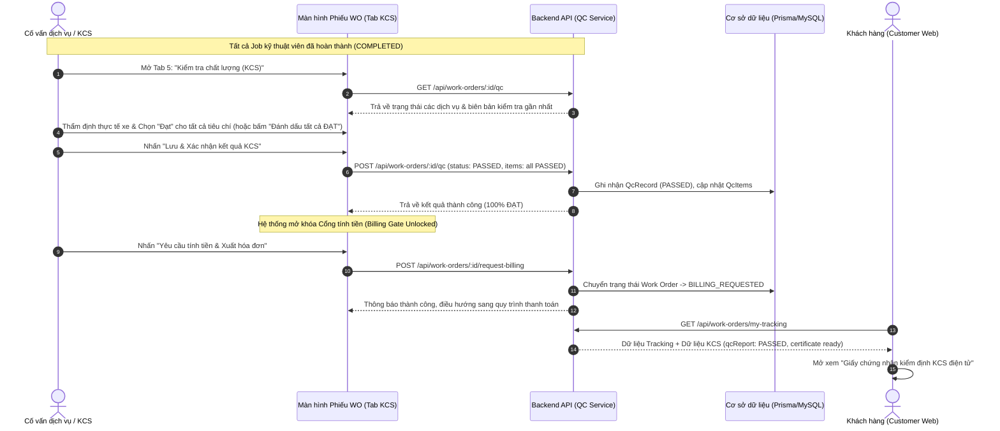
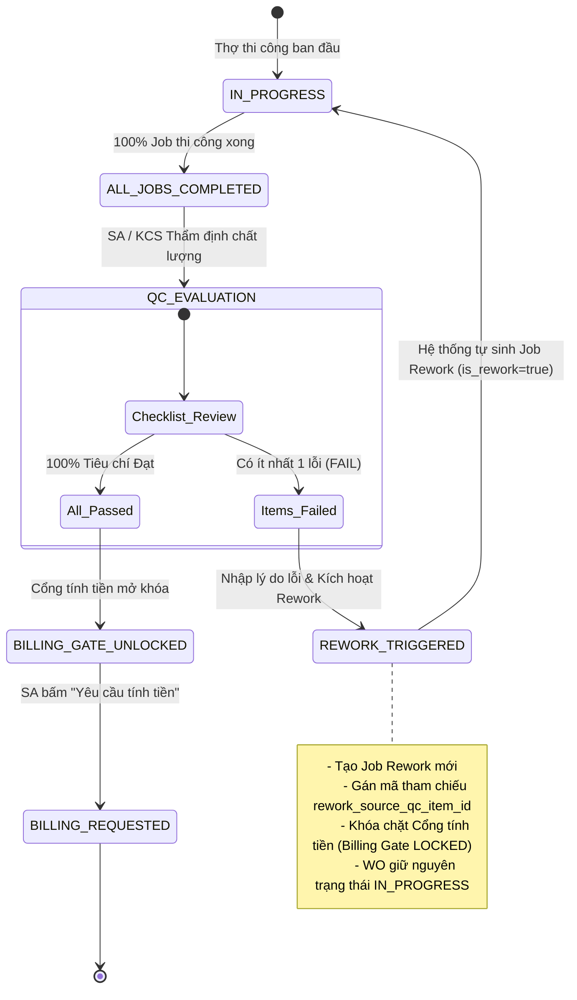

# ĐIỀU CHỈNH & CHUẨN HÓA ĐẶC TẢ USE CASE – KIỂM ĐỊNH CHẤT LƯỢNG KCS & VÒNG LẶP SỬA LẠI (UC-41)

> **Tài liệu:** Chuẩn hóa đặc tả nghiệp vụ Kiểm định chất lượng KCS (Quality Control & Inspection) và Vòng lặp sửa lại (Rework Loop)  
> **Áp dụng cho:** Cố vấn dịch vụ (Service Advisor), Nhân viên KCS / Quản lý xưởng (QC Inspector / Service Manager), Khách hàng (Customer), Kỹ thuật viên (Technician)  
> **Vị trí lưu trữ:** `docs/requirements/rev_uc/UC-41_rev.md`  
> **Tài liệu tham chiếu:** [`docs/requirements/UseCase V2.md`](file:///d:/TLCN/CAR%20SERVICE%20CENTER/docs/requirements/UseCase%20V2.md) (UC-41, UC-42), [`docs/requirements/WORK_ORDER_STATUS_TRANSITION.md`](file:///d:/TLCN/CAR%20SERVICE%20CENTER/docs/requirements/WORK_ORDER_STATUS_TRANSITION.md), [`API_CONVENTION.md`](file:///d:/TLCN/CAR%20SERVICE%20CENTER/API_CONVENTION.md)  
> **Phiên bản:** 2.0 (Chuẩn hóa toàn diện quy trình KCS đa cấp độ, vòng lặp Rework tự động, cổng chặn thanh toán Billing Gate và Minh bạch hóa Chứng nhận KCS điện tử cho Khách hàng).

---

## 1. BỐI CẢNH VÀ LÝ DO ĐIỀU CHỈNH

Trong chuỗi vận hành dịch vụ ô tô chuyên nghiệp, **Kiểm định chất lượng (Quality Control / Inspection - KCS)** là chốt chặn an toàn kỹ thuật tối thượng trước khi xe được phép chuyển sang khâu tính tiền và bàn giao cho khách hàng.

### 1.1 Những điểm hạn chế của đặc tả cũ (v2.0):
1. **Tiêu chí kiểm định còn sơ sài, thiếu chuẩn hóa:** Đặc tả cũ chỉ nêu chung chung "đi qua từng hạng mục kiểm định", chưa có danh mục tiêu chuẩn kỹ thuật cụ thể (hệ thống phanh/thắng, động cơ, khung gầm, hệ thống điện, siết lực ốc bánh xe, chạy thử đường - Road Test, vệ sinh nội ngoại thất xe).
2. **Quy trình xử lý lỗi (Rework) thủ công và thiếu liên kết:** Khi KCS phát hiện lỗi không đạt (`FAIL`), đặc tả cũ chưa quy định cơ chế tạo tự động công việc sửa lại gắn liền với lỗi vi phạm (`rework_source_qc_item_id`), dẫn đến việc thợ kỹ thuật sửa mò hoặc không có bằng chứng truy xuất nguồn gốc sai sót.
3. **Thiếu cơ chế Cổng chặn xuất xưởng / tính tiền (Billing Gate Guardrail):** Trước đây chưa có quy định bắt buộc 100% dịch vụ phải nghiệm thu Đạt trước khi chuyển qua kế toán lập hóa đơn. Dẫn đến rủi ro thu tiền khách hàng khi xe vẫn còn lỗi kỹ thuật hoặc chưa hoàn tất sửa lại.
4. **Khách hàng hoàn toàn bị cô lập khỏi thông tin KCS:** Trên cổng tra cứu trực tuyến (`Customer Portal`), khách hàng chỉ thấy dòng trạng thái xe mơ hồ, không có biên bản nghiệm thu hay chứng nhận an toàn kỹ thuật xuất xưởng để an tâm nhận xe.

### 1.2 Mục tiêu cải tiến trong phiên bản 2.0:
- **Chuẩn hóa Bộ tiêu chí kiểm định KCS (Standard Inspection Checklist):** Tự động khởi tạo danh mục tiêu chí kiểm định đa tiêu chuẩn theo từng gói dịch vụ và tổng thể an toàn xe.
- **Tự động hóa Vòng lặp sửa lại (Automated Rework Generation Loop):** Khi KCS/Cố vấn đánh dấu Không đạt (`FAIL`) và nhập lý do lỗi, hệ thống tự động sinh `Job` Rework (`is_rework: true`, `status: REWORK`), giữ phiếu ở trạng thái `IN_PROGRESS` và gán lại cho KTV xử lý dứt điểm.
- **Thiết lập Cổng chặn tính tiền nghiêm ngặt (Billing Gate Enforcement):** Nút "Yêu cầu tính tiền & Xuất hóa đơn" (`POST /api/work-orders/:id/request-billing`) chỉ được kích hoạt khi 100% dịch vụ/hạng mục KCS đạt `PASSED` và không còn bất kỳ Job Rework nào đang mở.
- **Minh bạch hóa Chứng nhận KCS điện tử (Electronic QC Certificate):** Khách hàng có thể tra cứu và xem trực tiếp **"Giấy chứng nhận thẩm định chất lượng KCS"** điện tử có dấu mộc số bảo đảm của garage ngay trên Cổng tra cứu tiến độ khách hàng (`Customer Web`).

---

## 2. THÔNG TIN CƠ BẢN USE CASE UC-41

| Thuộc tính | Chi tiết |
| :--- | :--- |
| **Mã Use Case** | **UC-41** |
| **Tên Use Case** | **Kiểm định chất lượng KCS & Vòng lặp sửa lại (Quality Inspection & Rework Loop)** |
| **Mô tả** | Cố vấn dịch vụ (SA) hoặc KCS Inspector thẩm định chất lượng kỹ thuật của từng dịch vụ và toàn bộ phương tiện theo danh mục checklist tiêu chuẩn. Nếu đạt 100%, hệ thống mở khóa cổng tính tiền để chuyển sang lập hóa đơn. Nếu có hạng mục không đạt, hệ thống kích hoạt tạo job sửa lại (Rework) và yêu cầu kỹ thuật viên khắc phục trước khi tái kiểm định. |
| **Tác nhân thực hiện** | **Chính:** Cố vấn dịch vụ (Service Advisor), Nhân viên KCS (QC Inspector)<br>**Phối hợp:** Kỹ thuật viên (Technician) – khắc phục lỗi rework<br>**Thụ hưởng:** Khách hàng (Customer) – xem chứng nhận kiểm định điện tử |
| **Tiền điều kiện** | 1. Phiếu công việc (`WorkOrder`) đang ở trạng thái `IN_PROGRESS`.<br>2. Toàn bộ các công việc (`Job`) thi công ban đầu của các dịch vụ đã ở trạng thái **Hoàn thành (`COMPLETED`)** (hoặc `CANCELLED`), không còn job nào đang `PENDING` hay `IN_PROGRESS`. |
| **Hậu điều kiện** | - **Trường hợp 100% ĐẠT:** Ghi nhận biên bản KCS `PASSED`, mở khóa Cổng tính tiền. Khi xác nhận, chuyển trạng thái Phiếu sang **Chờ tính tiền (`BILLING_REQUESTED`)**.<br>- **Trường hợp KHÔNG ĐẠT:** Ghi nhận biên bản KCS `FAILED`, tự động sinh các `Job` Rework liên kết, giữ Phiếu ở trạng thái `IN_PROGRESS` để tiếp tục khắc phục. |

---

## 3. DANH MỤC TIÊU CHÍ KIỂM ĐỊNH CHUẨN HÓA (STANDARD QC CHECKLIST)

Khi tiến hành kiểm tra một dịch vụ hoặc toàn bộ phương tiện, hệ thống tự động cung cấp bộ tiêu chuẩn kiểm định định chuẩn:

| STT | Nhóm tiêu chuẩn | Tiêu chí kiểm định chi tiết | Mức độ nghiêm trọng nếu lỗi |
| :---: | :--- | :--- | :---: |
| 1 | **An toàn Phanh & Lái** | Hành trình bàn đạp phanh, lực phanh, dầu phanh không rò rỉ, siết ốc bánh xe đủ mô-men xoắn quy định. | **CRITICAL** |
| 2 | **Động cơ & Vận hành** | Mức dầu máy/nước làm mát đạt vạch chuẩn, tiếng nổ êm ái không rung giật, không báo lỗi động cơ (Check Engine) trên táp-lô. | **CRITICAL** |
| 3 | **Hệ thống Điện & Đèn** | Đèn chiếu sáng pha/cốt, đèn xi-nhan, đèn phanh, còi xe, gạt mưa hoạt động bình thường. | **MAJOR** |
| 4 | **Khung gầm & Treo** | Giảm xóc không xì dầu, rô-tuyn không rơ lắc, áp suất lốp đủ chuẩn 4 bánh. | **MAJOR** |
| 5 | **Chạy thử đường (Road Test)** | Xe chạy ổn định, không nhao lái, chuyển số êm mượt, không có tiếng kêu bất thường dưới gầm xe. | **CRITICAL** |
| 6 | **Vệ sinh & Bàn giao** | Khoang máy sạch bụi bẩn, nội thất được lau sạch, không bám dầu mỡ do thợ để lại, tháo bỏ bọc vô-lăng bảo vệ. | **MINOR** |

---

## 4. LUỒNG SỰ KIỆN CHÍNH (LUỒNG CƠ BẢN – KIỂM ĐỊNH ĐẠT 100%)



### Các bước thực hiện chi tiết:
1. **Truy cập màn hình KCS:** Cố vấn dịch vụ hoặc KCS Inspector mở chi tiết Phiếu công việc (`WorkOrder`), chuyển sang **Tab 5 – Kiểm tra chất lượng (KCS)**.
2. **Kiểm tra tiến độ thi công:** Hệ thống hiển thị thanh tiến độ hoàn thành công việc thi công:
   - Nếu còn công việc đang thực hiện, hệ thống hiển thị cảnh báo: *"Còn X công việc chưa hoàn thành. Chỉ thực hiện KCS sau khi toàn bộ kỹ thuật viên đã hoàn tất phần việc."*
   - Nếu 100% công việc thi công đã xong, giao diện đánh giá KCS mở ra với danh sách các dịch vụ cần thẩm định.
3. **Thẩm định checklist kỹ thuật:** Người kiểm định kiểm tra thực tế xe và tích chọn kết quả cho từng hạng mục:
   - Tùy chọn nhanh: Nhấn **"Đánh dấu tất cả ĐẠT"** nếu toàn bộ quá trình chạy thử và nghiệm thu xe đều hoàn hảo.
   - Nhập thêm ghi chú chuyên môn (nếu có): *"Đã chạy thử 5km trên đường gom Đại lộ Thăng Long, phanh và lái chuẩn, xe sẵn sàng xuất xưởng."*
4. **Lưu biên bản kiểm định:** Người kiểm định nhấn **"Lưu & Xác nhận kết quả KCS"**.
5. **Hệ thống xử lý:**
   - Hệ thống tạo mới/cập nhật bản ghi `QcRecord` với trạng thái `PASSED`, lưu chi tiết từng `QcItem`.
   - Cập nhật tỷ lệ hoàn thành KCS của Phiếu công việc đạt **100% ĐẠT**.
   - Mở khóa nút **"Yêu cầu tính tiền & Xuất hóa đơn" (Billing Gate)**.
6. **Kích hoạt cổng tính tiền (Billing Request):**
   - Cố vấn dịch vụ nhấn **"Yêu cầu tính tiền & Xuất hóa đơn"**.
   - Hệ thống kiểm tra điều kiện an toàn: `hasPendingJobs == false` và `allServicesPassed == true`.
   - Hệ thống cập nhật trạng thái của Phiếu công việc từ `IN_PROGRESS` sang **`BILLING_REQUESTED`**.
   - Thông báo cho bộ phận Kế toán / Thu ngân chuẩn bị phát hành hóa đơn (UC-44).
7. **Hiển thị phía khách hàng:** Khách hàng theo dõi trên Cổng thông tin thấy Bước 3 ("Kiểm tra chất lượng & Nghiệm thu") đã hoàn thành, xuất hiện nút **"Xem chứng nhận KCS"**.

---

## 5. CÁC LUỒNG THAY THẾ & VÒNG LẶP SỬA LẠI (ALTERNATIVE FLOWS & REWORK LOOP)



### 5.1 Luồng 3a: Phát hiện lỗi kỹ thuật – KCS KHÔNG ĐẠT & Kích hoạt sửa lại (Auto-Rework)
- **Tình huống:** Tại Bước 3, người kiểm định phát hiện có lỗi kỹ thuật (Ví dụ: *"Dầu phanh rò rỉ nhẹ ở cùm phanh trước"* hoặc *"Đèn hậu bên phụ không sáng"*).
- **Trình tự xử lý:**
  1. Người kiểm định chọn trạng thái **Không đạt (`FAIL`)** cho hạng mục tương ứng.
  2. Người kiểm định chọn mức độ nghiêm trọng: `CRITICAL` (Nghiêm trọng - Cấm lưu hành), `MAJOR` (Nặng) hoặc `MINOR` (Nhẹ).
  3. Form nhập liệu sửa lại hiển thị, người kiểm định bắt buộc nhập:
     - **Lý do không đạt (Rework Reason):** Mô tả chi tiết hiện tượng lỗi.
     - **Hướng dẫn khắc phục (Rework Instructions):** Yêu cầu kỹ thuật cần làm lại.
     - **Kỹ thuật viên chịu trách nhiệm:** Chỉ định thợ đã làm sai hoặc thợ chuyên trách khắc phục.
  4. Người kiểm định nhấn **"Ghi nhận KCS & Kích hoạt sửa lại (Trigger Rework)"**.
  5. **Hệ thống tự động thực thi:**
     - Ghi nhận `QcRecord` ở trạng thái **`FAILED`**.
     - **Cơ chế chống sinh việc trùng lặp (Anti-Duplication & Idempotency Guardrail):**
       - Hệ thống kiểm tra xem đối với dịch vụ này, tiêu chí lỗi tương ứng đã có một `Job` sửa lại đang mở (`status: REWORK / PLANNED / IN_PROGRESS`) hay chưa.
       - *Nếu đã tồn tại Job Rework đang mở:* Hệ thống cập nhật mô tả lỗi, liên kết ID biên bản KCS mới nhất và phân công kỹ thuật viên, **tuyệt đối không tạo thêm job mới trùng lặp** khi người dùng bấm Lưu nhiều lần.
       - *Nếu chưa có Job Rework đang mở:* Hệ thống tự động sinh một công việc mới (`Job`) với các thuộc tính:
         - `is_rework: true`
         - `status: REWORK` (hoặc `PENDING`)
         - `rework_source_qc_item_id`: Liên kết trực tiếp tới ID của tiêu chí bị đánh trượt.
         - `rework_reason`: Nội dung lỗi và chỉ dẫn khắc phục.
     - Cập nhật số đếm vòng lặp sửa lại: `rework_count = rework_count + 1`.
     - Giữ nguyên trạng thái Phiếu công việc là **`IN_PROGRESS`**.
     - **Khóa chặt Cổng tính tiền:** Nút "Yêu cầu tính tiền" bị vô hiệu hóa kèm cảnh báo đỏ: *"Xe có hạng mục KCS không đạt và đang trong quy trình sửa lại. Không được phép xuất xưởng hoặc lập hóa đơn."*

### 5.2 Luồng 3b: Khắc phục lỗi và Tái kiểm định (Re-inspection Loop)
- **Trình tự:**
  1. Kỹ thuật viên nhận thông báo có công việc sửa lại (`Job.is_rework = true`).
  2. Kỹ thuật viên tiến hành khắc phục theo đúng hướng dẫn của KCS.
  3. Sau khi khắc phục xong, Kỹ thuật viên cập nhật trạng thái công việc thành **`COMPLETED`**.
  4. Khi toàn bộ các công việc sửa lại đã hoàn thành, Cố vấn / KCS mở lại Tab KCS.
  5. Hệ thống hiển thị lịch sử các lần kiểm định trước kèm nhãn: *"Lần kiểm định thứ [N]"*.
  6. KCS thực hiện thẩm định lại các tiêu chí lỗi.
  7. Nếu đạt chuẩn $\to$ Thực hiện theo Luồng cơ bản (Mục 4) để mở khóa cổng tính tiền.

### 5.3 Luồng 6a: Chặn yêu cầu tính tiền khi chưa đạt điều kiện (Billing Gate Enforcement)
- **Tình huống:** Người dùng cố tình kích hoạt yêu cầu tính tiền bằng API hoặc thao tác tắt giao diện khi xe chưa đủ điều kiện KCS.
- **Xử lý:**
  - Hệ thống kiểm tra: Nếu còn bất kỳ dịch vụ nào chưa có kết quả KCS, hoặc kết quả gần nhất là `FAILED`, hoặc còn `Job` nào có trạng thái `PENDING`, `IN_PROGRESS`, `REWORK` $\to$ Hệ thống ném ngoại lệ `HTTP 400 Bad Request` kèm thông điệp:
    > *"Không thể chuyển sang bước thanh toán: Xe chưa hoàn tất kiểm định chất lượng hoặc còn hạng mục không đạt yêu cầu kỹ thuật."*
  - Trạng thái Work Order được bảo toàn tuyệt đối ở `IN_PROGRESS`.

---

## 6. GIAO DIỆN PHÍA KHÁCH HÀNG – CHỨNG NHẬN KCS ĐIỆN TỬ (CUSTOMER QC CERTIFICATE)

Nhằm nâng cao trải nghiệm minh bạch và tạo sự an tâm tối đa cho khách hàng, hệ thống tích hợp tính năng **Giấy chứng nhận thẩm định chất lượng KCS điện tử** trên giao diện Khách hàng (`customer-web`):

### 6.1 Vị trí hiển thị:
- Tại trang Tra cứu tiến độ dịch vụ (`/tracking`): Màn hình hiển thị Step 3 **"Kiểm tra chất lượng & Nghiệm thu"**.
- Khi trạng thái KCS đạt chuẩn, xuất hiện nút bấm nổi bật: **"Xem chứng nhận KCS" (Xem tem kiểm định)**.

### 6.2 Nội dung Giấy chứng nhận thẩm định KCS (Customer QC Modal):
Khi khách hàng nhấp vào nút, một Modal sang trọng được hiển thị với cấu trúc chuẩn:
- **Đầu trang (Header):**
  - Biểu tượng Khiên an toàn (Security Shield Badge).
  - Tên chứng nhận: **GIẤY CHỨNG NHẬN KIỂM ĐỊNH CHẤT LƯỢNG KCS (QC PASSED)**.
  - Mã số phiếu dịch vụ và Biển số xe được chứng nhận.
- **Thông tin thẩm định (Inspection Metadata):**
  - Người thực hiện KCS: Tên Cố vấn dịch vụ / Chuyên viên KCS phụ trách.
  - Thời gian thẩm định: Ngày, giờ nghiệm thu chính xác.
  - Tổng số tiêu chí đánh giá: Đạt 100% (Ví dụ: 6/6 hạng mục).
- **Danh sách tiêu chuẩn an toàn đã vượt qua (Safety Checklist Passed):**
  - Hệ thống An toàn Phanh & Lực phanh: **ĐẠT**
  - Động cơ & Khí thải tiêu chuẩn: **ĐẠT**
  - Hệ thống Điện, Đèn & Tín hiệu: **ĐẠT**
  - Hệ thống Treo, Khung gầm & Áp suất lốp: **ĐẠT**
  - Thử nghiệm vận hành thực tế (Road Test): **ĐẠT**
  - Vệ sinh nội ngoại thất & Khử khuẩn khoang xe: **ĐẠT**
- **Cam kết & Dấu bảo chứng (Garage Seal):**
  - Tem mộc số điện tử: *"GARAGE QUALITY ASSURED - XE ĐẠT TIÊU CHUẨN XUẤT XƯỞNG"*.
  - Khuyến nghị an toàn cho khách hàng khi nhận xe.

---

## 7. MA TRẬN CHUYỂN ĐỔI TRẠNG THÁI PHIẾU CÔNG VIỆC (STATE TRANSITION MATRIX)

| Trạng thái hiện tại | Sự kiện / Hành động | Điều kiện ràng buộc | Trạng thái tiếp theo | Ghi chú nghiệp vụ |
| :--- | :--- | :--- | :--- | :--- |
| `IN_PROGRESS` | Tất cả Job thi công `COMPLETED` | Không còn job nào `PENDING` / `IN_PROGRESS` | `IN_PROGRESS` (Sẵn sàng KCS) | Mở khóa Tab KCS để chuyên viên đánh giá |
| `IN_PROGRESS` | Đánh giá KCS có mục `FAIL` | Có ít nhất 1 `QcItem` có status `FAILED` | `IN_PROGRESS` (Rework loop) | Tự động sinh `Job (is_rework: true)`, khóa Billing Gate |
| `IN_PROGRESS` | Hoàn thành sửa lại `Job Rework` | KTV bấm hoàn thành job sửa lại | `IN_PROGRESS` (Chờ tái kiểm định) | KCS kiểm tra lại các lỗi cũ |
| `IN_PROGRESS` | Đánh giá KCS đạt 100% | 100% dịch vụ và tiêu chí `PASSED`, 0 rework job mở | `IN_PROGRESS` (KCS Đạt chuẩn) | Mở khóa nút "Yêu cầu tính tiền" |
| `IN_PROGRESS` | SA nhấn "Yêu cầu tính tiền" | KCS đã `PASSED`, không còn việc tồn đọng | **`BILLING_REQUESTED`** | Chuyển quyền xử lý sang Thu ngân / Kế toán (UC-44) |

---

## 8. QUY CHUẨN DỮ LIỆU & BẢO MẬT API (DATA SCHEMA & API SECURITY)

Tất cả các giao tiếp API phục vụ UC-41 tuân thủ nghiêm ngặt định dạng chuẩn phản hồi quy định tại [`API_CONVENTION.md`](file:///d:/TLCN/CAR%20SERVICE%20CENTER/API_CONVENTION.md):
```json
{
  "success": true,
  "data": { ... },
  "message": "Thông điệp phản hồi nghiệp vụ",
  "meta": { "timestamp": "2026-11-02T10:00:00.000Z" }
}
```

### 8.1 Danh sách Endpoints phục vụ UC-41:

#### 1. Lấy dữ liệu thẩm định KCS của Phiếu công việc:
- **Endpoint:** `GET /api/work-orders/:id/qc`
- **Quyền truy cập:** `SERVICE_ADVISOR`, `SERVICE_MANAGER`, `TECHNICIAN`, `ADMIN`
- **Dữ liệu trả về:** Danh sách dịch vụ, trạng thái KCS từng dịch vụ, danh sách checklist tiêu chuẩn, các lần kiểm định lịch sử, và cờ `can_request_billing`.

#### 2. Gửi đánh giá thẩm định KCS & Kích hoạt Rework:
- **Endpoint:** `POST /api/work-orders/:id/qc`
- **Quyền truy cập:** `SERVICE_ADVISOR`, `SERVICE_MANAGER`, `ADMIN`
- **Payload (`SubmitQcDto`):**
  ```json
  {
    "service_id": 101,
    "status": "FAILED",
    "notes": "Phát hiện tiếng rít nhẹ ở phanh trước",
    "items": [
      {
        "item_name": "Kiểm tra phanh & lực siết ốc",
        "status": "FAILED",
        "severity": "CRITICAL",
        "notes": "Chưa tra mỡ bò ắc thắng phanh đĩa trước bên phụ"
      }
    ],
    "rework": {
      "rework_reason": "Tra lại mỡ bò chịu nhiệt ắc thắng và kiểm tra độ rơ",
      "assigned_technician_id": 12
    }
  }
  ```

#### 3. Chốt kiểm định & Yêu cầu tính tiền (Billing Gate):
- **Endpoint:** `POST /api/work-orders/:id/request-billing`
- **Quyền truy cập:** `SERVICE_ADVISOR`, `SERVICE_MANAGER`, `ADMIN`
- **Logic kiểm tra:**
  - `workOrder.status === 'IN_PROGRESS'`
  - 100% `jobs` không có trạng thái `PENDING`, `IN_PROGRESS`, `REWORK`
  - Tất cả các dịch vụ có `QcRecord` mới nhất là `PASSED`
  - Cập nhật `workOrder.status = 'BILLING_REQUESTED'`

#### 4. Khách hàng tra cứu chứng nhận KCS:
- **Endpoint:** `GET /api/work-orders/my-tracking` (hoặc `GET /api/work-orders/:id/tracking`)
- **Quyền truy cập:** `CUSTOMER` (chủ sở hữu xe), `SERVICE_ADVISOR`
- **Dữ liệu trả về bổ sung:** Đối tượng `qcReport` chứa ngày giờ nghiệm thu, người nghiệm thu, tổng số tiêu chí đạt chuẩn và danh sách các hạng mục an toàn đã vượt qua để hiển thị trên Giấy chứng nhận điện tử.

---

## 9. TIÊU CHÍ NGHIỆM THU NGHIỆP VỤ (UAT ACCEPTANCE CRITERIA)

| Mã tiêu chí | Kịch bản kiểm thử | Kết quả mong đợi | Trạng thái đạt được |
| :---: | :--- | :--- | :---: |
| **UAT-QC-01** | Cố vấn mở màn hình kiểm định khi thợ chưa làm xong các công việc chính. | Hệ thống cảnh báo việc chưa xong, chặn không cho xác nhận đạt KCS. | **ĐẠT** |
| **UAT-QC-02** | Cố vấn tích chọn "Đạt" cho toàn bộ các tiêu chuẩn kiểm định và nhấn xác nhận. | Hệ thống ghi nhận kết quả `PASSED`, mở khóa nút "Yêu cầu tính tiền". | **ĐẠT** |
| **UAT-QC-03** | Có tiêu chí bị đánh dấu "Không đạt" kèm lý do và kích hoạt sửa lại. | Hệ thống lưu KCS `FAILED`, tự động sinh `Job (is_rework: true)`, giữ phiếu ở `IN_PROGRESS`, khóa nút tính tiền. | **ĐẠT** |
| **UAT-QC-04** | Kỹ thuật viên sửa xong việc Rework, KCS thẩm định lại và cho "Đạt". | Hệ thống cập nhật vòng lặp KCS mới, mở khóa chuyển sang tính tiền. | **ĐẠT** |
| **UAT-QC-05** | Nhấn "Yêu cầu tính tiền" khi đã đủ điều kiện KCS. | Trạng thái Phiếu chuyển chính xác sang `BILLING_REQUESTED`, sẵn sàng cho Lễ tân/Thu ngân lập hóa đơn. | **ĐẠT** |
| **UAT-QC-06** | Khách hàng đăng nhập Cổng thông tin và bấm "Xem chứng nhận KCS". | Hiển thị Modal Giấy chứng nhận thẩm định chất lượng KCS đầy đủ thông số kỹ thuật, tem garage và người nghiệm thu. | **ĐẠT** |

---
*Tài liệu này là căn cứ chuẩn hóa nghiệp vụ chính thức cho phân hệ Kiểm định chất lượng KCS (UC-41) trong toàn bộ giải pháp quản lý dịch vụ ô tô.*

