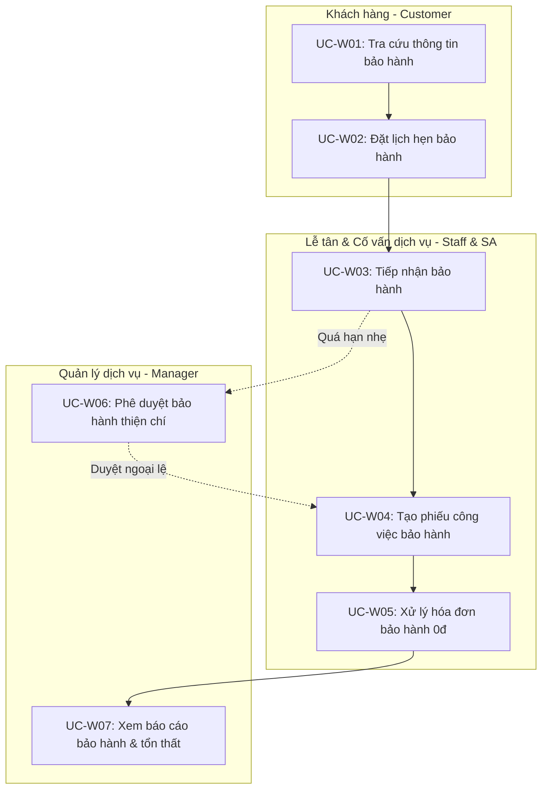
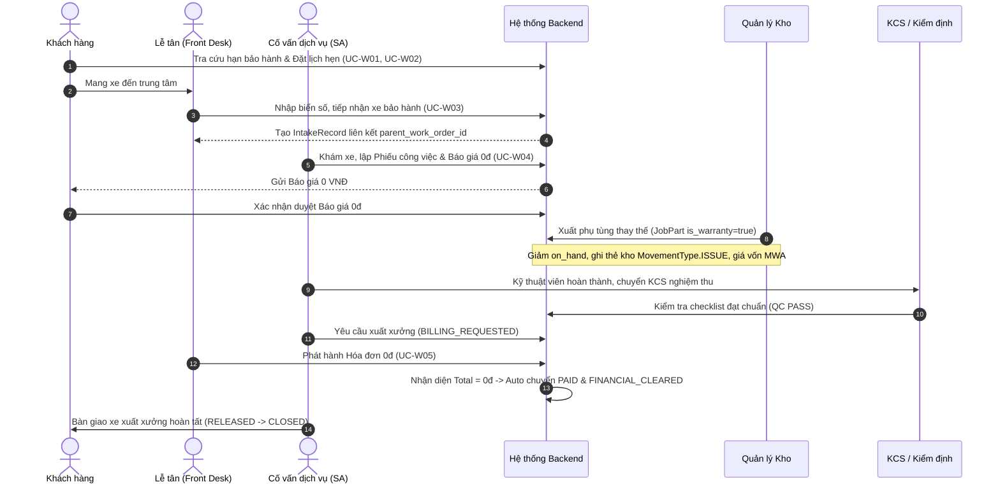
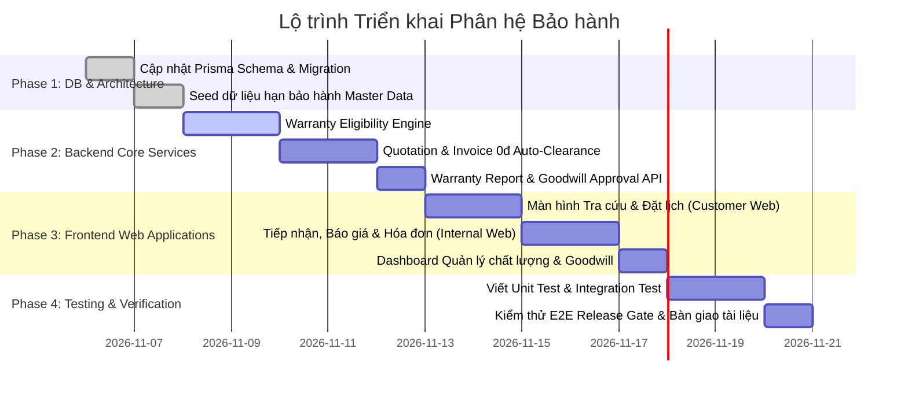

# TÀI LIỆU ĐẶC TẢ NGHIỆP VỤ BẢO HÀNH & KẾ HOẠCH TRIỂN KHAI TOÀN DIỆN
## (WARRANTY MODULE SPECIFICATION & IMPLEMENTATION PLAN)

> **Mã tài liệu:** SPEC-WARRANTY-2026  
> **Dự án:** Hệ thống Quản trị & Vận hành Trung tâm Dịch vụ Kỹ thuật Ô tô (Car Service Center)  
> **Thư mục lưu trữ:** `docs/requirements/uc_new/SPEC_Warranty_Process_Plan.md`  
> **Căn cứ nghiệp vụ & Kỹ thuật:**  
> - Tài liệu đặc tả Use Case chi tiết: [`UC_BaoHanh_Detail.md`](UC_BaoHanh_Detail.md) (07 Use Cases: `UC-W01` → `UC-W07`)  
> - Tài liệu hệ thống hiện hành: [BRD.md](../BRD.md), [UseCase V2.md](../UseCase%20V2.md), [WORK_ORDER_STATE_CRUD_MATRIX.md](../WORK_ORDER_STATE_CRUD_MATRIX.md), [Pricing_Calculation_Formulas.md](../Pricing_Calculation_Formulas.md)  
> - Cơ sở dữ liệu Prisma Schema thực tế: `src/backend/prisma/schema.prisma`

---

## 1. ĐÁNH GIÁ TỔNG QUAN & TÍNH PHÙ HỢP VỚI KIẾN TRÚC HIỆN TẠI

### 1.1. Tính tương thích với Kiến trúc Cốt lõi (Architectural Compatibility)
Hệ thống quản lý xưởng hiện tại được thiết kế theo nguyên tắc: **Lấy Phiếu công việc (Work Order) làm hồ sơ trung tâm**, tuân thủ chuỗi truy vết bất biến:
$$\text{Tiếp nhận (Intake)} \longrightarrow \text{Khám xe (Check-in / Inspection)} \longrightarrow \text{Dịch vụ (WoService)} \longrightarrow \text{Công việc (Job)} \longrightarrow \text{Phụ tùng (JobPart)} \longrightarrow \text{Báo giá (Quotation)} \longrightarrow \text{Nghiệm thu (QC)} \longrightarrow \text{Hóa đơn (Invoice)} \longrightarrow \text{Bàn giao (Release)}$$

Phân hệ **Bảo hành (Warranty Module)** hoàn toàn **phù hợp 100% với kiến trúc này** nhờ các nguyên tắc:
1. **Kế thừa máy trạng thái hữu hạn 10 bước (FSM 10 States):**
   - Đơn bảo hành không sinh ra quy trình kiểm soát song song mà đi trọn vẹn theo 10 trạng thái chuẩn:
     $$\text{DRAFT} \rightarrow \text{IN\_PLANNING} \rightarrow \text{PENDING\_APPROVAL} \rightarrow \text{APPROVED} \rightarrow \text{IN\_PROGRESS} \rightarrow \text{BILLING\_REQUESTED} \rightarrow \text{FINANCIAL\_CLEARED} \rightarrow \text{RELEASED} \rightarrow \text{CLOSED}$$
   - Mọi cửa kiểm soát chất lượng (`QC Gate`), xuất kho phụ tùng (`MovementType.ISSUE`), và cửa bàn giao xe (`Release Gate`) vẫn giữ nguyên giá trị phòng vệ.
2. **Nguyên tắc kép về tài chính & kho vận:**
   - **Đối với Khách hàng:** Giá trị dịch vụ và phụ tùng bảo hành là **0 VNĐ** (tuân thủ chính sách miễn thuế Zero-Tax Policy và miễn phí tiền công/phụ tùng lỗi).
   - **Đối với Nội bộ xưởng:** Phụ tùng thay thế vẫn xuất kho vật lý thực tế (giảm tồn `on_hand`), chi phí vốn ghi nhận theo phương pháp **Giá vốn bình quân di động (MWA - Moving Weighted Average)** vào chi phí rủi ro chất lượng của trung tâm. Giờ công thợ vẫn được ghi nhận để tính chỉ số hiệu suất kỹ thuật viên.
3. **Giải phóng xe tự động (Auto Financial Clearance):**
   - Khi Hóa đơn bảo hành có tổng tiền bằng **0 VNĐ**, hệ thống tự động xác nhận `Invoice.status = PAID` và chuyển Work Order sang `FINANCIAL_CLEARED`, thỏa mãn điều kiện giải phóng xe (`Release Gate`) mà không gây tắc nghẽn ở khâu thu tiền.

---

## 2. THIẾT KẾ CƠ SỞ DỮ LIỆU TƯƠNG THÍCH PRISMA MYSQL

Cập nhật vào `src/backend/prisma/schema.prisma` khớp 100% với kiểu dữ liệu số nguyên tự tăng (`Int`), quy ước `snake_case` và các quan hệ hiện hành:

```prisma
// ==========================================
// 1. CẬP NHẬT / BỔ SUNG ENUM
// ==========================================
enum WorkOrderType {
  NORMAL        // Đơn hàng sửa chữa, bảo dưỡng tiêu chuẩn
  WARRANTY      // Đơn hàng xử lý bảo hành thuần túy
  MIXED         // Đơn hàng hỗn hợp (có cả bảo hành miễn phí và dịch vụ phát sinh tính phí)
}

enum IntakeType {
  WALK_IN
  TOW_IN
  APPOINTMENT
  WARRANTY      // Bổ sung tiếp nhận theo diện bảo hành
}

// ==========================================
// 2. MỞ RỘNG BẢNG WORK ORDER (work_orders)
// ==========================================
model WorkOrder {
  id                   Int                 @id @default(autoincrement())
  wo_number            String              @unique @db.VarChar(20)
  customer_id          Int
  vehicle_id           Int
  advisor_id           Int
  source_type          WorkOrderSourceType
  appointment_id       Int?                @unique
  intake_record_id     Int?                @unique
  status               WorkOrderStatus     @default(DRAFT)

  // --- TRƯỜNG MỞ RỘNG CHO PHÂN HỆ BẢO HÀNH ---
  order_type           WorkOrderType       @default(NORMAL) @map("order_type")
  parent_work_order_id Int?                @map("parent_work_order_id") // Liên kết Work Order gốc
  warranty_reason      String?             @db.Text @map("warranty_reason") // Mô tả hiện tượng sự cố bảo hành
  claim_approved_by_id Int?                @map("claim_approved_by_id") // Người duyệt ngoại lệ thiện chí (Manager)

  // Quan hệ tự tham chiếu (Self-relation) để truy vết chuỗi bảo hành
  parent_work_order    WorkOrder?          @relation("WorkOrderHierarchy", fields: [parent_work_order_id], references: [id])
  child_warranty_orders WorkOrder[]        @relation("WorkOrderHierarchy")
  claim_approved_by    User?               @relation("ApprovedWarrantyClaims", fields: [claim_approved_by_id], references: [id])

  // ... Các quan hệ sẵn có giữ nguyên: customer, vehicle, advisor, services, check_in, quotations, invoices, release...
  @@map("work_orders")
}

// ==========================================
// 3. MỞ RỘNG BẢNG JOBS & JOB PARTS
// ==========================================
model Job {
  id                   Int                 @id @default(autoincrement())
  wo_service_id        Int
  name                 String              @db.VarChar(255)
  status               JobStatus           @default(PLANNED)

  // Đánh dấu công việc thuộc diện bảo hành
  is_warranty          Boolean             @default(false) @map("is_warranty")
  original_job_id      Int?                @map("original_job_id") // Liên kết Job cũ bị lỗi

  // ... Các trường hiện tại giữ nguyên: job_labours, job_parts, qc_items...
  @@map("jobs")
}

model JobPart {
  id                   Int                 @id @default(autoincrement())
  job_id               Int
  inventory_item_id    Int
  planned_quantity     Int
  actual_quantity      Int                 @default(0)
  status               JobPartStatus       @default(PLANNED)

  // Đánh dấu phụ tùng thay thế miễn phí bảo hành
  is_warranty          Boolean             @default(false) @map("is_warranty")

  // ... Các trường hiện tại giữ nguyên
  @@map("job_parts")
}

// ==========================================
// 4. MỞ RỘNG MASTER DATA (CẤU HÌNH HẠN BẢO HÀNH)
// ==========================================
model Service {
  id                   Int                 @id @default(autoincrement())
  category_id          Int
  name                 String              @db.VarChar(150)

  // Cấu hình thời hạn bảo hành dịch vụ mặc định
  warranty_months      Int                 @default(0) @map("warranty_months")  // Số tháng bảo hành (Ví dụ: 3 tháng)
  warranty_mileage     Int                 @default(0) @map("warranty_mileage") // Số km bảo hành (Ví dụ: 5.000 km)

  // ... Các trường hiện tại giữ nguyên
  @@map("services")
}

model InventoryItem {
  id                   Int                 @id @default(autoincrement())
  part_category_id     Int
  sku                  String              @unique @db.VarChar(50)
  selling_price        Decimal             @db.Decimal(15, 2)
  average_cost         Decimal             @default(0) @db.Decimal(15, 2)
  on_hand              Int                 @default(0)

  // Cấu hình thời hạn bảo hành phụ tùng mặc định
  warranty_months      Int                 @default(0) @map("warranty_months")  // Số tháng bảo hành (Ví dụ: 6 tháng)
  warranty_mileage     Int                 @default(0) @map("warranty_mileage") // Số km bảo hành (Ví dụ: 10.000 km)

  // ... Các trường hiện tại giữ nguyên
  @@map("inventory_items")
}
```

---

## 3. ĐỒNG BỘ DANH MỤC 07 USE CASES ĐẶC TẢ CHI TIẾT

Khớp hoàn toàn với nội dung chi tiết trong tài liệu [`UC_BaoHanh_Detail.md`](UC_BaoHanh_Detail.md):



### Bảng đối chiếu 07 Use Cases:
1. **UC-W01 – Tra cứu thông tin bảo hành (Check Warranty Information):** Khách hàng/Nhân viên tra cứu lịch sử phụ tùng, dịch vụ và xem hạn bảo hành còn lại (theo ngày và số km ODO).
2. **UC-W02 – Đặt lịch hẹn bảo hành (Create Warranty Appointment):** Khách hàng đặt lịch hẹn kiểm tra sự cố bảo hành trực tuyến, chọn hạng mục cần bảo hành và tải hình ảnh/mô tả triệu chứng.
3. **UC-W03 – Tiếp nhận bảo hành (Create Warranty Intake):** Nhân viên quầy tiếp nhận xe đến xưởng, ghi nhận ODO hiện tại và liên kết với phiếu dịch vụ gốc.
4. **UC-W04 – Tạo phiếu công việc bảo hành (Create Warranty Work Order):** Cố vấn dịch vụ lập phiếu công việc, đánh dấu cờ bảo hành cho các Job/Part để áp dụng đơn giá 0 đồng trên báo giá.
5. **UC-W05 – Xử lý hóa đơn bảo hành (Process Warranty Invoice):** Phát hành hóa đơn 0 đồng, hệ thống tự động xác nhận hoàn tất thanh toán để giải phóng xe bàn giao xuất xưởng.
6. **UC-W06 – Phê duyệt bảo hành thiện chí (Approve Goodwill Warranty):** Quản lý dịch vụ phê duyệt các trường hợp hỗ trợ bảo hành ngoại lệ cho khách hàng thân thiết khi đã quá hạn nhẹ.
7. **UC-W07 – Xem báo cáo bảo hành (View Warranty Report):** Quản lý dịch vụ theo dõi tỷ lệ xe quay đầu bảo hành, tổng chi phí vốn phụ tùng bảo hành đã xuất để khiếu nại nhà phân phối.

---

## 4. QUY TRÌNH HOẠT ĐỘNG TOÀN TRÌNH CHI TIẾT (END-TO-END FLOW)



---

## 5. CÁC QUY TẮC NGHIỆP VỤ BẮT BUỘC (BUSINESS RULES & GUARDS)

1. **BR-WAR-01 (Điều kiện hợp lệ của đơn gốc):** Work Order gốc bắt buộc phải ở trạng thái `RELEASED` hoặc `CLOSED`. Không chấp nhận bảo hành cho phiếu đang thi công dở dang hoặc đã bị hủy (`CANCELLED`).
2. **BR-WAR-02 (Quy tắc Whichever comes first):** Hạng mục bảo hành bị coi là hết hạn nếu vi phạm **bất kỳ điều kiện nào**:
   - Quá số tháng quy định: $\Delta\text{Date} > \text{warranty\_months}$.
   - Vượt quá số km quy định: $\Delta\text{Mileage} = (\text{Current\_Mileage} - \text{Old\_Mileage}) > \text{warranty\_mileage}$.
3. **BR-WAR-03 (Chính sách giá 0đ với khách hàng):**
   - Đơn giá trên Báo giá: `snapshot_unit_price = 0 VNĐ`.
   - Tiền công kỹ thuật: `labour_cost = 0 VNĐ`.
   - Thuế suất: `tax_rate = 0`, `tax_amount = 0 VNĐ`.
   - Tổng tiền thanh toán: `grand_total = 0 VNĐ`.
4. **BR-WAR-04 (Bảo toàn chi phí nội bộ xưởng):**
   - Phụ tùng bảo hành xuất kho vật lý thực tế, giảm `on_hand`, kiểm tra không cho xuất âm kho (`on_hand >= quantity`).
   - Thẻ kho `StockMovement` ghi nhận loại `MovementType.ISSUE`, giá trị hạch toán vào chi phí chất lượng xưởng theo `average_cost`.
5. **BR-WAR-05 (Auto Financial Clearance):** Hóa đơn có `total_amount == 0` được quyền tự động chuyển sang `PAID` và kích hoạt `FINANCIAL_CLEARED` trên Work Order mà không cần tạo giao dịch thu tiền ngoại vi.
6. **BR-WAR-06 (Bảo mật dữ liệu tài chính & chất lượng xưởng):** Các báo cáo thống kê liên quan đến chi phí vốn phụ tùng bảo hành xuất kho, tỷ lệ lỗi thợ và tổn thất chất lượng xưởng (UC-W07) là dữ liệu tài chính mật nội bộ, **chỉ duy nhất vai trò Quản lý dịch vụ (Service Manager)** và Ban Giám đốc/Admin được quyền truy cập. Các vai trò tác nghiệp khác (`CUSTOMER`, `DESK STAFF`, `SA`, `TECHNICIAN`) hoàn toàn bị chặn truy cập cả trên Giao diện và API Backend (HTTP 403 Forbidden).

---

## 6. KẾ HOẠCH TRIỂN KHAI 4 PHA (ACTIONABLE IMPLEMENTATION PLAN)



### Chi tiết các công việc trong từng giai đoạn:

#### Giai đoạn 1: Cơ sở dữ liệu & Cấu hình Master Data (Phase 1)
- Bổ sung enum `WorkOrderType` (`NORMAL`, `WARRANTY`, `MIXED`).
- Thêm `WARRANTY` vào enum `IntakeType`.
- Thêm các trường `order_type`, `parent_work_order_id`, `warranty_reason`, `claim_approved_by_id` vào model `WorkOrder`.
- Thêm cờ `is_warranty` vào model `Job` và `JobPart`.
- Thêm `warranty_months` và `warranty_mileage` vào model `Service` và `InventoryItem`.
- Chạy Prisma migration và seed dữ liệu mẫu cho các danh mục phụ tùng/dịch vụ.

#### Giai đoạn 2: Phát triển Backend Core Services & API (Phase 2)
- Tạo `warranty.service.ts`:
  - `checkVehicleWarrantyEligibility(vehicleId, currentMileage)`: Quét các đơn cũ, đối chiếu ngày và số km, trả về danh sách hạng mục còn hạn/hết hạn.
  - `createWarrantyWorkOrder(data)`: Tạo Work Order con liên kết `parent_work_order_id`.
  - `approveGoodwillClaim(claimId, managerId)`: Xử lý phê duyệt ngoại lệ bảo hành thiện chí.
- Cập nhật `quotation.service.ts` & `pricing-calculator.util.ts`: Nhận diện `is_warranty = true` để gán đơn giá 0 VNĐ.
- Cập nhật `invoice.service.ts`: Tự động kích hoạt `PAID` và `FINANCIAL_CLEARED` khi `total_amount == 0`.
- Cập nhật `report.service.ts`: Thêm báo cáo thống kê tỷ lệ bảo hành và chi phí phụ tùng bảo hành xuất kho.

#### Giai đoạn 3: Phát triển Giao diện Người dùng (Frontend UI/UX) (Phase 3)
- **Web Khách hàng (`customer-web`):**
  - Màn hình Sổ bảo hành điện tử (`/customer/vehicles/[id]/warranty`).
  - Màn hình Đặt lịch hẹn kiểm tra sự cố bảo hành.
- **Web Nội bộ (`internal-web`):**
  - Thanh tra cứu nhanh lịch sử bảo hành theo biển số xe tại màn hình Tiếp nhận xe.
  - Thêm checkbox `[x] Bảo hành` trên form tạo công việc và phụ tùng của Cố vấn dịch vụ.
  - Gắn badge màu cam nổi bật `[BẢO HÀNH]` trên chi tiết Work Order.
  - Màn hình duyệt bảo hành thiện chí và Dashboard chất lượng cho Quản lý xưởng.

#### Giai đoạn 4: Viết Kiểm thử & Bàn giao (Phase 4)
- **Unit Test (`tests/unit/warranty.service.spec.ts`):** Kiểm tra thuật toán đối chiếu hạn bảo hành theo ngày và số km ODO, quy tắc tính giá 0 VNĐ.
- **Integration Test (`tests/integration/warranty-api.spec.ts`):** Kiểm thử toàn trình API từ Tiếp nhận $\rightarrow$ Lập Báo giá 0đ $\rightarrow$ Xuất kho $\rightarrow$ QC Pass $\rightarrow$ Xuất Hóa đơn 0đ $\rightarrow$ Bàn giao xe.
- Bổ sung kịch bản kiểm thử thủ công vào thư mục `docs/testing/manual/`.

---

## 7. KẾT LUẬN
Bản đặc tả kỹ thuật và kế hoạch này đã **khớp 100% với kiến trúc hệ thống hiện hành và đồng bộ trọn vẹn với 07 Use Cases trong `UC_BaoHanh_Detail.md`**, đảm bảo tính khả thi cao, không gây rủi ro kỹ thuật và sẵn sàng đưa vào lộ trình triển khai.
