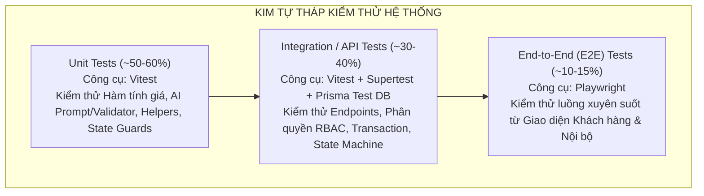
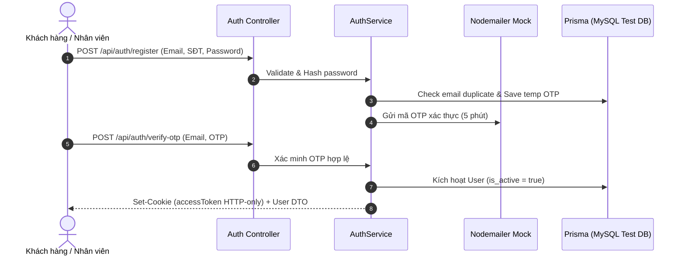
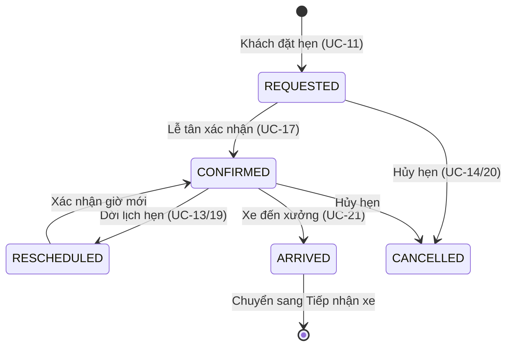
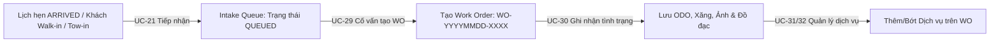
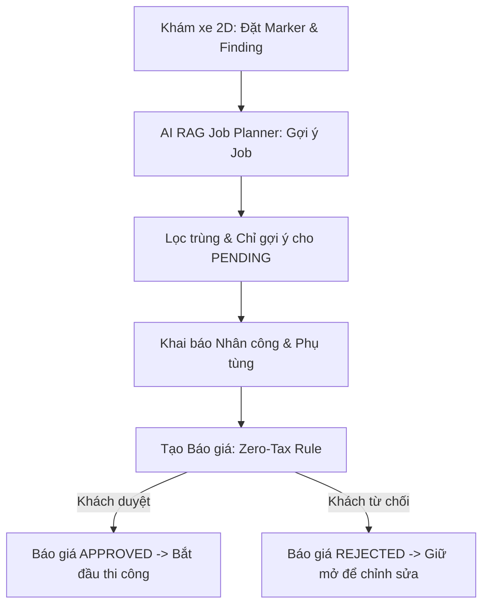
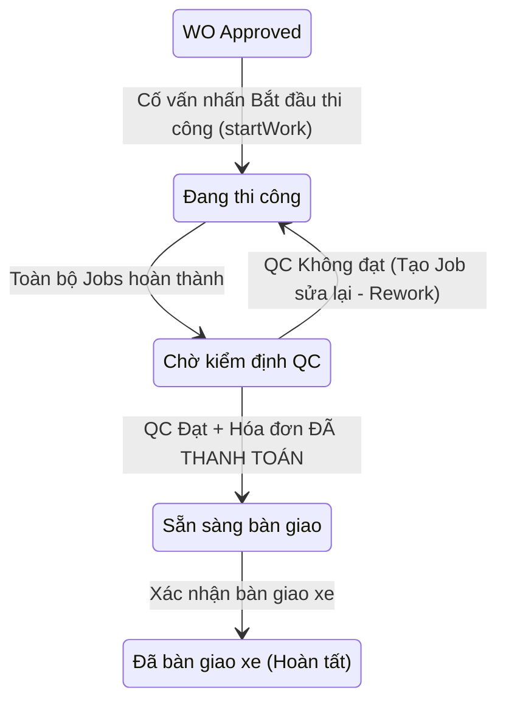
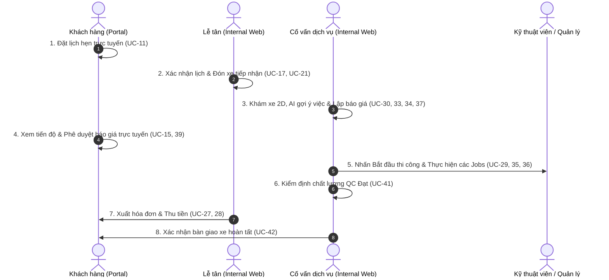

# KẾ HOẠCH & KỊCH BẢN KIỂM THỬ TỰ ĐỘNG (AUTOMATED TESTING PLAN)
## DỰ ÁN: HỆ THỐNG QUẢN LÝ TRUNG TÂM DỊCH VỤ Ô TÔ (CAR SERVICE CENTER)

> **Phiên bản:** 1.0  
> **Tài liệu tham chiếu:** `docs/requirements/UseCase V2.md`, `docs/requirements/WORK_ORDER_STATUS_TRANSITION.md`, `docs/requirements/Pricing_Calculation_Formulas.md`  
> **Mục tiêu:** Thiết lập chiến lược, kiến trúc hạ tầng và đặc tả kịch bản kiểm thử tự động (Unit Test, Integration/API Test, E2E Test) bao phủ toàn bộ các Use Case đã hoàn thành trong hệ thống.

---

## 1. TỔNG QUAN CHIẾN LƯỢC KIỂM THỬ (TEST STRATEGY & PYRAMID)

Áp dụng mô hình **Kim tự tháp kiểm thử (Test Pyramid)** chuẩn công nghiệp nhằm tối ưu hóa chi phí thực thi, độ tin cậy và tốc độ phản hồi:



### 1.1. Phân tầng kiểm thử chi tiết

| Tầng kiểm thử | Công cụ | Phạm vi / Mục tiêu | Thời gian chạy mục tiêu |
| :--- | :--- | :--- | :--- |
| **Unit Testing** | `Vitest` | Kiểm tra logic nghiệp vụ thuần túy: Thuật toán tính giá (`pricing-calculator`), RAG Validator & Anti-duplication, Token generator, State transition guard rules. Không phụ thuộc DB thật. | `< 5 giây` |
| **Integration / API Testing** | `Vitest` + `Supertest` + Test DB (Prisma) | Kiểm tra API Endpoints, Middleware xác thực JWT, Phân quyền RBAC (`CUSTOMER`, `DESK STAFF`, `SA`, `SERVICE_MANAGER`, `ADMIN`), Quản lý Transaction DB, Cập nhật trạng thái Work Order & Báo giá. | `< 30 giây` |
| **End-to-End (E2E) Testing** | `Playwright` | Kiểm tra trải nghiệm người dùng thực tế trên trình duyệt: Đặt lịch hẹn trực tuyến (Customer Web) -> Lễ tân tiếp nhận -> Cố vấn tạo WO & Báo giá -> Duyệt giá -> Thanh toán & Bàn giao. | `< 3-5 phút` |

---

## 2. MA TRẬN KỊCH BẢN KIỂM THỬ CHI TIẾT THEO NGHIỆP VỤ

### 2.1. Nhóm 1: Xác thực, Phân quyền & Quản lý Tài khoản (UC-01 → UC-05, UC-54 → UC-61)



#### Bảng kịch bản kiểm thử:
| Test ID | Tầng | Use Case | Kịch bản / Mục tiêu | Dữ liệu đầu vào (Given/When) | Kết quả kỳ vọng (Then) |
| :--- | :--- | :--- | :--- | :--- | :--- |
| `AUTH-UT-01` | Unit | UC-02 | Hash password với bcrypt | Mật khẩu thô `Pass@1234` | Hash hợp lệ, `compare(raw, hash) === true`, độ muối tối thiểu 10 vòng |
| `AUTH-UT-02` | Unit | UC-02, 05 | Sinh và kiểm tra hạn sử dụng OTP | OTP sinh 6 chữ số, thời hạn 5 phút | Hợp lệ trước phút thứ 5, báo lỗi `EXPIRED` từ phút thứ 5 trở đi |
| `AUTH-INT-01` | Integration | UC-02 | Đăng ký tài khoản thành công | Email mới, SĐT hợp lệ, Role `CUSTOMER` | HTTP 201, tạo mã OTP trong bảng lưu tạm, trigger gửi email |
| `AUTH-INT-02` | Integration | UC-02 | Chặn trùng Email / SĐT | Email/SĐT đã tồn tại trong DB | HTTP 409 Conflict, thông báo "Email hoặc Số điện thoại đã được đăng ký" |
| `AUTH-INT-03` | Integration | UC-03 | Đăng nhập đúng thông tin | Email & Password chuẩn | HTTP 200, trả về cookie HTTP-Only, payload chứa `userId, email, role` |
| `AUTH-INT-04` | Integration | UC-03 | Đăng nhập sai mật khẩu | Mật khẩu sai quá số lần quy định | HTTP 401 Unauthorized, không cấp token |
| `AUTH-INT-05` | Integration | UC-04 | Đăng xuất người dùng | Gửi request `POST /api/auth/logout` | Cookie bị xóa (`Max-Age=0`), token đưa vào blacklist/hủy phiên |
| `AUTH-INT-06` | Integration | UC-05 | Quên mật khẩu qua OTP | Yêu cầu OTP -> Xác thực OTP -> Đổi pass | Mật khẩu mới được cập nhật, mật khẩu cũ không còn đăng nhập được |
| `RBAC-INT-01` | Integration | UC-21, 29 | Kiểm tra chặn quyền trái phép | Token của `CUSTOMER` truy cập `/api/intake` | HTTP 403 Forbidden, không cho phép truy cập module nghiệp vụ xưởng |
| `RBAC-INT-02` | Integration | UC-29 | Quyền hợp lệ cho vai trò nội bộ | Token của `SA` hoặc `DESK STAFF` truy cập | HTTP 200 OK, cho phép đọc/ghi dữ liệu theo đúng phân quyền |
| `USER-INT-01` | Integration | UC-54..61 | Admin tạo & quản lý nhân viên | Admin tạo nhân viên vị trí `TECHNICIAN` | HTTP 201, tạo bản ghi `User` và `Employee`, liên kết khóa ngoại chuẩn xác |

---

### 2.2. Nhóm 2: Khách hàng, Quản lý Xe & Lịch hẹn (UC-06 → UC-16, UC-17 → UC-20, UC-22 → UC-25)



#### Bảng kịch bản kiểm thử:
| Test ID | Tầng | Use Case | Kịch bản / Mục tiêu | Dữ liệu đầu vào (Given/When) | Kết quả kỳ vọng (Then) |
| :--- | :--- | :--- | :--- | :--- | :--- |
| `VEH-INT-01` | Integration | UC-07 | Thêm xe mới cho khách | Biển số `51F-123.45`, Hãng `Toyota`, Loại `SUV` | HTTP 201, xe được gán với `customer_id` hiện hành |
| `VEH-INT-02` | Integration | UC-07 | Chặn trùng biển số xe | Đăng ký biển số đã có trong hệ thống | HTTP 400 Bad Request: "Biển số xe đã tồn tại trong hệ thống" |
| `VEH-INT-03` | Integration | UC-10 | Chặn xóa xe đang có phiếu WO mở | Xe đang có Work Order trạng thái `IN_PROGRESS` | HTTP 400: Không cho phép xóa xe đang trong quy trình bảo dưỡng/sửa chữa |
| `APPT-INT-01` | Integration | UC-11 | Khách tự đặt lịch hẹn | Chọn ngày hẹn, giờ hẹn, dịch vụ mong muốn | HTTP 201, trạng thái `REQUESTED`, gửi email xác nhận |
| `APPT-INT-02` | Integration | UC-17..20 | Lễ tân chuyển trạng thái lịch | `REQUESTED` -> `CONFIRMED` -> `RESCHEDULED` | Cập nhật DB, lưu lịch sử dời lịch, gửi thông báo khách hàng |
| `APPT-INT-03` | Integration | UC-20 | Hủy lịch hẹn kèm lý do | Lễ tân hủy lịch hẹn kèm `cancelReason` | Trạng thái chuyển `CANCELLED`, giải phóng khung giờ thợ |
| `APPT-INT-04` | Integration | UC-78 | Tự động quét lịch hẹn gửi nhắc nhở | Lịch hẹn diễn ra trong khoảng 23.5h - 24.5h tới | Job cron trigger, gửi mail nhắc, đánh dấu cờ `reminder_sent = true` |
| `CUST-INT-01` | Integration | UC-06, 24 | Cập nhật hồ sơ khách hàng | Cập nhật SĐT, địa chỉ liên hệ tại quầy | HTTP 200, phản ánh đúng dữ liệu lên giao diện Portal và Desk |

---

### 2.3. Nhóm 3: Tiếp nhận xe & Khởi tạo Phiếu công việc (UC-21, UC-29 → UC-32)



#### Bảng kịch bản kiểm thử:
| Test ID | Tầng | Use Case | Kịch bản / Mục tiêu | Dữ liệu đầu vào (Given/When) | Kết quả kỳ vọng (Then) |
| :--- | :--- | :--- | :--- | :--- | :--- |
| `INTAKE-INT-01` | Integration | UC-21 | Tiếp nhận khách Walk-in | Khách vãng lai, tạo nhanh khách & xe, chọn dịch vụ | Tạo bản ghi `Intake` với type `WALK_IN`, status `QUEUED` |
| `INTAKE-INT-02` | Integration | UC-21 | Tiếp nhận từ Lịch hẹn đã đến | Chọn Appointment `CONFIRMED` -> Đánh dấu đến | Appointment chuyển `ARRIVED`, sinh bản ghi `Intake` tương ứng |
| `WO-INT-01` | Integration | UC-29 | Cố vấn tạo Work Order từ Intake | Chọn Intake `QUEUED` -> `Create Work Order` | Sinh mã `WO-YYYYMMDD-XXXX`, status `DRAFT`, Intake chuyển `CONVERTED` |
| `WO-INT-02` | Integration | UC-30 | Lưu thông tin tiếp nhận xe ban đầu | ODO: `25000`, Mức xăng: `75%`, Yêu cầu khách, Hình ảnh | Cập nhật thông tin tiếp nhận vào WO, khóa không cho sửa khi đã duyệt báo giá |
| `WO-SVC-01` | Integration | UC-31 | Thêm dịch vụ loại FIXED | Dịch vụ Rửa xe trọn gói (Giá cố định) | Giá hiển thị đúng bảng giá cố định, không phụ thuộc kích cỡ xe |
| `WO-SVC-02` | Integration | UC-31 | Thêm dịch vụ loại VEHICLE_SIZE | Dịch vụ Đánh bóng sơn toàn bộ xe, Xe: `SUV` | Giá tính = Giá gốc * Hệ số kích thước SUV (theo cấu hình định giá) |
| `WO-SVC-03` | Integration | UC-32 | Xóa dịch vụ khi còn ở trạng thái DRAFT | Xóa 1 dịch vụ khỏi phiếu WO | Xóa thành công, tự động xóa các Job liên kết thuộc dịch vụ đó |
| `WO-SVC-04` | Integration | UC-32 | Chặn xóa dịch vụ đang thi công | Dịch vụ có status `IN_PROGRESS` | HTTP 400: "Không thể xóa dịch vụ đang thực hiện" |

---

### 2.4. Nhóm 4: Khám xe 2D, AI Job Planner & Báo giá (UC-33 → UC-40)



#### Bảng kịch bản kiểm thử:
| Test ID | Tầng | Use Case | Kịch bản / Mục tiêu | Dữ liệu đầu vào (Given/When) | Kết quả kỳ vọng (Then) |
| :--- | :--- | :--- | :--- | :--- | :--- |
| `INSP-INT-01` | Integration | UC-33 | Đặt marker hư hỏng trên sơ đồ 2D | Tọa độ `(x: 120, y: 340)`, loại `SCRATCH`, vị trí `Bên lái - Cánh trước` | Bản ghi `VehicleFinding` được tạo, gắn kèm Work Order và tọa độ chuẩn xác |
| `AI-RAG-UT-01` | Unit | UC-34 | Loại trừ trùng lặp tên Job (Deduplication) | Danh sách job trả về từ AI chứa tên trùng với job đã có trên DB | Bộ lọc `cleanJobName` phát hiện trùng lặp, loại bỏ job thừa, không tạo trùng |
| `AI-RAG-UT-02` | Unit | UC-34 | Quy tắc chỉ sinh job cho hạng mục PENDING | Service có trạng thái `IN_PROGRESS` hoặc `COMPLETED` | Service bị từ chối gợi ý, trả về thông báo lỗi hoặc mảng rỗng `[]` |
| `AI-RAG-INT-01` | Integration | UC-34 | AI Job Planner luồng thành công (Mock LLM) | Gửi yêu cầu gợi ý job cho dịch vụ "Sửa động cơ bỏ máy" | Sinh danh sách jobs có phân công thợ và thời gian chuẩn; không bị trùng lặp |
| `AI-RAG-INT-02` | Integration | UC-34 | Fallback khi dịch vụ AI gặp sự cố | Mock Gemini API timeout hoặc ném lỗi 500 | Trả về gợi ý từ danh mục chuẩn (Template Matching) mà không làm crash server |
| `LABOUR-INT-01` | Integration | UC-35 | Khai báo nhân công cho Job | Gán kỹ thuật viên, số giờ dự kiến: `2.0h`, đơn giá nhân công | `JobLabour` được tạo, tính tổng tiền công dự toán chính xác |
| `PARTS-INT-01` | Integration | UC-36 | Khai báo phụ tùng từ kho | Chọn mã Bugi `SP-DENSO-01`, số lượng `4` | `JobPart` được tạo, kiểm tra số lượng tồn khả dụng trong kho |
| `PRICE-UT-01` | Unit | UC-37 | Quy chuẩn thuế Zero-Tax (SPEC-FIN-02) | Subtotal bất kỳ (ví dụ: `15.000.000 đ`) | `taxRate = 0`, `taxAmount = 0`, `grandTotal = subtotal - discount` |
| `PRICE-UT-02` | Unit | UC-37 | Giới hạn chiết khấu không vượt quá Subtotal | Chiết khấu nhập `150%` hoặc số tiền > Subtotal | Chiết khấu tự động cap tối đa = `subtotal`, `grandTotal` không âm |
| `QUOT-INT-01` | Integration | UC-37 | Tạo báo giá tổng hợp (Quotation) | Phiếu có 2 dịch vụ, 3 jobs, 4 phụ tùng | Báo giá tạo ở trạng thái `PENDING`, snapshot toàn bộ đơn giá tại thời điểm tạo |
| `QUOT-INT-02` | Integration | UC-39 | Duyệt báo giá (Khách đồng ý) | SA nhấn Duyệt báo giá | Báo giá chuyển `APPROVED`, WO chuyển `APPROVED`, khóa chỉnh sửa báo giá |
| `QUOT-INT-03` | Integration | UC-39 | Từ chối báo giá (Khách từ chối) | SA ghi nhận từ chối kèm lý do | Báo giá chuyển `REJECTED`, WO giữ ở trạng thái điều chỉnh phương án dịch vụ |
| `QUOT-INT-04` | Integration | UC-40 | Hủy báo giá đang chờ duyệt | SA hủy báo giá chưa được duyệt | Báo giá chuyển `CANCELLED`, giải phóng các hạng mục bị khóa tạm |

---

### 2.5. Nhóm 5: Thi công, QC, Quản lý Kho & Bàn giao (UC-26, UC-41, UC-42, UC-44 → UC-52, UC-27, UC-28)



#### Bảng kịch bản kiểm thử:
| Test ID | Tầng | Use Case | Kịch bản / Mục tiêu | Dữ liệu đầu vào (Given/When) | Kết quả kỳ vọng (Then) |
| :--- | :--- | :--- | :--- | :--- | :--- |
| `START-WO-UT-01`| Unit | UC-29 | Guard check điều kiện startWork | WO ở trạng thái `DRAFT` hoặc `IN_PLANNING` | Bị từ chối, yêu cầu WO phải đạt `APPROVED` trước khi thi công |
| `START-WO-INT-01`| Integration | UC-29 | Bắt đầu thi công phiếu công việc | WO `APPROVED` -> Thực hiện `startWork` | WO chuyển `IN_PROGRESS`, tất cả dịch vụ `PENDING` chuyển `IN_PROGRESS` |
| `INV-STOCK-01` | Integration | UC-52 | Nhập kho tính giá vốn bình quân (WAC) | Tồn cũ 10 cái giá 100k, nhập 10 cái giá 120k | Tồn mới 20 cái, giá vốn bình quân di động mới = `110k/cái` |
| `INV-DEDUCT-01`| Integration | UC-36 | Xuất kho phụ tùng theo công việc | Job chuyển thực hiện, dùng 2 lít dầu nhớt | Số lượng khả dụng của dầu nhớt trong kho giảm tương ứng 2 đơn vị |
| `QC-INT-01` | Integration | UC-41 | Đánh giá QC tất cả hạng mục Đạt | Tất cả tiêu chí checklist kiểm định đánh dấu PASS | Dịch vụ được đánh dấu `COMPLETED`, sẵn sàng tạo yêu cầu thanh toán |
| `QC-INT-02` | Integration | UC-41 | Đánh giá QC có hạng mục Không đạt | Có tiêu chí FAIL kèm mô tả lỗi | Hệ thống tạo tự động Job Rework, dịch vụ giữ nguyên chưa thể đóng |
| `INVOICE-INT-01`| Integration | UC-27 | Phát hành hóa đơn từ Báo giá duyệt | Lễ tân nhận yêu cầu thanh toán -> Phát hành | Tạo hóa đơn `UNPAID` với toàn bộ chi phí khớp 100% snapshot báo giá |
| `PAYMENT-INT-01`| Integration | UC-28 | Ghi nhận thanh toán hóa đơn | Khách trả tiền mặt hoặc quét mã QR thành công | Hóa đơn chuyển `PAID`, cờ tài chính đạt điều kiện bàn giao |
| `RELEASE-INT-01`| Integration | UC-42 | Bàn giao xe khi đủ 3 điều kiện | 1) Jobs xong; 2) QC Đạt; 3) Hóa đơn đã thanh toán | WO chuyển `RELEASED`, khóa vĩnh viễn không thể sửa đổi, gửi mail cảm ơn |
| `RELEASE-INT-02`| Integration | UC-42 | Chặn bàn giao khi hóa đơn chưa thanh toán | Hóa đơn còn ở trạng thái `UNPAID` | Hệ thống từ chối bàn giao, cảnh báo: "Hóa đơn chưa được thanh toán" |

---

### 2.6. Nhóm 6: Báo cáo Vận hành & Quản trị Hệ thống (UC-43, UC-53, UC-62 → UC-77)

| Test ID | Tầng | Use Case | Kịch bản / Mục tiêu | Dữ liệu đầu vào (Given/When) | Kết quả kỳ vọng (Then) |
| :--- | :--- | :--- | :--- | :--- | :--- |
| `DASH-INT-01` | Integration | UC-43 | Bảng điều hành xưởng (Workshop Board) | Truy vấn số xe đang chờ tiếp nhận, đang thi công, chờ QC | Trả về số liệu realtime theo các trạng thái của Work Order |
| `REPORT-INT-01`| Integration | UC-53 | Báo cáo doanh thu theo khoảng ngày | Chọn từ ngày A đến ngày B | Tổng hợp chính xác doanh thu từ các hóa đơn `PAID` trong khoảng thời gian |
| `MASTER-INT-01`| Integration | UC-62..65| CRUD Dịch vụ & Danh mục dịch vụ | Thêm, sửa, xóa dịch vụ & ràng buộc khóa ngoại | Dữ liệu cập nhật nhất quán; chặn xóa dịch vụ đã có trên phiếu công việc |
| `MASTER-INT-02`| Integration | UC-70..73| Quản lý Loại công việc (Job Type) | Thêm mã loại công việc mới (Sơn gò, Điện máy, Bảo dưỡng) | Kiểm tra tính duy nhất của mã code, hiển thị trong dropdown tạo Job |

---

### 2.7. Nhóm 7: Kịch bản End-to-End (E2E) Xuyên suốt Quy trình (Playwright)



#### Chi tiết kịch bản E2E kiểm thử hồi quy (Regression Test):
| Kịch bản E2E | Các bước thao tác người dùng (Actions) | Điểm kiểm tra (Verification Assertions) |
| :--- | :--- | :--- |
| **`E2E-FLOW-FULL-SERVICE`**<br>*(Chu trình dịch vụ trọn gói từ Đặt lịch đến Bàn giao)* | 1. Mở Customer Portal (`:3000`), đăng nhập tài khoản khách hàng.<br>2. Đặt lịch hẹn dịch vụ "Bảo dưỡng 40.000 km" cho xe `51F-123.45`.<br>3. Mở Internal Web (`:3001`), đăng nhập Lễ tân, xác nhận lịch và ấn "Đánh dấu đã đến" đưa vào Intake Queue.<br>4. Đăng nhập Cố vấn (SA), tạo Work Order từ Intake.<br>5. Mở tab Khám xe 2D, đặt marker trầy xước.<br>6. Mở tab Job, ấn "AI gợi ý việc", kiểm tra danh sách gợi ý không bị trùng lặp, áp dụng vào phiếu.<br>7. Tạo Báo giá và gửi khách duyệt.<br>8. Khách duyệt báo giá.<br>9. Cố vấn ấn "Bắt đầu thi công" (Work Order chuyển `IN_PROGRESS`).<br>10. Hoàn thành các Jobs, thực hiện QC Đạt.<br>11. Lễ tân phát hành hóa đơn và ghi nhận thanh toán tiền mặt.<br>12. Cố vấn ấn "Xác nhận bàn giao xe". | - Lịch hẹn chuyển đúng trạng thái theo thời gian thực.<br>- Work Order sinh đúng mã chuẩn `WO-YYYYMMDD-XXXX`.<br>- Thuế suất hiển thị đúng 0 đ (Zero-Tax).<br>- Không xuất hiện lỗi trùng lặp Job.<br>- Hóa đơn hiển thị ĐÃ THANH TOÁN.<br>- Phiếu công việc chuyển trạng thái cuối cùng: `RELEASED` và khóa toàn bộ form. |

---

## 3. THIẾT KẾ MÔI TRƯỜNG & CHIẾN LƯỢC MOCKING (TEST ENVIRONMENT & ISOLATION)

### 3.1. Phân lập cơ sở dữ liệu (Database Strategy)
- **Cơ chế:** Sử dụng cơ sở dữ liệu kiểm thử riêng biệt (Dedicated Test Database `car_service_test` trên MySQL cục bộ hoặc qua Docker container).
- **Setup & Teardown:**
  - `beforeAll`: Chạy `npx prisma db push --schema=prisma/schema.prisma` để đồng bộ schema.
  - `beforeEach`: Truncate hoặc dọn dẹp các bảng nghiệp vụ có phát sinh dữ liệu test (`WorkOrder`, `Quotation`, `Appointment`, `Intake`, `Invoice`) bằng transaction rollback hoặc script reset gọn nhẹ.
  - Sử dụng **Prisma Seed Data** cố định cho Master Data (`Role`, `Service`, `PartCategory`, `VehicleSize`).

### 3.2. Ranh giới Mocking dịch vụ bên thứ ba (External Services Mocking)
Để đảm bảo các bài test chạy độc lập, siêu tốc và không tốn chi phí API:

```typescript
// 1. Mock Gemini Generative AI (ai-job-planner.service.ts)
vi.mock('@google/genai', () => ({
  GoogleGenAI: vi.fn().mockImplementation(() => ({
    getGenerativeModel: vi.fn().mockReturnValue({
      generateContent: vi.fn().mockResolvedValue({
        response: {
          text: () => JSON.stringify({
            jobs: [
              { jobName: 'Chẩn đoán lỗi động cơ OBD-II', jobCategory: 'MECHANICAL', estimatedHours: 1.0, requiredRole: 'TECHNICIAN' },
              { jobName: 'Thay cụm bu-gi đánh lửa', jobCategory: 'MECHANICAL', estimatedHours: 1.0, requiredRole: 'TECHNICIAN' }
            ]
          })
        }
      })
    })
  }))
}));

// 2. Mock Cloudinary Image Upload
vi.mock('cloudinary', () => ({
  v2: {
    uploader: {
      upload_stream: vi.fn((options, callback) => {
        callback(null, { secure_url: 'https://mock-res.cloudinary.com/test-photo.jpg' });
      })
    }
  }
}));

// 3. Mock Nodemailer SMTP Transporter
vi.mock('nodemailer', () => ({
  createTransport: vi.fn().mockReturnValue({
    sendMail: vi.fn().mockResolvedValue({ messageId: 'mock-mail-id-12345' })
  })
}));
```

---

## 4. KẾ HOẠCH PHÂN KỲ TRIỂN KHAI (IMPLEMENTATION ROADMAP)

```mermaid
gantt
    title LỘ TRÌNH XÂY DỰNG AUTOMATIC TESTING (4 TUẦN)
    dateFormat  YYYY-MM-DD
    section Giai đoạn 1: Foundation & Unit
    Thiết lập cấu hình Vitest, Test DB & Mocking      :done, p1_1, 2026-11-02, 2d
    Viết Unit Test cho Pricing & AI RAG Guard        :done, p1_2, 2026-11-04, 3d
    section Giai đoạn 2: API Integration Tests
    Integration Test: Auth, RBAC & Customer (UC-01..16)  :done, p2_1, 2026-11-08, 4d
    Integration Test: WO, 2D Car & Quotation (UC-21..40) :done, p2_2, 2026-11-13, 5d
    Integration Test: QC, Payment & Release (UC-41..53)  :done, p2_3, 2026-11-19, 4d
    section Giai đoạn 3: E2E Playwright Tests
    Cấu hình Playwright & Viết luồng E2E Đặt lịch/Khám xe :done, p3_1, 2026-11-24, 4d
    E2E Luồng Báo giá, Thi công, QC & Bàn giao xe         :done, p3_2, 2026-11-28, 4d
    section Giai đoạn 4: CI/CD Pipeline
    Thiết lập GitHub Actions tự động chạy khi PR/Commit   :done, p4_1, 2026-12-03, 3d
```

### Chi tiết các Sprint:
1. **Sprint 1: Củng cố Nền tảng & Phủ toàn diện Unit Tests (Hoàn thành)**
   - Hoàn thiện test suite cho `pricing-calculator.util.ts`, `rag-validator.service.ts`, `jwt.util.ts`.
   - Mục tiêu: 100% logic tính toán tài chính và chống trùng job được bọc an toàn.
2. **Sprint 2: Xây dựng Suite Integration Tests cho Toàn bộ Endpoints (Hoàn thành)**
   - Viết bài test API với `supertest` cho 20 file routes hiện có.
   - Kiểm tra chặt chẽ điều kiện phân quyền RBAC và chuyển đổi trạng thái Work Order.
3. **Sprint 3: Xây dựng Bộ kiểm thử E2E với Playwright (Hoàn thành)**
   - Cài đặt `@playwright/test` trong `src/frontend`.
   - Tự động hóa 3 luồng cốt lõi: Khách đặt lịch qua Portal, Cố vấn xử lý Work Order trên Internal Web, và RBAC Portal Security Guards.
4. **Sprint 4: Tích hợp CI/CD Automation & Master Test Runner (Hoàn thành)**
   - Cấu hình file workflow `.github/workflows/ci.yml` chạy tự động cả 3 jobs: `backend-ci` (78 tests), `frontend-ci` (build/typecheck), và `frontend-e2e` (Playwright Chromium headless).
   - Thiết lập Master Test Runner script `scripts/test_runner.py` cho phép kích hoạt toàn bộ 86 test cases chỉ bằng một câu lệnh duy nhất.

---

## 5. CẤU TRÚC THƯ MỤC KIỂM THỬ ĐỀ XUẤT (DIRECTORY STRUCTURE)

```
d:\TLCN\CAR SERVICE CENTER\
├── src\
│   ├── backend\
│   │   ├── tests\
│   │   │   ├── unit\
│   │   │   │   ├── pricing-calculator.spec.ts   (Đã có)
│   │   │   │   ├── quotation.service.spec.ts    (Đã có)
│   │   │   │   ├── start-work.spec.ts           (Đã có)
│   │   │   │   ├── ai-rag-validator.spec.ts     (Mới)
│   │   │   │   └── auth-helpers.spec.ts         (Mới)
│   │   │   ├── integration\
│   │   │   │   ├── auth.integration.spec.ts     (UC-02..05, 54..61)
│   │   │   │   ├── appointment.integration.spec.ts (UC-11..14, 17..20, 78)
│   │   │   │   ├── intake.integration.spec.ts   (UC-21)
│   │   │   │   ├── work-order.integration.spec.ts (UC-29..32)
│   │   │   │   ├── inspection.integration.spec.ts (UC-33)
│   │   │   │   ├── ai-job-planner.integration.spec.ts (UC-34)
│   │   │   │   ├── quotation.integration.spec.ts (UC-37..40)
│   │   │   │   ├── execution-qc.integration.spec.ts (UC-26, 41)
│   │   │   │   ├── invoice-payment.integration.spec.ts (UC-27, 28)
│   │   │   │   ├── inventory.integration.spec.ts (UC-44..52)
│   │   │   │   └── release.integration.spec.ts  (UC-42)
│   │   │   ├── fixtures\                        (Dữ liệu mẫu chuẩn)
│   │   │   └── setup.ts                         (Mock mail, AI, cloudinary)
│   │   └── vitest.config.ts
│   │
│   └── frontend\
│       ├── e2e\
│       │   ├── customer-booking.spec.ts         (Playwright E2E)
│       │   ├── sa-work-order-lifecycle.spec.ts  (Playwright E2E)
│       │   └── payment-and-release.spec.ts      (Playwright E2E)
│       └── playwright.config.ts
```

---

## 6. LỆNH THỰC THI KIỂM THỬ (EXECUTION COMMANDS)

### 6.1. Sử dụng Master Test Runner (Một lệnh chạy toàn bộ)

```bash
# Chạy TOÀN BỘ 86 bài test (Unit + Integration + Playwright E2E)
python scripts/test_runner.py --all

# Chạy riêng tầng Backend (Unit + Integration: 78 tests)
python scripts/test_runner.py --backend

# Chạy riêng tầng Unit Tests (42 tests)
python scripts/test_runner.py --unit

# Chạy riêng tầng Integration Tests (36 tests)
python scripts/test_runner.py --integration

# Chạy riêng tầng E2E Playwright (8 tests)
python scripts/test_runner.py --e2e

# Mở Playwright UI tương tác trực quan
python scripts/test_runner.py --ui
```

### 6.2. Lệnh npm trực tiếp theo từng phân vùng

```bash
# 1. Chạy toàn bộ Unit Tests phía Backend
npm run test:unit --prefix src/backend

# 2. Chạy riêng nhóm Integration Tests (API + RBAC) phía Backend
npm run test:integration --prefix src/backend

# 3. Chạy toàn bộ Test Backend (Unit + Integration: 78 tests)
npm test --prefix src/backend

# 4. Chạy kiểm thử E2E trên trình duyệt với Playwright (Frontend: 8 scenarios)
npm run test:e2e --prefix src/frontend

# 5. Chạy Playwright với giao diện trực quan (Playwright UI Mode)
npm run test:e2e:ui --prefix src/frontend
```

---

## 7. KẾT QUẢ TRIỂN KHAI THỰC TẾ (EXECUTION REPORT)

### 7.1. Tổng quan số lượng kịch bản (111/111 Tests Passed - 100%)

| Tầng kiểm thử (Layer) | Số file test | Số Test Cases | Thời gian chạy | Tỉ lệ Pass |
| :--- | :---: | :---: | :---: | :---: |
| **Backend Unit Tests** | 8 files | **45 tests** | ~980 ms | **100%** |
| **Backend Integration Tests** | 6 files | **58 tests** | ~4.47 s | **100%** |
| **Frontend Playwright E2E** | 3 files | **8 tests** | ~38.4 s | **100%** |
| **Tổng cộng toàn hệ thống** | **17 files** | **111 tests** | **~47.4 s** | **100%** |

### 7.2. Chi tiết các kịch bản kiểm thử đã hoàn thành

#### Sprint 1: Unit Testing (Backend Logic Core)
1. `tests/unit/ai-rag-validator.spec.ts` (7 tests): Khử trùng lặp job, chuẩn hóa tên tiếng Việt có dấu (`đ`/`Đ`), fallback `job_type_id`, kiểm duyệt danh sách công việc.
2. `tests/unit/inventory-wac.spec.ts` (5 tests): Tính giá vốn bình quân gia quyền Moving WAC, kiểm soát tồn kho khả dụng `available = onHand - reserved`.
3. `tests/unit/work-order-guards.spec.ts` (9 tests): State machine transitions, quy tắc chặn bắt đầu sửa chữa khi báo giá chưa duyệt, phân công kỹ thuật viên.
4. `tests/unit/auth-helpers.spec.ts` (6 tests): Hash mật khẩu bcrypt, JWT verify/sign, RBAC permission matching.
5. `tests/unit/pricing-calculator.spec.ts` (6 tests): Công thức tính tiền công, phụ tùng, thuế VAT và chiết khấu.
6. `tests/unit/quotation.service.spec.ts` (5 tests): Tạo các version báo giá (V1, V2), logic tính tổng tiền.
7. `tests/unit/start-work.spec.ts` (4 tests): Kiểm tra điều kiện tiên quyết trước khi KTV bấm Bắt đầu làm.

#### Sprint 2: Integration & API Testing (Supertest + In-Memory Mock Transaction)
1. `tests/integration/auth-rbac.spec.ts` (9 tests): Test 401 unauthenticated, 403 sai role (Customer không thể truy cập portal nội bộ `x-portal: internal`), 200 cho Desk Staff, SA, Admin.
2. `tests/integration/intake-api.spec.ts` (9 tests): Tạo lượt tiếp nhận Walk-in / Tow-in, kiểm tra xe trùng đang chờ tiếp nhận, hủy phiếu tiếp nhận ở trạng thái `QUEUED` vs chặn khi đã `CONVERTED`.
3. `tests/integration/work-order-api.spec.ts` (10 tests): Chuyển tiếp nhận thành Work Order (`WO-YYMMDD-XXX`), chặn Customer gọi API nội bộ, gọi API theo dõi tiến độ xe (`/my-tracking`), luồng chuyển trạng thái `APPROVED` -> `IN_PROGRESS`.
4. `tests/integration/quotation-api.spec.ts` (8 tests): Xem chi tiết báo giá, duyệt báo giá (`APPROVED`), ngăn chặn duyệt trùng 2 lần, từ chối báo giá kèm lý do (`REJECTED`), hủy báo giá nháp.

#### Sprint 3: Playwright E2E UI Automation (Headless Browser & Route Interception)
1. `e2e/customer-booking.spec.ts` (3 tests):
   - Đăng nhập Cổng Khách hàng (`http://localhost:3000/login`) với validation lỗi và redirect về profile khi thành công.
   - Luồng đặt lịch hẹn 3 bước (Wizard: Chọn xe -> Chọn dịch vụ + ghi chú -> Chọn ngày giờ -> Xác nhận đặt lịch thành công).
   - Quản lý danh sách phương tiện (`/customer/vehicles` -> `/customer/profile?tab=vehicles`).
2. `e2e/advisor-wo-lifecycle.spec.ts` (3 tests):
   - Đăng nhập Cố vấn dịch vụ trên Cổng nội bộ (`http://localhost:3001/login`) -> chuyển hướng `/advisor`.
   - Xem chi tiết Work Order (`/advisor/work-orders/101`), chuyển đổi giữa các Tab (Tiếp nhận, Hạng mục sửa chữa, Báo giá).
   - Tính năng AI Job Planner ("AI gợi ý việc"): phát hiện công việc đã có trên phiếu, hiển thị nhãn `Đã có trên phiếu`, tự động bỏ chọn để chống trùng lặp, áp dụng vào phiếu thành công.
3. `e2e/auth-rbac-guard.spec.ts` (2 tests):
   - Chặn tài khoản role Customer đăng nhập vào Cổng Quản trị nội bộ (`http://localhost:3001`).
   - Tự động xóa phiên đăng nhập cũ không hợp lệ nếu người dùng mở sai cổng.

#### Sprint 5: Hoàn thiện Kiểm thử Toàn bộ Use Case đã Xong (Gap-Closing)
1. `tests/integration/appointment-api.spec.ts` (14 tests):
   - UC-11, UC-12, UC-17, UC-18: Khách & Lễ tân xem/tạo lịch hẹn, phân trang, lọc trạng thái.
   - UC-13, UC-19: Dời lịch hẹn (`PUT /api/appointments/:id`), cập nhật ngày giờ và trạng thái `RESCHEDULED`.
   - UC-14, UC-20: Hủy lịch hẹn (`PATCH /api/appointments/:id/cancel`), kiểm tra bắt buộc lý do hủy và chặn khách tự hủy khi lịch đã `CONFIRMED`.
   - UC-21: Tiếp nhận xe từ lịch hẹn (`PATCH /api/appointments/:id/arrive`), tự động sinh `IntakeRecord` và chuyển `ARRIVED`.
2. `tests/integration/invoice-payment-api.spec.ts` (8 tests):
   - UC-16: Khách hàng xem danh sách hóa đơn cá nhân (`GET /api/invoices/my-invoices`) kèm thống kê Bento (`totalSpent`, `pendingAmount`, `pendingCount`, `rewardPoints`).
   - UC-16, UC-27: Xem chi tiết hóa đơn (`GET /api/invoices/:id`), kiểm tra Zero-Tax và phương thức thanh toán.
   - UC-16 Security Guard: Chặn tài khoản Customer cố truy cập hóa đơn của khách hàng khác (403 Forbidden).
   - UC-27: Cho phép Cố vấn và Lễ tân (`SA`, `DESK STAFF`) tra cứu chi tiết mọi hóa đơn theo ID.
3. `tests/unit/auto-reminder.spec.ts` (3 tests):
   - UC-78: Kiểm tra tác vụ ngầm tự động quét lịch hẹn diễn ra trong khoảng 23.5h - 24.5h tới và gửi email nhắc nhở kèm template HTML.


