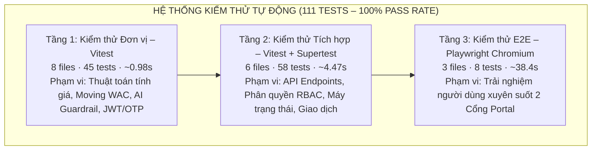
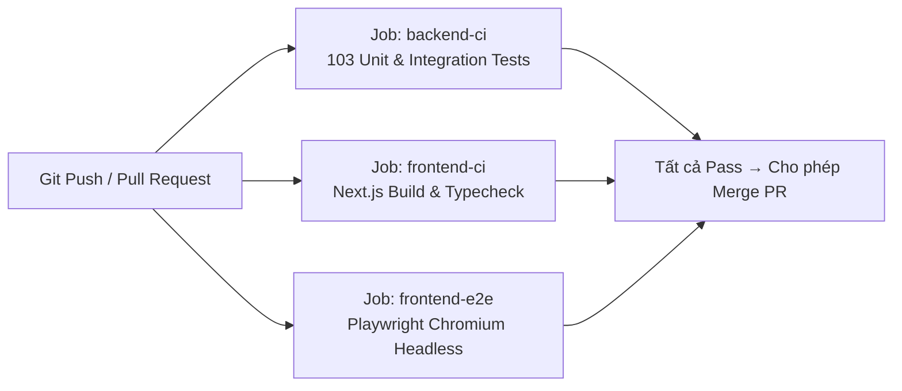

# KẾ HOẠCH KIỂM THỬ (TEST PLAN)
## HỆ THỐNG QUẢN LÝ TRUNG TÂM DỊCH VỤ Ô TÔ (CAR SERVICE CENTER)

> **Phiên bản tài liệu:** 1.0  
> **Ngày lập:** 2026-11-10  
> **Trạng thái:** Đang thực thi

---

## MỤC LỤC

1. [Giới thiệu (Introduction)](#1-giới-thiệu-introduction)
   - [1.1 Mục tiêu (Objectives)](#11-mục-tiêu-objectives)
   - [1.2 Thành viên nhóm (Team Members)](#12-thành-viên-nhóm-team-members)
2. [Phạm vi kiểm thử (Scope)](#2-phạm-vi-kiểm-thử-scope)
3. [Giả định và Rủi ro (Assumptions / Risks)](#3-giả-định-và-rủi-ro-assumptions--risks)
   - [3.1 Giả định (Assumptions)](#31-giả-định-assumptions)
   - [3.2 Rủi ro (Risks)](#32-rủi-ro-risks)
4. [Phương pháp Kiểm thử (Test Approach)](#4-phương-pháp-kiểm-thử-test-approach)
   - [4.1 Kiểm thử Thủ công (Manual Testing)](#41-kiểm-thử-thủ-công-manual-testing)
   - [4.2 Kiểm thử Hộp trắng (White-box Testing)](#42-kiểm-thử-hộp-trắng-white-box-testing)
   - [4.3 Kiểm thử Tự động (Automated Testing)](#43-kiểm-thử-tự-động-automated-testing)
5. [Môi trường Kiểm thử (Test Environment)](#5-môi-trường-kiểm-thử-test-environment)
6. [Mốc thời gian và Sản phẩm bàn giao (Milestones / Deliverables)](#6-mốc-thời-gian-và-sản-phẩm-bàn-giao-milestones--deliverables)
   - [6.1 Lịch trình Kiểm thử (Test Schedule)](#61-lịch-trình-kiểm-thử-test-schedule)
   - [6.2 Sản phẩm bàn giao (Deliverables)](#62-sản-phẩm-bàn-giao-deliverables)

---

## 1. GIỚI THIỆU (INTRODUCTION)

### 1.1 Mục tiêu (Objectives)

Dự án **"Hệ thống Quản lý Trung tâm Dịch vụ Ô tô" (Car Service Center)** xây dựng nền tảng phần mềm tích hợp nhằm số hóa toàn bộ quy trình vận hành của một garage ô tô chuyên nghiệp. Hệ thống bao gồm hai cổng giao diện độc lập:

- **Cổng Khách hàng (Customer Web):** Cho phép khách hàng tự đặt lịch hẹn, theo dõi tiến độ sửa chữa xe và tra cứu lịch sử dịch vụ trực tuyến.
- **Cổng Nội bộ (Internal Web):** Phục vụ 5 vai trò nhân sự (Nhân viên quầy, Cố vấn dịch vụ, Quản lý dịch vụ, Quản trị viên) quản lý toàn bộ quy trình từ tiếp nhận xe đến bàn giao.

Hệ thống được xây dựng trên nền tảng **Node.js + Express + Prisma + MySQL** (phía máy chủ) và **Next.js** (phía giao diện). Bộ kiểm thử tự động sử dụng Vitest (kiểm thử đơn vị và tích hợp) kết hợp Playwright (kiểm thử E2E) và được tích hợp trong pipeline CI/CD với GitHub Actions.

**Đội ngũ kiểm thử chịu trách nhiệm đảm bảo hệ thống đáp ứng toàn bộ 87 Use Case (UC-01 đến UC-87)** trải rộng trên 7 vai trò tác nhân, bao phủ vòng đời dịch vụ hoàn chỉnh từ Đặt lịch → Tiếp nhận → Khám xe → Báo giá → Thi công → Kiểm định chất lượng (QC) → Thanh toán → Bàn giao xe.

**Mục tiêu quan trọng nhất** là đảm bảo các chức năng nghiệp vụ cốt lõi (must-have) hoạt động chính xác, không có lỗi hồi quy, và đáp ứng đầy đủ 7 tiêu chí nghiệm thu đề tài (AC-01 đến AC-07):

| Mã TC | Tiêu chí nghiệm thu |
| :---: | :--- |
| **AC-01** | Luồng E2E trọn vẹn: Đặt lịch → Tiếp nhận → Khám xe → Báo giá → Thi công → QC → Thanh toán → Bàn giao xe hoạt động thông suốt. |
| **AC-02** | Liên kết chính xác giữa Hạng mục phát hiện (Finding) → Công việc (Job) → Phụ tùng/Vật tư (Part/Material). |
| **AC-03** | Kiểm soát tồn kho khả dụng: không cho phép xuất kho vượt số lượng hiện có. |
| **AC-04** | Tính toán chính xác định mức lao động và đóng băng (snapshot) báo giá khi được phê duyệt. |
| **AC-05** | Nhập kho tính đúng giá vốn bình quân di động (Moving WAC); xuất kho gắn theo từng công việc; tồn kho không âm. |
| **AC-06** | Cổng bàn giao xe (Release Gate) chỉ cho phép bàn giao khi đủ 3 điều kiện: thi công hoàn thành + QC đạt + hóa đơn đã thanh toán. |
| **AC-07** | Bộ kiểm thử tự động bao phủ toàn diện, thực thi độc lập, không phụ thuộc dịch vụ bên ngoài và không phát sinh chi phí. |

---

### 1.2 Thành viên nhóm (Team Members)

| **Họ và tên** | **MSSV** | **Vai trò** |
| :--- | :---: | :--- |
| [Tên thành viên 1] | [MSSV] | Developer / Tester |
| [Tên thành viên 2] | [MSSV] | Developer / Tester |
| [Tên thành viên 3] | [MSSV] | Developer / Tester |
| [Tên thành viên 4] | [MSSV] | Developer / Tester |
| [Tên thành viên 5] | [MSSV] | Developer / Tester |

> **Ghi chú:** Điền tên và MSSV của từng thành viên trong nhóm vào bảng trên.

---

## 2. PHẠM VI KIỂM THỬ (SCOPE)

Phạm vi kiểm thử của đồ án bao gồm toàn bộ các yêu cầu chức năng nghiệp vụ trọng tâm đã được định nghĩa trong tài liệu đặc tả yêu cầu (Requirement v3.md) và tài liệu Use Case (UseCase V2.md). Khi hoàn thành giai đoạn lập trình, quá trình kiểm thử phải đảm bảo **7 tác nhân** thực hiện được các luồng nghiệp vụ cốt lõi sau:

**Khách vãng lai (Guest) – UC-01 đến UC-03:**
- Xem danh sách dịch vụ và bảng giá công khai.
- Tìm kiếm thông tin dịch vụ.
- Đăng ký tài khoản mới.

**Khách hàng (Customer) – UC-04 đến UC-16:**
- Đăng nhập, quản lý hồ sơ cá nhân và thay đổi mật khẩu.
- Quản lý phương tiện cá nhân (thêm, sửa, xóa).
- Đặt lịch hẹn, dời lịch, hủy lịch hẹn trực tuyến.
- Theo dõi tiến độ sửa chữa xe theo thời gian thực.
- Xem, xác nhận hoặc từ chối báo giá sửa chữa.
- Tra cứu lịch sử dịch vụ và hóa đơn.

**Nhân viên quầy / Lễ tân (Front Desk Staff) – UC-17 đến UC-28:**
- Quản lý lịch hẹn toàn xưởng (xác nhận, từ chối, dời lịch).
- Tiếp nhận xe tại quầy (khách hẹn trước, khách vãng lai, xe cứu hộ).
- Tạo hồ sơ khách hàng mới và phương tiện ngay tại quầy.
- Lập và in hóa đơn thanh toán; xử lý thanh toán tại quầy.
- Bàn giao xe cho khách hàng.

**Cố vấn dịch vụ (Service Advisor – SA) – UC-29 đến UC-43:**
- Tạo phiếu công việc (Work Order) từ phiếu tiếp nhận.
- Thực hiện khám xe, ghi nhận hạng mục phát hiện trên sơ đồ 2D.
- Sử dụng AI Job Planner để gợi ý và phân công công việc.
- Lập báo giá chi tiết và gửi cho khách hàng phê duyệt.
- Giám sát tiến độ thi công và phân công thợ kỹ thuật.
- Thực hiện kiểm định chất lượng (QC) sau sửa chữa.
- Quản lý xuất nhập kho phụ tùng theo từng công việc.

**Quản lý dịch vụ (Service Manager) – UC-44 đến UC-53:**
- Quản lý danh mục và mã phụ tùng (SKU).
- Thực hiện nhập kho, điều chỉnh tồn kho và cảnh báo thiếu hàng.
- Xem báo cáo doanh thu, tồn kho và hiệu suất kỹ thuật viên.
- Quản lý danh mục loại dịch vụ và loại công việc.

**Quản trị viên (Administrator) – UC-54 đến UC-78:**
- Quản lý tài khoản nhân viên (tạo, cấp quyền, khóa, mở khóa).
- Quản lý dữ liệu chủ: hãng xe, dòng xe, loại dịch vụ, loại công việc.
- Xem báo cáo tổng hợp toàn hệ thống.

**Hệ thống tự động (System) – UC-79:**
- Tự động quét và gửi email nhắc lịch hẹn trước 24 giờ.

**Vì đây là đồ án môn học với quy mô và tài nguyên hạn chế**, các loại kiểm thử phi chức năng phức tạp như kiểm thử chịu tải (Load Testing), kiểm thử bảo mật chuyên sâu (Penetration Testing) sẽ **không** nằm trong phạm vi dự án.

**Ngoài phạm vi kiểm thử:**
- Ứng dụng di động (Mobile App).
- Tích hợp cổng thanh toán thực tế (VNPAY/MoMo production).
- Phân hệ Bảo hành (Warranty Management – UC-81 đến UC-87): Dự kiến bổ sung trong giai đoạn tiếp theo.
- Bộ kịch bản kiểm thử hóa đơn/thanh toán nội bộ chi tiết (TC_Billing_Invoice_Process.md): Dự kiến bổ sung trong giai đoạn tiếp theo.
- Kiểm thử bảo mật URL/API riêng lẻ: Sẽ được thực hiện trong bộ kiểm thử API riêng biệt.

---

## 3. GIẢ ĐỊNH VÀ RỦI RO (ASSUMPTIONS / RISKS)

### 3.1 Giả định (Assumptions)

Phần này liệt kê các giả định được đặt ra cụ thể cho dự án này:

- Toàn bộ mã nguồn backend và frontend có thể triển khai và chạy được trên môi trường cục bộ (localhost) của máy tính thành viên.
- Cơ sở dữ liệu MySQL (cục bộ hoặc Docker) có thể khởi tạo và nạp dữ liệu mẫu (seed) thành công trước khi thực thi kiểm thử.
- Toàn bộ 87 Use Case đã được phê duyệt và chốt về phạm vi; không có thay đổi chức năng lớn sau khi bắt đầu giai đoạn kiểm thử.
- Mọi thành viên trong nhóm đều có quyền truy cập vào cả hai cổng giao diện (Cổng Khách hàng tại cổng 3000 và Cổng Nội bộ tại cổng 3001).
- Các dịch vụ bên ngoài (Cloudinary để lưu ảnh, Nodemailer để gửi email) được giả lập (mock) trong môi trường kiểm thử tự động, không yêu cầu kết nối mạng thực.
- Trình duyệt Google Chrome (phiên bản mới nhất) được cài đặt sẵn trên máy dùng để kiểm thử E2E bằng Playwright.
- Python 3.x và Node.js (phiên bản LTS) đã được cài đặt để vận hành bộ kiểm thử tự động.

---

### 3.2 Rủi ro (Risks)

Các rủi ro sau đây đã được xác định và sẽ có hành động thích hợp để giảm thiểu tác động. Mức độ ảnh hưởng (severity) dựa trên việc dự án sẽ bị ảnh hưởng ra sao nếu rủi ro xảy ra.

| **#** | **Rủi ro (Risk)** | **Mức độ (Impact)** | **Dấu hiệu nhận biết (Trigger)** | **Kế hoạch giảm thiểu (Mitigation Plan)** |
| :---: | :--- | :---: | :--- | :--- |
| **1** | **Phạm vi mở rộng (Scope Creep):** Nhóm bổ sung tính năng mới ngoài đặc tả ban đầu trong giai đoạn lập trình. | **Cao** | Chậm trễ tiến độ nộp báo cáo đồ án. | Phạm vi dự án phải được chốt chặt chẽ theo đặc tả. Mọi thay đổi phải thảo luận nhóm và xin ý kiến giảng viên hướng dẫn trước khi thực hiện. |
| **2** | **Thay đổi chức năng ở phút chót:** Sửa code vào giai đoạn cuối làm vô hiệu hóa các kịch bản kiểm thử đã viết và làm hỏng bộ test tự động. | **Cao** | Các test case cũ không còn phù hợp; bộ kiểm thử tự động báo lỗi (FAIL) đột ngột. | Hạn chế tối đa việc thay đổi đặc tả trong giai đoạn kiểm thử. Nếu bắt buộc có thay đổi, phải cập nhật tài liệu và test case tương ứng ngay lập tức. Duy trì pipeline CI/CD để phát hiện hồi quy sớm. |
| **3** | **Thiếu dữ liệu kiểm thử:** Dữ liệu mẫu (seed data) trong database không đủ để thực thi tất cả các kịch bản kiểm thử thủ công, đặc biệt là các kịch bản phụ thuộc vào trạng thái trung gian của Work Order. | **Trung bình** | Tester không thể thực thi các test case vì thiếu dữ liệu tiền điều kiện. | Chuẩn bị bộ dữ liệu mẫu (seed data) toàn diện cho từng vai trò. Lập hướng dẫn cài đặt môi trường kiểm thử và chia sẻ cho toàn nhóm. |
| **4** | **Trễ tiến độ lập trình:** Các module code không hoàn thành đúng mốc thời gian dự kiến, dẫn đến không đủ thời gian kiểm thử trước ngày nộp đồ án. | **Trung bình** | Các chức năng chưa hoàn thiện theo kế hoạch sprint. | Phân bổ thời gian dự phòng (buffer). Thành viên hoàn thành chức năng nào sẽ tiến hành kiểm thử chéo ngay chức năng đó thay vì chờ đến giai đoạn kiểm thử tổng thể. |
| **5** | **Hai phân hệ lớn chưa có bộ kịch bản kiểm thử:** Phân hệ Hóa đơn/Thanh toán (Billing) và Bảo hành (Warranty – UC-81 đến UC-87) chưa được viết test case thủ công, làm giảm độ bao phủ kiểm thử tổng thể. | **Trung bình** | Luồng nghiệp vụ Thanh toán và Bảo hành không được xác nhận qua kiểm thử hộp đen. | Bổ sung TC_Billing_Invoice_Process.md và TC_Warranty_Process.md trong giai đoạn tiếp theo. Tạm thời bù đắp bằng bộ kiểm thử tích hợp tự động cho hóa đơn (invoice-payment-api.spec.ts). |

---

## 4. PHƯƠNG PHÁP KIỂM THỬ (TEST APPROACH)

Dự án được thực hiện theo mô hình **Waterfall**, phù hợp với tiến trình thực hiện một đồ án môn học. Quá trình kiểm thử hệ thống tổng thể sẽ diễn ra sau khi phần lớn các chức năng đã được lập trình xong.

Các thành viên trong nhóm sẽ luân phiên đóng vai trò là tester để tiến hành **kiểm thử chéo (Cross-testing)** các chức năng do thành viên khác phát triển, nhằm đảm bảo hệ thống đáp ứng đúng yêu cầu của đồ án.

Chiến lược kiểm thử của dự án kết hợp 3 phương pháp bổ sung lẫn nhau:

---

### 4.1 Kiểm thử Thủ công (Manual Testing)

Phương pháp kiểm thử hộp đen (Black-box Testing) theo hành vi người dùng thực tế.

**Cách thực hiện:**

1. Các thành viên sẽ đóng vai trò người dùng cuối (Khách hàng, Lễ tân, Cố vấn dịch vụ, Quản lý, Quản trị viên) và thao tác trực tiếp trên giao diện Website.
2. Dựa vào danh sách kịch bản kiểm thử (Test Cases) đã được biên soạn, tester sẽ thực thi từng bước bằng tay theo đúng quy trình đã mô tả.
3. Quá trình thiết kế dữ liệu đầu vào áp dụng các kỹ thuật phân tích sau:
   - **Phân vùng tương đương (Equivalence Partitioning):** Phân nhóm dữ liệu hợp lệ và không hợp lệ để lựa chọn đại diện tối ưu.
   - **Phân tích giá trị biên (Boundary Value Analysis):** Kiểm tra dữ liệu tại ngưỡng giới hạn (ví dụ: tồn kho = 0, chiết khấu = subtotal).
   - **Chuyển đổi trạng thái (State Transition Testing):** Kiểm tra các chuyển đổi trạng thái của Work Order (DRAFT → IN_PLANNING → PENDING_APPROVAL → APPROVED → IN_PROGRESS → QC_PENDING → READY_FOR_RELEASE → RELEASED).
   - **Bảng quyết định (Decision Table Testing):** Kiểm tra tổ hợp điều kiện phức tạp (ví dụ: Cổng bàn giao xe với 3 điều kiện đồng thời).
   - **Kiểm thử theo Use Case (Use Case Testing):** Mỗi bộ test case ánh xạ trực tiếp đến các Use Case đã định nghĩa.
4. So sánh kết quả thực tế (Actual Result) với kết quả mong đợi (Expected Result); ghi nhận mọi điểm bất thường (Bug/Defect) vào cột ghi chú tương ứng trong bảng kịch bản.

**Bộ kịch bản kiểm thử thủ công hiện có (292 kịch bản – 6 bộ file):**

| **Bộ kịch bản** | **Phân hệ / Phạm vi** | **Số TC** | **Use Case tương ứng** |
| :--- | :--- | :---: | :--- |
| TC_Auth_Profile_Process.md | Xác thực, Hồ sơ cá nhân (Guest + Customer + Nhân viên) | 38 | UC-01 đến UC-10 |
| TC_Appointment_Intake_Process.md | Đặt lịch hẹn, Tiếp nhận xe (Customer + Lễ tân) | 43 | UC-11 đến UC-14, UC-17 đến UC-21 |
| TC_Customer_Profile_Process.md | Hồ sơ khách hàng, Phương tiện, Dịch vụ, Hóa đơn (Customer Portal) | 37 | UC-06 đến UC-16, UC-26 đến UC-28 |
| TC_WorkOrder_SA_Process.md | Phiếu công việc, Khám xe, AI Job Planner, Báo giá, Thi công, QC, Bàn giao (SA) | 64 | UC-29 đến UC-43 |
| TC_Manager_Process.md | Quản lý kho, Danh mục, Báo cáo, Danh mục dịch vụ (Manager) | 60 | UC-44 đến UC-53 |
| TC_Admin_Process.md | Quản trị tài khoản, Dữ liệu chủ, Phân quyền (Admin) | 50 | UC-54 đến UC-78 |
| **TỔNG CỘNG** | | **292** | **UC-01 đến UC-78, UC-79** |

> **Lưu ý:** Hai phân hệ **Hóa đơn/Thanh toán chi tiết** (TC_Billing_Invoice_Process.md) và **Bảo hành** (TC_Warranty_Process.md – UC-81 đến UC-87) chưa có bộ kịch bản thủ công; sẽ được bổ sung trong giai đoạn tiếp theo.

---

### 4.2 Kiểm thử Hộp trắng (White-box Testing)

Bên cạnh kiểm thử hộp đen, nhóm sẽ tiến hành **Kiểm thử Hộp trắng** đối với các đơn vị mã nguồn (hàm/phương thức) có logic nghiệp vụ phức tạp trong tầng dịch vụ (Service Layer) của backend.

Vì nhóm có **5 thành viên**, số lượng đơn vị mã nguồn được chọn để phân tích ít nhất là **10 đơn vị** (2 × số sinh viên). Ưu tiên chọn các hàm/phương thức có nhiều nhánh điều kiện để đảm bảo số đường thi hành tuyến tính độc lập cơ bản đủ độ phức tạp.

**Các hàm nghiệp vụ được đề xuất phân tích:**

| **#** | **Hàm / Module** | **Mô tả nghiệp vụ** | **Lý do chọn** |
| :---: | :--- | :--- | :--- |
| 1 | `calculateLaborTotal()` – pricing-calculator | Tính tổng tiền công lao động theo giờ công và đơn giá | Nhiều nhánh: hệ số kích thước xe, giảm giá |
| 2 | `calculatePartsTotal()` – pricing-calculator | Tính tổng tiền phụ tùng/vật tư theo số lượng và đơn giá | Nhánh kiểm tra tồn kho và đơn giá WAC |
| 3 | `applyDiscount()` – pricing-calculator | Áp dụng và giới hạn chiết khấu không vượt quá subtotal | Quy tắc nghiệp vụ: discount ≤ subtotal |
| 4 | `calculateGrandTotal()` – pricing-calculator | Tính tổng thanh toán cuối cùng (GrandTotal ≥ 0) | Đảm bảo tổng không âm |
| 5 | `validateWorkOrderTransition()` – work-order-guards | Kiểm tra tính hợp lệ của chuyển đổi trạng thái phiếu công việc | Máy trạng thái 8 trạng thái, nhiều điều kiện |
| 6 | `checkReleaseGate()` – work-order-guards | Kiểm tra 3 điều kiện đồng thời để bàn giao xe | Quyết định đa điều kiện phức tạp |
| 7 | `recalculateWAC()` – inventory-wac | Tính lại giá vốn bình quân di động khi nhập kho mới | Công thức tài chính phức tạp, nhiều trường hợp đặc biệt |
| 8 | `checkAvailableStock()` – inventory-wac | Kiểm tra tồn kho khả dụng và chặn xuất kho âm | Điều kiện biên: tồn = 0, dự trữ > tồn |
| 9 | `validateAiJobSuggestions()` – ai-rag-validator | Lọc, chuẩn hóa và loại trùng danh sách công việc AI gợi ý | Nhiều bước xử lý chuỗi và điều kiện lọc |
| 10 | `approveQuotation()` – quotation-service | Phê duyệt báo giá và đóng băng snapshot giá tại thời điểm duyệt | Điều kiện tiền quyết phức tạp, side-effect tới Work Order |

**Quy trình thực hiện cho mỗi đơn vị mã nguồn:**

a. **Lập đồ thị dòng điều khiển cơ bản (Control Flow Graph – CFG):** Vẽ sơ đồ các nút (node) và cạnh (edge) thể hiện luồng thực thi của hàm.

b. **Tính độ phức tạp Cyclomatic (Cyclomatic Complexity – V(G)):** V(G) = E − N + 2P, xác định số đường thi hành tuyến tính độc lập cần kiểm thử.

c. **Thiết kế test case cho từng đường thi hành:** Mỗi đường thi hành độc lập phải có ít nhất 1 test case tương ứng bao phủ.

d. **Lập đồ thị dòng dữ liệu (Data Flow Graph – DFG):** Theo dõi vòng đời định nghĩa (def) và sử dụng (use) của từng biến trong hàm.

e. **Kiểm thử vòng đời biến:** Xác định các cặp def-use và thiết kế test case kiểm tra tính đúng đắn của từng biến tại các điểm sử dụng.

---

### 4.3 Kiểm thử Tự động (Automated Testing)

Dự án áp dụng **mô hình Kim tự tháp Kiểm thử 3 tầng** (Test Pyramid) nhằm tối ưu tốc độ phản hồi và độ tin cậy của bộ kiểm thử:



**Bảng tổng quan kết quả kiểm thử tự động:**

| **Tầng kiểm thử** | **Số files** | **Số tests** | **Thời gian chạy** | **Công cụ chính** | **Kết quả** |
| :--- | :---: | :---: | :---: | :--- | :---: |
| Kiểm thử Đơn vị (Unit Testing) | 8 | 45 | ~0.98s | Vitest | ✅ 45/45 PASS |
| Kiểm thử Tích hợp (Integration Testing) | 6 | 58 | ~4.47s | Vitest + Supertest | ✅ 58/58 PASS |
| Kiểm thử E2E – Playwright | 3 | 8 | ~38.4s | Playwright Chromium | ✅ 8/8 PASS |
| **TỔNG CỘNG** | **17** | **111** | **~47.4s** | **Tự động hóa hoàn toàn** | **✅ 111/111 PASS (100%)** |

**Các nhóm kịch bản kiểm thử tự động theo nghiệp vụ:**

| **Nhóm** | **File kiểm thử** | **Phạm vi nghiệp vụ** | **Số tests** |
| :--- | :--- | :--- | :---: |
| Xác thực & Phân quyền | auth-helpers.spec.ts, auth-rbac.spec.ts, auth-rbac-guard.spec.ts | Băm mật khẩu, JWT, OTP, Ranh giới RBAC, Chặn truy cập chéo cổng | 17 |
| AI Job Planner | ai-rag-validator.spec.ts, advisor-wo-lifecycle.spec.ts | Lọc trùng lặp, Chuẩn hóa tiếng Việt, Fallback job_type, Áp dụng gợi ý | 10 |
| Phiếu công việc | work-order-guards.spec.ts, start-work.spec.ts, work-order-api.spec.ts | Máy trạng thái 8 trạng thái, Điều kiện bắt đầu thi công, Cổng bàn giao xe | 23 |
| Báo giá | quotation.service.spec.ts, quotation-api.spec.ts | Snapshot giá, Zero-Tax, Phiên bản báo giá, Phê duyệt/Từ chối | 13 |
| Tồn kho & Moving WAC | inventory-wac.spec.ts | Tính giá vốn bình quân, Tồn khả dụng, Chặn tồn âm | 5 |
| Lịch hẹn & Tiếp nhận | appointment-api.spec.ts, intake-api.spec.ts | Đặt lịch, Dời lịch, Hủy lịch, Chặn trùng, Tiếp nhận xe 3 loại | 23 |
| Hóa đơn & Thanh toán | invoice-payment-api.spec.ts | Thống kê Bento, Zero-Tax, Bảo mật quyền sở hữu hóa đơn | 8 |
| Nhắc hẹn tự động | auto-reminder.spec.ts | Quét lịch trước 24h, Gửi email, Bỏ qua thiếu email | 3 |
| E2E Khách hàng | customer-booking.spec.ts | Đăng nhập, Đặt lịch 3 bước, Quản lý xe | 3 |
| **TỔNG** | **17 files** | | **111** |

**Lệnh thực thi kiểm thử tự động:**

```powershell
# Chạy TOÀN BỘ 111 bài test (Unit + Integration + E2E)
python scripts/test_runner.py --all

# Chạy riêng Backend (45 Unit + 58 Integration = 103 tests, ~5s)
python scripts/test_runner.py --backend

# Chạy riêng tầng Unit Tests (45 tests, ~1s)
python scripts/test_runner.py --unit

# Chạy riêng tầng Integration Tests (58 tests, ~5s)
python scripts/test_runner.py --integration

# Chạy riêng Playwright E2E Tests (8 tests, ~38s)
python scripts/test_runner.py --e2e

# Mở giao diện tương tác Playwright UI
python scripts/test_runner.py --ui
```

**Tích hợp CI/CD – GitHub Actions:**

Toàn bộ bộ kiểm thử tự động được tích hợp vào pipeline CI/CD thông qua file cấu hình `.github/workflows/ci.yml`. Hệ thống chạy song song 3 jobs mỗi khi có `push` hoặc `pull_request` vào nhánh `main` và `develop`:



**Chiến lược phân lập môi trường (Hermetic Testing):** Toàn bộ 111 bài test chạy độc lập 100%, không phụ thuộc hạ tầng mạng bên ngoài, nhờ sử dụng:
- **Mock Prisma In-Memory:** Giả lập tầng cơ sở dữ liệu.
- **Mock Nodemailer:** Giả lập dịch vụ gửi email thông báo.
- **Playwright Route Interception:** Chặn và giả lập phản hồi API trong kiểm thử E2E.

---

## 5. MÔI TRƯỜNG KIỂM THỬ (TEST ENVIRONMENT)

Môi trường kiểm thử của dự án được cài đặt hoàn toàn trên máy tính cục bộ (localhost) của từng thành viên, không yêu cầu máy chủ đám mây hay hạ tầng bên ngoài:

| **Thành phần** | **Chi tiết** |
| :--- | :--- |
| **Hệ điều hành** | Windows 10 / Windows 11 (64-bit) |
| **Trình duyệt kiểm thử thủ công** | Google Chrome (phiên bản mới nhất) |
| **Trình duyệt kiểm thử E2E** | Chromium Headless (Playwright tự quản lý) |
| **Node.js** | LTS (v18 trở lên) |
| **Python** | v3.8 trở lên (để chạy Master Test Runner) |
| **Cơ sở dữ liệu** | MySQL 8.x (cục bộ hoặc Docker Container) |
| **Backend Server** | Node.js + Express, cổng **3002** |
| **Cổng Khách hàng (Customer Web)** | Next.js, cổng **3000** |
| **Cổng Nội bộ (Internal Web)** | Next.js, cổng **3001** |
| **Framework kiểm thử tự động** | Vitest (Unit + Integration), Playwright (E2E) |
| **ORM / Migration** | Prisma + Prisma Migrate |
| **Lưu trữ ảnh** | Cloudinary (Giả lập trong kiểm thử tự động) |
| **Email** | Nodemailer (Giả lập trong kiểm thử tự động) |
| **CI/CD** | GitHub Actions (3 jobs song song) |

**Hướng dẫn khởi động môi trường kiểm thử cục bộ:**

```powershell
# 1. Khởi tạo và nạp dữ liệu cơ sở dữ liệu
cd src/backend
npx prisma migrate dev
npx prisma db seed

# 2. Khởi động Backend Server (cổng 3002)
npm run dev

# 3. Khởi động Cổng Nội bộ (cổng 3001) – terminal mới
cd src/frontend/internal-web
npm run dev

# 4. Khởi động Cổng Khách hàng (cổng 3000) – terminal mới
cd src/frontend/customer-web
npm run dev

# 5. Chạy toàn bộ kiểm thử tự động
python scripts/test_runner.py --all
```

---

## 6. MỐC THỜI GIAN VÀ SẢN PHẨM BÀN GIAO (MILESTONES / DELIVERABLES)

### 6.1 Lịch trình Kiểm thử (Test Schedule)

| **Tên công việc (Task Name)** | **Bắt đầu (Start)** | **Kết thúc (Finish)** | **Nỗ lực (Effort)** | **Ghi chú** |
| :--- | :---: | :---: | :---: | :--- |
| **Lập kế hoạch kiểm thử (Test Planning)** | | | | |
| &nbsp;&nbsp;Xem xét tài liệu yêu cầu và Use Case | | | 2 ngày | Requirement v3.md, UseCase V2.md |
| &nbsp;&nbsp;Lập kế hoạch kiểm thử (Test Plan) | | | 2 ngày | File TestPlan.md |
| **Thiết kế kịch bản kiểm thử thủ công** | | | | Các thành viên chia nhau viết TC |
| &nbsp;&nbsp;Viết bộ kịch bản cho phân hệ Auth & Hồ sơ | | | 2 ngày | TC_Auth_Profile_Process.md – 38 TC |
| &nbsp;&nbsp;Viết bộ kịch bản cho phân hệ Lịch hẹn & Tiếp nhận | | | 2 ngày | TC_Appointment_Intake_Process.md – 43 TC |
| &nbsp;&nbsp;Viết bộ kịch bản cho phân hệ Khách hàng Portal | | | 2 ngày | TC_Customer_Profile_Process.md – 37 TC |
| &nbsp;&nbsp;Viết bộ kịch bản cho phân hệ Work Order – SA | | | 3 ngày | TC_WorkOrder_SA_Process.md – 64 TC |
| &nbsp;&nbsp;Viết bộ kịch bản cho phân hệ Manager/Kho | | | 2 ngày | TC_Manager_Process.md – 60 TC |
| &nbsp;&nbsp;Viết bộ kịch bản cho phân hệ Admin | | | 2 ngày | TC_Admin_Process.md – 50 TC |
| **Thiết lập môi trường kiểm thử** | | | 1 ngày | Cài đặt, seed data, kiểm tra kết nối |
| **Viết kiểm thử tự động** | | | | |
| &nbsp;&nbsp;Viết Unit Tests (8 files, 45 tests) | | | 4 ngày | Vitest – Logic nghiệp vụ cốt lõi |
| &nbsp;&nbsp;Viết Integration Tests (6 files, 58 tests) | | | 5 ngày | Vitest + Supertest – API & RBAC |
| &nbsp;&nbsp;Viết E2E Tests (3 files, 8 tests) | | | 3 ngày | Playwright Chromium Headless |
| &nbsp;&nbsp;Tích hợp CI/CD – GitHub Actions | | | 2 ngày | 3 jobs song song: backend-ci, frontend-ci, frontend-e2e |
| **Thực thi kiểm thử chức năng thủ công** | | | 5 ngày | Kiểm thử chéo theo vai trò tác nhân |
| **Kiểm thử hệ thống (System Testing)** | | | 3 ngày | Kiểm tra luồng E2E trọn vẹn |
| **Sửa lỗi (Defect Resolution)** | | | 3 ngày | Phối hợp Dev và Tester |
| **Kiểm thử hồi quy (Regression Testing)** | | | 2 ngày | Chạy lại bộ test tự động và TC bị ảnh hưởng |
| **Phân tích hộp trắng (White-box Analysis)** | | | 4 ngày | CFG, V(G), DFG cho 10 hàm nghiệp vụ |
| **Đóng gói và viết báo cáo đồ án** | | | 2 ngày | Tổng hợp kết quả, chuẩn bị nộp |
| **Báo cáo đồ án (Project Presentation)** | | | 1 ngày | Trình bày trước hội đồng |

---

### 6.2 Sản phẩm bàn giao (Deliverables)

| **Sản phẩm bàn giao (Deliverable)** | **Dành cho** | **Ngày / Cột mốc** |
| :--- | :--- | :---: |
| Kế hoạch kiểm thử (Test Plan) – TestPlan.md | Giảng viên hướng dẫn; Nhóm dự án | |
| Bộ kịch bản kiểm thử thủ công (6 file TC_*.md, 292 kịch bản) | Nhóm dự án; Giảng viên | |
| Phân tích hộp trắng (White-box Analysis) – 10 hàm nghiệp vụ | Giảng viên hướng dẫn | |
| Bộ kiểm thử tự động (111 tests, 17 files) – 100% Pass | Nhóm dự án; Giảng viên | |
| Ma trận truy xuất yêu cầu (Requirements Traceability Matrix) | Giảng viên hướng dẫn; Nhóm dự án | |
| Báo cáo lỗi (Defect Report) | Giảng viên hướng dẫn; Nhóm dự án | |
| Báo cáo kết quả kiểm thử thủ công (Manual Test Results Report) | Giảng viên hướng dẫn | |
| Báo cáo kết quả kiểm thử tự động (CI/CD Pipeline Report) | Nhóm dự án | |
| Báo cáo đồ án tổng hợp (Final Project Report) | Giảng viên hướng dẫn; Hội đồng chấm điểm | |


