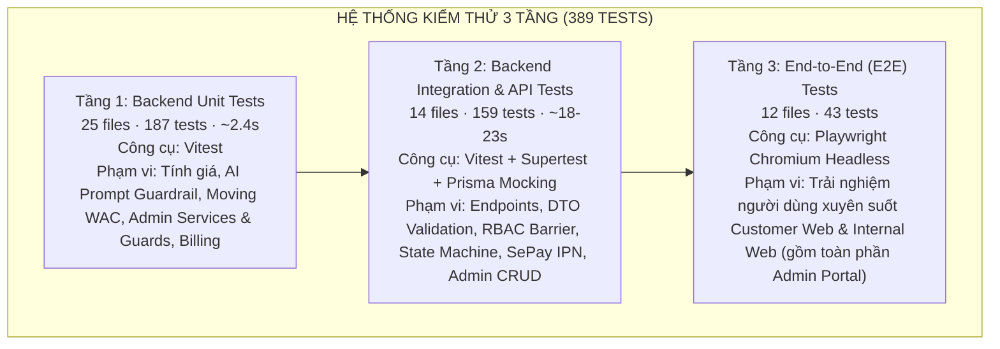
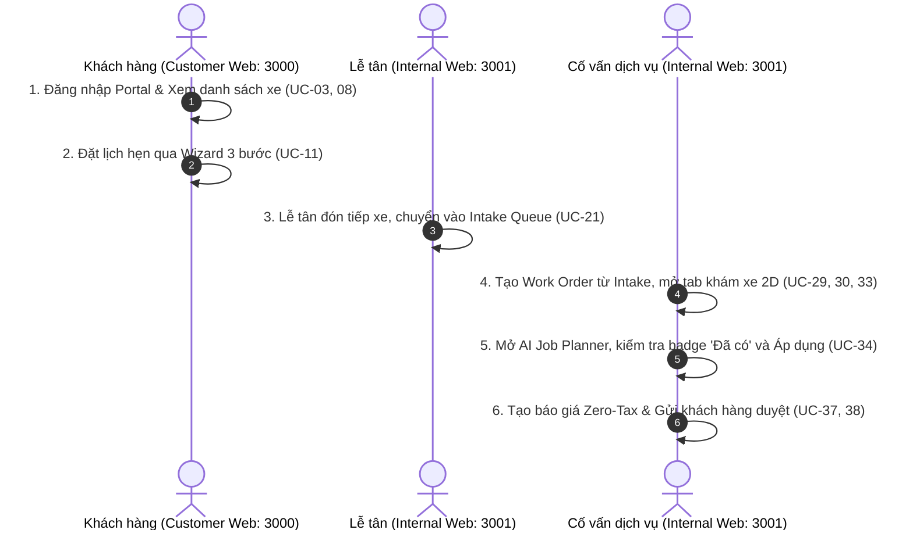
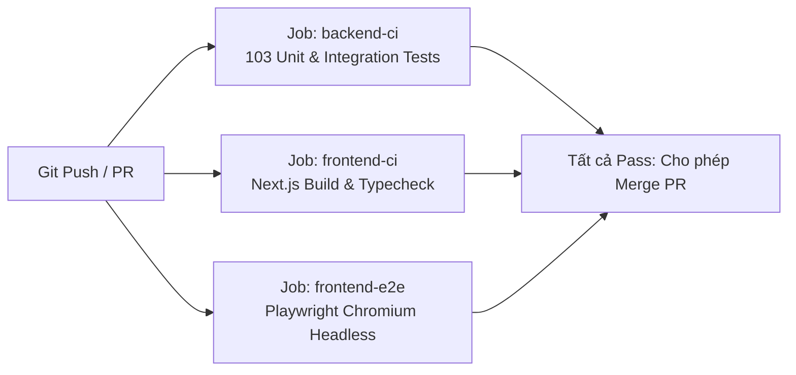

# TÀI LIỆU ĐẶC TẢ & HƯỚNG DẪN KIỂM THỬ TỰ ĐỘNG (AUTOMATED TESTING SPECIFICATION & MANUAL)
## HỆ THỐNG QUẢN LÝ TRUNG TÂM DỊCH VỤ Ô TÔ (CAR SERVICE CENTER)

> **Phiên bản tài liệu:** 2.2  
> **Ngày cập nhật:** 2026-11-13  
> **Tài liệu tham chiếu:** [`UseCase V2.md`](../../requirements/UseCase%20V2.md), [`Requirement v2.md`](../../requirements/Requirement%20v2.md), [`WORK_ORDER_STATUS_TRANSITION.md`](../../requirements/WORK_ORDER_STATUS_TRANSITION.md), [`Pricing_Calculation_Formulas.md`](../../requirements/Pricing_Calculation_Formulas.md), [`SPEC-ADMIN-PORTAL-AUTOMATED-TESTING.md`](./SPEC-ADMIN-PORTAL-AUTOMATED-TESTING.md)  
> **Trạng thái thực thi:** **346/346 Backend Tests PASSED + 43 Playwright E2E Tests (24/24 Admin E2E PASSED) — Tổng 389 Tests / 51 Files**

---

## MỤC LỤC
1. [Tổng quan & Mục đích tài liệu](#1-tổng-quan--mục-đích-tài-liệu)
2. [Kiến trúc Kiểm thử Kim tự tháp (Test Pyramid Architecture)](#2-kiến-trúc-kiểm-thử-kim-tự-tháp-test-pyramid-architecture)
3. [Đặc tả Chi tiết 389 Kịch bản Kiểm thử theo Từng Tầng](#3-đặc-tả-chi-tiết-389-kịch-bản-kiểm-thử-theo-từng-tầng)
   - [3.1. Tầng 1: Backend Unit Tests (25 files, 187 tests)](#31-tầng-1-backend-unit-tests-25-files-187-tests)
   - [3.2. Tầng 2: Backend Integration & API Tests (14 files, 159 tests)](#32-tầng-2-backend-integration--api-tests-14-files-159-tests)
   - [3.3. Tầng 3: Frontend Playwright E2E Tests (12 files, 43 tests)](#33-tầng-3-frontend-playwright-e2e-tests-12-files-43-tests)
4. [Chiến lược Phân lập Môi trường & Mocking Hermetic](#4-chiến-lược-phân-lập-môi-trường--mocking-hermetic)
5. [Hướng dẫn Vận hành & Lệnh Thực thi Kiểm thử](#5-hướng-dẫn-vận-hành--lệnh-thực-thi-kiểm-thử)
6. [Tích hợp Tự động hóa CI/CD (GitHub Actions Pipeline)](#6-tích-hợp-tự-động-hóa-cicd-github-actions-pipeline)
7. [Quy chuẩn Viết Test Mới & Bảo trì Hệ thống](#7-quy-chuẩn-viết-test-mới--bảo-trì-hệ-thống)

---

## 1. TỔNG QUAN & MỤC ĐÍCH TÀI LIỆU

Tài liệu này cung cấp đặc tả kỹ thuật, hướng dẫn vận hành và danh mục kịch bản kiểm thử tự động toàn diện cho hệ thống **Car Service Center**.

### Mục tiêu kỹ thuật:
- **Đảm bảo tính đúng đắn của logic nghiệp vụ cốt lõi:** Bọc toàn bộ các thuật toán tài chính (Zero-Tax, công thức tính tiền công, phụ tùng, chiết khấu, giá vốn bình quân di động Moving WAC).
- **Ngăn chặn lỗi hồi quy (Anti-Regression):** Đặc biệt là lỗi AI gợi ý trùng lặp công việc, các chuyển đổi trạng thái phi hợp lệ của phiếu công việc (Work Order State Transitions), và các lỗi phân quyền truy cập chéo giữa Cổng khách hàng và Cổng nội bộ.
- **Đáp ứng 100% tiêu chí nghiệm thu đề tài (AC-01 → AC-07):**
  - **AC-01:** Kiểm thử luồng E2E trọn vẹn từ Đặt lịch $\rightarrow$ Tiếp nhận $\rightarrow$ Khám xe $\rightarrow$ Báo giá $\rightarrow$ Thi công $\rightarrow$ QC $\rightarrow$ Thanh toán $\rightarrow$ Bàn giao xe.
  - **AC-02 & AC-03:** Liên kết Finding $\rightarrow$ Job $\rightarrow$ Part/Material và kiểm soát tồn kho khả dụng.
  - **AC-04:** Tính toán chính xác định mức lao động và snapshot báo giá cố định khi duyệt.
  - **AC-05:** Nhập kho tính đúng Moving WAC, xuất kho gắn theo Job, kiểm soát tồn kho không âm.
  - **AC-06:** Cổng bàn giao xe (Release Gate) khóa chặt nếu chưa hoàn thành thi công, chưa Pass QC hoặc hóa đơn chưa thanh toán.
  - **AC-07:** Hệ thống kiểm thử tự động bao phủ toàn diện và thực thi độc lập không tốn chi phí bên ngoài.

---

## 2. KIẾN TRÚC KIỂM THỬ KIM TỰ THÁP (TEST PYRAMID ARCHITECTURE)

Hệ thống áp dụng mô hình Kim tự tháp kiểm thử 3 tầng chuẩn công nghiệp nhằm tối ưu hóa tốc độ phản hồi và độ tin cậy:



### Bảng phân bố tài nguyên kiểm thử:
| Tầng kiểm thử | Số files | Số tests | Thời gian chạy | Công cụ chính | Mức độ phụ thuộc |
| :--- | :---: | :---: | :---: | :--- | :--- |
| **Unit Testing** | 25 | **187** | `~2.4s` | Vitest | Thuần In-Memory, không phụ thuộc mạng/DB |
| **Integration Testing** | 14 | **159** | `~18-23s` | Vitest + Supertest | Mock Prisma transaction, Redis & Express app |
| **Playwright E2E Testing** | 12 | **43** | `~1.5-2 phút` | Playwright Chromium | Browser thật (Headless), Route interception |
| **TỔNG CỘNG** | **51** | **389** | **~2 phút** | **Tự động hóa hoàn toàn** | **100% Hermetic & Self-Contained** |

---

## 3. ĐẶC TẢ CHI TIẾT 389 KỊCH BẢN KIỂM THỬ THEO TỪNG TẦNG

---

### 3.1. TẦNG 1: BACKEND UNIT TESTS (25 files, 187 tests)

Cấu trúc chuẩn hóa theo từng domain nghiệp vụ dưới `src/backend/tests/unit/<domain>/*.spec.ts`:

| Domain | File | Số tests | Phạm vi chính |
| :--- | :--- | :---: | :--- |
| `admin/` | `admin-validators.spec.ts` | 16 | Validate DTO quản trị danh mục, nhân viên, dịch vụ |
| `admin/` | `employee-deactivation.spec.ts` | 4 | Chặn vô hiệu hóa nhân viên đang giữ phiếu/việc mở |
| `admin/` | `employee-service.spec.ts` | 21 | Toàn bộ `EmployeeService` & logic thật `checkEmployeeActiveWorkConstraints`, kỹ năng theo role |
| `admin/` | `job-type-service.spec.ts` | 9 | `JobTypeService` CRUD, chặn trùng tên, chặn xóa khi còn tham chiếu |
| `admin/` | `job-type-toggle.spec.ts` | 3 | Bật/tắt loại công việc và kiểm tra ràng buộc |
| `admin/` | `service-category-delete.spec.ts` | 2 | Chặn xóa nhóm dịch vụ còn dịch vụ con |
| `admin/` | `service-category-service.spec.ts` | 6 | `ServiceCategoryService` (`getCategories`, `createCategory`, `updateCategory`) |
| `admin/` | `service-delete.spec.ts` | 4 | Chặn xóa dịch vụ đang gắn trên Work Order |
| `admin/` | `service-service.spec.ts` | 10 | `ServiceService` (`FIXED` bội số 1000, `VEHICLE_SIZE` `sizePrices`, `LABOUR_PARTS`) |
| `admin/` | `service-toggle-active.spec.ts` | 3 | Đổi trạng thái kích hoạt dịch vụ |
| `admin/` | `system-catalog-service.spec.ts` | 11 | `SystemCatalogService` (`typeCounts`, chặn trùng `(catalog_type, name)`, toggle, delete guard) |
| `admin/` | `user-service.spec.ts` | 13 | `UserService` (role alias, bcrypt, Redis `revoked_user:<id>`, chặn khóa `ADMIN`, reset pass) |
| `ai/` | `ai-rag-validator.spec.ts` | 7 | Guardrail chống trùng lặp Job, chuẩn hóa tiếng Việt, fallback `job_type_id` |
| `auth/` | `auth-helpers.spec.ts` | 6 | Bcrypt hash/compare, JWT sign/verify, OTP 6 số, RBAC role check |
| `billing/` | `invoice-builder.spec.ts` | 5 | Dựng hóa đơn từ Work Order / Quotation |
| `billing/` | `invoice-guards.spec.ts` | 10 | Bảo vệ trạng thái hóa đơn & thanh toán |
| `billing/` | `pricing-calculator.spec.ts` | 6 | Tính công, phụ tùng, hệ số kích thước xe, Zero-Tax, cap chiết khấu |
| `billing/` | `sepay-util.spec.ts` | 5 | Tiện ích chữ ký, mã đơn & parse payload SePay |
| `inventory/` | `inventory-wac.spec.ts` | 5 | Moving Weighted Average Cost (WAC), tồn khả dụng, chặn xuất âm |
| `jobs/` | `auto-reminder.spec.ts` | 3 | Cron job nhắc lịch hẹn trước 24h (UC-78) |
| `quotation/` | `quotation.service.spec.ts` | 5 | Versioning báo giá, snapshot đơn giá, khóa sau duyệt |
| `utils/` | `formatters.spec.ts` | 5 | Chuẩn hóa định dạng tiền tệ, ngày giờ, mã số |
| `work-order/` | `qc-workflow.spec.ts` | 7 | Quy trình nghiệm thu QC Pass / Fail & tạo Rework |
| `work-order/` | `start-work.spec.ts` | 4 | Điều kiện tiên quyết trước khi bắt đầu thi công |
| `work-order/` | `work-order-guards.spec.ts` | 17 | State machine Work Order & Release Gate 3 điều kiện |

#### 1. `src/backend/tests/unit/ai-rag-validator.spec.ts` (7 tests)
* **Mục tiêu:** Bọc quy tắc an toàn (Guardrail) cho module gợi ý công việc bằng AI RAG, giải quyết triệt để lỗi sinh trùng lặp công việc và sai lệch loại thợ.
* **Các kịch bản:**
  - `AI-VAL-01`: Lọc bỏ triệt để các Job bị trùng tên trong cùng một nhóm dịch vụ (Deduplication).
  - `AI-VAL-02`: Chuẩn hóa tiếng Việt có dấu/không dấu, chữ hoa/thường, loại bỏ khoảng trắng thừa (`"tháo  và  thay bugi "` $\rightarrow$ `"thao va thay bugi"`).
  - `AI-VAL-03`: Tự động gán fallback `job_type_id` không hợp lệ về mã mặc định hợp lệ đầu tiên của hệ thống.
  - `AI-VAL-04`: Giữ nguyên danh sách công việc khi không có trùng lặp.
  - `AI-VAL-05`: Xử lý an toàn mảng rỗng đầu vào mà không gây crash server.
  - `AI-VAL-06`: Loại bỏ công việc gợi ý nếu tên việc đã tồn tại trên cơ sở dữ liệu của phiếu công việc.
  - `AI-VAL-07`: Quy tắc chặn chỉ sinh công việc cho dịch vụ đang ở trạng thái Chờ xử lý (`PENDING`), từ chối dịch vụ `IN_PROGRESS` hoặc `COMPLETED`.

#### 2. `src/backend/tests/unit/pricing-calculator.spec.ts` (6 tests)
* **Mục tiêu:** Kiểm thử các công thức toán học tính tiền dịch vụ theo tài liệu đặc tả [`Pricing_Calculation_Formulas.md`](file:///d:/TLCN/CAR%20SERVICE%20CENTER/docs/requirements/Pricing_Calculation_Formulas.md).
* **Các kịch bản:**
  - `PRICE-01`: Tính tổng tiền công lao động: $\text{Labour} = \sum (\text{hours} \times \text{hourly\_rate})$.
  - `PRICE-02`: Tính tổng tiền phụ tùng/vật tư: $\text{Parts} = \sum (\text{quantity} \times \text{unit\_price})$.
  - `PRICE-03`: Tính giá theo hệ số kích thước phương tiện (`VEHICLE_SIZE markup multiplier` cho SUV, Sedan, Bán tải).
  - `PRICE-04`: Quy chuẩn thuế **Zero-Tax** theo quy định `SPEC-FIN-02`: $\text{taxRate} = 0$, $\text{taxAmount} = 0$.
  - `PRICE-05`: Giới hạn mức chiết khấu: Chiết khấu nhập quá lớn tự động được chặn lại không vượt quá Subtotal ($\text{Discount} \le \text{Subtotal}$).
  - `PRICE-06`: Tính tổng thanh toán cuối cùng: $\text{GrandTotal} = \text{Subtotal} - \text{Discount}$ (đảm bảo không bao giờ âm).

#### 3. `src/backend/tests/unit/quotation.service.spec.ts` (5 tests)
* **Mục tiêu:** Kiểm thử quản lý phiên bản và snapshot báo giá cố định.
* **Các kịch bản:**
  - `QUOT-SRV-01`: Tự động tăng phiên bản báo giá (`v1` $\rightarrow$ `v2`) khi cố vấn điều chỉnh phương án sửa chữa.
  - `QUOT-SRV-02`: Snapshot đóng băng toàn bộ đơn giá tại thời điểm phê duyệt (không bị ảnh hưởng khi bảng giá gốc thay đổi).
  - `QUOT-SRV-03`: Tổng hợp chính xác chi phí của toàn bộ dịch vụ và phụ tùng liên kết.
  - `QUOT-SRV-04`: Khóa chặn chỉnh sửa khi báo giá đã đạt trạng thái `APPROVED`.
  - `QUOT-SRV-05`: Tính toán lại tổng tiền khi áp dụng mã giảm giá mới.

#### 4. `src/backend/tests/unit/work-order-guards.spec.ts` (9 tests)
* **Mục tiêu:** Kiểm soát máy trạng thái (Finite State Machine) của Work Order theo [`WORK_ORDER_STATUS_TRANSITION.md`](file:///d:/TLCN/CAR%20SERVICE%20CENTER/docs/requirements/WORK_ORDER_STATUS_TRANSITION.md).
* **Các kịch bản:**
  - `WO-GUARD-01`: Chuyển từ `DRAFT` sang `IN_PLANNING` khi lưu thông tin tiếp nhận ban đầu.
  - `WO-GUARD-02`: Chuyển sang `PENDING_APPROVAL` khi gửi báo giá cho khách hàng.
  - `WO-GUARD-03`: Chuyển sang `APPROVED` khi khách hàng đồng ý báo giá.
  - `WO-GUARD-04`: Chuyển sang `IN_PROGRESS` khi cố vấn bấm bắt đầu thi công.
  - `WO-GUARD-05`: Chuyển sang `QC_PENDING` khi tất cả các Jobs thi công hoàn thành.
  - `WO-GUARD-06`: QC Không đạt (FAIL) chuyển ngược về `IN_PROGRESS` và tự động tạo việc sửa lại (Rework).
  - `WO-GUARD-07`: QC Đạt (PASS) chuyển sang `READY_FOR_RELEASE`.
  - `WO-GUARD-08`: **Release Gate:** Cho phép bàn giao xe (`RELEASED`) khi thỏa mãn đồng thời 3 điều kiện: 1) Jobs xong; 2) QC Đạt; 3) Hóa đơn ĐÃ THANH TOÁN (`PAID`).
  - `WO-GUARD-09`: **Release Gate Chặn:** Từ chối bàn giao xe nếu hóa đơn còn `UNPAID` hoặc QC chưa đạt.

#### 5. `src/backend/tests/unit/start-work.spec.ts` (4 tests)
* **Mục tiêu:** Kiểm tra các điều kiện tiên quyết trước khi kỹ thuật viên bắt đầu làm việc.
* **Các kịch bản:**
  - `START-01`: Cho phép bắt đầu thi công khi Work Order ở trạng thái `APPROVED`.
  - `START-02`: Chặn bắt đầu thi công khi Work Order còn ở trạng thái `DRAFT`.
  - `START-03`: Chặn bắt đầu thi công khi Work Order đang chờ duyệt (`PENDING_APPROVAL`).
  - `START-04`: Chặn thao tác bắt đầu thi công khi phiếu đã bị hủy (`CANCELLED`) hoặc đã bàn giao (`RELEASED`).

#### 6. `src/backend/tests/unit/inventory-wac.spec.ts` (5 tests)
* **Mục tiêu:** Kiểm thử thuật toán tính giá vốn bình quân di động (Moving Weighted Average Cost) và bảo vệ số lượng tồn kho khả dụng.
* **Các kịch bản:**
  - `WAC-01`: Tính lại giá vốn WAC khi nhập kho lô hàng mới:
    $$\text{WAC}_{\text{new}} = \frac{(\text{Qty}_{\text{old}} \times \text{WAC}_{\text{old}}) + (\text{Qty}_{\text{in}} \times \text{Price}_{\text{in}})}{\text{Qty}_{\text{old}} + \text{Qty}_{\text{in}}}$$
  - `WAC-02`: Thiết lập giá vốn ban đầu cho lô hàng đầu tiên.
  - `WAC-03`: Xuất kho phụ tùng cho công việc không làm thay đổi đơn giá vốn WAC hiện hành.
  - `WAC-04`: Tính toán số lượng tồn kho khả dụng: $\text{Available} = \text{On-Hand} - \text{Reserved}$.
  - `WAC-05`: Chặn xuất kho vượt quá số lượng tồn khả dụng (ngăn chặn tồn kho âm).

#### 7. `src/backend/tests/unit/auth-helpers.spec.ts` (6 tests)
* **Mục tiêu:** Kiểm thử các hàm tiện ích mã hóa, cấp phát token và kiểm tra quyền.
* **Các kịch bản:**
  - `AUTH-01`: Băm mật khẩu với bcrypt đảm bảo độ muối tối thiểu 10 vòng.
  - `AUTH-02`: So khớp mật khẩu đúng trả về `true`, mật khẩu sai trả về `false`.
  - `AUTH-03`: Sinh chuỗi JWT chứa đúng payload định danh (`userId, email, roles`).
  - `AUTH-04`: Xác minh tính hợp lệ và thời hạn sử dụng của JWT.
  - `AUTH-05`: Sinh mã OTP ngẫu nhiên 6 chữ số và kiểm tra hết hạn sau 5 phút.
  - `AUTH-06`: Kiểm tra vai trò người dùng tương thích với phân quyền hệ thống.

#### 8. `src/backend/tests/unit/auto-reminder.spec.ts` (3 tests)
* **Mục tiêu:** Kiểm thử tác vụ ngầm tự động quét và gửi email nhắc hẹn trước 24 giờ (UC-78).
* **Các kịch bản:**
  - `REMIND-01`: Quét lịch hẹn diễn ra trong khoảng 23.5h - 24.5h tới và gửi email nhắc hẹn kèm template HTML.
  - `REMIND-02`: Hoạt động êm ái, không gửi email nếu không có lịch hẹn nào sắp tới.
  - `REMIND-03`: Tự động bỏ qua an toàn nếu hồ sơ khách hàng không có địa chỉ email.

---

### 3.2. TẦNG 2: BACKEND INTEGRATION & API TESTS (14 files, 159 tests)

Ngoài 6 suite cốt lõi (`auth-rbac.spec.ts`: 9, `intake-api.spec.ts`: 9, `work-order-api.spec.ts`: 10, `quotation-api.spec.ts`: 8, `appointment-api.spec.ts`: 14, `invoice-payment-api.spec.ts`: 22 gồm cả SePay IPN webhook), tầng Integration đã bao phủ toàn phần **Admin Portal** với 8 suite:
- `src/backend/tests/integration/dashboard-api.spec.ts` (**10 tests**): Kiểm thử `GET /api/dashboard/:portal` cho Admin (`today`, `7days`, `30days`, `this_month`, `workshop` cross-access), Manager, SA, Staff, chặn sai role (403) và sai portal (400).
- `src/backend/tests/integration/user-api.spec.ts` (**12 tests**): Đủ 7 endpoints `/api/users` (`GET /`, `GET /:id`, `POST /`, `PUT /:id`, `DELETE /:id`, `PATCH /:id/reactivate`, `PATCH /:id/reset-password`).
- `src/backend/tests/integration/employee-api.spec.ts` (**17 tests**): Đủ 7 endpoints `/api/employees` (`GET /skills`, `GET /`, `GET /:id`, `POST /`, `PUT /:id`, `DELETE /:id`, `PATCH /:id/reactivate`).
- `src/backend/tests/integration/service-api.spec.ts`: Kiểm thử `GET /api/services/categories`, `GET /`, `POST /`, `PUT /:id`, `PATCH /:id/toggle`.
- `src/backend/tests/integration/service-delete-api.spec.ts` (**3 tests**): Kiểm thử `DELETE /api/services/:id` (soft-deactivate vs hard-delete & 404).
- `src/backend/tests/integration/service-category-api.spec.ts`: Đủ 4 endpoints `/api/service-categories`.
- `src/backend/tests/integration/job-type-api.spec.ts`: Đủ 5 endpoints `/api/job-types`.
- `src/backend/tests/integration/system-catalog-api.spec.ts` (**13 tests**): Đủ 5 endpoints trên cả `/api/system-catalogs` và alias `/api/catalogs`.

#### 1. `src/backend/tests/integration/auth-rbac.spec.ts` (9 tests)
* **Mục tiêu:** Kiểm thử xác thực JWT Middleware và ranh giới bảo mật phân quyền RBAC.
* **Các kịch bản:**
  - `API-HEALTH-01`: `GET /` trả về 200 OK xác nhận server sẵn sàng.
  - `API-AUTH-01`: Gọi endpoint nội bộ không gửi token $\rightarrow$ 401 Unauthorized.
  - `API-AUTH-02`: Gửi token giả mạo hoặc hết hạn $\rightarrow$ 401 Unauthorized.
  - `API-RBAC-01`: Tài khoản vai trò `CUSTOMER` cố truy cập endpoint xưởng $\rightarrow$ 403 Forbidden.
  - `API-RBAC-02`: Rào chắn Header `x-portal: internal` chặn khách hàng mở trang nội bộ.
  - `API-RBAC-03`: Lễ tân (`DESK STAFF`) truy cập hợp lệ $\rightarrow$ 200 OK.
  - `API-RBAC-04`: Cố vấn dịch vụ (`SA`) truy cập hợp lệ $\rightarrow$ 200 OK.
  - `API-RBAC-05`: Quản lý dịch vụ (`SERVICE_MANAGER`) truy cập hợp lệ $\rightarrow$ 200 OK.
  - `API-RBAC-06`: Quản trị viên (`ADMIN`) có toàn quyền truy cập $\rightarrow$ 200 OK.

#### 2. `src/backend/tests/integration/intake-api.spec.ts` (9 tests)
* **Mục tiêu:** Kiểm thử tiếp nhận xe tại quầy dịch vụ (UC-21).
* **Các kịch bản:**
  - `INT-API-01`: `POST /api/intake` tạo phiếu tiếp nhận khách vãng lai (`WALK_IN`, trạng thái `QUEUED`).
  - `INT-API-02`: `POST /api/intake` tạo phiếu tiếp nhận xe cứu hộ (`TOW_IN`) kèm đơn vị cứu hộ.
  - `INT-API-03`: Báo lỗi 400 Bad Request khi tiếp nhận `TOW_IN` thiếu thông tin đơn vị cứu hộ.
  - `INT-API-04`: **Chặn trùng:** Báo lỗi 400 khi xe này đã có phiếu tiếp nhận đang chờ (`QUEUED`).
  - `INT-API-05`: Báo lỗi 400 khi thiếu thời điểm xe đến (`arrivedAt`).
  - `INT-API-06`: `GET /api/intake/:id` lấy chi tiết phiếu tiếp nhận thành công (200 OK).
  - `INT-API-07`: `GET /api/intake/:id` trả về 404 khi mã phiếu không tồn tại.
  - `INT-API-08`: `PATCH /api/intake/:id/cancel` hủy phiếu tiếp nhận khi đang `QUEUED`.
  - `INT-API-09`: **Chặn hủy:** Từ chối hủy phiếu tiếp nhận đã chuyển thành Work Order (`CONVERTED`).

#### 3. `src/backend/tests/integration/work-order-api.spec.ts` (10 tests)
* **Mục tiêu:** Kiểm thử vòng đời phiếu công việc (UC-15, UC-26, UC-29).
* **Các kịch bản:**
  - `WO-API-01`: `POST /api/work-orders` sinh mã chuẩn `WO-YYMMDD-XXX`, chuyển Intake sang `CONVERTED`.
  - `WO-API-02`: Báo lỗi 400 khi body thiếu mã tiếp nhận `intakeRecordId`.
  - `WO-API-03`: Báo lỗi 422 khi phiếu tiếp nhận không ở trạng thái `QUEUED`.
  - `WO-API-04`: Chặn tài khoản khách hàng tạo Work Order $\rightarrow$ 403 Forbidden.
  - `WO-API-05`: `GET /api/work-orders/:id` lấy đầy đủ thông tin xe, khách, dịch vụ, báo giá.
  - `WO-API-06`: Trả về 404 khi ID phiếu không tồn tại.
  - `WO-API-07`: `POST /api/work-orders/:id/start-work` bắt đầu thi công khi WO ở trạng thái `APPROVED`.
  - `WO-API-08`: Chặn bắt đầu thi công khi WO chưa duyệt (`DRAFT`) $\rightarrow$ 400 Bad Request.
  - `WO-API-09`: `GET /api/work-orders/my-tracking` khách hàng tra cứu tiến độ xe của mình.
  - `WO-API-10`: Chặn nhân viên xưởng gọi endpoint `/my-tracking` của khách hàng.

#### 4. `src/backend/tests/integration/quotation-api.spec.ts` (8 tests)
* **Mục tiêu:** Kiểm thử quy trình phê duyệt và từ chối báo giá (UC-37, UC-38, UC-39, UC-40).
* **Các kịch bản:**
  - `QUOT-API-01`: `GET /api/quotations/:id` kiểm tra thuế suất Zero-Tax (`tax_rate=0, tax_amount=0`).
  - `QUOT-API-02`: Báo lỗi 400 khi mã báo giá không hợp lệ.
  - `QUOT-API-03`: Trả về 404 khi không tìm thấy báo giá.
  - `QUOT-API-04`: `POST /api/quotations/:id/approve` khách duyệt báo giá $\rightarrow$ chuyển `APPROVED`.
  - `QUOT-API-05`: Chặn phê duyệt lại báo giá đã ở trạng thái `APPROVED` (ngăn chặn duplicate).
  - `QUOT-API-06`: `POST /api/quotations/:id/reject` ghi nhận từ chối báo giá kèm lý do từ chối.
  - `QUOT-API-07`: `POST /api/quotations/:id/cancel` hủy báo giá nháp đang chờ duyệt.
  - `QUOT-API-08`: Chặn hủy báo giá đã được duyệt thành công.

#### 5. `src/backend/tests/integration/appointment-api.spec.ts` (14 tests)
* **Mục tiêu:** Kiểm thử toàn diện quy trình đặt lịch, dời lịch, hủy lịch và đón xe (UC-11..14, UC-17..21).
* **Các kịch bản:**
  - `APPT-API-01`: Khách hàng xem danh sách lịch hẹn của chính mình $\rightarrow$ 200 OK.
  - `APPT-API-02`: Lễ tân xem danh sách lịch hẹn toàn xưởng kèm bộ lọc trạng thái và phân trang.
  - `APPT-API-03`: Khách hàng xem chi tiết lịch hẹn của mình $\rightarrow$ 200 OK.
  - `APPT-API-04`: Trả về 404 khi ID lịch hẹn không tồn tại.
  - `APPT-API-05`: Đặt lịch hẹn mới thành công $\rightarrow$ 201 Created, trạng thái `REQUESTED`.
  - `APPT-API-06`: Báo lỗi 400 khi thiếu thông tin xe hoặc ngày hẹn bắt buộc.
  - `APPT-API-07`: Báo lỗi 400 khi đặt lịch ngoài khung giờ hành chính (8h00 - 17h00).
  - `APPT-API-08`: **Chặn trùng lịch:** Báo lỗi 400 khi phương tiện đã có lịch trong cùng ngày.
  - `APPT-API-09`: Dời lịch hẹn (`PUT /api/appointments/:id`) thành công $\rightarrow$ chuyển `RESCHEDULED`.
  - `APPT-API-10`: Lễ tân xác nhận lịch (`PATCH /api/appointments/:id/confirm`) $\rightarrow$ chuyển `CONFIRMED`.
  - `APPT-API-11`: Khách hàng hủy lịch hẹn ở trạng thái `REQUESTED` thành công $\rightarrow$ chuyển `CANCELLED`.
  - `APPT-API-12`: Báo lỗi 400 khi gửi yêu cầu hủy lịch mà không có lý do hủy.
  - `APPT-API-13`: **Bảo vệ an toàn:** Chặn khách tự hủy khi lịch hẹn đã được Lễ tân `CONFIRMED`.
  - `APPT-API-14`: Đánh dấu xe đã đến xưởng (`arrive`) $\rightarrow$ chuyển `ARRIVED` và sinh `IntakeRecord`.

#### 6. `src/backend/tests/integration/invoice-payment-api.spec.ts` (8 tests)
* **Mục tiêu:** Kiểm thử tra cứu hóa đơn, tính toàn vẹn tài chính và bảo mật quyền sở hữu (UC-16, UC-27, UC-28).
* **Các kịch bản:**
  - `INV-API-01`: Khách hàng lấy danh sách hóa đơn và thống kê Bento (`totalSpent`, `pendingAmount`, `pendingCount`, `rewardPoints`).
  - `INV-API-02`: Báo lỗi 401 Unauthorized khi không gửi Access Token.
  - `INV-API-03`: Chặn nhân viên nội bộ gọi endpoint `/my-invoices` của khách hàng $\rightarrow$ 403 Forbidden.
  - `INV-API-04`: Khách hàng xem chi tiết hóa đơn của mình (xác thực Zero-Tax và phương thức thanh toán).
  - `INV-API-05`: **Bảo mật quyền sở hữu:** Chặn khách hàng xem hóa đơn của khách hàng khác $\rightarrow$ 403 Forbidden.
  - `INV-API-06`: Nhân viên xưởng (`SA`, `DESK STAFF`) được phép tra cứu chi tiết mọi hóa đơn.
  - `INV-API-07`: Báo lỗi 400 khi ID hóa đơn trên URL không phải số hợp lệ.
  - `INV-API-08`: Trả về 404 khi không tìm thấy hóa đơn trong hệ thống.

---

### 3.3. TẦNG 3: FRONTEND PLAYWRIGHT E2E TESTS (12 files, 43 tests)



#### 1. `src/frontend/e2e/customer-booking.spec.ts` (3 tests)
* **Kịch bản 1:** Khách hàng đăng nhập Cổng Khách hàng (`:3000/login`) với validation form và redirect khi thành công.
* **Kịch bản 2:** Luồng đặt lịch hẹn trực tuyến 3 bước:
  - Bước 1: Chọn phương tiện trong danh sách xe đã lưu.
  - Bước 2: Chọn dịch vụ bảo dưỡng/sửa chữa và nhập ghi chú tình trạng xe.
  - Bước 3: Chọn ngày hẹn, khung giờ còn trống và nhấn Hoàn tất đặt hẹn.
* **Kịch bản 3:** Quản lý phương tiện cá nhân: hiển thị thẻ xe, biển số, dòng xe, năm sản xuất.

#### 2. `src/frontend/e2e/advisor-wo-lifecycle.spec.ts` (3 tests)
* **Kịch bản 1:** Cố vấn đăng nhập Cổng nội bộ (`:3001/login`) $\rightarrow$ chuyển hướng sang Dashboard điều hành `/advisor`.
* **Kịch bản 2:** Quản lý các Tab chi tiết Work Order: Tổng quan, Hạng mục dịch vụ & Việc, Khám xe 2D (vẽ marker trầy xước), Báo giá chi tiết.
* **Kịch bản 3:** Tính năng AI Job Planner ("AI gợi ý việc"):
  - Mở modal gợi ý việc bằng AI.
  - Tự động phát hiện công việc đã có trên phiếu và gắn nhãn badge `Đã có trong phiếu`.
  - Tự động bỏ chọn các công việc trùng lặp để bảo vệ chống trùng lặp.
  - Áp dụng các công việc hợp lệ vào phiếu thành công.

#### 3. `src/frontend/e2e/auth-rbac-guard.spec.ts` (2 tests)
* **Kịch bản 1:** Chặn tài khoản vai trò `CUSTOMER` đăng nhập vào Cổng quản trị nội bộ (`:3001`) $\rightarrow$ hiển thị thông báo lỗi từ chối truy cập.
* **Kịch bản 2:** Tự động xóa phiên làm việc (Session Guard) nếu người dùng truy cập trái phép cổng nội bộ khi đang giữ cookie khách hàng.

#### 4. `src/frontend/e2e/multi-portal-dashboard.spec.ts` (5 tests)
* Kiểm thử Dashboard đa cổng (`admin`, `manager`, `advisor`, `staff`), chuyển đổi scope (`my` vs `workshop`), cross-filtering và kiểm tra hiển thị trên 390px / 1440px.

#### 5. `src/frontend/e2e/saas-dashboard-roles.spec.ts` (5 tests)
* Kiểm thử giao diện SaaS Dashboard redesign cho Staff, Manager, Admin, Harmonic Sidebar Tone Switcher, Inventory 3-tab MWA Workspace và audit 4 viewports (`390px`, `768px`, `1024px`, `1440px`).

#### 6. Bộ E2E Toàn phần Admin Portal (7 files, 24 tests — chi tiết tại [`SPEC-ADMIN-PORTAL-AUTOMATED-TESTING.md`](./SPEC-ADMIN-PORTAL-AUTOMATED-TESTING.md))
* `src/frontend/e2e/admin-dashboard.spec.ts` (**4 tests**): Filter period, tabs `ALL/ACTIVE/LOCKED`, search, `UserDetailModal`, Empty/Error 500 states.
* `src/frontend/e2e/admin-accounts.spec.ts` (**4 tests**): Search/URL `?search=`/role pills/status/pagination, Create/Edit (`email` disabled), Reset password, Toggle & chặn self-deactivation.
* `src/frontend/e2e/admin-employees.spec.ts` (**4 tests**): Bento tiles, `EmployeeDetailModal`, `ComboBox` link `userId` & `skillIds` theo role, Deactivate guardrail 400 & Reactivate.
* `src/frontend/e2e/admin-service-categories.spec.ts` (**3 tests**): Search/pagination, Create/Edit (`isActive`), Delete `ConfirmModal` (soft-deactivate vs hard-delete).
* `src/frontend/e2e/admin-services.spec.ts` (**3 tests**): Search/`filterCat`, Create/Edit (`FIXED`, `VEHICLE_SIZE`, `LABOUR_PARTS`), Toggle & Delete.
* `src/frontend/e2e/admin-job-types.spec.ts` (**3 tests**): Search/pagination, Create/Edit, Toggle & Delete (lỗi 400 khi đang được sử dụng).
* `src/frontend/e2e/admin-catalogs.spec.ts` (**3 tests**): Bento filter tiles (`UOM`, `CANCEL_REASON`, `ADJUST_REASON`, `TERMS`), Create/Edit (`catalogType` disabled), Toggle & Delete.

---

## 4. CHIẾN LƯỢC PHÂN LẬP MÔI TRƯỜNG & MOCKING HERMETIC

Để đảm bảo các bài test chạy **độc lập 100%, siêu tốc (< 1 phút)** và **không phụ thuộc hạ tầng mạng bên ngoài**:

```typescript
// 1. Mocking In-Memory Prisma Client (Hermetic Transaction)
vi.mock('../../src/utils/prisma', () => ({
  __esModule: true,
  default: {
    user: { findUnique: vi.fn(), findMany: vi.fn() },
    appointment: { findMany: vi.fn(), create: vi.fn(), update: vi.fn() },
    workOrder: { findUnique: vi.fn(), update: vi.fn() },
    quotation: { findUnique: vi.fn(), create: vi.fn(), update: vi.fn() },
    invoice: { findMany: vi.fn(), findUnique: vi.fn(), count: vi.fn() },
    $transaction: vi.fn((callback) => callback(prismaMock)),
  },
}));

// 2. Mocking Email Transporter (Nodemailer)
vi.mock('../../src/services/notification.service', () => ({
  notificationService: {
    sendEmail: vi.fn().mockResolvedValue(true),
  },
}));

// 3. Mocking Playwright Browser Network Routes
await page.route('**/api/work-orders/101/apply-ai-jobs', async (route) => {
  await route.fulfill({
    status: 200,
    contentType: 'application/json',
    body: JSON.stringify({ success: true, message: 'Áp dụng công việc thành công' }),
  });
});
```

---

## 5. HƯỚNG DẪN VẬN HÀNH & LỆNH THỰC THI KIỂM THỬ

Toàn bộ 389 bài test được điều phối thống nhất thông qua công cụ trung tâm:

### 5.1. Sử dụng Master Test Runner (Khuyến nghị)
```powershell
# Chạy TOÀN BỘ 389 bài test (Unit + Integration + E2E)
python scripts/test_runner.py --all

# Chạy riêng toàn bộ Backend (187 Unit + 159 Integration = 346 tests)
python scripts/test_runner.py --backend

# Chạy riêng tầng Backend Unit Tests (187 tests, ~2.4s)
python scripts/test_runner.py --unit

# Chạy riêng tầng Backend Integration Tests (159 tests, ~18-23s)
python scripts/test_runner.py --integration

# Chạy riêng tầng Playwright E2E Tests (43 tests)
python scripts/test_runner.py --e2e

# Mở giao diện tương tác trực quan Playwright UI
python scripts/test_runner.py --ui
```

### 5.2. Chạy trực tiếp qua npm trong từng thư mục
```powershell
# Chạy Backend tests
cd src/backend
npm run test:unit           # Chạy Unit Tests (187 tests)
npm run test:integration    # Chạy Integration Tests (159 tests)
npm test                    # Chạy toàn bộ 346 backend tests

# Chạy Frontend E2E tests
cd src/frontend
npm run test:e2e            # Chạy Playwright headless (43 tests)
npm run test:e2e:ui         # Chạy Playwright với UI mode
```

---

## 6. TÍCH HỢP TỰ ĐỘNG HÓA CI/CD (GITHUB ACTIONS PIPELINE)

File cấu hình workflow [`.github/workflows/ci.yml`](file:///d:/TLCN/CAR%20SERVICE%20CENTER/.github/workflows/ci.yml) được thiết kế chạy song song 3 jobs mỗi khi có `push` hoặc `pull_request` vào các nhánh `main` và `develop`:



---

## 7. QUY CHUẨN CẤU TRÚC THƯ MỤC & VIẾT TEST MỚI

1. **Cấu trúc thư mục chuẩn (Single Source of Truth):**
   - **Tài liệu kiểm thử tự động:** `docs/testing/automatic/` (không tạo bản sao ở `docs/plan/`).
   - **Backend Unit Tests:** `src/backend/tests/unit/<domain>/<feature>.spec.ts` (nhóm theo domain: `admin`, `ai`, `auth`, `billing`, `inventory`, `jobs`, `quotation`, `utils`, `work-order`).
   - **Backend Integration Tests:** `src/backend/tests/integration/<module>-api.spec.ts`.
   - **Backend Manual/Ad-hoc Scripts:** `src/backend/scripts/` (không đặt ở root `src/backend/`).
   - **Frontend E2E Tests:** `src/frontend/e2e/<flow>.spec.ts` dùng chung [`src/frontend/playwright.config.ts`](../../../src/frontend/playwright.config.ts) (không tạo `tests/` hay `playwright.config.ts` riêng trong từng app con).
2. **Tuân thủ mô hình AAA (Arrange - Act - Assert):**
   - **Arrange:** Chuẩn bị dữ liệu mẫu và thiết lập mock cho Prisma / Notification Service.
   - **Act:** Thực hiện gọi hàm nghiệp vụ hoặc gửi HTTP request qua Supertest / Playwright.
   - **Assert:** Kiểm tra mã trạng thái HTTP, định dạng dữ liệu trả về và trạng thái chuyển đổi.
2. **Quy tắc đặt mã Test ID:**
   - Unit Test: `[MODULE]-UT-[INDEX]` (Ví dụ: `AI-VAL-01`, `PRICE-01`, `WAC-01`).
   - Integration Test: `[MODULE]-API-[INDEX]` (Ví dụ: `APPT-API-01`, `WO-API-01`, `INV-API-01`).
   - E2E Test: `E2E-[ROLE]-[INDEX]` (Ví dụ: `E2E-CUST-01`, `E2E-SA-01`).
3. **Quy tắc an toàn tài chính & trạng thái:**
   - Bất kỳ API thanh toán hoặc báo giá mới nào đều phải kiểm thử quy chuẩn **Zero-Tax** và chặn chiết khấu vượt quá subtotal.
   - Mọi API tiếp nhận hoặc hủy hẹn đều phải kiểm thử điều kiện chặn trùng dữ liệu và chặn hủy khi đã xác nhận.

