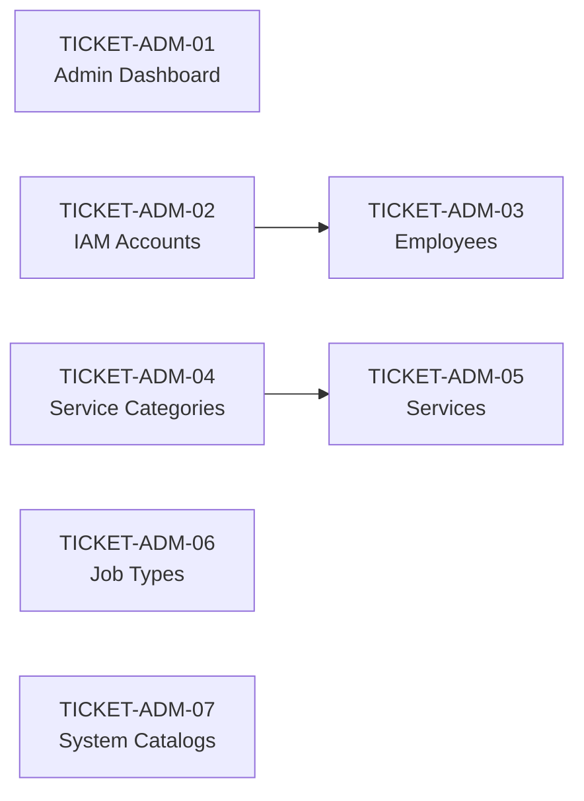

# ĐẶC TẢ KỸ THUẬT & DANH SÁCH TICKETS KIỂM THỬ TỰ ĐỘNG — ADMIN PORTAL
## HỆ THỐNG QUẢN LÝ TRUNG TÂM DỊCH VỤ Ô TÔ (CAR SERVICE CENTER)

> **Phiên bản tài liệu:** 1.0  
> **Ngày lập:** 2026-11-13  
> **Tài liệu chuẩn tham chiếu:** [`AUTOMATED_TESTING_DOCS.md`](./AUTOMATED_TESTING_DOCS.md)  
> **Phạm vi:** Toàn bộ 7 phân hệ thuộc cổng Quản trị Hệ thống (**Admin Portal** — `internal-web` & `backend`)  
> **Trạng thái:** Sẵn sàng triển khai theo mô hình Vertical Tracer-Bullet Tickets (`TICKET-ADM-01` → `TICKET-ADM-07`)

---

## MỤC LỤC
1. [Mục tiêu & Nguyên tắc Thiết kế](#1-mục-tiêu--nguyên-tắc-thiết-kế)
2. [Security & Architecture Gaps (Ghi nhận riêng — Out of Scope)](#2-security--architecture-gaps-ghi-nhận-riêng--out-of-scope)
3. [Ma trận Bao phủ Toàn phần Admin Portal (7 Phân hệ)](#3-ma-trận-bao-phủ-toàn-phần-admin-portal-7-phân-hệ)
4. [Danh sách Vertical Tickets (`TICKET-ADM-01` → `TICKET-ADM-07`)](#4-danh-sách-vertical-tickets-ticket-adm-01--ticket-adm-07)

---

## 1. MỤC TIÊU & NGUYÊN TẮC THIẾT KẾ

Tài liệu này đặc tả kế hoạch mở rộng hệ thống kiểm thử tự động bao phủ **100% 7 phân hệ của Admin Portal** (từ Unit $\rightarrow$ Integration $\rightarrow$ Playwright E2E), đồng bộ hoàn toàn với kiến trúc Kim tự tháp 3 tầng trong [`AUTOMATED_TESTING_DOCS.md`](./AUTOMATED_TESTING_DOCS.md).

### Các nguyên tắc bắt buộc:
1. **100% Hermetic Isolation (Phân lập tuyệt đối):**
   - **Backend Unit & Integration Tests:** Sử dụng `vi.mock` cho Prisma Client (`$transaction`, các model `user`, `employee`, `service`, `serviceCategory`, `jobType`, `systemCatalog`, v.v.), Redis cache (`revoked_user:<id>`), và `bcrypt` khi cần. **Không** kết nối MySQL thật, **không** phụ thuộc Redis server thật.
   - **Frontend E2E Tests:** Sử dụng Playwright `page.route` để chặn (intercept) toàn bộ HTTP API (`/api/**`) và trả về dữ liệu giả lập chuẩn xác theo contract hiện hành.
2. **Độc lập hoàn toàn với Manual Testing:** Không phụ thuộc dữ liệu seed từ các phiên kiểm thử thủ công; mọi test case tự khởi tạo (Arrange), thực thi (Act) và kiểm chứng (Assert) trên trạng thái sạch.
3. **Tuân thủ The Ponytail Ladder (Zero New Dependencies):**
   - Tái sử dụng toàn bộ toolchain sẵn có: **Vitest** (Unit), **Vitest + Supertest** (Integration), **Playwright Chromium** (E2E).
   - Tuyệt đối **không** cài thêm package npm mới.
4. **Bám sát Contract Hiện hành (Keep CI 100% Green):**
   - Bộ test mới được viết để xác thực đúng hành vi, status code và payload của Backend/Frontend **hiện tại** (kể cả định dạng lỗi `{ status: 'error', message }` hay ngoại lệ của `deleteService`).
   - Các lỗ hổng bảo mật/kiến trúc phát hiện khi audit được tách riêng tại [Mục 2](#2-security--architecture-gaps-ghi-nhận-riêng--out-of-scope) để xử lý ở một ticket hardening độc lập, **không** cố tình viết test fail làm đỏ CI.
5. **Chuẩn hóa Cấu trúc Thư mục & Mã Test ID:**
   - **Unit:** `src/backend/tests/unit/admin/*.spec.ts` (`ADM-[MODULE]-UT-[INDEX]`)
   - **Integration:** `src/backend/tests/integration/*-api.spec.ts` (`ADM-[MODULE]-API-[INDEX]`)
   - **E2E:** `src/frontend/e2e/*.spec.ts` (`E2E-ADM-[MODULE]-[INDEX]`), dùng chung `src/frontend/playwright.config.ts`.

---

## 2. SECURITY & ARCHITECTURE GAPS (GHI NHẬN RIÊNG — OUT OF SCOPE)

Trong quá trình kiểm toán mã nguồn Admin Portal (Backend & Frontend), nhóm audit ghi nhận 4 điểm hổng kiến trúc/bảo mật sau. **Các mục này nằm ngoài phạm vi của kế hoạch viết test hiện tại** và không được phép chặn tiến độ xanh CI của bộ test:

| Mã Gap | Phân hệ ảnh hưởng | Mô tả lỗ hổng hiện tại | Tác động & Ghi chú cho bộ Test |
| :--- | :--- | :--- | :--- |
| **GAP-SEC-01** | 6 Admin CRUD Routes (`/api/users`, `/api/employees`, `/api/services`, `/api/service-categories`, `/api/job-types`, `/api/system-catalogs`) | Chưa gắn middleware xác thực JWT (`authenticate`) và phân quyền RBAC (`authorizeRoles(['ADMIN'])`) trong `app.ts` hoặc các file route/controller. Mọi endpoint CRUD đang mở. *(Riêng `/api/dashboard/admin` đã có RBAC trả 403).* | Integration tests cho 6 module CRUD **không** assert 401/403 ở phase này để phản ánh đúng contract hiện tại. Sẽ bổ sung RBAC tests khi fix GAP-SEC-01. |
| **GAP-SEC-02** | IAM Accounts (`UserService.deactivateUser` — `DELETE /api/users/:id`) | Backend chưa có guard kiểm tra `req.user.id === id` để chặn Admin tự vô hiệu hóa chính mình (hiện mới chỉ chặn ở tầng UI `accounts/page.tsx` qua `isCurrentUser`). | Unit/Integration tests chỉ test guard chặn vô hiệu hóa user có role `ADMIN` (`Không thể vô hiệu hóa tài khoản Quản trị viên hệ thống.`). Test self-deactivation sẽ kiểm chứng ở tầng E2E UI. |
| **GAP-SEC-03** | Frontend Admin Layout (`src/app/(admin)/layout.tsx`, `AuthGuard.tsx`) | `AuthGuard` chỉ kiểm tra `state.auth.isAuthenticated` (chuyển về `/login` nếu chưa đăng nhập), chưa kiểm tra role `ADMIN` ở layout level. | E2E tests kiểm chứng `AuthGuard` redirect khi chưa đăng nhập và luồng UI Admin hợp lệ. |
| **GAP-ARC-01** | Error Response Format (`service.controller.ts` vs các controller khác) | 5 module (`users`, `employees`, `service-categories`, `job-types`, `system-catalogs`) trả lỗi `{ status: 'error', message }`, riêng `deleteService` trả `{ success: false, status: 'error', message, error: { code: 'DELETE_SERVICE_ERROR', details } }` (chưa đồng nhất 100% theo `API_CONVENTION.md`). | Integration tests assert đúng format thực tế của từng endpoint hiện tại. |

---

## 3. MA TRẬN BAO PHỦ TOÀN PHẦN ADMIN PORTAL (7 PHÂN HỆ)

Bảng dưới đây phân tách rạch ròi giữa **những gì ĐÃ CÓ (Already Exists)** và **những gì CẦN BỔ SUNG (New)** trên cả 3 tầng kiểm thử:

| # | Phân hệ & Routes | Tầng 1: Backend Unit (`tests/unit/admin/`) | Tầng 2: Backend Integration (`tests/integration/`) | Tầng 3: Frontend Playwright E2E (`src/frontend/e2e/`) |
| :---: | :--- | :--- | :--- | :--- |
| **1** | **Admin Dashboard**<br>`/admin`<br>`/api/dashboard/admin` | *(Không cần Unit riêng — logic tổng hợp nằm ở service/controller được bọc qua Integration)* | **ĐÃ CÓ:** `dashboard-api.spec.ts` (`GET /api/dashboard/admin?period=7days` 200 OK, invalid portal 400, non-admin `TECHNICIAN` 403).<br>**NEW:** Mở rộng `dashboard-api.spec.ts` với các `period` (`today`, `30days`, `this_month`), `scope`, và `GET /api/dashboard/workshop` với quyền `ADMIN`. | **ĐÃ CÓ:** `multi-portal-dashboard.spec.ts` (`AUDIT-01`, `AUDIT-05`).<br>**NEW:** `admin-dashboard.spec.ts` — chuyển period filter, chuyển tabs `ALL/ACTIVE/LOCKED`, search `DashboardActionTable`, mở `UserDetailModal`, empty/error states. |
| **2** | **IAM Accounts**<br>`/accounts`<br>`/api/users` | **ĐÃ CÓ:** `admin-validators.spec.ts` (chỉ có inline helpers).<br>**NEW:** `user-service.spec.ts` — toàn bộ `UserService` (CRUD, role alias normalization, bcrypt, Redis `revoked_user:<id>` TTL 7d, chặn khóa `ADMIN`, reactivate, reset password). | **ĐÃ CÓ:** *(Chưa có)*<br>**NEW:** `user-api.spec.ts` — đủ 7 endpoints: `GET /`, `GET /:id`, `POST /`, `PUT /:id`, `DELETE /:id`, `PATCH /:id/reactivate`, `PATCH /:id/reset-password`. | **ĐÃ CÓ:** `saas-dashboard-roles.spec.ts` (Test 3: mở/hủy modal Create Account + 4 viewports).<br>**NEW:** `admin-accounts.spec.ts` — Create/Edit (email disabled), Reset Password, Toggle active/locked + chặn self-deactivation, search/role pills/status/pagination. |
| **3** | **Employees**<br>`/employees`<br>`/api/employees` | **ĐÃ CÓ:** `employee-deactivation.spec.ts` (đang mock chính `checkEmployeeActiveWorkConstraints`).<br>**NEW:** `employee-service.spec.ts` — toàn bộ `EmployeeService` + test **thật** `checkEmployeeActiveWorkConstraints` (chặn khi có `JobLabour` ở `PLANNED`/`IN_PROGRESS`/`REWORK` hoặc `advisor_id` trên WO mở), skill attachment theo `isTechnicianRole`. | **ĐÃ CÓ:** *(Chưa có)*<br>**NEW:** `employee-api.spec.ts` — đủ 7 endpoints: `GET /skills`, `GET /`, `GET /:id`, `POST /`, `PUT /:id`, `DELETE /:id`, `PATCH /:id/reactivate`. | **ĐÃ CÓ:** `saas-dashboard-roles.spec.ts` (Test 4: smoke-load 1440px).<br>**NEW:** `admin-employees.spec.ts` — Bento filter tiles, search/position/status, `EmployeeDetailModal`, Create/Edit (`ComboBox` link `userId`, `skillIds` chỉ hiện với tech roles), Deactivate lỗi guardrail & Reactivate. |
| **4** | **Services**<br>`/services`<br>`/api/services` | **ĐÃ CÓ:** `service-delete.spec.ts`, `service-toggle-active.spec.ts`.<br>**NEW:** `service-service.spec.ts` — `getCategories`, `getServices`, `createService` & `updateService` (validate `FIXED` >= 1000 & bội số 1000, `VEHICLE_SIZE` `sizePrices` trong `$transaction`, `LABOUR_PARTS`). | **ĐÃ CÓ:** `service-delete-api.spec.ts` (`DELETE /api/services/:id`).<br>**NEW:** `service-api.spec.ts` — `GET /categories`, `GET /`, `POST /`, `PUT /:id`, `PATCH /:id/toggle`. | **ĐÃ CÓ:** `saas-dashboard-roles.spec.ts` (Test 4: smoke-load 1440px).<br>**NEW:** `admin-services.spec.ts` — Search & `filterCat`, Create/Edit (`FIXED`, `VEHICLE_SIZE` 5 kích thước xe, `LABOUR_PARTS`), Toggle active, Delete (soft-deactivation vs hard-delete). |
| **5** | **Service Categories**<br>`/service-categories`<br>`/api/service-categories` | **ĐÃ CÓ:** `service-category-delete.spec.ts` (`deleteCategory`).<br>**NEW:** `service-category-service.spec.ts` — `getCategories` (kèm `templatesCount`), `createCategory` (`sort_order = count + 1`), `updateCategory`. | **ĐÃ CÓ:** *(Chưa có)*<br>**NEW:** `service-category-api.spec.ts` — đủ 4 endpoints: `GET /`, `POST /`, `PUT /:id`, `DELETE /:id`. | **ĐÃ CÓ:** `saas-dashboard-roles.spec.ts` (Test 4: smoke-load 1440px).<br>**NEW:** `admin-service-categories.spec.ts` — Create/Edit (`isActive` checkbox), Delete `ConfirmModal` (cảnh báo soft-deactivate khi `templatesCount > 0`), search & pagination. |
| **6** | **Job Types**<br>`/job-types`<br>`/api/job-types` | **ĐÃ CÓ:** `job-type-toggle.spec.ts` (`toggleJobType`, `getJobTypes(isActive=true)`).<br>**NEW:** `job-type-service.spec.ts` — `createJobType` (chặn trùng tên), `updateJobType` (chặn trùng tên), `deleteJobType` (chặn xóa khi `totalRefs > 0` từ `JobTemplate`/`Job`/`JobLabour`). | **ĐÃ CÓ:** *(Chưa có)*<br>**NEW:** `job-type-api.spec.ts` — đủ 5 endpoints: `GET /`, `POST /`, `PUT /:id`, `PATCH /:id/toggle`, `DELETE /:id`. | **ĐÃ CÓ:** `saas-dashboard-roles.spec.ts` (Test 4: smoke-load 1440px).<br>**NEW:** `admin-job-types.spec.ts` — Search, Create/Edit, Toggle active, Delete (hiển thị lỗi khi bị tham chiếu). |
| **7** | **System Catalogs**<br>`/catalogs`<br>`/api/system-catalogs` & `/api/catalogs` | **ĐÃ CÓ:** *(Chưa có)*<br>**NEW:** `system-catalog-service.spec.ts` — toàn bộ `SystemCatalogService` (`getCatalogs` kèm `typeCounts`, `createCatalog` & `updateCatalog` chặn trùng `(catalog_type, name)`, `toggleCatalog`, `deleteCatalog` chặn xóa khi còn `part_categories`/`brand_items`). | **ĐÃ CÓ:** *(Chưa có)*<br>**NEW:** `system-catalog-api.spec.ts` — đủ 5 endpoints trên cả `/api/system-catalogs` và alias `/api/catalogs`. | **ĐÃ CÓ:** `saas-dashboard-roles.spec.ts` (Test 4: smoke-load 1440px).<br>**NEW:** `admin-catalogs.spec.ts` — Bento interactive filter tiles (`UOM`, `CANCEL_REASON`, `ADJUST_REASON`, `TERMS`), `filterType` dropdown, Create/Edit (`catalogType` disabled khi edit, `sortOrder`), Toggle & Delete. |

---

## 4. DANH SÁCH VERTICAL TICKETS (`TICKET-ADM-01` → `TICKET-ADM-07`)

Mỗi ticket đại diện cho một lát cắt dọc (Vertical Tracer-Bullet) hoàn chỉnh cho 1 phân hệ theo thứ tự thực thi bắt buộc bên trong: **Unit $\rightarrow$ Integration $\rightarrow$ E2E**.

### Thứ tự phụ thuộc giữa các Tickets:


---

### TICKET-ADM-01: Kiểm thử toàn diện Admin Dashboard (`/admin`, `/api/dashboard/admin`)
- **Blocked by:** `None`
- **Target files:**
  - Integration (Mở rộng): `src/backend/tests/integration/dashboard-api.spec.ts`
  - E2E (Mới): `src/frontend/e2e/admin-dashboard.spec.ts`
- **Các Test IDs & Kịch bản chính:**
  - **Integration (`dashboard-api.spec.ts`):**
    - `ADM-DASH-API-01`: `GET /api/dashboard/admin?period=today` & `30days` & `this_month` trả `200 OK` với đầy đủ KPIs, `rbacDistribution`, `actionableList`.
    - `ADM-DASH-API-02`: `GET /api/dashboard/workshop` với token `ADMIN` trả `200 OK` (xác thực quyền truy cập chéo workshop của Admin).
    - `ADM-DASH-API-03`: *(Đã có — giữ nguyên)* `TECHNICIAN` gọi `/api/dashboard/admin` $\rightarrow$ `403 Forbidden`; invalid portal $\rightarrow$ `400 Bad Request`.
  - **E2E (`admin-dashboard.spec.ts`):**
    - `E2E-ADM-DASH-01`: Chuyển đổi `DashboardFilterBar` (`today`, `7days`, `30days`, `this_month`) gọi lại API với query `period` tương ứng và cập nhật 4 `KPICard`s.
    - `E2E-ADM-DASH-02`: Chuyển đổi tabs `ALL` / `ACTIVE` / `LOCKED` trên `DashboardTelemetryMiniBars` và tìm kiếm trên `DashboardActionTable`.
    - `E2E-ADM-DASH-03`: Nhấn "Chi tiết" trên dòng người dùng $\rightarrow$ gọi `GET /api/users/:id` và hiển thị `UserDetailModal` (role badges, linked employee, link `/accounts?search=`).
    - `E2E-ADM-DASH-04`: Xử lý trạng thái Empty State (danh sách rỗng) và Error State (API trả `500`) không gây crash trang.
- **Verification commands:**
  ```powershell
  cd src/backend && npx vitest run tests/integration/dashboard-api.spec.ts
  cd src/frontend && npx playwright test e2e/admin-dashboard.spec.ts
  ```

---

### TICKET-ADM-02: Kiểm thử toàn diện IAM Accounts (`/accounts`, `/api/users`)
- **Blocked by:** `None`
- **Target files:**
  - Unit (Mới): `src/backend/tests/unit/admin/user-service.spec.ts`
  - Integration (Mới): `src/backend/tests/integration/user-api.spec.ts`
  - E2E (Mới): `src/frontend/e2e/admin-accounts.spec.ts`
- **Các Test IDs & Kịch bản chính:**
  - **Unit (`user-service.spec.ts`):**
    - `ADM-USR-UT-01`: `getUsers` lọc theo `search`, `status` (`active`/`true`/`inactive`/`false`), và chuẩn hóa alias role (`SA` $\rightarrow$ `ADVISOR`, `DESK_STAFF` $\rightarrow$ `FRONT_DESK`, `TECH`/`KY_THUAT_VIEN` $\rightarrow$ `TECHNICIAN`).
    - `ADM-USR-UT-02`: `createUser` kiểm tra trùng `email`, trùng `phone` (nếu có), resolve `Role` hợp lệ và hash mật khẩu bằng `bcrypt` (10 rounds).
    - `ADM-USR-UT-03`: `updateUser` kiểm tra trùng `phone` khi thay đổi; khi đổi `role` sẽ xóa các `UserRole` khác `CUSTOMER` và gán role mới trong `$transaction`.
    - `ADM-USR-UT-04`: **Business Guard:** `deactivateUser` chặn vô hiệu hóa tài khoản có role `ADMIN` (`"Không thể vô hiệu hóa tài khoản Quản trị viên hệ thống."`) và chặn nếu tài khoản đã inactive.
    - `ADM-USR-UT-05`: `deactivateUser` set `is_active = false` và ghi key `revoked_user:<id>` vào Redis (TTL 7 ngày); `reactivateUser` set `is_active = true` và xóa key Redis.
    - `ADM-USR-UT-06`: `resetPassword` hash mật khẩu mới và ném lỗi `"Không tìm thấy..."` nếu user không tồn tại.
  - **Integration (`user-api.spec.ts`):**
    - `ADM-USR-API-01`: `GET /api/users` trả `200` kèm phân trang & lọc theo `role`, `status`, `search`; trả `500` khi DB lỗi.
    - `ADM-USR-API-02`: `GET /api/users/:id` trả `200` kèm `roles` và `employee.skills`; trả `404` khi không tìm thấy (`{ status: 'error', message }`).
    - `ADM-USR-API-03`: `POST /api/users` trả `201` khi hợp lệ; trả `400` khi trùng email/phone hoặc role không tồn tại.
    - `ADM-USR-API-04`: `PUT /api/users/:id` trả `200` khi cập nhật thành công; `400` khi trùng phone; `404` khi không tìm thấy.
    - `ADM-USR-API-05`: `DELETE /api/users/:id` trả `204` (empty body) khi thành công; `400` khi khóa `ADMIN` hoặc đã khóa; `404` khi không tìm thấy.
    - `ADM-USR-API-06`: `PATCH /api/users/:id/reactivate` trả `200` khi mở khóa thành công; `404` khi không tìm thấy.
    - `ADM-USR-API-07`: `PATCH /api/users/:id/reset-password` trả `200` khi `newPassword.length >= 6`; trả `400` ở controller nếu `< 6` ký tự.
  - **E2E (`admin-accounts.spec.ts`):**
    - `E2E-ADM-USR-01`: Lọc danh sách theo search input (và URL `?search=`), role pills (`ADMIN`/`MANAGER`/`ADVISOR`/`FRONT_DESK`/`TECHNICIAN`/`CUSTOMER`), status dropdown và phân trang.
    - `E2E-ADM-USR-02`: Tạo tài khoản mới (`fullName`, `email`, `password` >= 6, `phone`, `role`, `address`) và chỉnh sửa tài khoản (trường `email` bị `disabled`).
    - `E2E-ADM-USR-03`: Đổi mật khẩu qua Reset Password modal (validate `newPassword` >= 6).
    - `E2E-ADM-USR-04`: Toggle khóa/mở khóa tài khoản qua `showToggleConfirmModal` (gửi `DELETE` hoặc `PATCH /reactivate`), đồng thời kiểm chứng UI **chặn tự khóa chính mình** (`isCurrentUser`).
- **Verification commands:**
  ```powershell
  cd src/backend && npx vitest run tests/unit/admin/user-service.spec.ts tests/integration/user-api.spec.ts
  cd src/frontend && npx playwright test e2e/admin-accounts.spec.ts
  ```

---

### TICKET-ADM-03: Kiểm thử toàn diện Employees (`/employees`, `/api/employees`)
- **Blocked by:** `TICKET-ADM-02` (vì Employee liên kết `userId` và màn hình `/employees` gọi `GET /api/users?limit=100` cho `ComboBox`)
- **Target files:**
  - Unit (Mới): `src/backend/tests/unit/admin/employee-service.spec.ts` *(giữ `employee-deactivation.spec.ts` hoặc hợp nhất rõ ràng; khuyến nghị giữ file cũ và bổ sung `employee-service.spec.ts` test logic thật)*
  - Integration (Mới): `src/backend/tests/integration/employee-api.spec.ts`
  - E2E (Mới): `src/frontend/e2e/admin-employees.spec.ts`
- **Các Test IDs & Kịch bản chính:**
  - **Unit (`employee-service.spec.ts`):**
    - `ADM-EMP-UT-01`: `getSkills` trả danh sách `Skill` đang active; `getEmployees` lọc theo `search`, `position` (`MANAGER`, `FRONT_DESK`/`RECEPTIONIST`, `ADVISOR`, `TECHNICIAN`), `status`.
    - `ADM-EMP-UT-02`: `createEmployee` kiểm tra `userId` phải tồn tại và chưa liên kết với nhân viên khác (`employee.user_id` unique); chỉ gắn `skillIds` khi `isTechnicianRole` (`TECHNICIAN`, `TECH`, `DETAILER`, `QC_STAFF`).
    - `ADM-EMP-UT-03`: `updateEmployee` xóa toàn bộ `employeeSkill` nếu đổi sang non-tech role; thay thế `skillIds` nếu là tech role; gọi `checkEmployeeActiveWorkConstraints` khi `isActive === false`.
    - `ADM-EMP-UT-04`: **Business Guard (Real Prisma Query):** `checkEmployeeActiveWorkConstraints` chặn vô hiệu hóa khi kỹ thuật viên có `JobLabour` trên job `PLANNED`/`IN_PROGRESS`/`REWORK` thuộc Work Order đang mở (khác `CLOSED`/`RELEASED`/`CANCELLED`), hoặc khi `userId` đang là `advisor_id` của Work Order mở.
    - `ADM-EMP-UT-05`: `deactivateEmployee` & `reactivateEmployee` chặn thao tác trùng trạng thái (đã inactive / đã active).
  - **Integration (`employee-api.spec.ts`):**
    - `ADM-EMP-API-01`: `GET /api/employees/skills` & `GET /api/employees` trả `200`; `500` khi DB lỗi.
    - `ADM-EMP-API-02`: `GET /api/employees/:id` trả `200`; `404` (`"Không tìm thấy"`) khi không tồn tại.
    - `ADM-EMP-API-03`: `POST /api/employees` trả `201`; `400` khi `userId` không tồn tại hoặc đã gắn cho nhân viên khác.
    - `ADM-EMP-API-04`: `PUT /api/employees/:id` trả `200`; `400` khi cố tắt `isActive: false` nhưng còn việc/phiếu mở; `404` khi không tìm thấy.
    - `ADM-EMP-API-05`: `DELETE /api/employees/:id` trả `204` khi hợp lệ; `400` khi còn việc mở hoặc đã inactive; `404` khi không tìm thấy.
    - `ADM-EMP-API-06`: `PATCH /api/employees/:id/reactivate` trả `200`; `400` nếu đã active; `404` khi không tìm thấy.
  - **E2E (`admin-employees.spec.ts`):**
    - `E2E-ADM-EMP-01`: Bento summary tiles (active/inactive) toggle `filterStatus`, kết hợp search, `filterPos` dropdown và `TablePagination`.
    - `E2E-ADM-EMP-02`: Mở `EmployeeDetailModal` (`GET /api/employees/:id`), kiểm tra badge chức vụ, kỹ năng, tài khoản IAM liên kết và nút "Chỉnh sửa hồ sơ".
    - `E2E-ADM-EMP-03`: Create/Edit nhân viên: `ComboBox` chọn/gỡ liên kết `userId`; chọn `TECHNICIAN`/`DETAILER`/`QC_STAFF` thì hiện multi-select `skillIds`, chọn `ADVISOR` thì ẩn `skillIds`.
    - `E2E-ADM-EMP-04`: Deactivate nhân viên bị backend trả `400` (active-work guardrail) $\rightarrow$ hiển thị thông báo lỗi rõ ràng; Reactivate nhân viên inactive thành công.
- **Verification commands:**
  ```powershell
  cd src/backend && npx vitest run tests/unit/admin/employee-service.spec.ts tests/integration/employee-api.spec.ts
  cd src/frontend && npx playwright test e2e/admin-employees.spec.ts
  ```

---

### TICKET-ADM-04: Kiểm thử toàn diện Service Categories (`/service-categories`, `/api/service-categories`)
- **Blocked by:** `None`
- **Target files:**
  - Unit (Mới): `src/backend/tests/unit/admin/service-category-service.spec.ts` *(song song với `service-category-delete.spec.ts` đã có)*
  - Integration (Mới): `src/backend/tests/integration/service-category-api.spec.ts`
  - E2E (Mới): `src/frontend/e2e/admin-service-categories.spec.ts`
- **Các Test IDs & Kịch bản chính:**
  - **Unit (`service-category-service.spec.ts`):**
    - `ADM-CAT-UT-01`: `getCategories` lọc theo `search`, phân trang và map đúng `templatesCount` (`_count.services`).
    - `ADM-CAT-UT-02`: `createCategory` tự động tính `sort_order = count + 1` và mặc định `is_active = true`.
    - `ADM-CAT-UT-03`: `updateCategory` cập nhật `name`, `description`, `isActive` và ném lỗi `"Không tìm thấy..."` khi ID không tồn tại.
  - **Integration (`service-category-api.spec.ts`):**
    - `ADM-CAT-API-01`: `GET /api/service-categories` trả `200` kèm `templatesCount`; `500` khi DB lỗi.
    - `ADM-CAT-API-02`: `POST /api/service-categories` trả `201` khi tạo thành công.
    - `ADM-CAT-API-03`: `PUT /api/service-categories/:id` trả `200`; `404` khi không tìm thấy.
    - `ADM-CAT-API-04`: `DELETE /api/service-categories/:id` trả `200` với `{ deleted: false, isDeactivated: true }` khi `_count.services > 0`, `{ deleted: true }` khi `_count.services === 0`, và `404` khi không tồn tại.
  - **E2E (`admin-service-categories.spec.ts`):**
    - `E2E-ADM-CAT-01`: Tìm kiếm theo tên và phân trang danh sách nhóm dịch vụ.
    - `E2E-ADM-CAT-02`: Tạo mới và chỉnh sửa nhóm dịch vụ (`name`, `description`, checkbox `isActive`).
    - `E2E-ADM-CAT-03`: Xóa nhóm dịch vụ qua `ConfirmModal` — kiểm chứng cảnh báo chuyển sang vô hiệu hóa khi `templatesCount > 0` và xóa hẳn khi `templatesCount === 0`.
- **Verification commands:**
  ```powershell
  cd src/backend && npx vitest run tests/unit/admin/service-category-service.spec.ts tests/unit/admin/service-category-delete.spec.ts tests/integration/service-category-api.spec.ts
  cd src/frontend && npx playwright test e2e/admin-service-categories.spec.ts
  ```

---

### TICKET-ADM-05: Kiểm thử toàn diện Services (`/services`, `/api/services`)
- **Blocked by:** `TICKET-ADM-04` (phụ thuộc `ServiceCategory` và `categoryId`)
- **Target files:**
  - Unit (Mới): `src/backend/tests/unit/admin/service-service.spec.ts` *(song song với `service-delete.spec.ts` và `service-toggle-active.spec.ts` đã có)*
  - Integration (Mới): `src/backend/tests/integration/service-api.spec.ts` *(song song với `service-delete-api.spec.ts` đã có)*
  - E2E (Mới): `src/frontend/e2e/admin-services.spec.ts`
- **Các Test IDs & Kịch bản chính:**
  - **Unit (`service-service.spec.ts`):**
    - `ADM-SRV-UT-01`: `getCategories` lấy `ServiceCategory` active sắp xếp theo `sort_order`; `getServices` hỗ trợ `search`, `categoryId`, `isActive`, `limit=all`/`0`, `all=true`.
    - `ADM-SRV-UT-02`: `createService` kiểm tra `categoryId` phải tồn tại; với `FIXED` yêu cầu `fixedPrice` nguyên, `>= 1000`, chia hết cho `1000` (VNĐ).
    - `ADM-SRV-UT-03`: `createService` với `VEHICLE_SIZE` yêu cầu `sizePrices` không rỗng, từng phần tử có `price` nguyên `>= 1000` và bội số `1000`, lưu vào `VehicleSizePrice`.
    - `ADM-SRV-UT-04`: `updateService` validate giá tương tự khi đổi `pricingType` và thay thế toàn bộ bản ghi `VehicleSizePrice` trong `$transaction`.
  - **Integration (`service-api.spec.ts`):**
    - `ADM-SRV-API-01`: `GET /api/services/categories` & `GET /api/services` trả `200`; `500` khi DB lỗi.
    - `ADM-SRV-API-02`: `POST /api/services` trả `201` cho `FIXED`, `VEHICLE_SIZE`, `LABOUR_PARTS`; trả `400` khi `categoryId` không tồn tại, giá `< 1000`, giá lẻ (không chia hết 1000), hoặc `sizePrices` rỗng.
    - `ADM-SRV-API-03`: `PUT /api/services/:id` trả `200` khi cập nhật hợp lệ; `400` khi sai rule giá; `404` khi không tìm thấy.
    - `ADM-SRV-API-04`: `PATCH /api/services/:id/toggle` trả `200` khi đổi `is_active`; `404` khi không tìm thấy.
    - *(Lưu ý: `DELETE /api/services/:id` đã được bọc bởi `service-delete-api.spec.ts` với format `{ success: false, status: 'error', error: { code: 'DELETE_SERVICE_ERROR' } }`).*
  - **E2E (`admin-services.spec.ts`):**
    - `E2E-ADM-SRV-01`: Lọc danh sách theo tên (`search`), dropdown `filterCat` (`GET /api/services/categories`) và phân trang.
    - `E2E-ADM-SRV-02`: Tạo/Sửa dịch vụ với cả 3 chế độ giá: `FIXED`, `VEHICLE_SIZE` (nhập giá `SMALL`, `MEDIUM`, `LARGE`, `SUV`, `TRUCK`), và `LABOUR_PARTS`.
    - `E2E-ADM-SRV-03`: Toggle kích hoạt dịch vụ qua `ConfirmModal` (`PATCH /toggle`).
    - `E2E-ADM-SRV-04`: Xóa dịch vụ qua `ConfirmModal` — xử lý đúng phản hồi soft-deactivation (`isDeactivated: true` khi có lịch sử sửa chữa) lẫn hard-delete.
- **Verification commands:**
  ```powershell
  cd src/backend && npx vitest run tests/unit/admin/service-service.spec.ts tests/unit/admin/service-delete.spec.ts tests/unit/admin/service-toggle-active.spec.ts tests/integration/service-api.spec.ts tests/integration/service-delete-api.spec.ts
  cd src/frontend && npx playwright test e2e/admin-services.spec.ts
  ```

---

### TICKET-ADM-06: Kiểm thử toàn diện Job Types (`/job-types`, `/api/job-types`)
- **Blocked by:** `None`
- **Target files:**
  - Unit (Mới): `src/backend/tests/unit/admin/job-type-service.spec.ts` *(song song với `job-type-toggle.spec.ts` đã có)*
  - Integration (Mới): `src/backend/tests/integration/job-type-api.spec.ts`
  - E2E (Mới): `src/frontend/e2e/admin-job-types.spec.ts`
- **Các Test IDs & Kịch bản chính:**
  - **Unit (`job-type-service.spec.ts`):**
    - `ADM-JOBT-UT-01`: `createJobType` kiểm tra trùng `name` qua `findFirst` và ném lỗi khi đã tồn tại.
    - `ADM-JOBT-UT-02`: `updateJobType` kiểm tra trùng `name` nếu đổi tên; ném `"Không tìm thấy..."` nếu ID không tồn tại.
    - `ADM-JOBT-UT-03`: **Business Guard:** `deleteJobType` chỉ hard-delete; chặn xóa (`throw Error`) nếu tổng tham chiếu `JobTemplate + Job + JobLabour` (`totalRefs > 0`), cho phép xóa khi `totalRefs === 0`.
  - **Integration (`job-type-api.spec.ts`):**
    - `ADM-JOBT-API-01`: `GET /api/job-types` (hỗ trợ `search`, `page`, `limit`, `all`, `isActive`) trả `200`.
    - `ADM-JOBT-API-02`: `POST /api/job-types` trả `201`; `400` khi trùng tên.
    - `ADM-JOBT-API-03`: `PUT /api/job-types/:id` trả `200`; `400` khi trùng tên; `404` khi không tìm thấy.
    - `ADM-JOBT-API-04`: `PATCH /api/job-types/:id/toggle` trả `200`; `404` khi không tìm thấy.
    - `ADM-JOBT-API-05`: `DELETE /api/job-types/:id` trả `200` khi `totalRefs === 0`; `400` khi đang được tham chiếu; `404` khi không tìm thấy.
  - **E2E (`admin-job-types.spec.ts`):**
    - `E2E-ADM-JOBT-01`: Tìm kiếm và phân trang danh sách loại công việc.
    - `E2E-ADM-JOBT-02`: Tạo mới & chỉnh sửa loại công việc (`name`, `description`).
    - `E2E-ADM-JOBT-03`: Toggle active & Delete qua `ConfirmModal`, bao gồm kiểm chứng hiển thị lỗi `400` khi xóa loại công việc đang được sử dụng.
- **Verification commands:**
  ```powershell
  cd src/backend && npx vitest run tests/unit/admin/job-type-service.spec.ts tests/unit/admin/job-type-toggle.spec.ts tests/integration/job-type-api.spec.ts
  cd src/frontend && npx playwright test e2e/admin-job-types.spec.ts
  ```

---

### TICKET-ADM-07: Kiểm thử toàn diện System Catalogs (`/catalogs`, `/api/system-catalogs` & `/api/catalogs`)
- **Blocked by:** `None`
- **Target files:**
  - Unit (Mới): `src/backend/tests/unit/admin/system-catalog-service.spec.ts`
  - Integration (Mới): `src/backend/tests/integration/system-catalog-api.spec.ts`
  - E2E (Mới): `src/frontend/e2e/admin-catalogs.spec.ts`
- **Các Test IDs & Kịch bản chính:**
  - **Unit (`system-catalog-service.spec.ts`):**
    - `ADM-SYSCAT-UT-01`: `getCatalogs` lọc theo `search`, `catalogType`, phân trang và trả đúng `typeCounts` (`UOM`, `CANCEL_REASON`, `ADJUST_REASON`, `TERMS`).
    - `ADM-SYSCAT-UT-02`: `createCatalog` kiểm tra trùng cặp `(catalog_type, name)` (cho phép trùng `name` nếu khác `catalog_type`, chặn nếu cùng `catalog_type`).
    - `ADM-SYSCAT-UT-03`: `updateCatalog` cập nhật `name`, `description`, `isActive`, `sortOrder` và kiểm tra trùng `(catalog_type, name)` khi đổi tên.
    - `ADM-SYSCAT-UT-04`: `toggleCatalog` đảo trạng thái `is_active`.
    - `ADM-SYSCAT-UT-05`: **Business Guard:** `deleteCatalog` chỉ hard-delete; chặn xóa khi `_count.part_categories > 0 || _count.brand_items > 0`.
  - **Integration (`system-catalog-api.spec.ts`):**
    - `ADM-SYSCAT-API-01`: `GET /api/system-catalogs` và alias `GET /api/catalogs` đều trả `200` kèm `typeCounts`.
    - `ADM-SYSCAT-API-02`: `POST /api/system-catalogs` (và `/api/catalogs`) trả `201`; `400` khi trùng `(catalog_type, name)`.
    - `ADM-SYSCAT-API-03`: `PUT /api/system-catalogs/:id` trả `200`; `400` khi trùng tên trong cùng `catalog_type`; `404` khi không tìm thấy.
    - `ADM-SYSCAT-API-04`: `PATCH /api/system-catalogs/:id/toggle` trả `200`; `404` khi không tìm thấy.
    - `ADM-SYSCAT-API-05`: `DELETE /api/system-catalogs/:id` trả `200` khi không có tham chiếu; `400` khi còn `part_categories` hoặc `brand_items`; `404` khi không tìm thấy.
  - **E2E (`admin-catalogs.spec.ts`):**
    - `E2E-ADM-SYSCAT-01`: Bento summary interactive filter tiles (`UOM`, `CANCEL_REASON`, `ADJUST_REASON`, `TERMS`), `filterType` dropdown và search đồng bộ danh sách.
    - `E2E-ADM-SYSCAT-02`: Tạo danh mục mới và chỉnh sửa danh mục (kiểm chứng `catalogType` bị `disabled` khi edit, cập nhật `sortOrder`, `name`, `description`).
    - `E2E-ADM-SYSCAT-03`: Toggle active & Delete qua `ConfirmModal`, bao gồm hiển thị lỗi `400` khi danh mục đang được tham chiếu.
- **Verification commands:**
  ```powershell
  cd src/backend && npx vitest run tests/unit/admin/system-catalog-service.spec.ts tests/integration/system-catalog-api.spec.ts
  cd src/frontend && npx playwright test e2e/admin-catalogs.spec.ts
  ```

---

### Lệnh kiểm tra tổng hợp sau khi hoàn thành cả 7 Tickets:
```powershell
# Kiểm tra TypeScript & toàn bộ Backend Unit + Integration Tests
cd src/backend && npx tsc --noEmit && npm test

# Kiểm tra TypeScript & toàn bộ Frontend Playwright E2E Tests
cd src/frontend/apps/internal-web && npx tsc --noEmit
cd src/frontend && npm run test:e2e
```
